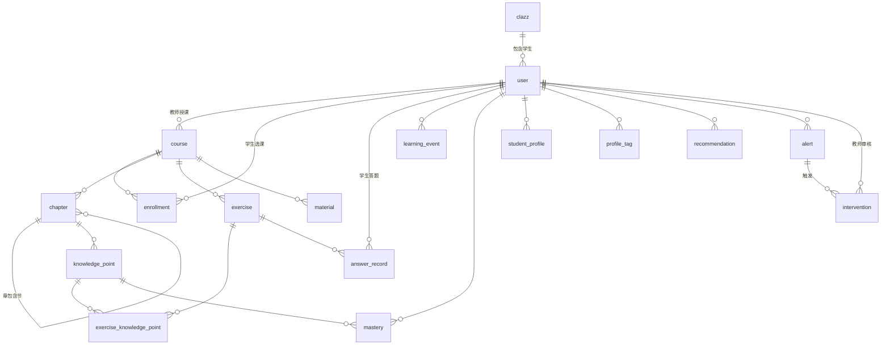
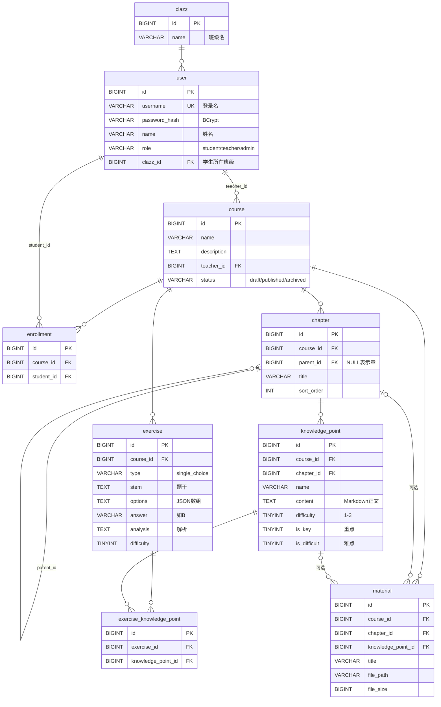

# 数据库设计 — 软件工程智能学习平台

> 版本 v0.2（W1 设计阶段）· MySQL 8（开发期可用 H2 的 MySQL 兼容模式）
> 每个模块的表由负责人维护。**改表结构要先改这份文档，并通知读这张表的组员。**

## 1. 设计约定

| 约定 | 规则 | 原因 |
|---|---|---|
| 命名 | 表名、字段名用小写下划线 `snake_case`，表名用单数（`course`，不用 `courses`） | MyBatis-Plus 会把 `teacher_id` 自动映射成 Java 的 `teacherId` |
| 主键 | 统一叫 `id`，类型 `BIGINT`，自增 | 简单统一，前端用 id 定位数据 |
| 外键 | 字段名是 `<表名>_id`，**建索引但不建数据库外键约束**，关联完整性由 Service 层保证 | 便于逻辑删除、分模块开发和导入演示数据（阿里巴巴 Java 开发手册的做法） |
| 时间 | `created_at`、`updated_at`，类型 `DATETIME`，由 MyBatis-Plus 自动填充 | 排查问题、按时间排序 |
| 删除 | 内容类表用逻辑删除：`deleted TINYINT DEFAULT 0`，1 表示已删除 | 课程、题目被删后，历史答题记录仍然能关联上 |
| 枚举 | 用 `VARCHAR` 存英文小写值（如 `published`），不用 MySQL `ENUM` | 加新值时不用改表结构，H2 也兼容 |
| 布尔 | `TINYINT(1)`，0/1 | MySQL 惯例 |
| JSON 数据 | 首版用 `TEXT` 存 JSON 字符串（如选项列表） | H2 和 MySQL 都兼容 |
| 字符集 | `utf8mb4` | 支持中文和 emoji |
| 小数 | 掌握度、正确率用 `DECIMAL(5,4)`，范围 0～1 | 避免浮点误差 |

## 2. 存什么数据（数据对象总览）

> 回应老师的意见「『存』的数据对象没有定义」：平台存储的全部数据对象如下。

| 环节 | 数据对象 | 表 | 负责人 | 谁写入 | 谁读取 |
|---|---|---|---|---|---|
| 基础 | 用户、班级 | `user`, `clazz` | A | 管理员 / 初始化数据 | 所有模块 |
| 学 | 课程、选课 | `course`, `enrollment` | A | 教师 | 所有模块 |
| 学 | 章节、知识点 | `chapter`, `knowledge_point` | A | 教师 | B 诊断、C 画像、D 推荐 |
| 学 | 习题、习题-知识点关联 | `exercise`, `exercise_knowledge_point` | A | 教师 | B 判分、D 推荐 |
| 学 | 教学资料（文件元数据；文件本身存在磁盘） | `material` | A | 教师 | 学生、D 推荐 |
| 记 | 答题记录 | `answer_record` | B | 学生答题时 | B 诊断、C 画像、D 预警 |
| 记 | 学习行为 | `learning_event` | B | 前端埋点 | C 画像、D 预警 |
| 诊 | 知识点掌握度 | `mastery` | B | 每次答题后重新计算 | C、D |
| 画 | 画像快照、画像标签 | `student_profile`, `profile_tag` | C | 定时任务 / 手动刷新 | 学生、教师 |
| 荐 | 推荐记录 | `recommendation` | D | 推荐算法 | 学生 |
| 干 | 预警、干预 | `alert`, `intervention` | D | 规则引擎 / 教师 | 教师 |

## 3. ER 图

### 3.1 全局关系（所有模块）

### 3.2 「学」模块详细（成员 A）

**关系说明**

- **课程 → 章节 → 知识点**是一棵树。章节用 `parent_id` 自关联：`parent_id` 为 NULL 是「章」，否则是「节」，首版最多两级。
- **习题 ↔ 知识点是多对多**：一道题可以考多个知识点，一个知识点有多道题，所以需要中间表 `exercise_knowledge_point`。「诊」模块靠这张表把答题结果分摊到知识点上。
- 习题挂在**课程**上，不挂在章节上：题目和章节没有固定的从属关系，通过知识点间接定位。
- 资料必须属于一门课程，可以进一步挂到章节或知识点上（可选）。

## 4. 表结构

### 4.1 「学」模块与用户（成员 A）

#### `clazz` 班级

| 字段 | 类型 | 约束 | 说明 |
|---|---|---|---|
| id | BIGINT | PK, 自增 | |
| name | VARCHAR(64) | NOT NULL, UNIQUE | 如「软工 2301 班」 |
| created_at | DATETIME | NOT NULL | |

> 表名叫 `clazz`，因为 `class` 是 Java 关键字，实体类不能叫 `Class`。

#### `user` 用户

| 字段 | 类型 | 约束 | 说明 |
|---|---|---|---|
| id | BIGINT | PK, 自增 | |
| username | VARCHAR(32) | NOT NULL, UNIQUE | 登录名，如学号 `2023001` 或 `teacher01` |
| password_hash | VARCHAR(100) | NOT NULL | BCrypt 哈希，**不存明文** |
| name | VARCHAR(32) | NOT NULL | 显示姓名 |
| role | VARCHAR(16) | NOT NULL | `student` / `teacher` / `admin` |
| clazz_id | BIGINT | 索引, 可空 | 学生所在班级；教师、管理员为空 |
| status | TINYINT | NOT NULL, 默认 1 | 1 正常，0 禁用 |
| created_at / updated_at | DATETIME | | |
| deleted | TINYINT | 默认 0 | 逻辑删除 |

> `user` 在 MySQL 里不是保留字，可以直接用；但在 H2 里是关键字，H2 连接要加 `NON_KEYWORDS=USER`（写在 application.yml 里）。

#### `course` 课程

| 字段 | 类型 | 约束 | 说明 |
|---|---|---|---|
| id | BIGINT | PK, 自增 | |
| name | VARCHAR(100) | NOT NULL | 课程名 |
| description | TEXT | | 简介 |
| teacher_id | BIGINT | NOT NULL, 索引 | 授课教师 → `user.id` |
| status | VARCHAR(16) | NOT NULL, 默认 `draft` | `draft` 草稿 / `published` 已发布 / `archived` 已归档 |
| created_at / updated_at | DATETIME | | |
| deleted | TINYINT | 默认 0 | |

> 前端列表里的 `teacher`（教师姓名）、`chapterCount`、`studentCount` **不存在表里**，查询时由 Service 关联计算。存冗余字段容易和真实数据不一致。

#### `enrollment` 选课

| 字段 | 类型 | 约束 | 说明 |
|---|---|---|---|
| id | BIGINT | PK, 自增 | |
| course_id | BIGINT | NOT NULL | |
| student_id | BIGINT | NOT NULL | → `user.id` |
| created_at | DATETIME | | 选课时间 |
| | | UNIQUE(course_id, student_id) | 同一学生不能重复选同一门课 |

#### `chapter` 章节

| 字段 | 类型 | 约束 | 说明 |
|---|---|---|---|
| id | BIGINT | PK, 自增 | |
| course_id | BIGINT | NOT NULL, 索引 | |
| parent_id | BIGINT | 可空, 索引 | NULL = 章；非 NULL = 节，指向所属的章 |
| title | VARCHAR(100) | NOT NULL | 如「第 2 章 软件过程模型」 |
| sort_order | INT | NOT NULL, 默认 0 | 同级之间排序，小的在前 |
| created_at / updated_at | DATETIME | | |
| deleted | TINYINT | 默认 0 | |

#### `knowledge_point` 知识点

| 字段 | 类型 | 约束 | 说明 |
|---|---|---|---|
| id | BIGINT | PK, 自增 | |
| course_id | BIGINT | NOT NULL, 索引 | 冗余字段，方便按课程直接查（不用先查章节） |
| chapter_id | BIGINT | NOT NULL, 索引 | 所属章节（章或节都可以） |
| name | VARCHAR(100) | NOT NULL | 如「螺旋模型」 |
| content | TEXT | | 学习正文，Markdown 格式 |
| difficulty | TINYINT | NOT NULL, 默认 2 | 1 易 / 2 中 / 3 难 |
| is_key | TINYINT(1) | 默认 0 | 教师标注的重点（E4） |
| is_difficult | TINYINT(1) | 默认 0 | 教师标注的难点（E4） |
| sort_order | INT | 默认 0 | |
| created_at / updated_at | DATETIME | | |
| deleted | TINYINT | 默认 0 | |

#### `exercise` 习题

| 字段 | 类型 | 约束 | 说明 |
|---|---|---|---|
| id | BIGINT | PK, 自增 | |
| course_id | BIGINT | NOT NULL, 索引 | |
| type | VARCHAR(16) | NOT NULL | 首版只有 `single_choice`；以后加 `multiple_choice` / `true_false` / `short_answer` |
| stem | TEXT | NOT NULL | 题干 |
| options | TEXT | | JSON 数组，如 `["瀑布模型","螺旋模型","增量模型","原型模型"]`，按顺序对应 A/B/C/D |
| answer | VARCHAR(16) | NOT NULL | 正确答案，单选题为 `A`～`D` |
| analysis | TEXT | | 解析 |
| difficulty | TINYINT | NOT NULL, 默认 2 | 1～3 |
| created_by | BIGINT | NOT NULL | 出题教师 → `user.id` |
| created_at / updated_at | DATETIME | | |
| deleted | TINYINT | 默认 0 | 删除后历史答题记录仍可关联 |

#### `exercise_knowledge_point` 习题-知识点关联

| 字段 | 类型 | 约束 | 说明 |
|---|---|---|---|
| id | BIGINT | PK, 自增 | |
| exercise_id | BIGINT | NOT NULL, 索引 | |
| knowledge_point_id | BIGINT | NOT NULL, 索引 | |
| | | UNIQUE(exercise_id, knowledge_point_id) | 不重复关联 |

> 编辑习题时，关联关系采用「先删后插」：删掉这道题的全部关联，再插入新的知识点列表，放在同一个事务里。

#### `material` 教学资料

| 字段 | 类型 | 约束 | 说明 |
|---|---|---|---|
| id | BIGINT | PK, 自增 | |
| course_id | BIGINT | NOT NULL, 索引 | |
| chapter_id | BIGINT | 可空 | |
| knowledge_point_id | BIGINT | 可空, 索引 | |
| title | VARCHAR(100) | NOT NULL | 显示名 |
| original_name | VARCHAR(255) | NOT NULL | 上传时的原文件名 |
| file_path | VARCHAR(255) | NOT NULL | 服务器上的相对路径，如 `2026/10/uuid.pdf`。**文件存磁盘，不存数据库** |
| file_size | BIGINT | NOT NULL | 字节数 |
| content_type | VARCHAR(100) | | 如 `application/pdf` |
| uploaded_by | BIGINT | NOT NULL | → `user.id` |
| created_at | DATETIME | | |
| deleted | TINYINT | 默认 0 | |

### 4.2 「记 + 诊」模块（成员 B，草案，B 确认）

#### `answer_record` 答题记录

| 字段 | 类型 | 约束 | 说明 |
|---|---|---|---|
| id | BIGINT | PK, 自增 | |
| student_id | BIGINT | NOT NULL, 索引 | |
| exercise_id | BIGINT | NOT NULL, 索引 | |
| course_id | BIGINT | NOT NULL | 冗余，方便按课程统计 |
| item_id | BIGINT | | 哪一次练习 → `chapter_item.id`；同一次交卷的几题 `submitted_at` 相同 |
| answer | VARCHAR(255) | NOT NULL | 学生的答案，没作答存空串 |
| is_correct | TINYINT(1) | NOT NULL | |
| time_spent_sec | INT | | 作答用时 |
| submitted_at | DATETIME | NOT NULL, 索引 | |

> 每次作答都插一条新记录，不覆盖之前的记录（重做也保留历史），方便看进步趋势。

#### `learning_event` 学习行为

| 字段 | 类型 | 约束 | 说明 |
|---|---|---|---|
| id | BIGINT | PK, 自增 | |
| student_id | BIGINT | NOT NULL, 索引 | |
| event_type | VARCHAR(32) | NOT NULL | 已实现：`view_item` 看了一项内容 / `finish_item` 学完一项；预留：`view_knowledge_point` / `login` |
| target_id | BIGINT | | 对应的内容项（`chapter_item.id`）或知识点 id |
| course_id | BIGINT | | 冗余，方便按课程统计 |
| duration_sec | INT | | 停留时长 |
| created_at | DATETIME | NOT NULL, 索引 | |

#### `mastery` 知识点掌握度

| 字段 | 类型 | 约束 | 说明 |
|---|---|---|---|
| id | BIGINT | PK, 自增 | |
| student_id | BIGINT | NOT NULL | |
| knowledge_point_id | BIGINT | NOT NULL | |
| mastery | DECIMAL(5,4) | NOT NULL | 0～1 |
| attempt_count | INT | NOT NULL | 该知识点累计作答次数 |
| correct_count | INT | NOT NULL | |
| updated_at | DATETIME | | |
| | | UNIQUE(student_id, knowledge_point_id) | 每人每知识点一行，答题后更新 |

> **C 和 D 都要读这张表，B 最先发布它的结构**（team-plan 的约定）。

### 4.3 「画」模块（成员 C，草案，C 确认）

#### `student_profile` 画像快照

| 字段 | 类型 | 约束 | 说明 |
|---|---|---|---|
| id | BIGINT | PK, 自增 | |
| student_id | BIGINT | NOT NULL | |
| course_id | BIGINT | NOT NULL | |
| study_minutes | INT | | 累计学习时长 |
| exercise_count | INT | | 累计做题数 |
| accuracy | DECIMAL(5,4) | | 正确率 |
| active_days | INT | | 近 14 天活跃天数 |
| weak_point_count | INT | | 薄弱知识点数 |
| snapshot_date | DATE | NOT NULL | |
| | | UNIQUE(student_id, course_id, snapshot_date) | 每天一份快照，用来画趋势 |

#### `profile_tag` 画像标签

| 字段 | 类型 | 约束 | 说明 |
|---|---|---|---|
| id | BIGINT | PK, 自增 | |
| student_id | BIGINT | NOT NULL, 索引 | |
| tag_type | VARCHAR(16) | NOT NULL | `behavior` 行为 / `weakness` 薄弱 / `strength` 优势 |
| tag_name | VARCHAR(32) | NOT NULL | 如「勤奋型」「薄弱：螺旋模型」 |
| reason | VARCHAR(255) | | 打标签的依据，如「近 14 天活跃 12 天」 |
| created_at | DATETIME | | |

### 4.4 「荐 + 干」模块（成员 D，草案，D 确认）

#### `recommendation` 推荐

| 字段 | 类型 | 约束 | 说明 |
|---|---|---|---|
| id | BIGINT | PK, 自增 | |
| student_id | BIGINT | NOT NULL, 索引 | |
| target_type | VARCHAR(16) | NOT NULL | `exercise` / `material` / `knowledge_point` |
| target_id | BIGINT | NOT NULL | |
| knowledge_point_id | BIGINT | | 针对的薄弱知识点 |
| reason | VARCHAR(255) | | 如「螺旋模型掌握度 0.40，推荐巩固」 |
| status | VARCHAR(16) | NOT NULL, 默认 `new` | `new` / `done` 已完成 / `dismissed` 不感兴趣 |
| created_at / updated_at | DATETIME | | |

#### `alert` 预警

| 字段 | 类型 | 约束 | 说明 |
|---|---|---|---|
| id | BIGINT | PK, 自增 | |
| student_id | BIGINT | NOT NULL, 索引 | |
| rule_code | VARCHAR(32) | NOT NULL | `LOW_MASTERY` / `INACTIVE` / `ACCURACY_DROP` |
| level | VARCHAR(8) | NOT NULL | `low` / `medium` / `high` |
| message | VARCHAR(255) | NOT NULL | 如「螺旋模型掌握度 0.40，低于 0.6」 |
| status | VARCHAR(16) | NOT NULL, 默认 `open` | `open` 待处理 / `handled` 已处理 / `ignored` 已忽略 |
| created_at / updated_at | DATETIME | | |

#### `intervention` 干预

| 字段 | 类型 | 约束 | 说明 |
|---|---|---|---|
| id | BIGINT | PK, 自增 | |
| alert_id | BIGINT | 可空 | 由哪条预警触发 |
| student_id | BIGINT | NOT NULL, 索引 | |
| content | TEXT | NOT NULL | 干预措施，如「布置螺旋模型专项练习 10 道并约谈」 |
| source | VARCHAR(16) | NOT NULL | `system` 系统建议 / `teacher` 教师创建 |
| status | VARCHAR(16) | NOT NULL | `pending` 待审核 / `approved` 已通过 / `rejected` 已驳回 / `done` 已完成 |
| reviewer_id | BIGINT | | 审核教师 |
| review_comment | VARCHAR(255) | | |
| reviewed_at | DATETIME | | |
| created_at / updated_at | DATETIME | | |

## 5. 初始化数据（首版）

由 A 提供 `schema.sql`（建表）和 `data.sql`（课程内容），B 提供 `demo-data.sql`（学生答题历史）。

| 数据 | 内容 |
|---|---|
| 用户 | `admin`、`teacher01`（李老师）、`2023001`～`2023010`（10 名学生，软工 2301 班）。开发环境统一密码见 `backend/README.md`（**不要用真实密码**） |
| 课程 | 《软件工程导论》，已发布，教师为 `teacher01`，10 名学生全部选课 |
| 章节 | 第 2 章 软件过程模型（首版只有这一章，不分节） |
| 知识点 | 瀑布模型、增量模型、原型模型、螺旋模型、敏捷开发与 Scrum、统一过程 RUP |
| 习题 | 30 道单选题，每个知识点 5 道 |
| 资料 | 2 份（课件 PDF、Scrum 流程图） |

## 6. 变更记录

| 日期 | 版本 | 变更 | 作者 |
|---|---|---|---|
| 2026-10-10 | v0.2 | 首版：全组表结构；新增 `clazz`、`enrollment`、`material`；明确不建物理外键 | A |
| 2026-10-30 | v0.3 | 实现 `answer_record`（加 `item_id`）和 `learning_event`（加 `course_id`，事件类型改为按内容项记）；AI 对话记录直接读 `dialogue_session` / `dialogue_message` | A |
| 2026-10-30 | v0.4 | 实现 `mastery`：交卷后按 docs/design.md 5.1 的公式重算 | A |
| 2026-10-30 | v0.5 | 学生画像先不建 `student_profile` / `profile_tag`：打开页面时用 `learning_event`、`answer_record`、`mastery`、对话结果现算 | A |
| 2026-10-30 | v0.6 | 实现 `recommendation`（首版只推题，`target_type = exercise`；加唯一约束 student_id + target_type + target_id）；`exercise.item_id` 为空表示题库题，只给推荐用；`answer_record.item_id` 为空表示在推荐页做的题 | A |
