# 系统设计 — 软件工程智能学习平台

> 版本 v0.2（W1 设计阶段）
> 相关文档：[需求](requirements.md) · [数据库](database.md) · [接口](api.md) · [测试计划](test-plan.md)

## 1. 系统架构

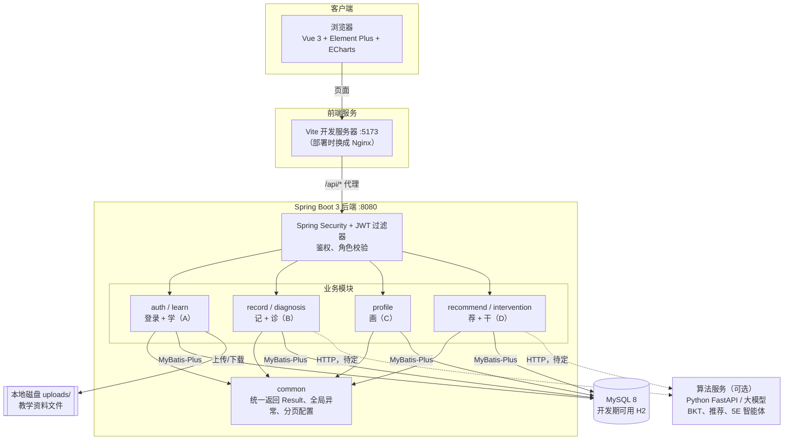

| 层 | 技术 | 说明 |
|---|---|---|
| 前端 | Vue 3、Vite、Element Plus、ECharts、Pinia、Vue Router | 已完成模板，mock 模式可独立运行 |
| 后端 | Spring Boot 3、Spring Security、JWT、MyBatis-Plus、Java 21、Maven | 一个工程，按模块分包 |
| 数据库 | MySQL 8（开发期 H2） | 表结构见 [database.md](database.md) |
| 文件 | 本地磁盘 `uploads/` | 数据库只存文件路径 |
| 算法（可选） | Python FastAPI | B、C、D 的智能算法是否单独起服务，待定 |

## 2. 后端分层与包结构

### 2.1 一个请求在后端怎么走

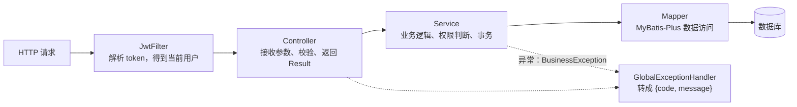

| 层 | 职责 | 不应该做的事 |
|---|---|---|
| Controller | 接收请求、校验参数格式、调用 Service、包装成 `Result` | 写业务逻辑、直接调 Mapper |
| Service | 业务规则、权限判断（如「只能改自己的课程」）、事务 | 处理 HTTP 相关的东西 |
| Mapper | 增删改查 | 写业务判断 |
| Entity | 和表一一对应的类 | 直接返回给前端（应该转成 VO） |
| DTO / VO | DTO 接收请求参数，VO 返回给前端 | — |

### 2.2 包结构

```
backend/src/main/java/com/se/platform/
├── PlatformApplication.java        启动类
├── common/                         公共（A 负责）
│   ├── Result.java                 统一返回 {code, message, data}
│   ├── PageResult.java             分页返回 {records, total}
│   ├── BusinessException.java      业务异常
│   ├── GlobalExceptionHandler.java 全局异常处理
│   └── config/                     MyBatis-Plus 分页插件、时间自动填充、跨域
├── auth/                           登录与鉴权（A）
│   ├── controller/  service/  dto/
│   └── security/                   JwtUtil、JwtFilter、SecurityConfig
├── user/                           用户与班级（A）
├── learn/                          学（A）
│   ├── controller/                 CourseController、ChapterController……
│   ├── service/                    CourseService（接口）+ impl/
│   ├── mapper/                     CourseMapper……
│   ├── entity/                     Course、Chapter、KnowledgePoint……
│   └── dto/                        CourseQuery、CourseForm、CourseVO……
├── record/       diagnosis/        记 + 诊（B）
├── profile/                        画（C）
└── recommend/    intervention/     荐 + 干（D）
```

### 2.3 模块之间的调用规则

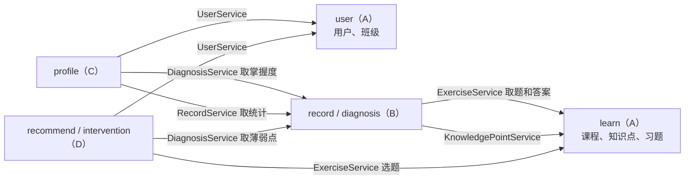

- **只调别人的 Service 接口**，不直接用别人的 Mapper、不直接查别人的表、不调别人的 Controller
- 依赖只能顺着主线方向（学 → 记 → 诊 → 画/荐/干），**不能反向依赖**，避免循环
- 别人的 Service 还没写好时，先约定接口方法签名，自己写一个假实现（mock）继续开发

## 3. 关键业务流程

### 3.1 登录与鉴权（时序图）

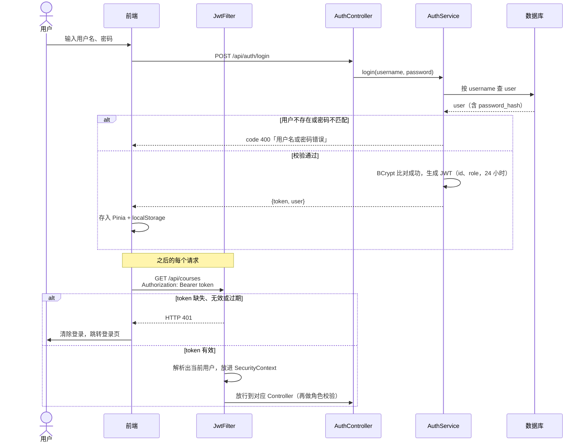

### 3.2 教师建课流程

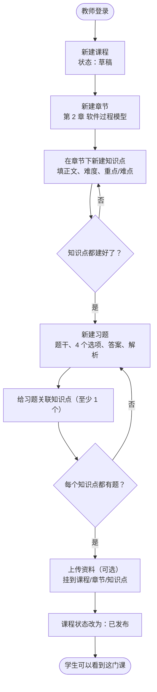

### 3.3 学生学习流程

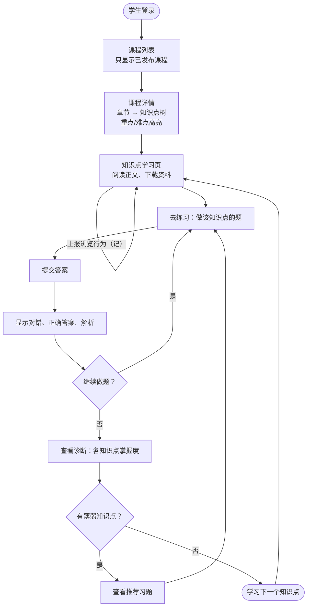

### 3.4 答题后的数据流：记 → 诊 → 画 / 荐 / 干（时序图）

这是整条主线的核心，首版演示的就是这条链。

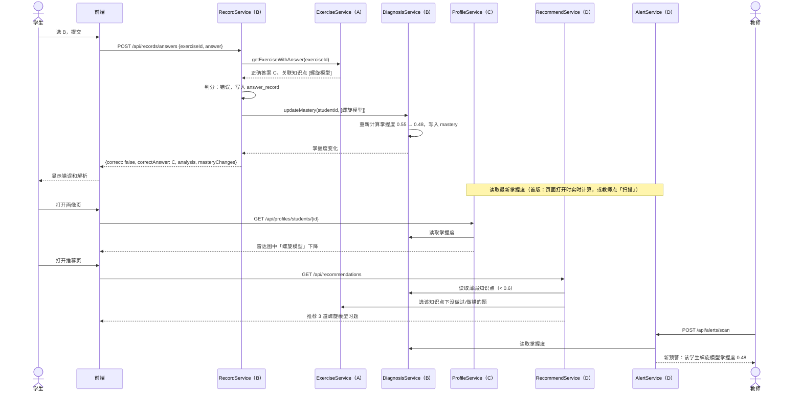

### 3.5 资料上传（时序图）

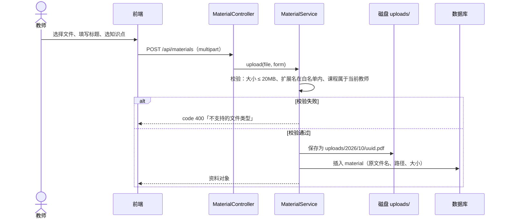

## 4. 状态图

### 4.1 课程状态

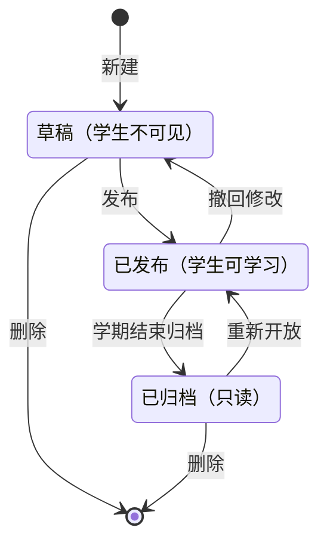

### 4.2 预警状态

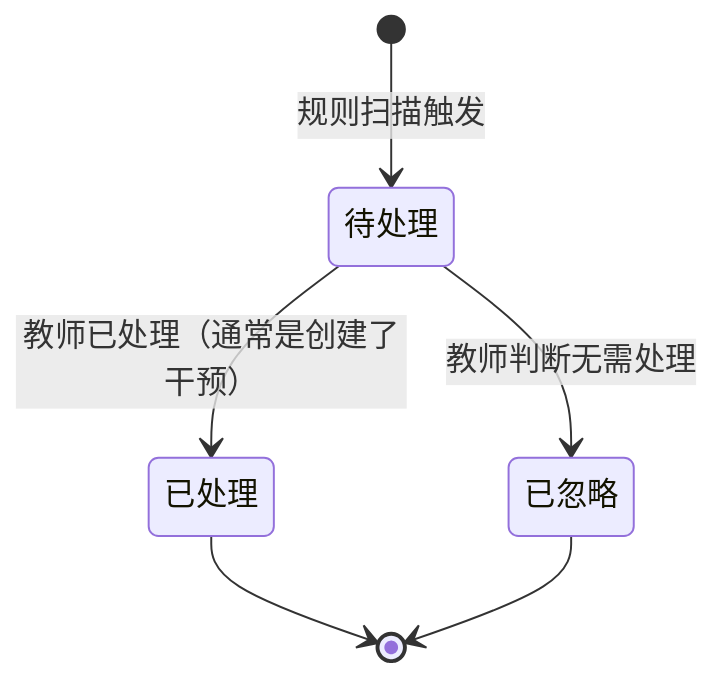

### 4.3 干预状态

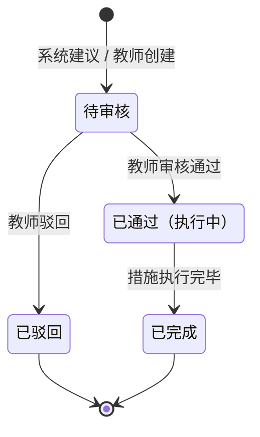

## 5. 关键算法（首版，力求简单）

### 5.1 掌握度（B）

首版用**加权近期正确率**：取该学生在这个知识点上最近 10 次作答，越近的权重越大。

```
mastery = Σ(wᵢ × correctᵢ) / Σ wᵢ ，   wᵢ = 0.8^(n-i)，   i = 1（最早）…n（最近）
```

- 一次都没做：没有掌握度记录，界面显示「未学习」
- 作答次数少于 3 次：结果乘以 `次数 / 3`，避免做对 1 道就算掌握
- W4 之后可以换成 BKT（贝叶斯知识追踪），接口不变

### 5.2 推荐（D）

1. 取学生掌握度 < 0.6 的知识点，按掌握度从低到高排序
2. 每个知识点选题，优先级：做错过的题 > 没做过的题 > 难度接近的题
3. 每次最多推荐 5 道，并写明理由（如「螺旋模型掌握度 0.48」）

### 5.3 预警规则（D）

| 规则 | 条件 | 级别 |
|---|---|---|
| `LOW_MASTERY` 掌握度过低 | 某知识点作答 ≥ 3 次且掌握度 < 0.4 | high |
| `LOW_MASTERY` | 作答 ≥ 3 次且掌握度 < 0.6 | medium |
| `INACTIVE` 不活跃 | 连续 7 天没有任何学习行为 | medium |
| `ACCURACY_DROP` 正确率下降 | 最近 7 天正确率比前 7 天下降 ≥ 20 个百分点 | low |

同一个学生、同一条规则、同一个知识点，在没处理前不重复生成预警。

## 6. 开发与部署环境

| 环境 | 前端 | 后端 | 数据库 |
|---|---|---|---|
| 个人开发 | `npm run dev`（5173） | IDEA 运行（8080） | H2 内存库 / 本机 MySQL |
| 联调（W4） | 同上，`VITE_USE_MOCK=false` | 同上 | 本机 MySQL，导入 `schema.sql` + `data.sql` + `demo-data.sql` |
| 演示 / 交付（W5） | Nginx 容器 | Spring Boot 容器 | MySQL 容器（Docker Compose 一条命令启动） |
