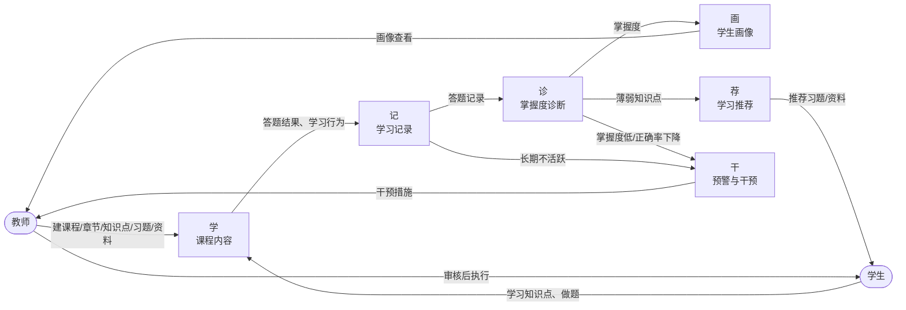
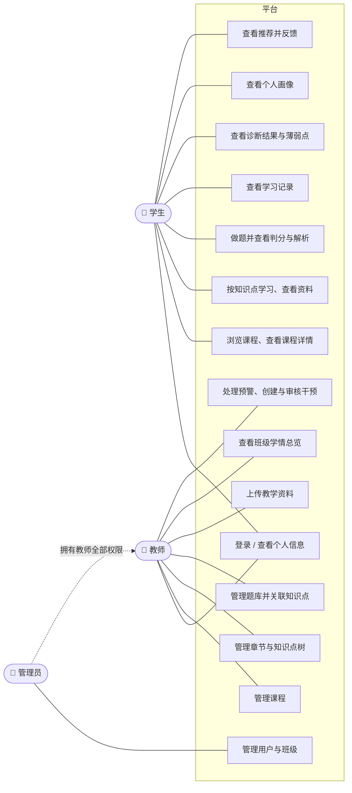

# 需求规格说明 — 软件工程智能学习平台

> 版本 v0.2（W1 设计阶段）· 第二组
> 相关文档：[系统设计](design.md) · [数据库设计](database.md) · [接口文档](api.md) · [测试计划](test-plan.md) · [分工](team-plan.md)

## 1. 背景与目标

软件工程课程的学生在学习中常见三个问题：不知道自己哪里薄弱、练习没有针对性、老师发现学困生太晚。

本平台围绕一条闭环主线解决这些问题：

**学 → 记 → 诊 → 画 → 荐 → 干**

| 环节 | 含义 | 平台做什么 |
|---|---|---|
| 学 | 学习内容 | 老师组织课程、章节、知识点、习题、资料；学生按知识点学习 |
| 记 | 学习记录 | 记录答题结果、学习时长、浏览行为 |
| 诊 | 学情诊断 | 计算每个学生对每个知识点的掌握度，找出薄弱点 |
| 画 | 学生画像 | 汇总成画像：学习时长、正确率趋势、活跃度、标签 |
| 荐 | 学习推荐 | 针对薄弱知识点推荐习题和资料 |
| 干 | 教学干预 | 按规则预警，老师审核干预措施并跟进 |

**首版目标**：用一门课的一个单元，让一个学生完整走通这条闭环（见第 6 节）。

## 2. 角色

| 角色 | 说明 | 主要操作 |
|---|---|---|
| 学生 student | 学习者 | 学习知识点、做题、查看自己的记录/诊断/画像/推荐 |
| 教师 teacher | 授课老师 | 管理课程内容和题库、上传资料、查看班级学情、处理预警、审核干预 |
| 管理员 admin | 系统管理 | 管理用户和班级，拥有教师的全部权限 |

账号由管理员创建（首版用初始化数据），**不开放注册**。

## 3. 业务主线

闭环的含义：推荐和干预让学生回到「学」，产生新的记录，诊断结果随之更新，可以看出干预有没有效果。

## 4. 用例图

## 5. 功能需求

优先级：**P0** = 首版必须完成，**P1** = 主线跑通后做，**P2** = 有时间再做。

### 5.1 登录与角色（成员 A）

| 编号 | 需求 | 优先级 |
|---|---|---|
| F-A01 | 用户名 + 密码登录，返回 token 和用户信息（id、姓名、角色） | P0 |
| F-A02 | 获取当前登录用户信息 | P0 |
| F-A03 | 所有接口按角色鉴权，未登录返回 401，无权限返回 403 | P0 |
| F-A04 | 菜单和页面按角色显示（前端已实现） | P0 |
| F-A05 | 管理员管理用户和班级 | P2 |

### 5.2 学：课程内容（成员 A）

| 编号 | 需求 | 优先级 |
|---|---|---|
| F-A11 | 课程增删改查，列表支持分页和按名称搜索；状态分为草稿/已发布/已归档 | P0 |
| F-A12 | 章节增删改查，支持「章 → 节」两级，可排序 | P0 |
| F-A13 | 知识点增删改查，挂在章节下，含正文（Markdown）、难度、是否重点/难点 | P0 |
| F-A14 | 课程内容树：一次返回 章节 → 知识点 的树形结构 | P0 |
| F-A15 | 题库：习题增删改查，首版只支持**单选题**；每道题可关联多个知识点 | P0 |
| F-A16 | 学生端看题时不返回答案和解析，提交后由「记」模块返回 | P0 |
| F-A17 | 资料上传（PDF/PPT/Word/图片等），可挂到课程/章节/知识点，支持下载和删除 | P1 |
| F-A18 | 学生知识点学习页：正文 + 相关资料 + 「去练习」入口 | P0 |
| F-A19 | 学生选课（加入课程），课程详情显示学生人数 | P2（首版用初始化数据） |

### 5.3 记 + 诊（成员 B）

| 编号 | 需求 | 优先级 |
|---|---|---|
| F-B01 | 提交答案并自动判分，返回对错、正确答案、解析 | P0 |
| F-B02 | 查看我的答题记录（分页） | P0 |
| F-B03 | 记录学习行为：浏览知识点、浏览资料、停留时长 | P1 |
| F-B04 | 每次答题后更新该题关联知识点的掌握度 | P0 |
| F-B05 | 学生诊断结果：各知识点掌握度、薄弱知识点列表 | P0 |
| F-B06 | 班级诊断：各知识点平均掌握度和分布 | P1 |
| F-B07 | 生成全组演示数据（学生、答题历史） | P0 |

### 5.4 画（成员 C）

| 编号 | 需求 | 优先级 |
|---|---|---|
| F-C01 | 学生画像：学习时长、做题数、正确率、薄弱点数、掌握度雷达图、周趋势 | P0 |
| F-C02 | 画像标签，如「勤奋型」「薄弱：螺旋模型」，并给出依据 | P1 |
| F-C03 | 教师班级总览：学生列表 + 关键指标，点击进入学生画像 | P1 |

### 5.5 荐 + 干（成员 D）

| 编号 | 需求 | 优先级 |
|---|---|---|
| F-D01 | 根据薄弱知识点给学生推荐习题（优先没做过、做错过的题） | P0 |
| F-D02 | 学生对推荐反馈：已完成 / 不感兴趣 | P1 |
| F-D03 | 预警规则：掌握度过低、连续多天不活跃、正确率下降 | P0 |
| F-D04 | 预警列表，教师可标记已处理/忽略 | P0 |
| F-D05 | 创建干预（系统建议或教师手写），教师审核通过/驳回，标记完成 | P1 |

### 5.6 选做模块

| 编号 | 模块 | 在本系统里怎么落地 | 负责人 | 时间 |
|---|---|---|---|---|
| E4 | 重点难点 | 知识点表已有「重点」「难点」字段（教师标注）；再加上数据驱动的难点：班级平均掌握度低的知识点自动标为「实际难点」；学习页高亮显示 | A（标注）+ B（统计） | W4 之后 |
| E1 | 5E 学习智能体 | 在知识点学习页按 5E 模型（Engage 引入 → Explore 探究 → Explain 解释 → Elaborate 拓展 → Evaluate 评价）引导学生，调用大模型生成引导问题，最后用该知识点的习题评价 | 待定 | W4 之后 |

## 6. 首版范围（MVP）

老师的意见是首版太大。首版**只做下面这些**，其他功能等主线跑通后再加：

| 项目 | 首版范围 |
|---|---|
| 课程 | 1 门：《软件工程导论》 |
| 单元 | 1 个：第 2 章「软件过程模型」 |
| 知识点 | 6 个：瀑布模型、增量模型、原型模型、螺旋模型、敏捷开发与 Scrum、统一过程 RUP |
| 题型 | 1 种：**单选题**（纯文本题干 + 4 个选项，可自动判分） |
| 题量 | 每个知识点 5 道，共 30 道 |
| 资料 | 2 份（单元课件 PDF、Scrum 流程图片） |
| 用户 | 1 名教师、1 名管理员、1 个班级 10 名学生 |
| 演示数据 | B 生成 10 名学生约两周的答题历史，覆盖「好、中、差」三类学生 |

**为什么选单选题**：判分是确定的（对就是对），「诊」的掌握度计算最简单，整条主线最快跑通。多选、判断、填空、简答等首版之后再加，加题型只需要扩展 `exercise.type`，不用改表结构。

**首版验收标准（W4 演示）**：
1. 教师登录，看到该单元的 6 个知识点和 30 道题
2. 学生登录，学习「螺旋模型」知识点，做 5 道题，故意做错 3 道
3. 学生的诊断页显示「螺旋模型」为薄弱知识点
4. 学生画像的雷达图和正确率随之变化
5. 推荐页出现「螺旋模型」相关的习题
6. 教师端出现该学生的「掌握度过低」预警，教师创建干预并审核通过

**首版明确不做**：注册、找回密码、多门课程运营、多题型、在线视频、讨论区、消息通知、移动端适配。

## 7. 需求编号映射（M1–M10）

> ⚠️ 作业原文的 M1–M10 还没有整理进来。请对照作业要求，在「作业编号」一列填上 M 编号，一条要求可以对应多行。
> 填完后检查两件事：每个 M 都至少有一行；每一行都有负责人和自测用例（见 [test-plan.md](test-plan.md)）。

| 作业编号 | 主线环节 | 我们的功能（第 5 节编号） | 负责人 | 首版 |
|---|---|---|---|---|
| M? | 学 | 登录与角色 F-A01~A04 | A | ✅ |
| M? | 学 | 课程/章节/知识点 F-A11~A14、学习页 F-A18 | A | ✅ |
| M? | 学 | 题库与知识点关联 F-A15~A16 | A | ✅ |
| M? | 学 | 资料上传 F-A17 | A | P1 |
| M? | 记 | 答题与判分 F-B01~B02 | B | ✅ |
| M? | 记 | 学习行为记录 F-B03 | B | P1 |
| M? | 诊 | 掌握度诊断 F-B04~B06 | B | ✅ |
| M? | 画 | 学生画像与标签 F-C01~C02 | C | ✅ |
| M? | 画 | 班级总览 F-C03 | C | P1 |
| M? | 荐 | 薄弱点推荐 F-D01~D02 | D | ✅ |
| M? | 干 | 预警 F-D03~D04 | D | ✅ |
| M? | 干 | 干预审核 F-D05 | D | P1 |
| E1 | 选做 | 5E 学习智能体 | 待定 | ❌ |
| E4 | 选做 | 重点难点 | A + B | ❌ |

## 8. 非功能需求

| 类别 | 要求 |
|---|---|
| 性能 | 列表接口在演示数据量下响应 < 500 ms |
| 安全 | 密码用 BCrypt 加密存储；JWT 有效期 24 小时；学生只能看自己的记录/诊断/画像 |
| 可用性 | 页面统一使用 Element Plus 组件和设计令牌（见 [frontend/README.md](../frontend/README.md)） |
| 可维护性 | 模块之间只通过 Service 调用，不跨模块直接读写表 |
| 可部署 | 新克隆的仓库按 README 一条命令能启动（W5 用 Docker Compose） |
| 可测试 | 每人的 P0 功能都有自测用例，后端 Service 层有 JUnit 测试 |

## 9. 术语表

| 术语 | 含义 |
|---|---|
| 知识点 | 课程中最小的学习单元，例如「螺旋模型」。习题、资料、掌握度都挂在知识点上 |
| 掌握度 | 0～1 的数值，表示学生对一个知识点的掌握程度，由答题记录计算 |
| 薄弱知识点 | 掌握度低于 0.6 的知识点 |
| 预警 | 系统按规则自动发现的学习风险，例如掌握度过低、长期不活跃 |
| 干预 | 教师针对预警采取的措施，例如约谈、布置补充练习 |
| MVP | 最小可用版本，即首版范围 |
