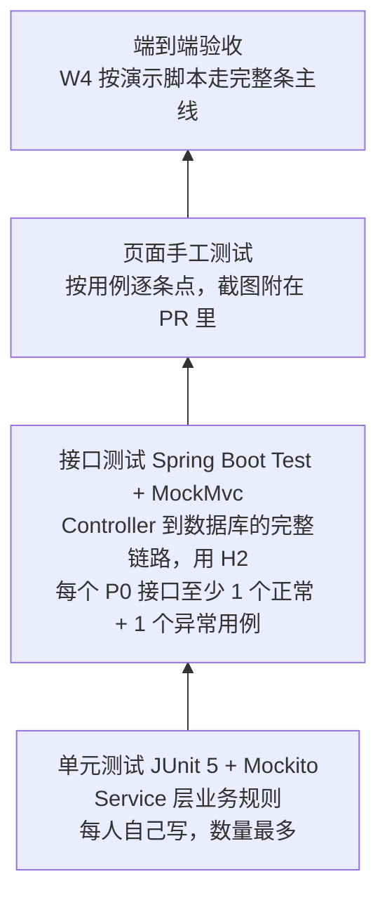

# 测试计划 — 软件工程智能学习平台

> 版本 v0.2（W1 设计阶段）
> 回应老师的意见「每个人要写清楚自己怎么验证自己的部分」：第 4 节是每个人的自测清单。

## 1. 测试策略

| 层次 | 工具 | 谁写 | 什么时候跑 |
|---|---|---|---|
| 单元测试 | JUnit 5、Mockito | 每个模块的负责人 | 每次提交前本地跑；CI 自动跑 |
| 接口测试 | `@SpringBootTest` + MockMvc + H2 | 每个模块的负责人 | 同上 |
| 页面测试 | 浏览器手工测试 + 截图 | 每个模块的负责人 | 提 PR 前 |
| 端到端验收 | 演示脚本（第 5 节） | 全组，B 主持 | W4 联调、W5 交付前 |

## 2. 测试环境与数据

| 项目 | 说明 |
|---|---|
| 自动化测试数据库 | H2 内存库，每个测试类启动时执行 `schema.sql` + `data.sql`，测试之间互不影响（`@Transactional` 自动回滚） |
| 手工测试数据库 | 本机 MySQL 或 H2 文件库，导入 `data.sql` + `demo-data.sql` |
| 测试账号 | `admin`、`teacher01`、`2023001`～`2023010`，开发环境统一密码写在 `backend/README.md` |
| 测试课程 | 《软件工程导论》第 2 章，6 个知识点、30 道单选题（见 [database.md 第 5 节](database.md)） |
| 接口调试 | IDEA 自带 HTTP Client（`.http` 文件放在 `backend/http/`，提交到仓库，组员可以直接复用） |

## 3. 通过标准

一个模块满足以下条件才算「自测完成」，可以提 PR 合并：

1. 第 4 节里自己的 **P0 用例全部通过**
2. `mvn test` 全部通过，没有被跳过（`@Disabled`）的测试
3. Service 层行覆盖率 ≥ 60%（IDEA 里 Run with Coverage 查看）
4. 页面改动附截图；前端 `npm run lint` 没有错误
5. 在 PR 描述里写明「测了什么、怎么测的、结果如何」

## 4. 每人自测清单

用例编号规则：`T-<成员>-<序号>`。「方式」一列：**U** = 单元测试，**I** = 接口测试，**M** = 手工页面测试。

### 4.1 成员 A：登录/角色 + 学

#### 登录与鉴权

| 编号 | 场景 | 输入 / 步骤 | 预期结果 | 方式 | 优先级 |
|---|---|---|---|---|---|
| T-A-01 | 正确登录 | `teacher01` + 正确密码 | 200，返回 token，`user.role = teacher` | I | P0 |
| T-A-02 | 密码错误 | `teacher01` + 错误密码 | `code 400`「用户名或密码错误」，不返回 token | I | P0 |
| T-A-03 | 用户不存在 | `nobody` + 任意密码 | 和 T-A-02 相同的提示（不暴露账号是否存在） | I | P0 |
| T-A-04 | 不带 token 访问 | `GET /api/courses`，不带请求头 | HTTP 401 | I | P0 |
| T-A-05 | token 被篡改 | token 改掉一个字符 | HTTP 401 | I | P0 |
| T-A-06 | 获取当前用户 | 带学生 token 调 `GET /api/auth/me` | 返回该学生的信息，不含密码字段 | I | P0 |
| T-A-07 | 密码不存明文 | 查数据库 `user.password_hash` | 以 `$2a$` 开头（BCrypt） | M | P0 |
| T-A-08 | 页面：登录与菜单 | 分别用学生、教师登录 | 学生看不到「干预管理」菜单，教师能看到 | M | P0 |

#### 课程

| 编号 | 场景 | 输入 / 步骤 | 预期结果 | 方式 | 优先级 |
|---|---|---|---|---|---|
| T-A-11 | 分页列表 | `page=1&size=2` | `records` 2 条，`total` 等于课程总数 | I | P0 |
| T-A-12 | 关键字搜索 | `keyword=导论` | 只返回名称含「导论」的课程 | I | P0 |
| T-A-13 | 学生只看已发布 | 学生 token 查列表 | 不含 `draft` 和 `archived` 课程 | I | P0 |
| T-A-14 | 新建课程 | 教师提交 `{name, status: draft}` | 成功；`teacherId` 等于当前教师 | I | P0 |
| T-A-15 | 必填校验 | `name` 为空 | `code 400`，提示课程名不能为空 | I | P0 |
| T-A-16 | 非法状态 | `status = abc` | `code 400` | U | P0 |
| T-A-17 | 学生不能新建 | 学生 token 调 `POST /api/courses` | `code 403` | I | P0 |
| T-A-18 | 不能改别人的课 | 教师 B 修改教师 A 的课程 | `code 403` | U | P1 |
| T-A-19 | 逻辑删除 | 删除课程后查列表、查数据库 | 列表里没有；数据库中 `deleted = 1` | I | P0 |
| T-A-20 | 详情不存在 | `GET /api/courses/99999` | `code 404` | I | P0 |
| T-A-21 | 计算字段 | 查课程详情 | `chapterCount`、`studentCount` 和实际数量一致 | I | P0 |
| T-A-22 | 页面：课程管理 | 关闭 mock，新建 → 编辑 → 搜索 → 删除 | 每一步列表都正确刷新，有成功提示 | M | P0 |

#### 章节与知识点

| 编号 | 场景 | 输入 / 步骤 | 预期结果 | 方式 | 优先级 |
|---|---|---|---|---|---|
| T-A-31 | 内容树 | `GET /api/courses/1/tree` | 1 章，下面 6 个知识点，按 `sortOrder` 排序 | I | P0 |
| T-A-32 | 节的层级限制 | 新建节时 `parentId` 指向另一个「节」 | `code 400`（最多两级） | U | P0 |
| T-A-33 | 跨课程挂载 | `parentId` 指向别的课程的章 | `code 400` | U | P1 |
| T-A-34 | 删除非空章节 | 删除还有知识点的章节 | `code 409`，提示有几个知识点 | I | P0 |
| T-A-35 | 知识点详情 | `GET /api/knowledge-points/{螺旋模型}` | 含 `content`、`exerciseCount = 5`、资料列表 | I | P0 |
| T-A-36 | 删除有题的知识点 | 删除关联了习题的知识点 | `code 409` | I | P0 |
| T-A-37 | 页面：章节/知识点树 | 新建、重命名、删除节点 | 树实时更新；重点/难点有标识 | M | P0 |
| T-A-38 | 页面：知识点学习页 | 学生打开「螺旋模型」 | Markdown 正确渲染，资料可下载，「去练习」可跳转 | M | P0 |

#### 习题

| 编号 | 场景 | 输入 / 步骤 | 预期结果 | 方式 | 优先级 |
|---|---|---|---|---|---|
| T-A-41 | 新建单选题 | 4 个选项，答案 `C`，关联 1 个知识点 | 成功；关联表多 1 行 | I | P0 |
| T-A-42 | 答案越界 | 4 个选项，答案 `E` | `code 400` | U | P0 |
| T-A-43 | 没有关联知识点 | `knowledgePointIds = []` | `code 400` | U | P0 |
| T-A-44 | 修改关联 | 关联从 [A] 改成 [B, C] | 关联表里只剩 B、C 两行（先删后插） | I | P0 |
| T-A-45 | 学生看不到答案 | 学生 token 查习题 | `answer`、`analysis` 为 null | I | P0 |
| T-A-46 | 按知识点筛选 | `knowledgePointId = 螺旋模型` | 返回 5 道 | I | P0 |
| T-A-47 | 页面：题库管理 | 新建、编辑、按知识点筛选、删除 | 操作正确，选项和答案显示正确 | M | P0 |

#### 资料（P1）

| 编号 | 场景 | 输入 / 步骤 | 预期结果 | 方式 | 优先级 |
|---|---|---|---|---|---|
| T-A-51 | 上传 PDF | 1 MB 的 PDF | 成功；磁盘上出现 uuid 命名的文件；数据库有记录 | I | P1 |
| T-A-52 | 文件过大 | 25 MB 的文件 | `code 400`「文件不能超过 20MB」 | I | P1 |
| T-A-53 | 非法类型 | `.exe` 文件，或改了扩展名的 exe | `code 400` | I | P1 |
| T-A-54 | 路径穿越 | 文件名为 `../../evil.pdf` | 存盘路径仍在 `uploads/` 下 | U | P1 |
| T-A-55 | 下载 | 学生下载资料 | 文件内容一致，浏览器显示原文件名 | M | P1 |

### 4.2 成员 B：记 + 诊（B 补充完善）

| 编号 | 场景 | 预期结果 | 方式 | 优先级 |
|---|---|---|---|---|
| T-B-01 | 提交正确答案 | `correct = true`，写入 1 条记录 | I | P0 |
| T-B-02 | 提交错误答案 | `correct = false`，返回正确答案和解析 | I | P0 |
| T-B-03 | 题目不存在 | `code 404` | I | P0 |
| T-B-04 | 教师不能提交答案 | `code 403` | I | P0 |
| T-B-05 | 掌握度计算 | 构造「对对错错错」序列，结果和公式手算值一致（误差 < 0.001） | U | P0 |
| T-B-06 | 少于 3 次的折减 | 只答对 1 次，掌握度 ≤ 0.34 | U | P0 |
| T-B-07 | 一题多知识点 | 关联 2 个知识点的题，两个掌握度都更新 | I | P0 |
| T-B-08 | 诊断薄弱点 | 掌握度 0.48 的知识点出现在 `weakPoints` 里 | I | P0 |
| T-B-09 | 学生不能看别人的诊断 | `code 403` | I | P0 |
| T-B-10 | 演示数据 | 导入后 10 名学生都有记录，好、中、差三类分布明显 | M | P0 |
| T-B-11 | 页面：答题 | 选择、提交、看解析、下一题 | M | P0 |

### 4.3 成员 C：画（C 补充完善）

| 编号 | 场景 | 预期结果 | 方式 | 优先级 |
|---|---|---|---|---|
| T-C-01 | 画像统计 | 做题数、正确率和 `answer_record` 手动统计一致 | I | P0 |
| T-C-02 | 雷达图数据 | 各知识点数值和 `mastery` 表一致 | I | P0 |
| T-C-03 | 没有数据的新学生 | 不报错，显示空状态 | I | P0 |
| T-C-04 | 标签规则 | 近 14 天活跃 ≥ 10 天的学生有「勤奋型」标签 | U | P1 |
| T-C-05 | 学生不能看别人的画像 | `code 403` | I | P0 |
| T-C-06 | 页面：画像 | 接入真实数据后图表正常、没有溢出 | M | P0 |
| T-C-07 | 页面：班级总览 | 点击学生跳转到该学生的画像 | M | P1 |

### 4.4 成员 D：荐 + 干（D 补充完善）

| 编号 | 场景 | 预期结果 | 方式 | 优先级 |
|---|---|---|---|---|
| T-D-01 | 推荐命中薄弱点 | 推荐的题都属于掌握度 < 0.6 的知识点 | U | P0 |
| T-D-02 | 推荐优先级 | 做错过的题排在没做过的题前面 | U | P0 |
| T-D-03 | 没有薄弱点 | 返回空列表，页面提示「暂无推荐」 | I | P0 |
| T-D-04 | 低掌握度预警 | 掌握度 0.35、作答 4 次 → 生成 high 级预警 | U | P0 |
| T-D-05 | 不重复预警 | 连续扫描两次，只有 1 条 open 预警 | U | P0 |
| T-D-06 | 不活跃预警 | 7 天没有行为 → 生成 `INACTIVE` 预警 | U | P0 |
| T-D-07 | 干预审核 | pending → approved → done；非法流转（如 rejected → done）返回 `409` | I | P1 |
| T-D-08 | 学生不能看预警 | `code 403` | I | P0 |
| T-D-09 | 页面：推荐、预警、干预 | 主流程能点通 | M | P0 |

## 5. 端到端验收脚本（W4 演示）

对应 [requirements.md 第 6 节](requirements.md) 的首版验收标准。全组一起执行，每一步截图存到 `docs/screenshots/`。

| 步骤 | 角色 | 操作 | 预期 | 涉及成员 |
|---|---|---|---|---|
| 1 | 教师 | 用 `teacher01` 登录，打开课程管理 → 《软件工程导论》 | 看到第 2 章、6 个知识点、30 道题 | A |
| 2 | 学生 | 用 `2023005`（演示数据里的「中等生」）登录 | 进入首页，菜单中没有「干预管理」 | A |
| 3 | 学生 | 课程详情 → 「螺旋模型」学习页 → 去练习 | 正文和资料正常显示 | A |
| 4 | 学生 | 做 5 道题，故意做错 3 道 | 每题都立即显示对错和解析 | B |
| 5 | 学生 | 打开学情诊断 | 「螺旋模型」显示为薄弱知识点 | B |
| 6 | 学生 | 打开学生画像 | 雷达图上「螺旋模型」比第 3 步之前低 | C |
| 7 | 学生 | 打开学习推荐 | 出现螺旋模型的习题，并写明推荐理由 | D |
| 8 | 教师 | 打开干预管理 → 扫描预警 | 出现该学生「螺旋模型掌握度过低」的预警 | D |
| 9 | 教师 | 针对该预警创建干预 → 审核通过 → 标记完成 | 状态依次变化，预警变为已处理 | D |
| 10 | 学生 | 做推荐的题，全部答对后再看诊断 | 掌握度回升，形成闭环 | B、C |

## 6. 缺陷管理

- 发现问题就在 GitHub 提 Issue，加 `bug` 标签和模块标签（如 `module:learn`），指派给模块负责人
- Issue 里写清楚：复现步骤、预期结果、实际结果、截图或日志
- 修复的 PR 里写 `Fixes #<编号>`，合并后自动关闭 Issue
- 每周例会过一遍还没关闭的 bug
