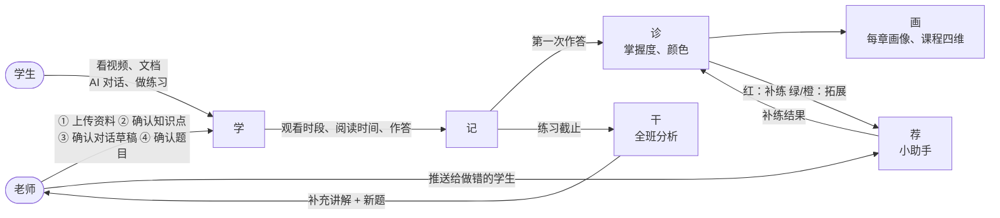
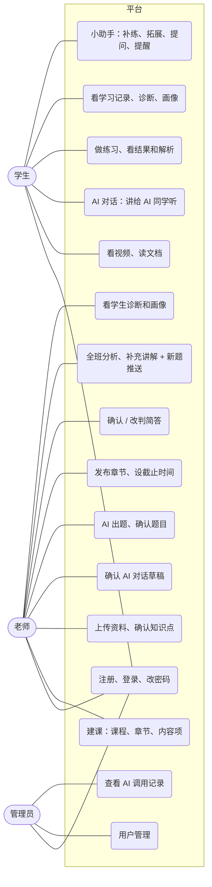

# 软件工程智能学习平台 · 需求分析说明书

<!-- 文档信息 开始 -->

| 项目 | 内容 |
|---|---|
| 项目名称 | 软件工程智能学习平台 |
| 文档名称 | 需求分析说明书 |
| 文档编号 | SE-G2-01 |
| 版本 | V1.0 |
| 日期 | 2026-11-28 |
| 编写 | 第 2 组 |
| 代码仓库 | GitHub：BRYANSOONZEN/Ai-Agent-Learning-Assistant，分支 feature/ai-learning-studywise |

**修订记录**

| 版本 | 日期 | 说明 |
|---|---|---|
| V1.0 | 2026-11-28 | 按提交时的代码整理，首次提交 |

**说明**

<!-- 说明 -->
- 本文描述平台**现在实现的需求**（按代码核对过）。每条功能需求都标了对应的课程要求编号（M1–M10、E1、E4）和实现位置，测试见《测试报告》。
<!-- 说明完 -->

**目录**

- 一、背景和要解决的问题
- 二、目标：一条闭环
- 三、用户角色
- 四、用例
- 五、功能需求
  - 5.0 登录与用户（M1–M4、M7 的基础）
  - 5.1 ① 上传资料（老师端，M1–M4）
  - 5.2 ② 识别知识点（老师端，M1–M4、E4 重点）
  - 5.3 ③ AI 对话（老师端起草，学生端对话；M1–M4、M7、E1）
  - 5.4 ④ 出题（老师端，M5、E4 重点）
  - 5.5 ⑥ 做练习与掌握度（学生端，M5、M6、M8）
  - 5.6 ⑤ 老师干预（全班，M10、E4 难点）
  - 5.7 ⑦ 小助手（学生端，M7、M9、E1）
  - 5.8 ⑧ 学生画像（学生端，M9）
  - 5.9 运维
- 六、对照课程要求
- 七、非功能需求
- 八、约束和不做的
- 九、术语

<!-- 文档信息 结束 -->

---

## 一、背景和要解决的问题

软件工程课程的学生在学习中常见的问题，以及平台的做法：

| 问题 | 平台怎么做 |
|---|---|
| 学生不知道自己哪里薄弱 | 每道题标“知识点 → 第几条要点 → 考查类型”；练习只算第一次作答，知识点标绿 / 橙 / 红，画像告诉学生哪里还没掌握 |
| 练习没有针对性 | 小助手按这个学生自己的错题（错的要点、选错的误解）当场出补练题；掌握了的去做更难的拓展题 |
| 老师发现学困生太晚 | 练习截止时自动做全班分析：哪道题有问题、哪条要点在哪种考查类型上全班都错，老师补充讲解 + 新题推给做错的学生 |
| 学生直接向通用 AI 要答案，思考被跳过 | AI 对话让学生把知识点讲给 AI 同学听，AI 只追问、不给答案；小助手手里没有答案，程序再检查回复 |
| 老师准备内容的工作量大 | 上传视频和课件后自动转文字、识别知识点、起草 AI 对话、出题，老师只需检查和确认 |

## 二、目标：一条闭环

**学 → 记 → 诊 → 画 → 荐 → 干**，每一环都落在具体的模块上：

| 环节 | 含义 | 对应模块 |
|---|---|---|
| 学 | 学习内容 | 老师：① 上传资料、② 识别知识点、③ AI 对话草稿、④ 出题；学生：看视频和文档、AI 对话 |
| 记 | 学习记录 | 视频看过的时间段、文档阅读时间、每一道题的作答（①、⑥） |
| 诊 | 学情诊断 | 每道题只算第一次作答：原始掌握度 F、补练 R、知识点颜色（⑥） |
| 画 | 学生画像 | 每章画像 + 课程四维：持续性、完成度、按时完成率、有效作答正确率（⑧） |
| 荐 | 学习推荐 | 小助手：推荐资料（跳到那一秒 / 那一页）、个人补练题、拓展题；出好的题和老师推送保存在“学习推荐”页（小助手的延伸）里做和回看（⑦） |
| 干 | 教学干预 | 个人的交给小助手自动处理；全班的由老师在截止时分析、补充讲解 + 新题（⑤） |

## 三、用户角色

| 角色 | 说明 | 账号来源 | 主要操作 |
|---|---|---|---|
| 学生 | 学习者 | 自己注册 | 学习课程（视频、文档、AI 对话、练习）；看学习记录、诊断、画像；用小助手补练、拓展、提问 |
| 老师 | 授课老师 | 管理员开通 | 建课；上传资料；确认知识点、对话草稿、题目；发布；确认简答判分；全班分析和干预；看学生诊断和画像 |
| 管理员 | 系统管理 | 初始化数据 | 用户管理（开通老师、禁用 / 启用、重置密码）；查看 AI 调用记录和费用 |

## 四、用例

## 五、功能需求

编号规则：`F-模块-序号`。“触发条件”写的是“满足什么条件 → 系统做什么”，都由程序自动判断。

### 5.0 登录与用户（M1–M4、M7 的基础）

| 编号 | 需求 | 验收标准 |
|---|---|---|
| F-0-1 | 用户名 + 密码登录，返回令牌，24 小时有效 | 正确登录得到令牌；令牌过期或账号被禁用后接口返回 401 |
| F-0-2 | 学生自己注册；老师账号由管理员开通 | 学生能注册；注册不能选老师角色 |
| F-0-3 | 防猜密码：同一用户名连续输错 5 次锁 15 分钟 | 第 6 次即使密码正确也被拒 |
| F-0-4 | 每个接口按角色控制；没有规则的接口一律拒绝 | 学生调老师接口返回 403；测试检查每个接口都有规则 |
| F-0-5 | 管理员：用户列表、开通老师、禁用 / 启用、重置密码 | 被禁用的账号立即不能用 |
| F-0-6 | 令牌快过期自动续期；“记住我”7 天；退出登录令牌立即失效；管理员开的账号首次登录先改密码；演示账号一键切换（部署时关掉） | AuthSecurityTest、DemoSwitchOffTest |

### 5.1 ① 上传资料（老师端，M1–M4）

| 编号 | 需求 | 验收标准 / 触发条件 |
|---|---|---|
| F-1-1 | 老师在章节里加视频项、文档项并上传文件（视频、PDF、PPT、Word；学生先“加入课程”才能学） | 上传后马上开始排队转文字 |
| F-1-2 | 本机转文字：PPT、Word 先用本机 Office 转 PDF；PDF 读文字；视频专业词同音错字按课件纠正（大模型列出、程序核对）；课件里的图交给大模型看图写文字；视频语音识别 | 每段文字带出处（课件第几页、第几张图；视频起止秒） |
| F-1-3 | 同一个文件（按内容）只处理一次，结果缓存 | 重新上传同一个文件不再花时间和费用 |
| F-1-4 | 转文字失败时显示原因；重新上传这个文件就重新处理 | 失败的任务不挡住识别知识点 |
| F-1-5 | 学生学完判定：视频看到 90%（快进跳过的部分不算）；文档前台阅读满 30 秒并点“我已读完” | 防伪造：上报的观看时长不能超过真实经过的时间；视频总时长定下后不能改小 |
| F-1-6 | 学习顺序固定为“资料（视频、文档）→ AI 对话 → 练习”。解锁规则：视频、文档一直解锁，可以来回看；AI 对话要本章视频、文档全部学完；练习要本章 AI 对话完成（没有对话的章节，资料学完即可）。老师调顺序时不能把 AI 对话排到练习后面；练习之后小助手也不再把学生送回 AI 对话 | 锁住时提示还差哪几项；后端同样检查，绕过页面直接调接口也会被拒 |

### 5.2 ② 识别知识点（老师端，M1–M4、E4 重点）

| 编号 | 需求 | 验收标准 / 触发条件 |
|---|---|---|
| F-2-1 | 老师点“上传完毕”，且没有排队 / 处理中的任务时，自动识别本章知识点 | 失败的任务不挡；资料有增删时状态回到“资料有更新” |
| F-2-2 | 每个知识点包含：名称、一句话说明、重点 / 一般、n 条要点（每条标出处）、常见误解 | 出处编号必须存在，编出来的出处去掉 |
| F-2-3 | 老师可以改名称、要点、误解、重点 / 一般，加、删知识点，然后确认 | 确认后同步到知识点表，出题和对话才能用 |
| F-2-4 | 知识点地图：每条要点点出处直接跳到视频那一秒、课件那一页；学生看到自己每个知识点的颜色 | 学生只看到老师确认过的 |

### 5.3 ③ AI 对话（老师端起草，学生端对话；M1–M4、M7、E1）

| 编号 | 需求 | 验收标准 / 触发条件 |
|---|---|---|
| F-3-1 | 老师给 AI 对话项选知识点（一次最多 2 个，必须已确认），大模型起草 | 知识点没确认时按钮变灰并提示 |
| F-3-2 | 草稿包含：场景和 AI 同学、误解试探、**每条要点一组**：讲清楚标准、不完整标准、L1 泛泛追问、L2 情境追问、L3 聚焦提问、讲不出时回看哪里 | 程序检查 4 项：每条要点都有；各项都写了；每句 ≤ 80 字；提示没有照抄要点原文（连续 4 个以上汉字）。没过的标红给老师看 |
| F-3-3 | 老师改草稿、确认；要点原文改了草稿就过期，要重新生成 | 已确认的草稿改了变回“待确认” |
| F-3-4 | 学生把知识点讲给 AI 同学听；AI 只追问、不给答案 | 每一句由大模型判断每条要点：讲清楚 / 不完整 / 讲错 / 没讲到，必须摘学生原话，程序核对原话存在才算 |
| F-3-5 | 三级提示：先追问讲错的要点，否则第一条没讲清的；每级连续 2 次没进展才升一级；L3 也不行就指出资料、换下一条 | 状态只升不降 |
| F-3-6 | AI 回复的泄露检查：没讲清的要点原文里任意连续 4 个字出现在回复里（学生自己说过的、知识点名称、开场白、这条要点的 L1～L3 除外）→ 这句不用，改用老师确认的提示 | — |
| F-3-7 | 结束：要点都讲清，或学生说满 10 句；AI 复述讲清的部分；学生认真尝试过（≥ 3 次）的没讲清要点用老师确认的原文补充 | 只诊断、不打分：记录每条要点是自己讲清、第几级提示后讲清，还是补充后才知道 |

### 5.4 ④ 出题（老师端，M5、E4 重点）

| 编号 | 需求 | 验收标准 / 触发条件 |
|---|---|---|
| F-4-1 | 6 种题型：单选、两段式单选（答案 + 理由）、多选、判断、填空、简答 | 每道题标知识点、第几条要点、考查类型（概念辨析 / 情境应用 / 数据分析 / 流程步骤） |
| F-4-2 | AI 出题：选的知识点都已确认才能出；重点知识点多出 1 道 | 程序检查格式、要点和误解的覆盖；题干或选项和要点原文连续 15 个字一样就提醒“照抄了原文” |
| F-4-3 | 大模型不看答案再做一遍，做错的题标“可能有歧义” | 生成的题先是草稿，老师确认后学生才看得到 |
| F-4-4 | 覆盖检查：每个知识点在每种考查类型、题型下各有几道题 | — |
| F-4-5 | 老师也可以手动出题、改题、删题 | — |

### 5.5 ⑥ 做练习与掌握度（学生端，M5、M6、M8）

| 编号 | 需求 | 验收标准 / 触发条件 |
|---|---|---|
| F-6-1 | 交卷前题目不带答案；交卷后给对错、正确答案、解析、选错的选项对应的误解 | 没作答的题算错 |
| F-6-2 | 客观题程序判分：多选部分对 0.5 分；两段式答案和理由都对才算对 | — |
| F-6-3 | 简答：去掉空格和标点后少于 5 个字 → 0 分；和参考答案完全一样 → 1 分；其余大模型并行判两次，按要点给分；两次一致才算，不一致等老师确认 | 等老师确认的不算进掌握度；老师可以确认或改判 |
| F-6-4 | 掌握度只算练习里每道题的**第一次作答**：原始掌握度 F = 第一次作答平均分；补练另外记 R | 重做不改 F |
| F-6-5 | 知识点颜色：F ≥ 0.8 绿；F < 0.8 但补练补回来了橙；还没补回来红；没练过灰 | 练习、小助手、画像、老师端用同一套颜色 |
| F-6-6 | 截止时间：练习和 AI 对话可以设；截止前 3 天开始提醒；老师设置不允许补交时过期拒绝，允许时记为迟交 | 老师看到谁没做、谁迟交 |

### 5.6 ⑤ 老师干预（全班，M10、E4 难点）

| 编号 | 需求 | 验收标准 / 触发条件 |
|---|---|---|
| F-5-1 | 练习到截止时间或全部交完才分析；交卷人数 < 80% 这次分析作废 | — |
| F-5-2 | 规则①：某道题全班 ≥ 80% 做错 → 提示老师检查题目；老师选“没问题 / 已修正 / 作废 / 忽略” | 作废的题不算进掌握度 |
| F-5-3 | 规则②：某条要点在某种考查类型上全班错误率 > 50% → 全班问题 | — |
| F-5-4 | 对规则②的问题：大模型写补充讲解 + 出新题，老师改、确认后推送给做错的学生 | 推送出现在学生的小助手里；统计推送后的效果 |
| F-5-5 | 个人问题不需要老师处理，由小助手自动干预（旧版“概念层”个人预警已去掉） | — |

### 5.7 ⑦ 小助手（学生端，M7、M9、E1）

| 编号 | 需求 | 验收标准 / 触发条件 |
|---|---|---|
| F-7-1 | 两个阶段：本章练习交卷前只回答概念问题、不出题；交卷后给每个知识点的结论和下一步 | — |
| F-7-2 | 红色知识点：按这个学生自己的错题（错的要点、选错的误解）当场出 3 道补练题，最多 2 轮；补回来了变橙 | 补练题只给他自己，不进别人的练习；出好后点“去查看”，在学习推荐页里做 |
| F-7-3 | 绿色、橙色知识点：拓展（E1 Elaborate），按学生选的考查类型出更难的题，想做几轮都可以 | 拓展题不算进掌握度，做错不影响画像 |
| F-7-4 | 推荐资料：直接跳到讲这条要点的视频那一秒、课件那一页 | — |
| F-7-5 | 自由聊天：小助手手里没有答案；学生贴了本章的题（和题干连续 15 个字一样）只讲概念不给答案；回复和简答参考答案连续 15 个字一样就拦下 | — |
| F-7-6 | 提醒：快到截止的项、老师推送的讲解和新题；顶栏消息铃铛 | — |
| F-7-7 | 每个学生每天最多问 20 句；AI 对话里每条要点的情况作为说明显示（不计分） | RemedyAndChatTest、FeynmanTest |
| F-7-8 | 学习推荐（小助手的延伸）：要先经过小助手。页面分三类保存——系统补充（补练题，一律保存，知识点变色要靠这些记录）、拓展（做完学生自己选保存不保存）、老师推送（学生在小助手里点“接收”后保存）；没做的在页面里做，做过的可以回看（我的答案、正确答案、解析、“你可能是这样想的”）。不从练习里挑题 | RemedyAndChatTest |
| F-7-9 | 学情诊断的每个薄弱知识点有“让小助手帮我补”，打开小助手的这一章 | — |

### 5.8 ⑧ 学生画像（学生端，M9）

| 编号 | 需求 | 验收标准 / 触发条件 |
|---|---|---|
| F-8-1 | 每章画像（学的过程中一直显示）：学习流程进度、内容进度、练习交了几组、第一次作答全对、知识点颜色、一句话小结 | 一句话小结由程序拼，不调用大模型 |
| F-8-2 | 课程四维（全部章节学完后开放）：学习持续性 C = min(1, 近 14 天有效学习日 / 7)；学习完成度 P；按时完成率 T；有效作答正确率 A | 各章合并时分子、分母分别相加再除，不平均百分比 |
| F-8-3 | 有效学习日：这一天看视频、文档累计 ≥ 30 秒，或交过 ≥ 1 道已判的题（AI 对话不算） | — |
| F-8-4 | 没有数据的维度显示“暂无数据”，不用 0 或 100 补；四维不全时不画四边形 | — |
| F-8-5 | 不做总分、不排名；不推断性格、态度 | — |
| F-8-6 | 全部学完时保存一份画像快照（之后不改） | CourseProfileTest |

### 5.9 运维

| 编号 | 需求 | 验收标准 |
|---|---|---|
| F-9-1 | 每次调用大模型都记录：任务、输入 / 输出 token、耗时、费用、成功或失败 | 管理员能看到合计费用 |
| F-9-2 | 开发数据库重启后保留数据；表结构升级不丢数据 | — |
| F-9-3 | 老师首页“待你确认”；课程每页最多 50 条、老师只看自己的课、课程不重名、发布前后端再检查、新项排最后 | TeacherTodoTest、CourseRulesTest |

## 六、对照课程要求

| 编号 | 内容 | 完成情况 | 对应需求 |
|---|---|---|---|
| M1–M4、M7 | 学习与提问：课程资料、知识点、学习、答疑 | 已做：上传即转文字 + 识别知识点；视频、文档学完判定；AI 对话；小助手聊天 | F-1、F-2、F-3、F-7-5 |
| M5 | 测验 | 已做：6 种题型、AI 出题和程序检查、简答大模型判两次 + 老师改判 | F-4、F-6-1～6-3 |
| M6 | 事件记录 | 已做：视频看过的时间段、文档阅读时间、每道题的作答 | F-1-5、F-6 |
| M8 | 诊断 + 证据 | 已做：第一次作答算原始掌握度，补练单独记；每道题标要点和考查类型 | F-6-4、F-6-5 |
| M9 | 画像与推荐 | 已做：每章画像 + 课程四维；小助手推荐资料、个人补练、拓展；学习推荐页保存补练、拓展和老师推送 | F-7、F-8 |
| M10 | 教师查看 / 干预 | 已做：截止时全班分析（规则①②）、补充讲解 + 新题推送；简答改判 | F-5、F-6-3 |
| E1 | 5E 学习智能体 | Engage、Explore、Explain 在 AI 对话；Evaluate 在练习；Elaborate 在小助手拓展 | F-3、F-6、F-7-3 |
| E4 | 重点难点 | 重点：识别时标“重点 / 一般”，出题时重点多 1 道；难点：个人的由 AI 对话和小助手处理，全班的由规则②找出 | F-2-2、F-4-2、F-5-3 |

## 七、非功能需求

| 类别 | 要求 | 现状（实测） |
|---|---|---|
| 成本 | 每次大模型请求 ≤ 0.05 元（立项目标）；只有看图、识别知识点、出题、对话、判简答、聊天、补充讲解调用大模型，能在本机做的（PDF 文字、语音识别）都在本机做 | 识别知识点一次 0.052～0.054 元，略超；其他单次调用都在目标以内（简答约 0.004 元 / 份，聊天约 0.010 元 / 句） |
| 响应时间 | 对话、聊天每句几秒内回复 | 学生 AI 对话每句约 1 秒；小助手聊天约 1.2 秒；简答判分约 1 秒 |
| 处理时间 | 一章资料（39 页课件 + 25 分钟视频）处理 + 识别在 10 分钟内 | 约 7 分 40 秒 |
| 准确性 | 识别的要点都要有出处；AI 出的题没有歧义 | 出处有效率、支持率 100%；第 6 章 20 道客观题，大模型不看答案全部做对 |
| 安全 | 密码 BCrypt；JWT 24 小时；每个接口按角色控制；API key 不进代码、不进前端 | 测试覆盖每个接口的权限规则 |
| 防泄露 | 学生端题目交卷前不带答案；AI 对话、小助手回复经程序检查 | 小助手聊天：该拦的 6 句、不该拦的 6 句全部正确 |
| 隐私 | 学生只看自己的记录、诊断、画像；补练题只给本人 | — |
| 可测试 | 单元测试不调用真实大模型（假的大模型，不联网、不花钱、结果固定） | 后端 158 个测试全部通过；每次推送 CI 自动跑 |
| 可维护 | 提示词放在独立文件并带版本号；表结构升级脚本可重复执行 | — |

## 八、约束和不做的

- 不做“蒙对型 / 粗心型”学生分类：原来依赖已去掉的“概念层”，组里决定不做。
- AI 对话不打分，只做诊断；掌握度只看练习。
- 画像不做总分、不排名。
- PPT、Word 资料需要服务器装 Microsoft Office（本机转 PDF）；没有 Office 时提示转成 PDF。
- 数据库已经能用 MySQL 8.4 运行（本机已装好，开发库数据已搬过去，见《数据库说明书》）；资料处理服务的 Docker 打包还没做。

## 九、术语

| 术语 | 含义 |
|---|---|
| 知识点 | 一章里一个可以讲清楚的概念，包含名称、一句话说明、重点 / 一般、n 条要点、常见误解 |
| 要点 | 学生应该能用自己的话讲出来的一条内容，带出处；AI 对话的标准答案就是老师确认的要点原文 |
| 考查类型 | 概念辨析、情境应用、数据分析、流程步骤 |
| 原始掌握度 F | 练习里每道题第一次作答的平均分，之后不改 |
| 补练 R | 小助手补练题（和老师推送的新题）第一次作答的平均分 |
| 三级提示 | AI 对话里引导学生的 L1 泛泛追问、L2 情境追问、L3 聚焦提问 |
| 全班分析 | 练习截止后按规则①（题目检查）、规则②（要点 × 考查类型）找全班问题 |
