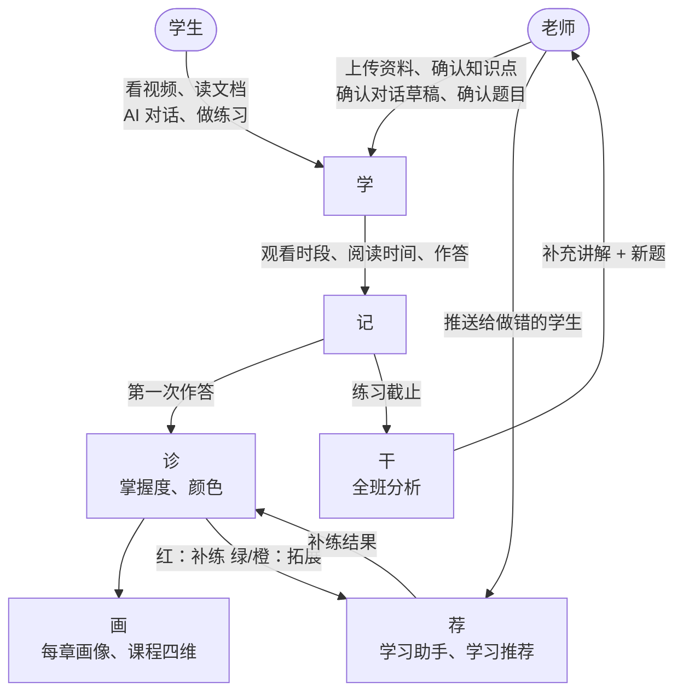
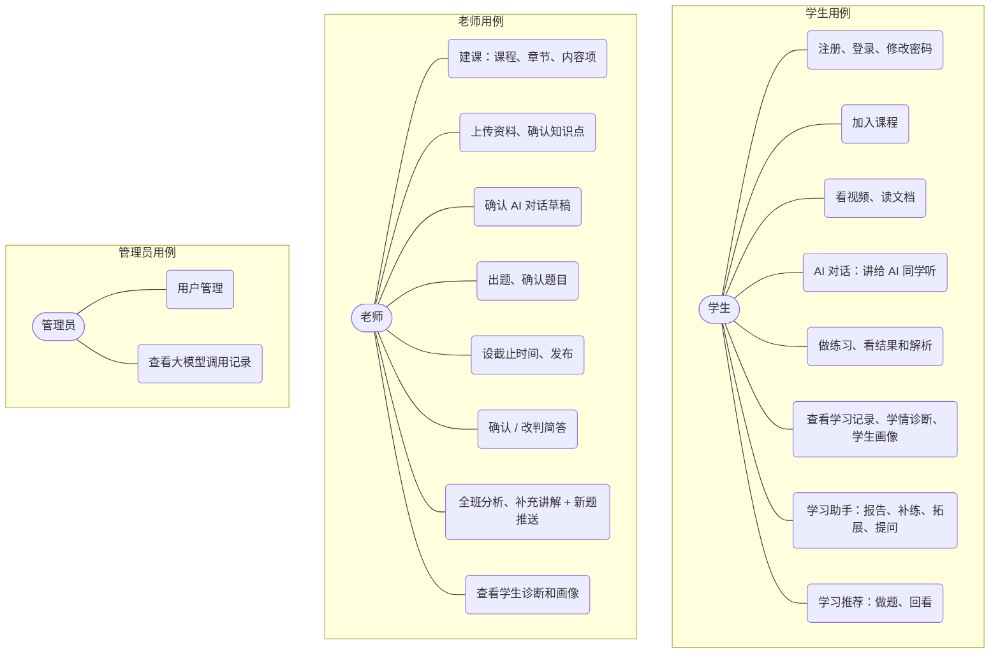

# 软件工程智能学习平台 · 需求分析说明书

<!-- 文档信息 开始 -->

**目录**

- 1 引言
  - 1.1 编写目的
  - 1.2 项目背景
  - 1.3 适用范围
  - 1.4 术语和缩写
  - 1.5 参考资料
- 2 总体描述
  - 2.1 产品概述
  - 2.2 用户角色
  - 2.3 用例图
  - 2.4 运行环境
  - 2.5 开发技术和工具
  - 2.6 设计和实现约束
  - 2.7 假设和依赖
- 3 功能需求
  - 3.1 编号和优先级说明
  - 3.2 账号与权限（AUTH）
  - 3.3 课程与学习流程（COURSE）
  - 3.4 ① 上传资料（MAT）
  - 3.5 ② 识别知识点（KP）
  - 3.6 ③ AI 对话（DLG）
  - 3.7 ④ 出题（QUIZ）
  - 3.8 ⑤ 老师干预（INT）
  - 3.9 ⑥ 做练习与掌握度（PRAC）
  - 3.10 ⑦ 学习助手与学习推荐（AST）
  - 3.11 ⑧ 学情诊断与学生画像（PROF）
  - 3.12 系统管理（SYS）
- 4 用例描述
  - 4.1 UC-01 老师上传资料并确认知识点
  - 4.2 UC-02 学生完成 AI 对话
  - 4.3 UC-03 学生做练习
  - 4.4 UC-04 老师处理全班分析
  - 4.5 UC-05 学生用学习助手补练
- 5 数据需求
- 6 外部接口需求
  - 6.1 用户界面
  - 6.2 软件接口
- 7 非功能需求
- 8 课程要求对照

<!-- 文档信息 结束 -->

---

## 1 引言

### 1.1 编写目的

本说明书描述“软件工程智能学习平台”的全部需求：要解决的问题、用户、功能需求、数据需求、外部接口和非功能需求，作为设计、实现和测试的依据。读者是项目组成员、课程老师和评审人员。

### 1.2 项目背景

软件工程课程的学习中有以下几个常见问题，平台针对每一个问题给出对应的做法：

| 问题 | 平台的做法 |
|---|---|
| 学生不知道自己哪里薄弱 | 每道题都标明考哪个知识点、第几条要点、哪种考查类型；只按第一次作答计算掌握度，知识点用绿 / 橙 / 红标出掌握情况 |
| 练习缺少针对性 | 学习助手按学生本人做错的要点和选错的选项，当场生成补练题；已经掌握的知识点提供更难的拓展题 |
| 老师发现共性问题太晚 | 练习截止后自动做全班分析，找出可能有问题的题目，以及全班普遍出错的“要点 × 考查类型”，老师补充讲解并推送新题 |
| 学生直接向通用 AI 要答案，跳过思考 | AI 对话让学生把知识点讲给“AI 同学”听，AI 只追问、不给答案；学习助手不掌握练习答案，回复由程序检查 |
| 老师准备课程内容的工作量大 | 上传视频和课件后，系统自动转成文字、识别知识点、起草 AI 对话、出题，老师负责检查和确认 |

### 1.3 适用范围

本说明书适用于平台的学生端、老师端和管理员端，以及后端服务、资料处理服务和数据库。

### 1.4 术语和缩写

| 术语 | 含义 |
|---|---|
| 知识点 | 一章中可以独立讲清楚的一个概念，包含名称、一句话说明、重点 / 一般、若干条要点、常见误解 |
| 要点 | 学生应当能用自己的话说出的一条内容，标有出处（课件第几页、视频第几段）；AI 对话的判断标准就是老师确认的要点原文 |
| 考查类型 | 题目考查的能力：概念辨析、情境应用、数据分析、流程步骤 |
| 原始掌握度 F | 练习中每道题第一次作答的平均分，确定后不再改变 |
| 补练 R | 学习助手补练题和老师推送新题的第一次作答平均分 |
| 知识点颜色 | 绿：第一次就掌握（F ≥ 0.8）；橙：第一次没掌握，补练后补回来；红：还没掌握；灰：还没练习 |
| 三级提示 | AI 对话中引导学生的 L1 泛泛追问、L2 情境追问、L3 聚焦提问 |
| 全班分析 | 练习截止后按规则①（题目检查）和规则②（要点 × 考查类型）找出全班共性问题 |
| 学习助手 | 学生端右下角的个人助手（界面上称“小助手”），负责个人的学习报告、补练、拓展和问答 |
| 学习推荐 | 学习助手的延伸页面，保存学习助手生成的补练题、拓展题和学生接收的老师推送 |
| LLM | 大语言模型（本项目使用 DeepSeek） |
| JWT | 登录令牌（JSON Web Token） |

### 1.5 参考资料

- 课程项目要求（必做 M1–M10，选做 E1、E4）
- 《组件设计说明书》《接口设计说明书》《数据设计说明书》《界面设计说明书》《数据库说明书（MySQL）》《测试报告》

---

## 2 总体描述

### 2.1 产品概述

平台是一个面向软件工程课程的智能学习系统，把学习过程组织成一条闭环：**学 → 记 → 诊 → 画 → 荐 → 干**。

| 环节 | 含义 | 平台中的实现 |
|---|---|---|
| 学 | 学习内容 | 老师上传资料、确认知识点、确认 AI 对话草稿、确认题目；学生看视频、读文档、进行 AI 对话 |
| 记 | 学习记录 | 视频看过的时间段、文档阅读时间、每一道题的作答 |
| 诊 | 学情诊断 | 按第一次作答计算原始掌握度 F，补练另记 R，给出知识点颜色 |
| 画 | 学生画像 | 每章画像和课程四维画像（学习持续性、学习完成度、按时完成率、有效作答正确率） |
| 荐 | 学习推荐 | 学习助手推荐资料位置、生成补练题和拓展题，保存在学习推荐页 |
| 干 | 教学干预 | 个人问题由学习助手自动处理；全班共性问题由老师在练习截止后处理 |

### 2.2 用户角色

| 角色 | 说明 | 账号来源 | 主要操作 |
|---|---|---|---|
| 学生 | 课程的学习者 | 自己注册 | 加入课程；看视频、读文档、AI 对话、做练习；查看学习记录、学情诊断、学生画像；使用学习助手和学习推荐 |
| 老师 | 课程的授课者 | 管理员开通 | 建课；上传资料；确认知识点、AI 对话草稿和题目；发布；确认简答判分；全班分析和干预；查看学生的诊断和画像 |
| 管理员 | 系统管理者 | 系统初始化 | 用户管理（开通老师、禁用 / 启用、重置密码）；查看大模型调用记录和费用 |

### 2.3 用例图

### 2.4 运行环境

| 项目 | 要求 |
|---|---|
| 客户端 | 桌面浏览器（Chrome、Edge 最新版），屏幕宽度 ≥ 1280 像素 |
| 后端服务 | Java 21 运行环境 |
| 数据库 | MySQL 8.4（字符集 utf8mb4） |
| 资料处理服务 | Python 3.12；处理 PPT、Word 时需要 Microsoft Office |
| 大模型 | DeepSeek 接口（OpenAI 兼容格式），需要联网和 API key |

### 2.5 开发技术和工具

| 部分 | 技术 |
|---|---|
| 前端 | Vue 3.5、Element Plus 2、Vite、ECharts |
| 后端 | Java 21、Spring Boot 3.5、MyBatis-Plus 3.5、Spring Security + JWT |
| 数据库 | MySQL 8.4（开发调试也可用 H2，同一份建表语句） |
| 资料处理 | Python 3.12：PyMuPDF（PDF 文字和图片）、SenseVoice（语音识别） |
| 大模型 | DeepSeek（看图、识别知识点、起草对话、对话判断、出题、判简答、聊天、补充讲解） |
| 测试和集成 | JUnit 5、Spring Boot Test；GitHub Actions 持续集成 |
| 版本管理 | Git、GitHub |

### 2.6 设计和实现约束

- 大模型的 API key 只放在后端配置中，不进入代码仓库和前端。
- 能在本机完成的处理（PDF 取文字、语音识别）不调用大模型，降低成本。
- 学生端题目在交卷前不包含答案；学习助手不掌握练习答案。
- AI 对话只做诊断、不计分；掌握度只由练习计算。
- PPT、Word 资料需要先转成 PDF 再处理，转换依赖 Microsoft Office。

### 2.7 假设和依赖

- 大模型接口可用；不可用时，与大模型相关的功能给出失败提示，其他功能照常使用。
- 老师上传的资料是本章的教学视频和课件，内容与章节一致。

---

## 3 功能需求

### 3.1 编号和优先级说明

功能需求编号格式为 **FR-模块-序号**。例如 `FR-AUTH-01` 表示“账号与权限”模块的第 1 条功能需求。

| 模块缩写 | 模块 | 主要用户 |
|---|---|---|
| AUTH | 账号与权限 | 全部 |
| COURSE | 课程与学习流程 | 老师、学生 |
| MAT | ① 上传资料 | 老师 |
| KP | ② 识别知识点 | 老师 |
| DLG | ③ AI 对话 | 老师、学生 |
| QUIZ | ④ 出题 | 老师 |
| INT | ⑤ 老师干预 | 老师 |
| PRAC | ⑥ 做练习与掌握度 | 学生 |
| AST | ⑦ 学习助手与学习推荐 | 学生 |
| PROF | ⑧ 学情诊断与学生画像 | 学生、老师 |
| SYS | 系统管理 | 管理员 |

优先级：**高** = 闭环必需，缺少则主流程无法完成；**中** = 提升体验或管理效率。

### 3.2 账号与权限（AUTH）

| 编号 | 需求描述 | 优先级 | 验收标准 |
|---|---|---|---|
| FR-AUTH-01 | 用户用用户名和密码登录，系统返回登录令牌，有效期 24 小时 | 高 | 正确登录得到令牌；令牌过期或账号被禁用后，接口返回 401 |
| FR-AUTH-02 | 学生自行注册；老师账号由管理员开通 | 高 | 注册时不能选择老师或管理员角色 |
| FR-AUTH-03 | 同一用户名连续输错密码 5 次，锁定 15 分钟 | 中 | 锁定期内即使密码正确也拒绝登录 |
| FR-AUTH-04 | 每个接口按角色控制访问，没有配置规则的接口一律拒绝 | 高 | 学生调用老师接口返回 403 |
| FR-AUTH-05 | 令牌快过期时自动续期；勾选“记住我”保持 7 天；退出登录后令牌立即失效 | 中 | 退出后用旧令牌访问返回 401 |
| FR-AUTH-06 | 管理员开通或重置密码的账号，第一次登录必须先修改密码 | 中 | 登录后先弹出修改密码窗口，改完才能继续使用 |
| FR-AUTH-07 | 演示账号一键登录，可通过配置关闭 | 中 | 关闭后演示登录接口不可用 |

### 3.3 课程与学习流程（COURSE）

| 编号 | 需求描述 | 优先级 | 验收标准 |
|---|---|---|---|
| FR-COURSE-01 | 老师新建课程，填写课程名、简介，选择使用的模块（视频、文档、知识点、AI 对话、题目） | 高 | 同一老师的课程不能重名 |
| FR-COURSE-02 | 课程下建章节；章节下添加内容项（视频、文档、AI 对话、练习），可以调整顺序 | 高 | 内容项只能在本章内调整 |
| FR-COURSE-03 | 学习顺序固定为“资料（视频、文档）→ AI 对话 → 练习”。老师调整顺序时，AI 对话不能排在练习后面，资料不能排在 AI 对话或练习后面；新加的 AI 对话自动排在练习前面 | 高 | 违反顺序的调整被拒绝并提示原因 |
| FR-COURSE-04 | 解锁规则：视频、文档一直可以学，可以来回看；本章资料全部学完才解锁 AI 对话；AI 对话完成才解锁练习（没有 AI 对话的章节，资料学完即可） | 高 | 未解锁的项打不开，并提示还差哪几项；直接调用接口同样被拒绝 |
| FR-COURSE-05 | 学生先“加入课程”才能学习；老师的全班统计只计算加入了课程的学生 | 高 | 未加入的学生打不开课程内容 |
| FR-COURSE-06 | 练习和 AI 对话可以设截止时间，并设定过期后能否补做；截止前 3 天开始提醒学生 | 高 | 不允许补做时过期拒绝提交；允许时记为迟交 |
| FR-COURSE-07 | 章节发布前系统检查：已写章节介绍、至少有一项内容、每一项内容都已准备好（如资料已上传、练习已有题目）、每次练习都设了截止时间 | 高 | 检查不通过不能发布，并列出未完成项；直接调用接口同样被拒绝 |
| FR-COURSE-08 | 课程本身的状态（草稿 / 已发布 / 已归档）；只有已发布课程中的已发布章节对学生可见 | 高 | 草稿课程不出现在学生的课程列表中 |
| FR-COURSE-09 | 老师首页显示“待你确认”的事项（知识点、AI 对话草稿、AI 出的题、待确认的简答）和各项截止情况 | 中 | 只列出老师自己课程的事项 |

### 3.4 ① 上传资料（MAT）

| 编号 | 需求描述 | 优先级 | 验收标准 |
|---|---|---|---|
| FR-MAT-01 | 老师在视频项、文档项中上传文件：视频（mp4 / webm）、PDF、PPT、Word | 高 | 上传完成后立即排队转成文字 |
| FR-MAT-02 | 资料转文字：PPT、Word 先转成 PDF；PDF 按页取文字；课件中的图片交给大模型看图写成文字；视频做语音识别，并按课件纠正专业词的同音错字 | 高 | 每段文字带出处编号：课件第几页、第几张图；视频起止秒 |
| FR-MAT-03 | 同一个文件（按内容判断）只处理一次，结果缓存 | 中 | 重复上传同一文件不再重复处理和计费 |
| FR-MAT-04 | 转文字失败时显示原因；重新上传即重新处理 | 中 | 失败的资料不阻止其他资料识别知识点 |
| FR-MAT-05 | 视频学完判定：看过的时间段累计达到视频时长的 90%；拖动进度条跳过的部分不计入 | 高 | 上报的观看时长不能超过实际经过时间的 2 倍；视频时长一经记录不能改小 |
| FR-MAT-06 | 文档学完判定：页面在前台阅读满 30 秒，并点击“我已读完” | 高 | 切到别的页面时暂停计时；不满 30 秒时提示还差几秒 |

### 3.5 ② 识别知识点（KP）

| 编号 | 需求描述 | 优先级 | 验收标准 |
|---|---|---|---|
| FR-KP-01 | 老师点击“上传完毕”，且本章没有排队或处理中的资料时，系统自动识别本章知识点 | 高 | 资料有增删时，状态变为“资料有更新”，可重新识别 |
| FR-KP-02 | 每个知识点包含：名称、一句话说明、重点 / 一般、若干条要点（每条标出处）、常见误解 | 高 | 出处编号必须在资料文字中存在，不存在的出处被去掉 |
| FR-KP-03 | 老师可以修改名称、要点、误解、重点 / 一般，添加或删除知识点，然后确认 | 高 | 确认后才能用于出题和 AI 对话；老师改过的标“老师改过” |
| FR-KP-04 | 知识点地图：显示每个知识点在哪份资料的哪里讲到；点击出处直接跳到视频的那一秒、课件的那一页 | 高 | 学生只看到老师确认过的知识点，并看到自己的掌握颜色 |

### 3.6 ③ AI 对话（DLG）

| 编号 | 需求描述 | 优先级 | 验收标准 |
|---|---|---|---|
| FR-DLG-01 | 老师为 AI 对话项选择知识点（一次最多 2 个，必须已确认），由大模型起草对话 | 高 | 知识点未确认时不能起草，并给出提示 |
| FR-DLG-02 | 草稿包含：AI 同学的人设和场景、开场白、要试探的误解；每条要点一组设置：讲清楚的标准、不完整的标准、L1 泛泛追问、L2 情境追问、L3 聚焦提问、讲不出时回看的资料位置 | 高 | 程序检查 4 项：每条要点都有设置；各项都填写；每句不超过 80 字；提示没有照抄要点原文（连续 4 个以上汉字相同）。未通过的项标红 |
| FR-DLG-03 | 老师修改并确认草稿；要点原文改动后，草稿失效，需要重新生成 | 高 | 已确认的草稿被修改后回到“待确认” |
| FR-DLG-04 | 学生把知识点讲给 AI 同学听，AI 只追问、不给答案 | 高 | 每一句由大模型判断每条要点的状态（讲清楚 / 不完整 / 讲错 / 没讲到），并摘出学生原话，程序核对原话确实存在 |
| FR-DLG-05 | 三级提示：优先追问讲错的要点，否则追问第一条没讲清的要点；同一级连续 2 次没有进展才升一级；L3 之后仍讲不出，指出资料位置并换下一条 | 高 | 要点状态只升不降 |
| FR-DLG-06 | AI 回复的防泄露检查：没讲清的要点原文中任意连续 4 个字出现在回复里（学生自己说过的、知识点名称、开场白和这条要点的提示除外），这句回复不发出，改用老师确认的提示 | 高 | — |
| FR-DLG-07 | 结束条件：要点全部讲清，或每个知识点学生说满 10 句。结束时 AI 复述讲清的部分；学生认真尝试过（≥ 3 次）但没讲清的要点，用老师确认的原文补充 | 高 | 记录每条要点是自己讲清、第几级提示后讲清，还是补充后才知道；结果只给学生本人看，不计分 |

### 3.7 ④ 出题（QUIZ）

| 编号 | 需求描述 | 优先级 | 验收标准 |
|---|---|---|---|
| FR-QUIZ-01 | 支持 6 种题型：单选、两段式单选（答案 + 理由）、多选、判断、填空、简答 | 高 | 每道题标明知识点、第几条要点、考查类型 |
| FR-QUIZ-02 | AI 出题：老师选择知识点（必须已确认）、考查类型、题型、每个知识点的题数，并可用文字填写其他要求；重点知识点多出 1 道 | 高 | 程序检查格式、要点和误解的覆盖；题干或选项与要点原文连续 15 个字相同时提醒“照抄原文” |
| FR-QUIZ-03 | 大模型不看答案把题再做一遍，做错的题标为“可能有歧义” | 高 | 新生成的题是草稿，老师确认后学生才看得到 |
| FR-QUIZ-04 | 覆盖检查：统计每个知识点在每种考查类型、题型下各有几道题，少于 3 道时提醒 | 中 | — |
| FR-QUIZ-05 | 老师可以手动出题、上传已有题目、修改和删除题目 | 中 | 上传的题目由大模型整理格式并标知识点，不改题目内容 |

### 3.8 ⑤ 老师干预（INT）

| 编号 | 需求描述 | 优先级 | 验收标准 |
|---|---|---|---|
| FR-INT-01 | 练习到截止时间或全班提前交完时进行全班分析；只计算截止前的第一次作答 | 高 | 截止前显示“等待截止” |
| FR-INT-02 | 交卷人数不足全班 80% 时，本次分析作废，列出没交的学生；老师可以提醒没交的学生，或延长截止时间（到新的截止时间再分析） | 高 | 提醒出现在学生的学习助手中 |
| FR-INT-03 | 规则①（题目检查）：某道题全班错误率 > 80%，提示老师检查题目；老师选择“没问题 / 已修改 / 作废” | 高 | 作废的题不计入任何人的掌握度；“没问题”的题重新计入规则② |
| FR-INT-04 | 规则②（学习判断）：某条要点在某种考查类型上全班错误率 > 50%，生成一张问题卡片，附按考查类型给出的推荐方案 | 高 | 检查中的题（规则①）暂不计入规则② |
| FR-INT-05 | 老师处理卡片：大模型起草补充讲解并出 3 道同类型新题，或老师自己写讲解；老师可以修改、删题、重新出题、合并同一知识点的卡片、设完成期限；也可以忽略卡片 | 高 | 讲解和新题经老师确认后才推送 |
| FR-INT-06 | 推送对象为这一格中第一次作答至少做错一道的学生；推送后统计效果：推给几人、几人完成、推送前后的错误率、补回来几人 | 高 | 做对的学生不会收到推送 |

### 3.9 ⑥ 做练习与掌握度（PRAC）

| 编号 | 需求描述 | 优先级 | 验收标准 |
|---|---|---|---|
| FR-PRAC-01 | 学生完成全部题目后交卷；交卷前题目不含答案；交卷后显示对错、正确答案、解析，以及选错的选项对应的误解（“你可能是这样想的”） | 高 | 未作答的题按错误计 |
| FR-PRAC-02 | 客观题由程序判分：多选只选对一部分得 0.5 分；两段式答案和理由都对才算对 | 高 | — |
| FR-PRAC-03 | 简答题：去掉空格和标点后少于 5 个字得 0 分；与参考答案完全一致得 1 分；其余由大模型并行判两次，按判分要点给分，两次一致才采用，不一致交老师确认 | 高 | 待老师确认的简答不计入掌握度；老师可以确认或改判 |
| FR-PRAC-04 | 掌握度只计算练习中每道题的第一次作答：原始掌握度 F 为第一次作答的平均分；补练成绩另记为 R | 高 | 重做不改变 F |
| FR-PRAC-05 | 知识点颜色：F ≥ 0.8 为绿；F < 0.8 但补练补回来（补练 ≥ 2 道且平均分 ≥ 0.8）为橙；还没补回来为红；没练过为灰 | 高 | 学生端、学习助手、画像、老师端使用同一套颜色 |

### 3.10 ⑦ 学习助手与学习推荐（AST）

| 编号 | 需求描述 | 优先级 | 验收标准 |
|---|---|---|---|
| FR-AST-01 | 学习助手分两个阶段：本章练习交卷前，只回答概念问题、不出题；交卷后，给出每个知识点的结论和下一步 | 高 | 交卷后自动弹出一次 |
| FR-AST-02 | 学习报告：每个知识点的颜色、错在哪种考查类型、漏了哪条要点、反复出现的误解，以及复习方案（从视频哪一秒、课件哪一页开始看） | 高 | 颜色只由练习决定 |
| FR-AST-03 | 红色知识点：按该学生做错的要点和选错的选项，当场生成 3 道补练题，最多 2 轮；补回来后颜色变为橙 | 高 | 补练题只属于该学生，不进入任何练习和其他学生的页面 |
| FR-AST-04 | 绿色、橙色知识点：拓展（E1 Elaborate），学生选择考查类型，生成比练习更难的题，轮数不限 | 中 | 拓展题不计入掌握度 |
| FR-AST-05 | 学习推荐页是学习助手的延伸，学生要先在学习助手中出题或接收推送，再到学习推荐页做题和回看。页面分三类：系统补充（补练题，全部保存）、拓展（做完由学生决定是否保存）、老师推送（在学习助手中点“接收”后保存） | 高 | 练习中的题不出现在学习推荐页；做过的题可以回看自己的答案、正确答案、解析和误解说明 |
| FR-AST-06 | 老师推送的补充讲解和新题出现在学习助手顶部“老师给你的”，有新推送时自动弹出一次 | 高 | 做对推送的新题计入补练 |
| FR-AST-07 | 自由提问：学习助手不掌握练习答案；学生贴出本章题目（与题干连续 15 个字相同）时只讲概念、不给答案；回复与简答参考答案连续 15 个字相同时拦下 | 高 | — |
| FR-AST-08 | 每个学生每天最多提问 20 句 | 中 | 超出后提示明天再问 |
| FR-AST-09 | 提醒：快到截止的练习和 AI 对话、老师的提醒；顶栏消息铃铛 | 中 | — |

### 3.11 ⑧ 学情诊断与学生画像（PROF）

| 编号 | 需求描述 | 优先级 | 验收标准 |
|---|---|---|---|
| FR-PROF-01 | 学情诊断：按课程 → 章节 → 知识点列出掌握度、颜色和依据（第一次作答对了几道、补练情况）；薄弱知识点旁边提供“让学习助手帮我补”，直接打开学习助手的这一章 | 高 | 学生只看到自己的诊断 |
| FR-PROF-02 | 每章画像（学习过程中一直显示）：学习流程进度、内容进度、练习交了几组、第一次作答全对题数、知识点颜色、一句话小结 | 高 | 一句话小结由程序生成，不调用大模型 |
| FR-PROF-03 | 课程四维画像（课程全部章节学完后开放）：学习持续性 C = min(1, 近 14 天有效学习日 ÷ 7)；学习完成度 P；按时完成率 T（截止时间已过的练习中按时提交的比例）；有效作答正确率 A | 高 | 各章合并时分子、分母分别相加后再相除；每一维都显示算法、数据来源和原因 |
| FR-PROF-04 | 有效学习日：当天看视频、读文档累计 ≥ 30 秒，或提交过已判分的题 | 中 | AI 对话不计入 |
| FR-PROF-05 | 没有数据的维度显示“暂无数据”，不以 0 或 100 代替；四维不全时不画雷达图 | 高 | — |
| FR-PROF-06 | 课程全部学完时保存一份画像快照，之后不再改变 | 中 | — |
| FR-PROF-07 | 老师查看全班诊断和单个学生的画像 | 高 | 老师只能查看自己课程的学生 |

### 3.12 系统管理（SYS）

| 编号 | 需求描述 | 优先级 | 验收标准 |
|---|---|---|---|
| FR-SYS-01 | 管理员管理用户：查看列表、开通老师账号、禁用 / 启用、重置密码 | 高 | 被禁用的账号立即不能使用 |
| FR-SYS-02 | 每次调用大模型都记录任务、输入 / 输出 token、耗时、费用、成功或失败 | 高 | 管理员可以查看记录和合计费用 |
| FR-SYS-03 | 数据持久保存，服务重启后不丢失；数据库表结构升级时保留原有数据 | 高 | — |

---

## 4 用例描述

以下是闭环中最主要的 5 个用例。

### 4.1 UC-01 老师上传资料并确认知识点

| 项目 | 内容 |
|---|---|
| 参与者 | 老师 |
| 前置条件 | 老师已登录，课程和章节已建好 |
| 基本流程 | 1. 老师在章节中添加文档项、视频项，上传课件和视频；2. 系统逐份把资料转成文字，显示处理进度；3. 老师点击“上传完毕”；4. 资料处理完后，系统自动识别知识点，状态变为“待确认”；5. 老师查看每个知识点的要点、出处和常见误解，必要时修改；6. 老师点击确认 |
| 扩展流程 | 2a. 某份资料转文字失败：显示原因，老师重新上传；4a. 识别失败：显示失败，老师可重新识别；5a. 资料有增删：状态变为“资料有更新”，老师重新识别 |
| 后置条件 | 知识点已确认，可以用于 AI 对话和出题；学生能看到知识点地图 |
| 相关需求 | FR-MAT-01～04、FR-KP-01～04 |

### 4.2 UC-02 学生完成 AI 对话

| 项目 | 内容 |
|---|---|
| 参与者 | 学生 |
| 前置条件 | 学生已加入课程；本章资料已全部学完；老师已确认对话草稿 |
| 基本流程 | 1. 学生打开 AI 对话，AI 同学用开场白提出问题并带出误解；2. 学生用自己的话讲解；3. 系统判断每条要点的状态，AI 同学针对没讲清的要点追问；4. 重复 2～3，直到要点全部讲清或说满 10 句；5. 换下一个知识点；6. AI 同学复述讲清的部分，补充没讲清的要点，显示总结 |
| 扩展流程 | 3a. 学生连续 2 次没有进展：提示升一级；3b. L3 之后仍讲不出：指出资料位置并换下一条要点；3c. AI 回复泄露了要点原文：改用老师确认的提示 |
| 后置条件 | AI 对话项记为完成，练习解锁；对话结果出现在学习助手的报告中（不计分） |
| 相关需求 | FR-COURSE-04、FR-DLG-04～07 |

### 4.3 UC-03 学生做练习

| 项目 | 内容 |
|---|---|
| 参与者 | 学生 |
| 前置条件 | 本章 AI 对话已完成（练习已解锁） |
| 基本流程 | 1. 学生打开练习，题目不含答案；2. 学生作答全部题目并交卷；3. 系统判分（简答由大模型判两次）；4. 显示每道题的对错、正确答案、解析和误解说明，以及各知识点掌握度的变化；5. 学习助手自动弹出 |
| 扩展流程 | 2a. 已过截止时间且不允许补做：拒绝提交；2b. 已过截止时间但允许补做：记为迟交；3a. 两次判分不一致：该简答等待老师确认 |
| 后置条件 | 第一次作答计入原始掌握度 F；知识点颜色更新 |
| 相关需求 | FR-PRAC-01～05、FR-COURSE-06 |

### 4.4 UC-04 老师处理全班分析

| 项目 | 内容 |
|---|---|
| 参与者 | 老师 |
| 前置条件 | 练习已到截止时间，或全班已交完 |
| 基本流程 | 1. 老师打开干预管理，查看每次练习的分析结果；2. 对“题目检查”卡片判断题目是否有问题；3. 对规则②的卡片查看推荐方案，点击“AI 起草讲解 + 出题”；4. 老师修改讲解和新题，设完成期限；5. 确认推送；6. 查看推送效果 |
| 扩展流程 | 1a. 交卷不足 80%：分析作废，老师提醒没交的学生或延长截止时间；2a. 题目有问题：老师修改或作废；3a. 老师选择自己写讲解或忽略卡片 |
| 后置条件 | 做错的学生在学习助手中收到推送；系统统计推送前后的错误率 |
| 相关需求 | FR-INT-01～06 |

### 4.5 UC-05 学生用学习助手补练

| 项目 | 内容 |
|---|---|
| 参与者 | 学生 |
| 前置条件 | 本章练习已交卷，存在红色知识点 |
| 基本流程 | 1. 学生打开学习助手，查看红色知识点的报告和复习方案；2. 点击“去看”跳到视频或课件对应位置复习；3. 点击“出补练题”，系统按学生的错题生成 3 道题；4. 点击“去查看”，在学习推荐页的“系统补充”中作答；5. 系统判分，达到补回来标准时，知识点由红变橙 |
| 扩展流程 | 5a. 没有补回来：可以进行第 2 轮；5b. 2 轮后仍未补回来：提示看资料、向学习助手提问，老师在学情诊断中可以看到 |
| 后置条件 | 补练记录保存在学习推荐页；补练成绩记为 R |
| 相关需求 | FR-AST-02～05、FR-PRAC-05 |

---

## 5 数据需求

系统需要保存的主要数据如下，表结构和字段说明见《数据设计说明书》《数据库说明书（MySQL）》。

| 数据 | 内容 | 保存要求 |
|---|---|---|
| 用户 | 账号、密码哈希、角色、状态 | 密码只存 BCrypt 哈希 |
| 课程内容 | 课程、章节、内容项（顺序、截止时间、是否允许补交）、选课关系 | 长期保存 |
| 资料 | 上传的文件、处理进度、转出的文字（带出处） | 文件保存在服务器目录，文字保存在数据库 |
| 知识点 | 识别结果草稿、老师确认后的知识点、要点、误解、出处 | 草稿和确认版本分开保存 |
| AI 对话 | 老师确认的草稿、学生的每次对话、每一句和每条要点的判断 | 只给学生本人和系统使用 |
| 题目和作答 | 题目（题型、考查类型、要点、答案、解析）、每一次作答和得分 | 保留每一次作答，掌握度只取第一次 |
| 掌握度 | 每个学生每个知识点的原始掌握度 F、补练 R、补练状态 | 随作答更新 |
| 学习记录 | 视频观看时间段、文档阅读时间、学完事件 | 长期保存，用于画像 |
| 学习助手 | 补练和拓展的每一轮、聊天记录、提醒 | 只属于学生本人 |
| 全班干预 | 分析结果、问题卡片、补充讲解和推送、接收情况 | 长期保存，用于统计效果 |
| 画像快照 | 学完课程时的四维画像 | 保存后不再修改 |
| 大模型调用记录 | 任务、token、耗时、费用、结果 | 长期保存 |

---

## 6 外部接口需求

### 6.1 用户界面

- 学生端、老师端、管理员端使用同一套界面风格，左侧为导航菜单，菜单按角色显示。
- 学生端：首页、课程学习、学习记录、学情诊断、学生画像、学习推荐，以及右下角的学习助手。
- 老师端：首页、我的课程（建课）、学情诊断、干预管理。
- 管理员端：用户管理、大模型调用记录。
- 各页面的布局和元素见《界面设计说明书》。

### 6.2 软件接口

| 接口 | 说明 |
|---|---|
| 前端 ↔ 后端 | HTTP + JSON，统一返回格式 `{code, message, data}`，请求头携带登录令牌；接口清单见《接口设计说明书》 |
| 后端 ↔ 资料处理服务 | 本机 HTTP 接口，提交文件路径，返回处理结果和带出处的文字 |
| 后端 ↔ 大模型 | DeepSeek 接口（OpenAI 兼容格式），超时和服务端错误时重试，每次调用记录费用 |
| 后端 ↔ 数据库 | JDBC 访问 MySQL 8.4 |

---

## 7 非功能需求

| 编号 | 类别 | 需求 |
|---|---|---|
| NFR-01 | 性能 | 学生 AI 对话、学习助手聊天每句在 5 秒内回复 |
| NFR-02 | 性能 | 一章资料（约 40 页课件 + 25 分钟视频）的转文字和知识点识别在 10 分钟内完成 |
| NFR-03 | 成本 | 只有看图、识别知识点、起草对话、对话判断、出题、判简答、聊天、补充讲解调用大模型；单次调用费用控制在 0.05 元左右；每次调用都记录费用 |
| NFR-04 | 准确性 | 识别出的要点都有可核对的出处；AI 出的客观题经大模型不看答案验证，避免歧义 |
| NFR-05 | 安全 | 密码使用 BCrypt 保存；登录令牌 24 小时有效；每个接口按角色控制访问；API key 不进入代码仓库和前端 |
| NFR-06 | 防泄露 | 学生端题目在交卷前不含答案；AI 对话和学习助手的回复由程序检查，不泄露答案和要点原文 |
| NFR-07 | 隐私 | 学生只能查看自己的记录、诊断和画像；补练题只属于学生本人；老师只能查看自己课程的学生 |
| NFR-08 | 可靠性 | 大模型调用失败时自动重试并给出提示，不影响其他功能；数据持久保存，重启不丢失 |
| NFR-09 | 可用性 | 未解锁、未完成的项给出明确提示（还差哪几项）；没有数据时显示“暂无数据”而不是 0 |
| NFR-10 | 可测试性 | 后端自动测试不调用真实大模型（使用固定返回的替身），每次推送由 GitHub Actions 自动运行测试 |
| NFR-11 | 可维护性 | 提示词放在独立文件并带版本号；数据库升级脚本可以重复执行 |

---

## 8 课程要求对照

| 课程要求 | 内容 | 对应需求 |
|---|---|---|
| M1–M4 | 课程资料、知识点、学习 | FR-COURSE、FR-MAT、FR-KP、FR-DLG |
| M5 | 测验 | FR-QUIZ、FR-PRAC-01～03 |
| M6 | 学习事件记录 | FR-MAT-05～06、FR-PRAC-04 |
| M7 | 答疑 | FR-DLG、FR-AST-07 |
| M8 | 诊断与证据 | FR-PRAC-04～05、FR-PROF-01 |
| M9 | 画像与推荐 | FR-PROF、FR-AST-02～05 |
| M10 | 教师查看与干预 | FR-INT、FR-PRAC-03、FR-PROF-07 |
| E1 | 5E 学习智能体 | Engage、Explore、Explain：FR-DLG；Evaluate：FR-PRAC；Elaborate：FR-AST-04 |
| E4 | 重点难点 | 重点：FR-KP-02（重点 / 一般）、FR-QUIZ-02（重点多出 1 道）；难点：个人由 FR-DLG、FR-AST 处理，全班由 FR-INT-04 找出 |
