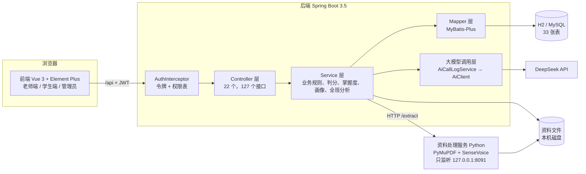
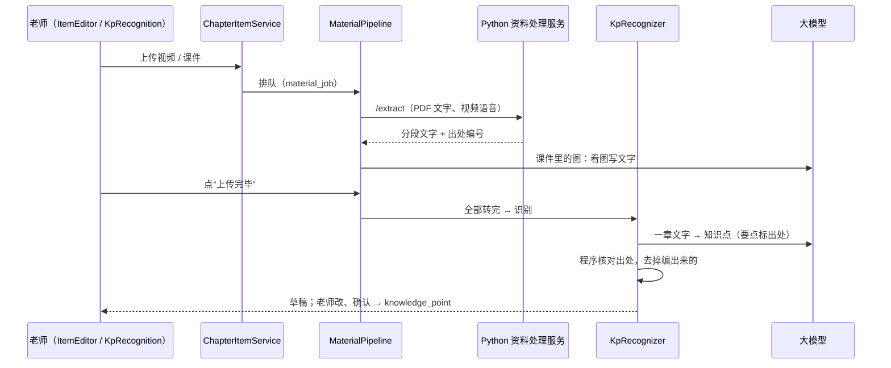
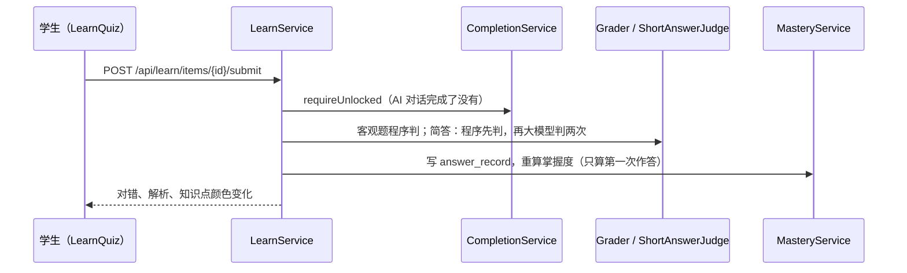
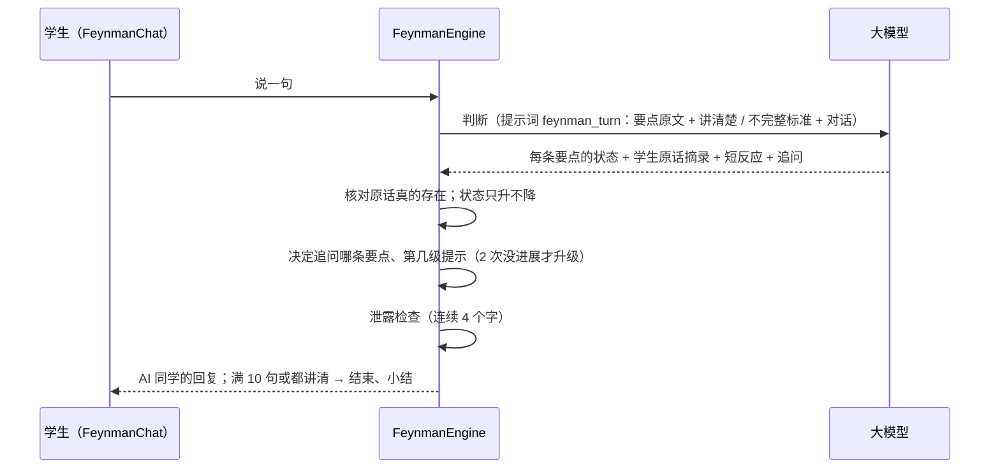

# 组件设计

> 软件工程智能学习平台 · 第 2 组 · 2026-11-27
> 本文按现在的代码写（分支 `feature/ai-learning-studywise`）。每个组件都写了源码位置，类名、包名可以直接在代码里搜到。

---

## 一、总体架构

| 部分 | 技术 | 负责什么 |
|---|---|---|
| 前端 | Vue 3、Vue Router、Pinia、Element Plus、ECharts、Axios、Vite | 三种角色的页面；统一请求封装、登录状态、路由按角色过滤 |
| 后端 | Java 21、Spring Boot 3.5、MyBatis-Plus | 全部业务规则；对外只有 REST 接口 |
| 数据库 | H2（开发，文件模式）/ MySQL 8（部署） | 33 张表，见《数据设计》 |
| 资料处理服务 | Python（PyMuPDF、SenseVoice），常驻进程 | 本机读 PDF 文字、视频语音识别；模型只加载一次；按文件内容 SHA-256 缓存结果；一次只处理一份 |
| 大模型 | DeepSeek（OpenAI 兼容接口） | 看图写文字、识别知识点、AI 对话草稿和对话、出题、判简答、小助手、补充讲解 |
| 持续集成 | GitHub Actions | 每次推送跑后端测试、前端 lint 和打包 |

**分工原则**：大模型只负责“读懂、起草、判断一句话”，程序负责“检查、决定、计算”。例如 AI 对话里问哪条要点、给第几级提示、什么时候结束由程序决定；掌握度、颜色、画像全部由程序计算。

---

## 二、后端分层

一个请求在后端的路径：

1. `AuthInterceptor`：查权限表 `AccessRules` → 验证 JWT → 查账号状态 → 角色检查；
2. **Controller**：只做参数接收和返回包装（`Result`），不写业务；
3. **Service**：业务规则；需要大模型时通过 `AiCallLogService` 调用；
4. **Mapper**：MyBatis-Plus 的 `BaseMapper`，简单查询用 `LambdaQueryWrapper`；
5. 出错时抛 `BusinessException`，由 `GlobalExceptionHandler` 统一转成 `{code, message}`。

**调用规则**：Controller 只调本模块的 Service；Service 之间可以互相调用（例如交卷时 `LearnService` 调 `MasteryService` 重算掌握度），但不跨模块直接用别人的 Mapper 改数据；所有大模型调用都必须经过 `AiCallLogService`，保证每次调用都有记录。

---

## 三、后端组件（按包）

源码根目录：`backend/src/main/java/com/se/platform/`

### 3.1 公共与安全

| 组件 | 源码 | 职责 |
|---|---|---|
| Result / PageResult | `common/` | 统一返回格式 `{code, message, data}`；分页 `{records, total}` |
| BusinessException、GlobalExceptionHandler | `common/` | 业务异常（400 / 403 / 404 / 409）；统一转成返回格式，未知异常只返回“服务器错误” |
| CurrentUser | `common/CurrentUser.java` | 当前请求的用户 id、角色（拦截器放进去） |
| AuthInterceptor | `auth/security/` | 每个 `/api` 请求先过这里：权限表、令牌、账号状态、角色 |
| AccessRules | `auth/security/` | 权限表：路径模式 → 允许的角色；表里没有的接口一律拒绝 |
| JwtService | `auth/security/` | 签发、验证 JWT（HS256，24 小时） |
| LoginAttempts | `auth/security/` | 连续输错 5 次锁 15 分钟 |
| AuthService、AdminUserService | `auth/service/` | 登录、注册、改密码；管理员开通老师账号、禁用 / 启用、重置密码 |

### 3.2 大模型调用层（`ai/`）

| 组件 | 职责 |
|---|---|
| `AiClient`（接口） | “发一组消息，拿回一段文字和 token 数”。业务代码只依赖这个接口 |
| `OpenAiCompatibleClient` | 正式实现：`POST {base-url}/chat/completions`；超时、5xx 重试 2 次，4xx 不重试；关闭“思考”模式 |
| `FakeAiClient`（测试） | 单元测试用的假实现：按顺序返回预设回复、记录收到的请求；测试不联网、不花钱、结果固定 |
| `AiCallLogService` | 业务代码调大模型的唯一入口：调用 + 写 `ai_call_log`（任务名、token、耗时、按配置的价格算费用、成功或失败） |
| `PromptTemplate` | 从 `resources/prompts/*.md` 读提示词模板，替换 `{{占位符}}` |
| `LlmProperties` | 读 `application.yml` 的 `llm:` 配置；API key 只来自 `application-local.yml` 或环境变量 |

提示词全部放在 `backend/src/main/resources/prompts/`，带版本号，例如 `kp_extract_v1.md`（识别知识点）、`feynman_draft_v1.md`（AI 对话草稿）、`feynman_turn_v1.md`（对话中每一句的判断）、`exercise_gen_v1.md`（出题）、`exercise_solve_v1.md`（不看答案做题，检查歧义）、`short_judge_v1.md`（判简答）、`assistant_chat_v1.md`（小助手聊天）、`class_explain_v1.md`（全班补充讲解）。

### 3.3 课程内容（`course/`）

| 组件 | 职责 |
|---|---|
| `CourseService`、`ChapterService` | 课程、章节的增删改查和发布；老师只能操作自己的课；发布章节前每次练习都要设截止时间（到截止才做全班分析） |
| `ChapterItemService` | 内容项（视频、文档、练习、AI 对话）的增删改、排序、截止时间；视频 / 文档项上传文件后交给资料流水线 |
| `MaterialService` | 资料文件的保存、读取（支持视频分段读取）、删除 |
| `KnowledgePointService` | 确认后的知识点 |
| `ExerciseService` | 题目增删改查、题目-知识点关联；6 种题型：单选、两段式单选、多选、判断、填空、简答 |
| `ExerciseGenService` | **④ 出题**：按老师选的知识点让大模型出题 → 程序检查（格式；要点和误解的覆盖；题干或选项和要点原文连续 15 个字一样就提醒“照抄了原文”）→ 大模型不看答案再做一遍，做错的标“可能有歧义” → 存成草稿等老师确认；也负责小助手补练题和拓展题 |
| `ExerciseReviewService` | 覆盖检查（每个知识点在每种考查类型、题型下有几道题）；简答作答的老师确认和改判 |
| `Grader` | 客观题判分（单选、判断、多选部分得分 0.5、两段式、填空）和答案归一化（全半角、大小写、空格标点） |
| `ShortAnswerJudge` | 简答判分：少于 5 个字 0 分、和参考答案一样 1 分，否则大模型并行判两次，一致才算，不一致等老师确认 |
| `LearnService` | 学生端：已发布的课程和章节、学习大纲（含已学完、锁住的项）、取题（不带答案）、交卷判分 |

### 3.4 ① 上传资料、② 识别知识点（`material/`）

| 组件 | 职责 |
|---|---|
| `MaterialPipeline` | 资料 → 文字 → 知识点的流水线：上传即排队转文字；老师点“上传完毕”且没有排队 / 处理中的任务时自动识别知识点；资料有增删时状态回到“资料有更新” |
| `MaterialExtractor` / `HttpMaterialExtractor` | 把一份资料转成文字：调本机 Python 资料处理服务（PDF 文字 + 图片交给大模型看图；视频语音识别） |
| `KpRecognizer` | 把一章转出来的文字交给大模型识别知识点；每条要点必须标出处编号，程序核对出处存在、编出来的去掉；存成草稿 |
| `ChapterKpService` | 老师看识别进度、改知识点、确认（确认后同步到 `knowledge_point`）；老师和学生看知识点地图（学生只看已确认的） |

### 3.5 ③ AI 对话（`feynman/`，旧版在 `dialogue/`）

| 组件 | 职责 |
|---|---|
| `FeynmanDraftService` | 老师端：选知识点（最多 2 个，必须已确认）→ 大模型起草（场景、AI 同学、误解试探、每条要点的“讲清楚 / 不完整”标准和 L1～L3 提示、讲不出时回看哪里）→ 程序检查 4 项（每条要点都有、各项都写了、每句 ≤ 80 字、提示没照抄要点原文）→ 老师改、确认 |
| `FeynmanEngine` | 学生端对话：每一句由大模型判断（讲解 / 提问 / 卡住 / 闲聊；每条要点的状态，必须摘学生原话），程序核对原话、更新状态、决定追问哪条要点和第几级提示（每级 2 次没进展才升级），检查回复有没有泄露答案（任意连续 4 个字），满 10 句或要点都讲清时结束、总评、补充、小结 |
| `DialogueService` 等（`dialogue/`） | 旧版“话题式”对话，老师没有配置费曼对话的对话项仍可使用 |

### 3.6 记录与诊断（`record/`、`diagnosis/`）

| 组件 | 职责 |
|---|---|
| `ProgressService` | 视频：合并看过的时间段，完成度 ≥ 90% 算学完，防快进、防伪造（两次上报的间隔、时长不能改小）；文档：累计阅读 ≥ 30 秒并点“我已读完” |
| `CompletionService` | 一项内容学完没有（学完事件 / 交过卷 / 对话结束）；**解锁规则**：视频、文档不锁，AI 对话要本章资料全部学完，练习要本章 AI 对话完成（`blockers`） |
| `RecordService` | 保存作答和学习行为，整理成学习记录页 |
| `DeadlineService` | 截止时间：学生端提醒（截止前 3 天开始）、老师端谁没做 / 迟交；不允许补交时拒绝 |
| `MasteryService` | 掌握度：每道题只算第一次作答得原始掌握度 F；补练单独记 R；颜色：F ≥ 0.8 绿，补回来了橙，还没补回来红，没练过灰 |
| `DiagnosisService` | 学情诊断页：课程 → 章节 → 知识点的掌握度和依据 |

### 3.7 ⑤ 老师干预（`intervention/`）

| 组件 | 职责 |
|---|---|
| `ClassAnalysisService` | 练习截止（或全部交完）后的全班分析；交卷 < 80% 作废。规则①：某题全班 ≥ 80% 做错 → 提示老师检查题目；规则②：某条要点在某种考查类型上错误率 > 50% → 全班问题 |
| `ClassPushService` | 对规则②的问题：大模型写补充讲解 + 出新题 → 老师改、确认 → 推送给做错的学生（出现在他们的小助手里）→ 统计推送后的效果 |
| `EnrollmentService`（course 包） | 选课；全班 = 选了这门课的学生 |
| `TeacherTodoService` | 老师首页“待你确认” |
| `OfficeToPdf`、`VideoTermFixer`（material 包） | PPT、Word 转 PDF；视频同音错字纠正 |
| `FeynmanDiagnosis`（feynman 包） | AI 对话学习情况给小助手和画像 |

### 3.8 ⑦ 小助手、推荐（`assistant/`、`recommend/`）

| 组件 | 职责 |
|---|---|
| `AssistantService` | 学过的章节、进度、每个知识点的结论和下一步（红 → 补练，绿 / 橙 → 拓展） |
| `PracticeAnalysis` | 从练习结果看出一个知识点具体哪条要点、哪种考查类型不足，给复习方案（推荐资料跳到对应的秒 / 页） |
| `RemedyService` | 个人补练：按这个学生自己的错题当场出 3 道，最多 2 轮，补练平均分够了算“补回来了”；拓展：绿 / 橙知识点按学生选的考查类型出更难的题，不算进掌握度 |
| `AssistantChatService` | 自由聊天：手里没有答案；学生贴了本章的题（和题干连续 15 个字一样）时不给答案只讲概念；程序检查回复，和简答参考答案连续 15 个字一样就拦下；交卷前不讨论题目 |
| `RecommendService` | 学习推荐：掌握度 < 0.6 的知识点从低到高，推荐资料和题目 |

### 3.9 ⑧ 学生画像（`profile/`）

| 组件 | 职责 |
|---|---|
| `CourseProfileService` | 每章画像（进度、交卷、第一次全对、知识点颜色、一句话小结）+ 课程四维（持续性、完成度、按时完成率、有效作答正确率）；全部章节学完才开放四维；全部现算，没数据显示“暂无数据” |
| `ProfileService` | 旧版画像（维度 + 标签）：`/api/profiles/me` 和老师查看单个学生 `/api/profiles/students/{id}` |

### 3.10 运维

| 组件 | 职责 |
|---|---|
| `AiCallLogController` | 管理员查看 AI 调用记录和合计费用 |
| `KeepDataConfig`（`common/config/`） | 开发库已存在时只执行升级脚本，保留数据 |

---

## 四、前端组件

源码根目录：`frontend/src/`

### 4.1 基础设施

| 组件 | 职责 |
|---|---|
| `api/request.js` | Axios 封装：自动带令牌；`code == 200` 取 `data`，否则弹 `message`；401 回登录页 |
| `api/*.js` | 按模块分的接口函数（auth、course、teacherCourse、learn、dialogue、diagnosis、profile、recommend、assistant、intervention、classAnalysis、aiLog） |
| `stores/user.js` | Pinia：令牌和当前用户，存在 localStorage |
| `router/index.js` | 路由表；每个页面的 `meta.roles` 决定谁能进、菜单里显示给谁 |
| `layout/` | 左侧菜单 + 顶栏的整体布局 |

### 4.2 页面（views）

| 页面 | 角色 | 说明 |
|---|---|---|
| `login/LoginView`、`RegisterView` | 全部 | 登录；学生注册 |
| `dashboard/DashboardView`、`DeadlineBoard`、`TeacherCourses` | 学生、老师 | 首页：学生看快到期的项和继续学习；老师看自己的课和截止情况 |
| `teacher/CourseManage`、`CourseFormDialog` | 老师 | 我的课程：新建、编辑、发布 |
| `teacher/CourseBuilder` + `teacher/chapter/*` | 老师 | 建课：章节大纲、每章的介绍（`ChapterIntro`）、内容项编辑和上传（`ItemEditor`）、识别知识点（`KpRecognition`）、知识点列表（`ChapterKnowledgePoints`）、AI 对话设置（`FeynmanSetup`）、出题（`ExerciseGenDialog`）、题目列表（`ChapterExercises`）、覆盖检查（`ExerciseCoverage`）、简答确认（`ShortAnswerReview`）、发布检查（`ChapterPublish`） |
| `teacher/TopicManage` | 老师 | 旧版对话话题 |
| `learn/LearnCourses`、`LearnCourse` | 学生 | 课程列表；学习页（章节导航、视频 `VideoPlayer`、文档 `ReadingTimer`、AI 对话、练习 `LearnQuiz`、解锁提示） |
| `records/RecordsView` | 学生 | 学习记录（按天） |
| `diagnosis/DiagnosisView`、`StudentDiagnosis`、`CourseDiagnosis`、`MasteryMeter` | 学生、老师 | 学情诊断：学生看自己；老师看全班和单个学生 |
| `profile/ProfileView` | 学生 | 学生画像：每章画像 + 课程四维 |
| `recommend/RecommendView` | 学生 | 学习推荐 |
| `intervention/ClassAnalysisView` | 老师 | 全班分析（规则①②、补充讲解 + 新题推送） |
| `components/MessageBell`、`dashboard/TodoBoard` | 学生、老师 | 顶栏消息铃铛；老师首页待你确认 |
| `admin/UserManage`、`teacher/AiCallLog` | 管理员 | 用户管理；AI 调用记录 |

### 4.3 可复用组件（components）

| 组件 | 职责 |
|---|---|
| `FeynmanChat` | 学生 AI 对话（讲给 AI 同学听）界面：消息、每条要点进度、小结 |
| `AiDialogue` | 旧版对话界面 |
| `StudyAssistant` | 右下角的小助手浮窗：章节结论、补练、拓展、老师推送、提醒、聊天 |
| `AssistantChat`、`RemedyBox`、`PushBox` | 小助手里的聊天、补练 / 拓展做题、老师推送做题 |
| `KpMap`、`KpCircles` | 知识点地图（要点 → 出处：视频第几秒、课件第几页，点了直接跳过去） |
| `ChartCard`、`StatCard`、`PageHeader` | 图表卡片（ECharts）、数字卡片、页面标题行 |
| `ChangePasswordDialog` | 改密码 |

---

## 五、关键协作流程

### 5.1 老师上传资料到确认知识点

### 5.2 学生交卷

### 5.3 学生 AI 对话的一句话

---

## 六、可测试性设计

- 大模型通过 `AiClient` 接口注入，测试时换成 `FakeAiClient`：不联网、不花钱、每次结果一样，还能检查发给大模型的提示词内容。
- 资料处理服务通过 `MaterialExtractor` 接口注入，测试时换成假的实现（`MaterialKpTest.FakeExtractor`）。
- 业务规则尽量写成不依赖数据库的纯函数（例如 `CompletionService.blockers`、`Grader`、`DialogueRules`），可以直接写单元测试。
- 测试用 H2 内存库和 `data.sql` 演示数据，每个测试类独立的 Spring 上下文。详见《测试说明》。
