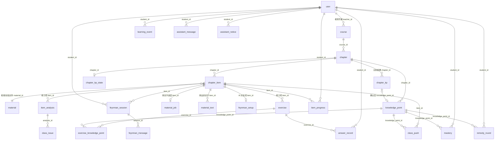

# 软件工程智能学习平台 · 数据设计说明书

<!-- 文档信息 开始 -->

| 项目 | 内容 |
|---|---|
| 项目名称 | 软件工程智能学习平台 |
| 文档名称 | 数据设计说明书 |
| 文档编号 | SE-G2-04 |
| 版本 | V1.0 |
| 日期 | 2026-11-28 |
| 编写 | 第 2 组 |
| 代码仓库 | GitHub：BRYANSOONZEN/Ai-Agent-Learning-Assistant，分支 feature/ai-learning-studywise |

**修订记录**

| 版本 | 日期 | 说明 |
|---|---|---|
| V1.0 | 2026-11-28 | 按提交时的代码整理，首次提交 |

**说明**

<!-- 说明 -->
- 第五节的表结构由 `tools/docs/gen_schema.py` 从 `backend/src/main/resources/schema.sql` 直接生成，和代码一致；改了表重新运行 `python tools/docs/build_docs.py` 即可。
<!-- 说明完 -->

**目录**

- 一、设计约定
- 二、数据对象总览（按模块）
- 三、主要关系（ER 图）
- 四、数据怎么流动
- 五、表结构（自动生成）

<!-- 文档信息 结束 -->

---

---

---

---

## 一、设计约定

| 约定 | 说明 |
|---|---|
| 数据库 | 开发用 H2（文件模式，MySQL 兼容模式），部署用 MySQL 8；建表语句同时兼容两者，不写 `ENGINE`、`CHARSET` 这类 MySQL 专用选项 |
| 建表方式 | 启动时执行 `schema.sql`；开发库已存在时只执行 `schema-upgrade.sql`（每条都是 `ADD COLUMN IF NOT EXISTS`，可以重复执行，旧数据不动），重启后资料、知识点、学习记录都保留 |
| 主键 | 每张表 `id BIGINT AUTO_INCREMENT` |
| 外键 | **不建外键约束**，引用关系在列注释里写明（例如 `teacher_id → user.id`），由代码保证。原因：H2 和 MySQL 两边都要能跑，测试数据好准备，删除时由业务层决定级联还是拒绝 |
| 唯一约束 | 业务上“每人每项只有一行”的都加唯一约束，例如 `mastery (student_id, knowledge_point_id)`、`item_progress (student_id, item_id)`、`user.username` |
| 时间 | `created_at`、`updated_at` 由 MyBatis-Plus 自动填充 |
| 逻辑删除 | 用户、课程等用 `deleted`（1 = 已删除），查询自动过滤 |
| 结构化内容 | 题目选项、要点、误解、出处、对话草稿、对话进度等用 JSON 字符串存进 `TEXT` 列，例如 `exercise.options = ["8、12、16", "7、8、16、17", ...]` |
| 冗余列 | `answer_record.course_id`、`learning_event.course_id` 等是为了按课程统计时少连表，写入时一起填 |
| 现算不存 | 解锁状态、学生画像、全班分析的大部分数字都按学习记录现算，不另外存表，避免和记录不一致 |
| 敏感数据 | 密码只存 BCrypt 哈希；大模型 API key 不进数据库；学生作答原文只给本人、任课老师看 |

---

## 二、数据对象总览（按模块）

共 33 张表。

| 模块 | 表 | 存什么 |
|---|---|---|
| 用户 | `user` | 账号、BCrypt 密码哈希、角色（student / teacher / admin）、状态 |
| 课程内容 | `course`、`chapter`、`chapter_item` | 课程 → 章节 → 内容项（视频、文档、练习、AI 对话），内容项有顺序、截止时间、是否允许补交 |
| | `material` | 上传的视频、课件文件信息（路径、大小、类型） |
| | `knowledge_point` | 老师确认后的知识点（练习、诊断、画像用） |
| | `exercise`、`exercise_knowledge_point` | 题目（6 种题型、考查类型、考第几条要点、答案、解析、选项说明、来源：老师手写 / 上传识别 / AI 生成 / 小助手个人题；草稿标记）和题目-知识点关联 |
| ① 资料转文字 | `material_job`、`material_text` | 每个视频 / 文档项的处理进度；转出来的文字，一段一行（课件一页、一张图、视频 30～60 秒），带出处编号 |
| ② 识别知识点 | `chapter_kp_state`、`chapter_kp` | 每章识别走到哪一步（等上传完 / 识别中 / 草稿 / 已确认 / 失败）；识别出的知识点草稿（名称、一句话说明、重点 / 一般、要点及出处、常见误解），确认后同步到 `knowledge_point` |
| ③ AI 对话（费曼式） | `feynman_setup`、`feynman_session`、`feynman_message` | 老师选的知识点和确认的草稿（场景、每条要点的判断标准和 L1～L3 提示）；学生的一次对话及进度（每条要点的状态、提示级别、次数）；每一句话和大模型的判断 |
| ③ AI 对话（旧版话题式） | `dialogue_topic`、`dialogue_session`、`dialogue_topic_state`、`dialogue_message` | 老师没有配置费曼对话时使用的旧版对话 |
| 记录 | `learning_event` | 学习行为：看了一项内容（停留秒数）、学完一项 |
| | `item_progress` | 视频看过的时间段、上次位置；文档累计阅读秒数；是否学完 |
| | `answer_record` | 每一次作答：答案、对错、得分、蒙对概率、可信度、状态（已判 / 等老师确认）、简答每条要点的判定 |
| 诊断 | `mastery` | 每人每知识点一行：原始掌握度 F（第一次作答）、补练 R、当前掌握度、补练状态 |
| ⑤ 老师干预（全班） | `item_analysis`、`class_issue`、`class_push` | 每次练习的全班分析；规则①（题目可能有问题）和规则②（要点 × 考查类型）发现的问题及老师的处理；补充讲解 + 新题的推送 |
| 选课、快照、推荐 | `enrollment`、`profile_snapshot`、`recommendation` | 学生加入的课程；学完时的画像快照；学习推荐 |
| ⑦ 小助手 | `remedy_round` | 个人补练 / 拓展的每一轮：题目、得分、状态 |
| | `assistant_message` | 小助手聊天记录 |
| | `assistant_notice` | 小助手的提醒（截止提醒、老师推送） |
| 运维 | `ai_call_log` | 每次调用大模型：任务名、输入 / 输出 token、耗时、费用、成功或失败 |

---

## 三、主要关系（ER 图）

（旧版话题式对话、选课、快照的几张表关系较简单，见第五节各表的列注释。）

---

## 四、数据怎么流动

| 时刻 | 写哪些表 | 读哪些表 |
|---|---|---|
| 老师上传视频 / 课件 | `material`、`chapter_item.material_id`、`material_job`（排队） | — |
| 资料处理服务转完文字 | `material_text`、`material_job`（完成 / 失败） | `material` |
| 老师点“上传完毕”，全部转完 | `chapter_kp_state`（识别中 → 草稿）、`chapter_kp`、`ai_call_log` | `material_text` |
| 老师确认知识点 | `chapter_kp_state`（已确认）、`knowledge_point`（同步） | `chapter_kp` |
| 老师生成、确认 AI 对话草稿 | `feynman_setup`、`ai_call_log` | `chapter_kp`、`material_text`（要点出处的原文） |
| 老师 AI 出题、确认 | `exercise`（先存草稿，确认后学生可见）、`exercise_knowledge_point`、`ai_call_log` | `chapter_kp`、`material_text` |
| 学生看视频 / 读文档 | `item_progress`、`learning_event`（停留、学完） | `chapter_item` |
| 学生 AI 对话 | `feynman_session`、`feynman_message`、`ai_call_log`；对话结束写 `learning_event`（学完） | `feynman_setup` |
| 学生交卷 | `answer_record`、`mastery`（重算）、`ai_call_log`（简答判分） | `exercise` |
| 练习截止 | `item_analysis`、`class_issue` | `answer_record`、`exercise` |
| 老师推送补充讲解 + 新题 | `class_push`、`exercise`、`assistant_notice` | `class_issue` |
| 学生做补练 / 拓展 | `remedy_round`、`exercise`（来源 assistant，只给他自己）、`answer_record`；补练会更新 `mastery.remedy`，拓展不改掌握度 | `mastery`、`answer_record` |
| 打开画像 / 诊断 | 不写（现算） | `learning_event`、`item_progress`、`answer_record`、`mastery` |

---

## 五、表结构（自动生成）

<!-- 以下由 tools/docs/gen_schema.py 生成，重新生成：python tools/docs/build_docs.py -->

共 33 张表（来源：`backend/src/main/resources/schema.sql`）。

#### `user`

用户（docs/database.md 4.1） user 在 H2 里是关键字，所以表名加反引号；application.yml 里的 NON_KEYWORDS=USER 也是为了它

| 列 | 类型 | 约束 / 默认值 | 说明 |
|---|---|---|---|
| `id` | BIGINT | NOT NULL AUTO_INCREMENT |  |
| `username` | VARCHAR(32) | NOT NULL | 登录名 |
| `password_hash` | VARCHAR(100) | NOT NULL | BCrypt 哈希，不存明文 |
| `name` | VARCHAR(32) | NOT NULL | 显示姓名 |
| `role` | VARCHAR(16) | NOT NULL | student / teacher / admin |
| `clazz_id` | BIGINT |  | 学生所在班级（班级表以后再建） |
| `status` | TINYINT | NOT NULL DEFAULT 1 | 1 正常，0 禁用 |
| `token_version` | INT | NOT NULL DEFAULT 0 | 令牌版本：退出登录、改密码、管理员重置密码时加 1，旧令牌立即失效 |
| `must_change_password` | TINYINT | NOT NULL DEFAULT 0 | 1 = 管理员开的账号或重置过的密码，第一次登录要先改密码 |
| `created_at` | DATETIME |  |  |
| `updated_at` | DATETIME |  |  |
| `deleted` | TINYINT | NOT NULL DEFAULT 0 | 逻辑删除：1 = 已删除 |

主键 / 约束 / 索引：PRIMARY KEY (id)；CONSTRAINT uk_user_username UNIQUE (username)（登录名不能重复）

#### `course`

课程（docs/database.md 4.1） 前端要的 teacher（教师姓名）、chapterCount、studentCount 不存在这里，查询时计算

| 列 | 类型 | 约束 / 默认值 | 说明 |
|---|---|---|---|
| `id` | BIGINT | NOT NULL AUTO_INCREMENT |  |
| `name` | VARCHAR(100) | NOT NULL |  |
| `description` | TEXT |  |  |
| `teacher_id` | BIGINT | NOT NULL | 授课教师 → user.id（不建外键约束，由代码保证） |
| `status` | VARCHAR(16) | NOT NULL DEFAULT 'draft' | draft 草稿 / published 已发布 / archived 已归档 老师建课时选的模块，逗号分隔：video 视频 / document 文档 / knowledge 知识点 / dialogue AI 对话 / exercise 题目 |
| `modules` | VARCHAR(100) | NOT NULL DEFAULT 'video,document,knowledge,dialogue,exercise' |  |
| `created_at` | DATETIME |  |  |
| `updated_at` | DATETIME |  |  |
| `deleted` | TINYINT | NOT NULL DEFAULT 0 |  |

主键 / 约束 / 索引：PRIMARY KEY (id)；索引 idx_course_teacher（teacher_id）

#### `chapter`

章节（docs/database.md 4.1，按新版设计加了 intro、status） 一章 = 章节介绍 + 一串内容项（chapter_item：视频、文档、练习、AI 对话，数量和顺序由老师定）

| 列 | 类型 | 约束 / 默认值 | 说明 |
|---|---|---|---|
| `id` | BIGINT | NOT NULL AUTO_INCREMENT |  |
| `course_id` | BIGINT | NOT NULL |  |
| `parent_id` | BIGINT |  | 预留：NULL = 章；首版只做一级 |
| `title` | VARCHAR(100) | NOT NULL |  |
| `intro` | TEXT |  | 章节介绍（学习目标 + 概要），学生进入本章先看到 |
| `status` | VARCHAR(16) | NOT NULL DEFAULT 'draft' | draft 草稿 / published 已发布（学生可见） |
| `sort_order` | INT | NOT NULL DEFAULT 0 |  |
| `created_at` | DATETIME |  |  |
| `updated_at` | DATETIME |  |  |
| `deleted` | TINYINT | NOT NULL DEFAULT 0 |  |

主键 / 约束 / 索引：PRIMARY KEY (id)；索引 idx_chapter_course（course_id）

#### `chapter_item`

章节内容项：学生按 sort_order 一项一项学。一章可以有几个视频、几次练习，穿插着排 video    视频：material_id 指向一个视频文件，description 是说明 document 文档：material_id 指向一个文件，或者不传文件、直接在 description 里写正文 exercise 练习：题目挂在这一项下（exercise.item_id） dialogue AI 对话：话题挂在这一项下（dialogue_topic.item_id）

| 列 | 类型 | 约束 / 默认值 | 说明 |
|---|---|---|---|
| `id` | BIGINT | NOT NULL AUTO_INCREMENT |  |
| `course_id` | BIGINT | NOT NULL |  |
| `chapter_id` | BIGINT | NOT NULL |  |
| `type` | VARCHAR(16) | NOT NULL | video / document / exercise / dialogue |
| `title` | VARCHAR(100) | NOT NULL |  |
| `description` | TEXT |  | 说明；文档项也可以直接写正文 |
| `material_id` | BIGINT |  | 视频 / 文档项的文件 → material.id |
| `sort_order` | INT | NOT NULL DEFAULT 0 |  |
| `due_at` | DATETIME |  | 截止时间（只有练习、AI 对话可以设），NULL = 不限时 |
| `allow_late` | TINYINT(1) | NOT NULL DEFAULT 1 | 过了截止时间还能不能补做：1 能（记为迟交）/ 0 不能 |
| `created_at` | DATETIME |  |  |
| `updated_at` | DATETIME |  |  |
| `deleted` | TINYINT | NOT NULL DEFAULT 0 |  |

主键 / 约束 / 索引：PRIMARY KEY (id)；索引 idx_chapter_item_chapter（chapter_id）

#### `knowledge_point`

知识点（docs/database.md 4.1）

| 列 | 类型 | 约束 / 默认值 | 说明 |
|---|---|---|---|
| `id` | BIGINT | NOT NULL AUTO_INCREMENT |  |
| `course_id` | BIGINT | NOT NULL |  |
| `chapter_id` | BIGINT | NOT NULL |  |
| `name` | VARCHAR(100) | NOT NULL |  |
| `content` | TEXT |  | 说明 / 原理句 |
| `difficulty` | TINYINT | NOT NULL DEFAULT 2 | 1 易 / 2 中 / 3 难 |
| `is_key` | TINYINT(1) | NOT NULL DEFAULT 0 | 重点（E4） |
| `is_difficult` | TINYINT(1) | NOT NULL DEFAULT 0 | 难点（E4） |
| `sort_order` | INT | NOT NULL DEFAULT 0 |  |
| `created_at` | DATETIME |  |  |
| `updated_at` | DATETIME |  |  |
| `deleted` | TINYINT | NOT NULL DEFAULT 0 |  |

主键 / 约束 / 索引：PRIMARY KEY (id)；索引 idx_kp_chapter（chapter_id）

#### `exercise`

习题（docs/database.md 4.1，加了 chapter_id 和 option_notes） option_notes：每个选项的误解说明，学生选错时错题讲解用；正确选项那一项留空

| 列 | 类型 | 约束 / 默认值 | 说明 |
|---|---|---|---|
| `id` | BIGINT | NOT NULL AUTO_INCREMENT |  |
| `course_id` | BIGINT | NOT NULL |  |
| `chapter_id` | BIGINT | NOT NULL |  |
| `item_id` | BIGINT |  | 属于哪一次练习 → chapter_item.id（type = exercise） 题型：single_choice 单选 / two_tier 两段式单选 / multiple 多选 / judge 判断 / fill 填空 / short_answer 简答 |
| `type` | VARCHAR(16) | NOT NULL DEFAULT 'single_choice' |  |
| `assess_type` | VARCHAR(16) | NOT NULL DEFAULT 'concept' | 考查类型：concept 概念辨析 / scenario 情境应用 / data 数据分析 / process 流程步骤 |
| `key_point_no` | INT |  | 考的是知识点的第几条要点（AI 出题时标），可以为空 |
| `stem` | TEXT | NOT NULL |  |
| `options` | TEXT | NOT NULL | JSON 数组，按顺序对应 A/B/C/D；填空、简答为 [] |
| `answer` | VARCHAR(16) | NOT NULL | 单选、判断、两段式：一个字母；多选：几个字母如 AC；填空、简答：空串 |
| `analysis` | TEXT |  |  |
| `option_notes` | TEXT |  | JSON 数组，和 options 一一对应 |
| `reasons` | TEXT |  | 两段式：理由选项 JSON 数组 |
| `reason_answer` | VARCHAR(4) |  | 两段式：正确理由的字母 |
| `reason_notes` | TEXT |  | 两段式：每个错误理由对应的误解 JSON 数组 |
| `accepts` | TEXT |  | 填空：都算对的说法 JSON 数组 |
| `reference` | TEXT |  | 简答：参考答案 |
| `key_points` | TEXT |  | 简答：判分要点 JSON 数组 |
| `source` | VARCHAR(16) | NOT NULL DEFAULT 'manual' | manual 老师手写 / upload 老师上传后识别 / ai AI 生成 |
| `draft` | TINYINT(1) | NOT NULL DEFAULT 0 | 1 = 草稿（上传或生成后老师还没确认），学生看不到 |
| `check_note` | TEXT |  | 程序检查发现的问题，给老师看 |
| `difficulty` | TINYINT | NOT NULL DEFAULT 2 |  |
| `sort_order` | INT | NOT NULL DEFAULT 0 |  |
| `created_by` | BIGINT | NOT NULL |  |
| `created_at` | DATETIME |  |  |
| `updated_at` | DATETIME |  |  |
| `deleted` | TINYINT | NOT NULL DEFAULT 0 |  |

主键 / 约束 / 索引：PRIMARY KEY (id)；索引 idx_exercise_chapter（chapter_id）

#### `exercise_knowledge_point`

| 列 | 类型 | 约束 / 默认值 | 说明 |
|---|---|---|---|
| `id` | BIGINT | NOT NULL AUTO_INCREMENT |  |
| `exercise_id` | BIGINT | NOT NULL |  |
| `knowledge_point_id` | BIGINT | NOT NULL |  |

主键 / 约束 / 索引：PRIMARY KEY (id)；CONSTRAINT uk_exercise_kp UNIQUE (exercise_id, knowledge_point_id)

#### `material`

教学资料（docs/database.md 4.1）：课件、文档、视频。文件存磁盘，表里只存路径

| 列 | 类型 | 约束 / 默认值 | 说明 |
|---|---|---|---|
| `id` | BIGINT | NOT NULL AUTO_INCREMENT |  |
| `course_id` | BIGINT | NOT NULL |  |
| `chapter_id` | BIGINT |  |  |
| `knowledge_point_id` | BIGINT |  |  |
| `title` | VARCHAR(100) | NOT NULL |  |
| `original_name` | VARCHAR(255) | NOT NULL |  |
| `file_path` | VARCHAR(255) | NOT NULL | 相对路径，如 2026/10/uuid.pdf |
| `file_size` | BIGINT | NOT NULL |  |
| `content_type` | VARCHAR(100) |  |  |
| `uploaded_by` | BIGINT | NOT NULL |  |
| `created_at` | DATETIME |  |  |
| `deleted` | TINYINT | NOT NULL DEFAULT 0 |  |

主键 / 约束 / 索引：PRIMARY KEY (id)；索引 idx_material_chapter（chapter_id）

#### `dialogue_topic`

对话话题（docs/ai-implementation.md 2.1）：老师确认过的巩固问题，学生的 AI 对话从这里取题 老师填写情境问题和参考答案，AI 拆出要点、简单问法和提示，老师修改后保存

| 列 | 类型 | 约束 / 默认值 | 说明 |
|---|---|---|---|
| `id` | BIGINT | NOT NULL AUTO_INCREMENT |  |
| `chapter_id` | BIGINT | NOT NULL | 所属章节 → chapter.id |
| `item_id` | BIGINT |  | 属于哪个 AI 对话项 → chapter_item.id（type = dialogue） |
| `knowledge_point_id` | BIGINT |  | 考哪个知识点（概念层）→ knowledge_point.id；干预按它对上练习题（应用层） |
| `sort_order` | INT | NOT NULL DEFAULT 0 | 对话里的先后顺序，小的在前 |
| `title` | VARCHAR(100) | NOT NULL | 话题名 |
| `question` | TEXT | NOT NULL | 情境问题 |
| `simple_question` | TEXT |  | 答非所问时换用的简单问法 |
| `key_points` | TEXT | NOT NULL | JSON 数组：要点，如 ["越过边界的 0","边界上的 1"] |
| `hints` | TEXT |  | JSON 数组：预写提示 L1、L2、L3，模型失败时才用 |
| `reveal_text` | TEXT | NOT NULL | 讲解原文（老师的参考答案） |
| `source_ref` | VARCHAR(100) |  | 出处，如"课件第 13 页" |
| `source_text` | TEXT |  | 依据的原理句原文 |
| `transfer_question` | TEXT |  | 变式题：换情境考同一个知识点，旧话题可以为空 |
| `transfer_points` | TEXT |  | JSON 数组：变式题的要点 |
| `transfer_reveal` | TEXT |  | 变式题的参考答案 |
| `created_by_ai` | TINYINT(1) | NOT NULL DEFAULT 0 | 要点等内容是否由 AI 起草 |
| `enabled` | TINYINT(1) | NOT NULL DEFAULT 1 | 是否启用 |
| `created_at` | DATETIME |  |  |
| `updated_at` | DATETIME |  |  |
| `deleted` | TINYINT | NOT NULL DEFAULT 0 |  |

主键 / 约束 / 索引：PRIMARY KEY (id)；索引 idx_dialogue_topic_chapter（chapter_id）

#### `dialogue_session`

一次对话（docs/ai-implementation.md 2.2）：学生在某一章开始的一次巩固对话

| 列 | 类型 | 约束 / 默认值 | 说明 |
|---|---|---|---|
| `id` | BIGINT | NOT NULL AUTO_INCREMENT |  |
| `student_id` | BIGINT | NOT NULL |  |
| `chapter_id` | BIGINT | NOT NULL |  |
| `item_id` | BIGINT |  | 章节里的哪个 AI 对话项 → chapter_item.id；为空 = 整章的话题 |
| `kind` | VARCHAR(16) | NOT NULL | CHAPTER 章节对话 / REVIEW 错题讲解（先只做 CHAPTER） |
| `status` | VARCHAR(16) | NOT NULL | OPEN 进行中 / PAUSED 暂停 / FINISHED 结束 |
| `current_idx` | INT | NOT NULL DEFAULT 0 | 当前第几个话题（从 0 开始） |
| `irrelevant_topics_in_row` | INT | NOT NULL DEFAULT 0 | 连续几个话题因答非所问被跳过 |
| `created_at` | DATETIME |  |  |
| `updated_at` | DATETIME |  |  |

主键 / 约束 / 索引：PRIMARY KEY (id)

#### `dialogue_topic_state`

每个话题的进度（2.3）：程序状态，规则和总结都看这里，不看模型

| 列 | 类型 | 约束 / 默认值 | 说明 |
|---|---|---|---|
| `id` | BIGINT | NOT NULL AUTO_INCREMENT |  |
| `session_id` | BIGINT | NOT NULL |  |
| `topic_idx` | INT | NOT NULL | 第几个话题 |
| `topic_id` | BIGINT |  | → dialogue_topic.id |
| `wrong_count` | INT | NOT NULL DEFAULT 0 | 答错 / 部分对的次数 |
| `stuck_count` | INT | NOT NULL DEFAULT 0 | 点"我卡住了"或直接要答案的次数 |
| `irrelevant_count` | INT | NOT NULL DEFAULT 0 | 答非所问的次数 |
| `hint_level` | INT | NOT NULL DEFAULT -1 | 已给到第几级提示（0、1、2 = L1、L2、L3），-1 = 还没给 |
| `hit_points` | VARCHAR(100) |  | 已经答到的要点序号，如 "1,2" |
| `result` | VARCHAR(20) |  | SELF_CORRECT / HINT_CORRECT / REVEALED_APPLIED / REVEALED / SKIPPED_IRRELEVANT |
| `phase` | VARCHAR(16) | NOT NULL DEFAULT 'ANSWER' | ANSWER 作答 / TRANSFER 变式检验 |
| `turn_count` | INT | NOT NULL DEFAULT 0 | 当前阶段走了几轮，到上限就往下走 |
| `answer_count` | INT | NOT NULL DEFAULT 0 | 真正作答过几次，没作答过的拿不到答案 |
| `refuse_count` | INT | NOT NULL DEFAULT 0 | 不作答只要答案的次数，进入变式时清零 |
| `given_points` | VARCHAR(100) |  | 程序已告诉学生的要点序号，不算学生答到 |
| `transfer_hit_points` | VARCHAR(100) |  | 变式题已答到的要点序号 |
| `transfer_tries` | INT | NOT NULL DEFAULT 0 | 变式题作答了几次 |
| `misconception` | VARCHAR(500) |  | 模型最近发现的错误想法，不算进展 |

主键 / 约束 / 索引：PRIMARY KEY (id)；CONSTRAINT uk_topic_state UNIQUE (session_id, topic_idx)

#### `dialogue_message`

对话消息（2.4）

| 列 | 类型 | 约束 / 默认值 | 说明 |
|---|---|---|---|
| `id` | BIGINT | NOT NULL AUTO_INCREMENT |  |
| `session_id` | BIGINT | NOT NULL |  |
| `topic_idx` | INT |  |  |
| `role` | VARCHAR(16) | NOT NULL | STUDENT / AI |
| `content` | TEXT | NOT NULL |  |
| `source` | VARCHAR(16) |  | MODEL 模型写的 / TEMPLATE 预写文字 / RULE 程序生成 |
| `judged_type` | VARCHAR(16) |  | 学生这句被判成哪一类 |
| `ai_call_id` | BIGINT |  | 这句对应的模型调用 → ai_call_log.id |
| `created_at` | DATETIME |  |  |

主键 / 约束 / 索引：PRIMARY KEY (id)；索引 idx_dialogue_message_session（session_id）

#### `ai_call_log`

AI 调用日志（docs/ai-implementation.md 2.5）：每次调模型记一条，老师拆要点和学生对话共用

| 列 | 类型 | 约束 / 默认值 | 说明 |
|---|---|---|---|
| `id` | BIGINT | NOT NULL AUTO_INCREMENT |  |
| `task` | VARCHAR(32) | NOT NULL | TOPIC_DRAFT 老师拆要点 / DIALOGUE_TURN 学生对话一轮 |
| `model` | VARCHAR(64) | NOT NULL |  |
| `prompt_version` | VARCHAR(32) | NOT NULL | 提示词模板名，如 dialogue_turn_v1 |
| `input_tokens` | INT |  |  |
| `output_tokens` | INT |  |  |
| `cost_cny` | DECIMAL(10,6) |  | 费用（元）= 输入 token × 输入单价 ÷ 100 万 + 输出 token × 输出单价 ÷ 100 万 |
| `latency_ms` | INT |  | 从发出到拿到结果的总耗时，包含重试 |
| `success` | TINYINT(1) | NOT NULL | 调用本身是否成功 |
| `passed_check` | TINYINT(1) |  | 输出是否通过检查（格式、长度） |
| `error` | VARCHAR(255) |  |  |
| `request_json` | TEXT |  | 开发阶段保存完整请求，方便排查；上线前改为只存摘要 |
| `response_json` | TEXT |  | 模型返回的文字 |
| `created_at` | DATETIME |  |  |

主键 / 约束 / 索引：PRIMARY KEY (id)

#### `answer_record`

「记」：答题记录（docs/database.md 4.2）。每次作答都插新记录，重做也保留历史

| 列 | 类型 | 约束 / 默认值 | 说明 |
|---|---|---|---|
| `id` | BIGINT | NOT NULL AUTO_INCREMENT |  |
| `student_id` | BIGINT | NOT NULL |  |
| `exercise_id` | BIGINT | NOT NULL |  |
| `course_id` | BIGINT | NOT NULL | 冗余，方便按课程统计 |
| `item_id` | BIGINT |  | 哪一次练习 → chapter_item.id；同一次交卷的几题 submitted_at 相同 |
| `answer` | VARCHAR(4000) | NOT NULL | 学生的答案，没作答存空串；两段式存 B\|C，多选存 AC |
| `is_correct` | TINYINT(1) | NOT NULL | 得分 = 1 才算对 |
| `score` | DOUBLE |  | 这题得分 0～1：客观题 0 或 1，简答 = 答到的要点数 / 要点总数 |
| `guess` | DOUBLE |  | 这道题蒙对的概率 g（单选 1/选项数，判断 0.5……） |
| `reliability` | DOUBLE |  | 可信度权重 r：程序判 1，简答两次一致 0.5，老师确认 1 |
| `status` | VARCHAR(16) | NOT NULL DEFAULT 'graded' | graded 已判 / pending 简答两次不一致，等老师确认（不算进掌握度） |
| `detail` | TEXT |  | 简答：每条要点两次判的结果和学生原话（JSON） |
| `reviewed_by` | BIGINT |  | 简答：哪位老师确认或改判的 |
| `time_spent_sec` | INT |  | 作答用时（首版不记） |
| `submitted_at` | DATETIME | NOT NULL |  |

主键 / 约束 / 索引：PRIMARY KEY (id)；索引 idx_answer_record_student（student_id, submitted_at）

#### `learning_event`

「记」：学习行为（docs/database.md 4.2） event_type：view_item 看了一项内容（duration_sec = 停留秒数）/ finish_item 学完一项

| 列 | 类型 | 约束 / 默认值 | 说明 |
|---|---|---|---|
| `id` | BIGINT | NOT NULL AUTO_INCREMENT |  |
| `student_id` | BIGINT | NOT NULL |  |
| `event_type` | VARCHAR(32) | NOT NULL |  |
| `target_id` | BIGINT |  | 内容项 → chapter_item.id |
| `course_id` | BIGINT |  | 冗余，方便按课程统计 |
| `duration_sec` | INT |  |  |
| `created_at` | DATETIME | NOT NULL |  |

主键 / 约束 / 索引：PRIMARY KEY (id)；索引 idx_learning_event_student（student_id, created_at）

#### `material_job`

每个视频 / 文档项一行：转文字的进度 「记」：视频和文档的学习进度（每人每项一行），用来判断"学完"，学完才解锁下一项 视频：完成度 P = 合并后各段 (e - s) 之和 ÷ 视频总时长，P >= 90% 算学完 文档：累计阅读 >= 30 秒，并且学生自己点了"我已读完" 「资料 → 知识点」：老师上传的课件、视频转成文字，再由大模型识别本章知识点（设计见 docs/模块说明/设计方案-费曼式AI对话.md） 流程：上传一份就马上转文字（material_job）→ 老师点“上传完毕” → 资料都处理好就自动识别知识点（chapter_kp_state） → 知识点草稿（chapter_kp）→ 老师修改、确认 → 学生能看到知识点地图

| 列 | 类型 | 约束 / 默认值 | 说明 |
|---|---|---|---|
| `id` | BIGINT | NOT NULL AUTO_INCREMENT |  |
| `item_id` | BIGINT | NOT NULL | chapter_item.id |
| `chapter_id` | BIGINT | NOT NULL |  |
| `material_id` | BIGINT |  | 处理的是哪个文件；老师换了文件就重新处理 |
| `status` | VARCHAR(16) | NOT NULL | queued 排队 / processing 处理中 / done 完成 / failed 失败 |
| `message` | VARCHAR(500) |  | 失败原因，或完成时的简要结果（几页、几张图、几分钟） |
| `meta` | TEXT |  | 处理服务返回的统计（JSON：耗时、图片数、token） |
| `terms_checked` | TINYINT(1) |  | 视频：同音字纠正已经做过 |
| `started_at` | DATETIME |  |  |
| `finished_at` | DATETIME |  |  |
| `created_at` | DATETIME | NOT NULL |  |
| `updated_at` | DATETIME | NOT NULL |  |

主键 / 约束 / 索引：PRIMARY KEY (id)；CONSTRAINT uk_material_job UNIQUE (item_id)

#### `material_text`

转出来的文字，一段一行（课件一页、一张图、视频 30～60 秒）

| 列 | 类型 | 约束 / 默认值 | 说明 |
|---|---|---|---|
| `id` | BIGINT | NOT NULL AUTO_INCREMENT |  |
| `item_id` | BIGINT | NOT NULL |  |
| `chapter_id` | BIGINT | NOT NULL |  |
| `seg_key` | VARCHAR(20) | NOT NULL | 这份资料里的编号：P4（第 4 页）、P13-图1（第 13 页的图）、01（视频第 1 段） |
| `kind` | VARCHAR(10) | NOT NULL | pdf / image / video / text（老师直接写在页面上的文字） |
| `page` | INT |  | 课件第几页 |
| `start_sec` | DECIMAL(9,1) |  | 视频片段从第几秒开始 |
| `end_sec` | DECIMAL(9,1) |  |  |
| `content` | TEXT | NOT NULL |  |
| `original` | TEXT |  | 视频同音字纠正前的原文（改过才有） |
| `sort_order` | INT | NOT NULL |  |

主键 / 约束 / 索引：PRIMARY KEY (id)；索引 idx_material_text_chapter（chapter_id, item_id）

#### `chapter_kp_state`

每章一行：识别知识点走到哪一步

| 列 | 类型 | 约束 / 默认值 | 说明 |
|---|---|---|---|
| `id` | BIGINT | NOT NULL AUTO_INCREMENT |  |
| `chapter_id` | BIGINT | NOT NULL |  |
| `upload_done` | TINYINT(1) | NOT NULL DEFAULT 0 | 老师点了“上传完毕” |
| `status` | VARCHAR(16) | NOT NULL | none / waiting 等资料处理完 / recognizing 识别中 / draft 待确认 / confirmed 已确认 / failed |
| `message` | VARCHAR(500) |  |  |
| `ai_call_id` | BIGINT |  | 识别用的那次模型调用 → ai_call_log.id（看 token、费用） |
| `recognized_at` | DATETIME |  |  |
| `confirmed_at` | DATETIME |  |  |
| `created_at` | DATETIME | NOT NULL |  |
| `updated_at` | DATETIME | NOT NULL |  |

主键 / 约束 / 索引：PRIMARY KEY (id)；CONSTRAINT uk_chapter_kp_state UNIQUE (chapter_id)

#### `chapter_kp`

识别出的知识点（老师可以改）；确认后同步一份到 knowledge_point 给练习、诊断用

| 列 | 类型 | 约束 / 默认值 | 说明 |
|---|---|---|---|
| `id` | BIGINT | NOT NULL AUTO_INCREMENT |  |
| `chapter_id` | BIGINT | NOT NULL |  |
| `sort_order` | INT | NOT NULL |  |
| `name` | VARCHAR(100) | NOT NULL |  |
| `summary` | VARCHAR(500) |  |  |
| `importance` | VARCHAR(8) |  | 重点 / 一般 |
| `key_points` | TEXT |  | JSON：[{"text": "...", "sources": ["D1-P4", "V1-02"]}] |
| `misconceptions` | TEXT |  | JSON：["...", "..."] |
| `sources` | TEXT |  | JSON：["D1-P4", "V1-02"]，编号见 material_text（D = 第几份文档，V = 第几个视频） |
| `edited` | TINYINT(1) | NOT NULL DEFAULT 0 | 老师改过：重新识别时保留 |
| `knowledge_point_id` | BIGINT |  | 确认后对应的 knowledge_point.id |
| `created_at` | DATETIME | NOT NULL |  |
| `updated_at` | DATETIME | NOT NULL |  |

主键 / 约束 / 索引：PRIMARY KEY (id)；索引 idx_chapter_kp_chapter（chapter_id, sort_order）

#### `feynman_setup`

一个 AI 对话项：老师选的知识点（最多 2 个）和大模型起草、老师确认的草稿 费曼式 AI 对话：学生把知识点讲给 AI 扮演的同学“小林”听（规则见 docs/模块说明/设计方案-费曼式AI对话.md 第十二节）

| 列 | 类型 | 约束 / 默认值 | 说明 |
|---|---|---|---|
| `id` | BIGINT | NOT NULL AUTO_INCREMENT |  |
| `item_id` | BIGINT | NOT NULL | chapter_item.id（type = dialogue） |
| `chapter_id` | BIGINT | NOT NULL |  |
| `kp_ids` | VARCHAR(100) | NOT NULL | chapter_kp.id，逗号分隔，按对话顺序 |
| `drafts` | TEXT |  | JSON：每个知识点的草稿（场景、开场白、误解、判断标准、三级提示、考一考小林） |
| `status` | VARCHAR(16) | NOT NULL | draft 待确认 / confirmed 已确认（学生能用） |
| `created_at` | DATETIME | NOT NULL |  |
| `updated_at` | DATETIME | NOT NULL |  |

主键 / 约束 / 索引：PRIMARY KEY (id)；CONSTRAINT uk_feynman_setup UNIQUE (item_id)

#### `feynman_session`

一个学生的一次对话；进度（每个知识点的要点状态、提示级别、次数）存在 state 里

| 列 | 类型 | 约束 / 默认值 | 说明 |
|---|---|---|---|
| `id` | BIGINT | NOT NULL AUTO_INCREMENT |  |
| `student_id` | BIGINT | NOT NULL |  |
| `item_id` | BIGINT | NOT NULL |  |
| `status` | VARCHAR(16) | NOT NULL | open 进行中 / done 完成 / expired 老师重新生成了草稿，没聊完的作废 |
| `state` | TEXT | NOT NULL | JSON |
| `created_at` | DATETIME | NOT NULL |  |
| `updated_at` | DATETIME | NOT NULL |  |

主键 / 约束 / 索引：PRIMARY KEY (id)

#### `feynman_message`

对话里的每一句；学生的话附上大模型的判断（存档、老师复核用）

| 列 | 类型 | 约束 / 默认值 | 说明 |
|---|---|---|---|
| `id` | BIGINT | NOT NULL AUTO_INCREMENT |  |
| `session_id` | BIGINT | NOT NULL |  |
| `kp_idx` | INT | NOT NULL | 第几个知识点（从 0 开始） |
| `role` | VARCHAR(10) | NOT NULL | student / ai / system |
| `content` | TEXT | NOT NULL |  |
| `judgment` | TEXT |  | JSON：大模型对学生这一句的判断 |
| `ai_call_id` | BIGINT |  |  |
| `created_at` | DATETIME | NOT NULL |  |

主键 / 约束 / 索引：PRIMARY KEY (id)；索引 idx_feynman_message_session（session_id）

#### `item_progress`

| 列 | 类型 | 约束 / 默认值 | 说明 |
|---|---|---|---|
| `id` | BIGINT | NOT NULL AUTO_INCREMENT |  |
| `student_id` | BIGINT | NOT NULL |  |
| `item_id` | BIGINT | NOT NULL | chapter_item.id |
| `course_id` | BIGINT |  |  |
| `duration_sec` | DECIMAL(9,1) |  | 视频总时长（秒，第一次上报时定下，之后不改） |
| `watched_ranges` | VARCHAR(4000) |  | 视频真正播放过的时间段，合并后的 JSON：[[0,12.5],[14,20]] |
| `watched_sec` | DECIMAL(9,1) | NOT NULL DEFAULT 0 | 上面各段长度之和 |
| `read_sec` | INT | NOT NULL DEFAULT 0 | 文档累计阅读秒数（页面在前台才算） |
| `last_position` | DECIMAL(9,1) |  | 视频上次播放到哪里，下次接着看 |
| `completed_at` | DATETIME |  | 判定学完的时间；空 = 还没学完 |
| `created_at` | DATETIME | NOT NULL |  |
| `updated_at` | DATETIME | NOT NULL |  |

主键 / 约束 / 索引：PRIMARY KEY (id)；CONSTRAINT uk_item_progress UNIQUE (student_id, item_id)

#### `mastery`

「诊」：知识点掌握度（docs/database.md 4.2，算法见 docs/design.md 5.1） 每人每知识点一行，交卷后重算；画像和预警都读这张表

| 列 | 类型 | 约束 / 默认值 | 说明 |
|---|---|---|---|
| `id` | BIGINT | NOT NULL AUTO_INCREMENT |  |
| `student_id` | BIGINT | NOT NULL |  |
| `knowledge_point_id` | BIGINT | NOT NULL |  |
| `mastery` | DECIMAL(5,4) | NOT NULL | 当前掌握度 0～1：补练够 2 道用补练平均分，否则用第一次的 |
| `attempt_count` | INT | NOT NULL | 算进来的题数（第一次作答 + 补练新题） |
| `correct_count` | INT | NOT NULL |  |
| `first_mastery` | DECIMAL(5,4) |  | 原始掌握度：练习里每道题第一次作答的平均分，之后不改 |
| `first_count` | INT | NOT NULL DEFAULT 0 |  |
| `remedy` | DECIMAL(5,4) |  | 补练（小助手推荐、干预布置的新题）第一次作答的平均分 |
| `remedy_count` | INT | NOT NULL DEFAULT 0 |  |
| `remedy_status` | VARCHAR(16) |  | recovered 已补回来 / practicing 补练中 |
| `updated_at` | DATETIME |  |  |

主键 / 约束 / 索引：PRIMARY KEY (id)；CONSTRAINT uk_mastery UNIQUE (student_id, knowledge_point_id)

#### `recommendation`

「荐」：学习推荐（docs/database.md 4.4，算法见 docs/design.md 5.2） 打开推荐页时按薄弱知识点选题，一题一行；学生做对了 done，点"换一道" dismissed，以后不再推

| 列 | 类型 | 约束 / 默认值 | 说明 |
|---|---|---|---|
| `id` | BIGINT | NOT NULL AUTO_INCREMENT |  |
| `student_id` | BIGINT | NOT NULL |  |
| `target_type` | VARCHAR(16) | NOT NULL | exercise（首版只推题）/ material / knowledge_point |
| `target_id` | BIGINT | NOT NULL |  |
| `knowledge_point_id` | BIGINT |  | 针对的薄弱知识点 |
| `reason` | VARCHAR(255) |  | 如「上次做错了」「还没做过」 |
| `status` | VARCHAR(16) | NOT NULL DEFAULT 'new' | new / done 做对了 / dismissed 不想做 |
| `source` | VARCHAR(16) | NOT NULL DEFAULT 'system' | system 系统推荐 / teacher 老师布置（干预） |
| `intervention_id` | BIGINT |  | 旧版个人干预用（已去掉），现在一直为空 |
| `created_at` | DATETIME |  |  |
| `updated_at` | DATETIME |  |  |

主键 / 约束 / 索引：PRIMARY KEY (id)；CONSTRAINT uk_recommendation UNIQUE (student_id, target_type, target_id)

#### `remedy_round`

小助手自动干预：每一轮补练（docs/模块说明/小助手-自动干预与聊天.md 第四节）

| 列 | 类型 | 约束 / 默认值 | 说明 |
|---|---|---|---|
| `id` | BIGINT | NOT NULL AUTO_INCREMENT |  |
| `student_id` | BIGINT | NOT NULL |  |
| `knowledge_point_id` | BIGINT | NOT NULL |  |
| `kind` | VARCHAR(16) | NOT NULL DEFAULT 'remedy' | remedy 补练 / extend 拓展（E1，已掌握的学生要更难的题） |
| `assess_type` | VARCHAR(16) |  | 拓展：学生选的考查类型 |
| `round_no` | INT | NOT NULL | 第几轮（补练最多 2 轮；拓展不限） |
| `exercise_ids` | VARCHAR(255) | NOT NULL | 这一轮的补练题（小助手当场生成的），逗号分隔 |
| `status` | VARCHAR(16) | NOT NULL DEFAULT 'open' | open 还没交 / done 交了 |
| `score` | DOUBLE |  | 这一轮的平均分 |
| `escalated` | TINYINT(1) | NOT NULL DEFAULT 0 | 2 轮做完还没补回来（只记录，老师能看到，不转给老师处理） |
| `created_at` | DATETIME |  |  |
| `finished_at` | DATETIME |  |  |

主键 / 约束 / 索引：PRIMARY KEY (id)；索引 idx_remedy_student（student_id, knowledge_point_id）

#### `assistant_message`

小助手聊天记录（docs/模块说明/小助手-自动干预与聊天.md 第三节）

| 列 | 类型 | 约束 / 默认值 | 说明 |
|---|---|---|---|
| `id` | BIGINT | NOT NULL AUTO_INCREMENT |  |
| `student_id` | BIGINT | NOT NULL |  |
| `chapter_id` | BIGINT | NOT NULL |  |
| `role` | VARCHAR(16) | NOT NULL | student / assistant |
| `content` | TEXT | NOT NULL |  |
| `blocked` | VARCHAR(32) |  | 被程序拦下的原因（question 出题 / answer 给答案），没拦为空 |
| `original` | TEXT |  | 被拦下时大模型原来的回复（只给开发看，用来调规则） |
| `ai_call_id` | BIGINT |  |  |
| `created_at` | DATETIME |  |  |

主键 / 约束 / 索引：PRIMARY KEY (id)；索引 idx_assistant_message（student_id, chapter_id）

#### `item_analysis`

老师干预：每次练习的全班分析（docs/模块说明/老师干预-全班分析.md）

| 列 | 类型 | 约束 / 默认值 | 说明 |
|---|---|---|---|
| `id` | BIGINT | NOT NULL AUTO_INCREMENT |  |
| `item_id` | BIGINT | NOT NULL |  |
| `due_at` | DATETIME | NOT NULL | 按哪一个截止时间分析的（延期后会重新分析） |
| `status` | VARCHAR(16) | NOT NULL | done 已分析 / void 交卷人数不够，作废 |
| `students` | INT | NOT NULL | 全班人数 |
| `submitted` | INT | NOT NULL | 截止前交卷的人数 |
| `analyzed_at` | DATETIME |  |  |

主键 / 约束 / 索引：PRIMARY KEY (id)；索引 idx_item_analysis（item_id）

#### `class_issue`

| 列 | 类型 | 约束 / 默认值 | 说明 |
|---|---|---|---|
| `id` | BIGINT | NOT NULL AUTO_INCREMENT |  |
| `analysis_id` | BIGINT | NOT NULL |  |
| `item_id` | BIGINT | NOT NULL |  |
| `course_id` | BIGINT | NOT NULL |  |
| `kind` | VARCHAR(16) | NOT NULL | question 题目检查 / cell 要点 × 考查类型 |
| `knowledge_point_id` | BIGINT |  |  |
| `key_point_no` | INT |  | 第几条要点；没标要点的旧题为空（按知识点 × 考查类型算） |
| `assess_type` | VARCHAR(16) |  |  |
| `exercise_id` | BIGINT |  | question：哪一道题 |
| `attempts` | INT | NOT NULL | 作答人次（question：作答人数） |
| `wrong` | INT | NOT NULL | 做错的人次 |
| `student_ids` | VARCHAR(2000) |  | 做错的学生，逗号分隔（推送对象） |
| `status` | VARCHAR(16) | NOT NULL DEFAULT 'open' | open 待处理 / ok 题目没问题 / fixed 已修改 / voided 已作废 / ignored 忽略 / pushed 已推送 |
| `created_at` | DATETIME |  |  |
| `updated_at` | DATETIME |  |  |

主键 / 约束 / 索引：PRIMARY KEY (id)；索引 idx_class_issue_item（item_id）

#### `class_push`

老师确认后推给做错的学生：补充讲解 + 新题（docs/模块说明/老师干预-全班分析.md 第四、五节）

| 列 | 类型 | 约束 / 默认值 | 说明 |
|---|---|---|---|
| `id` | BIGINT | NOT NULL AUTO_INCREMENT |  |
| `course_id` | BIGINT | NOT NULL |  |
| `item_id` | BIGINT | NOT NULL | 哪一次练习的分析 |
| `issue_ids` | VARCHAR(255) | NOT NULL | 处理的卡片（同一个知识点的几张可以合并），逗号分隔 |
| `knowledge_point_id` | BIGINT |  |  |
| `assess_type` | VARCHAR(16) |  |  |
| `explanation` | TEXT |  | 补充讲解（大模型起草、老师改过，或老师自己写的） |
| `explanation_by` | VARCHAR(16) |  | ai 大模型起草 / teacher 老师写的 |
| `exercise_ids` | VARCHAR(255) |  | 新题（来源 class），逗号分隔 |
| `student_ids` | VARCHAR(2000) | NOT NULL | 推送对象：做错的学生 |
| `before_rate` | DOUBLE |  | 推送前的错误率（卡片上的） |
| `status` | VARCHAR(16) | NOT NULL DEFAULT 'draft' | draft 老师还在改 / pushed 已推送 |
| `due_at` | DATETIME |  |  |
| `pushed_at` | DATETIME |  |  |
| `created_at` | DATETIME |  |  |
| `updated_at` | DATETIME |  |  |

主键 / 约束 / 索引：PRIMARY KEY (id)

#### `assistant_notice`

老师给学生的提醒（分析作废时提醒没交的学生），显示在学生的小助手里

| 列 | 类型 | 约束 / 默认值 | 说明 |
|---|---|---|---|
| `id` | BIGINT | NOT NULL AUTO_INCREMENT |  |
| `student_id` | BIGINT | NOT NULL |  |
| `item_id` | BIGINT |  |  |
| `content` | VARCHAR(500) | NOT NULL |  |
| `created_at` | DATETIME |  |  |

主键 / 约束 / 索引：PRIMARY KEY (id)；索引 idx_assistant_notice（student_id）

#### `profile_snapshot`

「画」：学完一门课时的画像快照（docs/模块说明/学生画像-设计.md） 全部章节学完、第一次打开课程画像时存一份，之后不再改；平时的画像仍然每次现算

| 列 | 类型 | 约束 / 默认值 | 说明 |
|---|---|---|---|
| `id` | BIGINT | NOT NULL AUTO_INCREMENT |  |
| `student_id` | BIGINT | NOT NULL |  |
| `course_id` | BIGINT | NOT NULL |  |
| `data` | TEXT | NOT NULL | JSON：当时的四维和每章画像 |
| `created_at` | DATETIME | NOT NULL | 保存的时间（≈ 学完的时间） |

主键 / 约束 / 索引：PRIMARY KEY (id)；CONSTRAINT uk_profile_snapshot UNIQUE (student_id, course_id)

#### `enrollment`

选课：学生加入一门课后才能学，老师的全班分析、截止情况只算选了这门课的学生

| 列 | 类型 | 约束 / 默认值 | 说明 |
|---|---|---|---|
| `id` | BIGINT | NOT NULL AUTO_INCREMENT |  |
| `course_id` | BIGINT | NOT NULL | → course.id |
| `student_id` | BIGINT | NOT NULL | → user.id（学生） |
| `created_at` | DATETIME | NOT NULL | 加入的时间 |

主键 / 约束 / 索引：PRIMARY KEY (id)；CONSTRAINT uk_enrollment UNIQUE (course_id, student_id)；索引 idx_enrollment_student（student_id）

