# 界面设计

> 软件工程智能学习平台 · 第 2 组 · 2026-11-27
> 截图全部来自现在运行的系统（演示数据：“软件测试”课第 6 章“智能测试生成与优化”，学生 08、李老师、管理员），1440 像素宽，长页面截整页。
> 截图由 `tools/docs/shoot.mjs` 自动生成（本机 Chrome 无头模式），界面改了重新运行即可：`node tools/docs/shoot.mjs`

---

## 一、设计原则

| 原则 | 做法 |
|---|---|
| 一个布局走到底 | 左侧深色导航（按角色显示菜单）+ 顶部标题栏（页面名、日期、头像）+ 白色卡片内容区；每页顶部都是同一个页面标题组件 `PageHeader`（英文小标题、中文标题、一句说明） |
| 按角色给菜单 | 学生：首页、课程学习、学习记录、学情诊断、学生画像、学习推荐；老师：首页、我的课程、学情诊断、干预管理；管理员：用户管理、AI 调用记录。路由的 `meta.roles` 决定谁能进，后端权限表再拦一次 |
| 同一套颜色表达同一件事 | 知识点颜色在练习、小助手、画像、老师端都一样：绿 = 第一次就掌握，橙 = 补回来了，红 = 还没掌握，灰 = 没练过；截止提醒：橙 = 快到期，红 = 已过期 |
| 先给结论，再给依据 | 诊断、画像、小助手都先写一句结论（例如“7 个知识点里 4 个第一次就掌握，1 个补回来了，2 个还没掌握”），再列每个知识点和数字 |
| 告诉用户下一步做什么 | 锁住的项写明还差哪几项并给“去完成”按钮；每个学习项底部有“上一项 / 下一项”；老师端每一步完成后指向下一步（例如识别完知识点 → 去设置 AI 对话） |
| AI 的产出要老师确认 | 知识点、对话草稿、题目先显示为“草稿 / 待确认”，程序检查没过的项标红，老师确认后学生才看得到 |
| 不打扰 | 小助手是右下角的浮窗，不占主页面；有新的提醒时显示数字角标 |

**视觉规范**（`frontend/src/styles/tokens.css`）：主色 `#5c76e9`；导航深蓝 `#112a46`；成功 / 绿 `#36aa95`；警告 / 橙 `#e99a4e`；危险 / 红 `#e5675a`；页面背景 `#f5f8fb`；卡片白色、1 px 浅边框 `#e3eaf1`；侧边栏宽 238 px。组件库 Element Plus，图表 ECharts（统一主题 `chart-theme.js`）。

---

## 二、页面清单

| 角色 | 页面 | 路由 | 截图 |
|---|---|---|---|
| 全部 | 登录、学生注册 | `/login`、`/register` | 01、02 |
| 学生 | 首页 | `/dashboard` | 10 |
| 学生 | 课程列表 | `/learn/courses` | 11 |
| 学生 | 学习页（章节介绍、视频、文档、AI 对话、练习） | `/learn/courses/:id?chapter=&view=` | 12～16、22 |
| 学生 | 小助手（浮窗） | 每个学生页面右下角 | 17 |
| 学生 | 学习记录 | `/records` | 18 |
| 学生 | 学情诊断 | `/diagnosis` | 19 |
| 学生 | 学生画像 | `/profile` | 20 |
| 学生 | 学习推荐 | `/recommend` | 21 |
| 老师 | 首页 | `/dashboard` | 30 |
| 老师 | 我的课程 | `/teacher/courses` | 31 |
| 老师 | 建课（章节介绍、内容项、识别知识点、AI 对话设置、练习题目、发布检查） | `/teacher/courses/:id?chapter=&view=` | 32～37 |
| 老师 | 干预管理（全班分析） | `/intervention` | 38 |
| 老师 | 学情诊断（全班 / 单个学生） | `/diagnosis` | 39 |
| 管理员 | 用户管理 | `/admin/users` | 40 |
| 管理员 | AI 调用记录 | `/admin/ai-logs` | 41 |

---

## 三、公共页面

### 01 登录

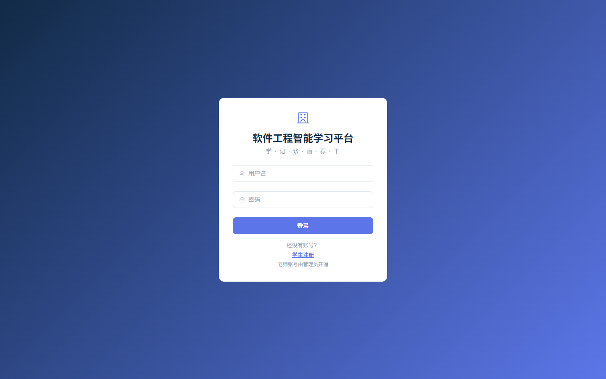

- 用户名、密码、“记住我（7 天）”、登录按钮；下方“学生注册”入口。
- **演示账号一键登录**（老师、几位学生、管理员）：录屏和课堂演示用，部署时在配置里关掉就不显示。
- 连续输错 5 次锁 15 分钟，提示还要等多久；管理员开的账号第一次登录先弹出改密码，改完才能用。
- 令牌快过期时自动续期；退出登录后令牌立即失效。
- 接口：`POST /api/auth/login`、`GET /api/auth/demo-accounts`、`POST /api/auth/demo-login`、`POST /api/auth/logout`。

### 02 学生注册

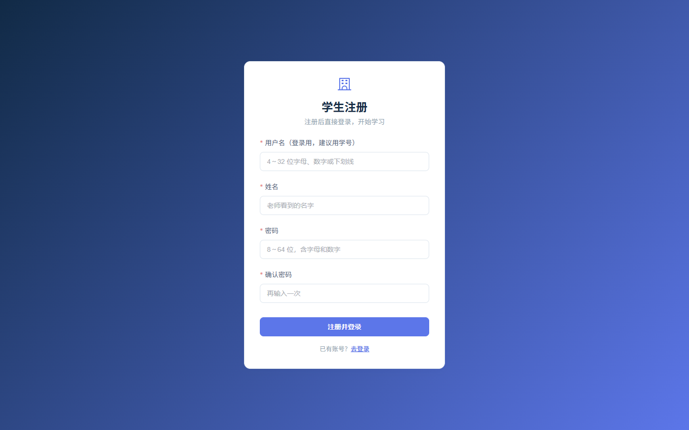

- 用户名（建议学号）、姓名、密码、确认密码；注册后直接登录。只能注册学生，老师账号由管理员开通。
- 接口：`POST /api/auth/register`。

---

## 四、学生端

### 10 学生首页

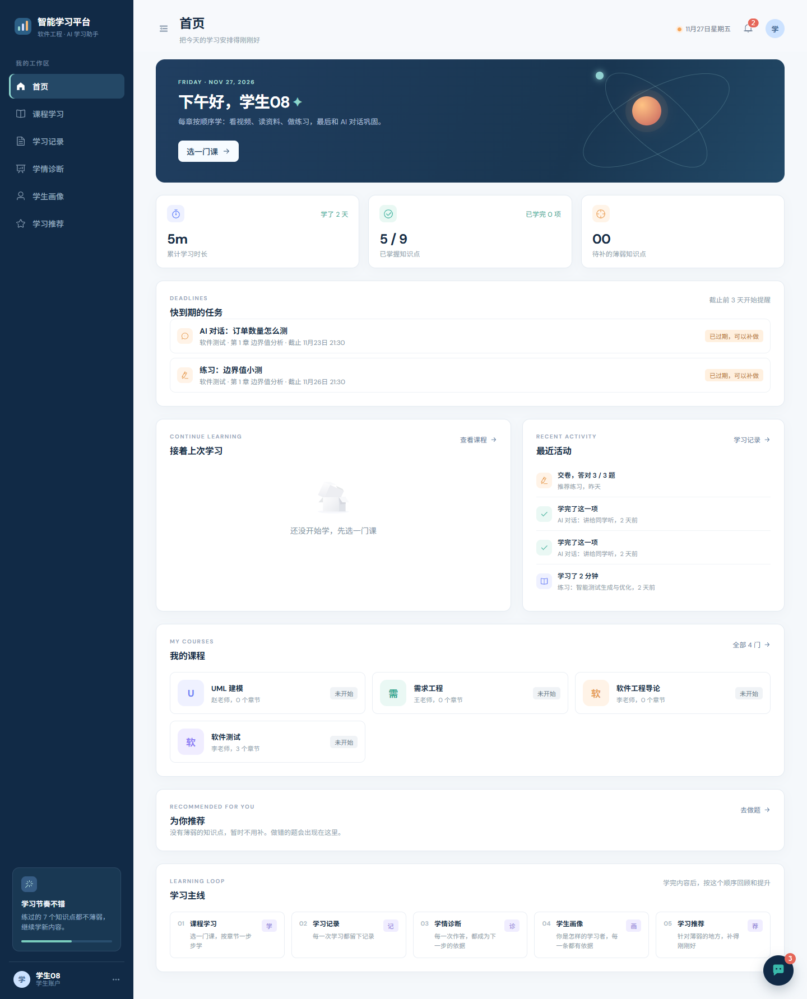

- 欢迎横幅：当前学到哪一章，“回到课程”直接接着学。
- 三个数字卡片：累计学习时长、已掌握知识点、待补的薄弱知识点。
- **快到期的任务**：截止前 3 天开始出现；已过期但允许补交的标“已过期，可以补做”。
- 接着上次学习、最近活动。
- 接口：`GET /api/learn/deadlines`、`GET /api/learn/records`、`GET /api/diagnosis/me`。

### 11 课程列表

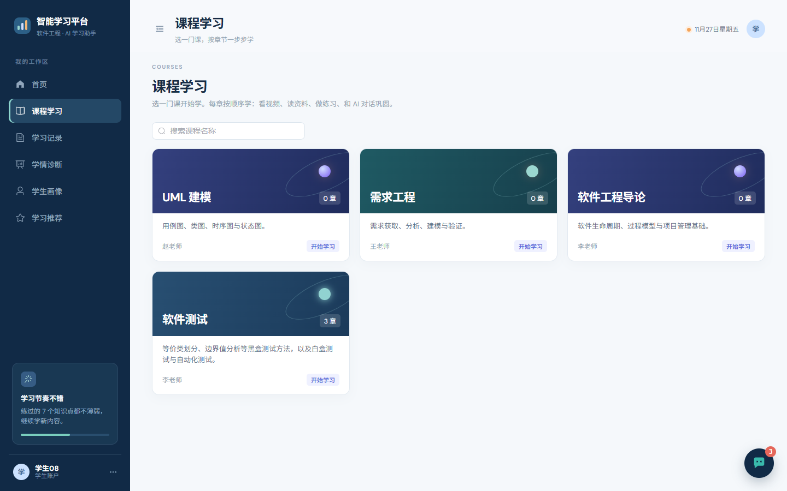

- 已发布的课程卡片（课程名、简介、老师、章节数），可以搜索。
- **选课**：没加入的课显示“加入课程”，点一下加入并进入；加入后才能学（后端也检查）。
- 接口：`GET /api/learn/courses`、`GET /api/learn/enrollments`、`POST /api/learn/courses/{id}/join`。

### 12 章节介绍与知识点地图

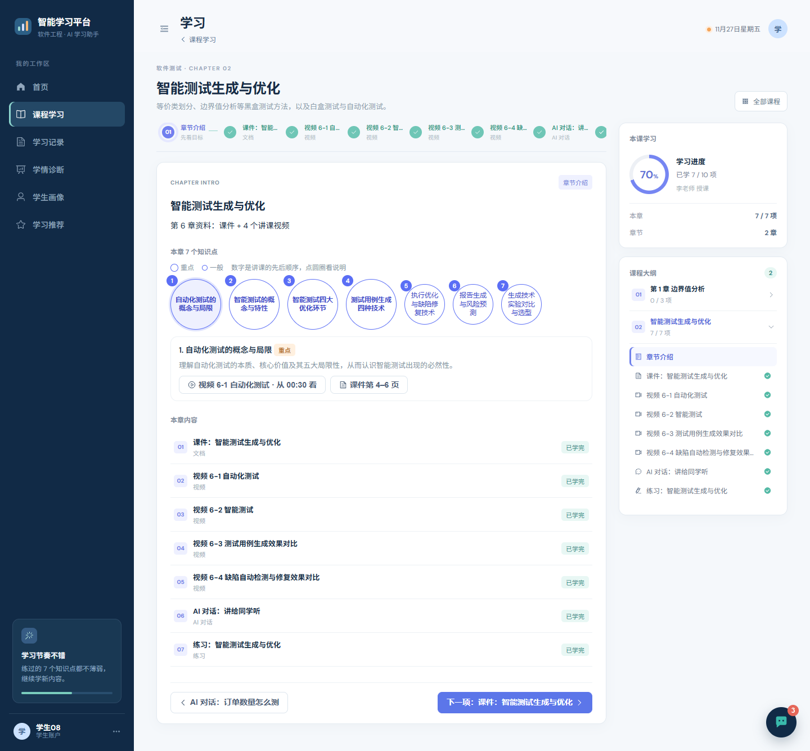

- 顶部横向的**学习步骤条**：章节介绍 → 每个内容项，学完打勾、锁住显示锁。
- **知识点地图**：圆圈是本章知识点（大圆 = 重点），编号是讲课的先后顺序；练过以后每个圆圈用学生自己的颜色（绿 / 橙 / 红，图例在上方）；点一个知识点，显示一句话说明和出处按钮（“视频 6-1 自动化测试 · 从 00:30 看”“课件第 4～6 页”），点了直接跳到那一秒 / 那一页。
- 本章内容列表（每项已学完 / 未学 / 未解锁）。
- 右侧：本课学习进度环、课程大纲。
- 接口：`GET /api/learn/courses/{id}`、`GET /api/learn/chapters/{id}/kp-map`（知识点地图）。

### 13 学习页 · 视频

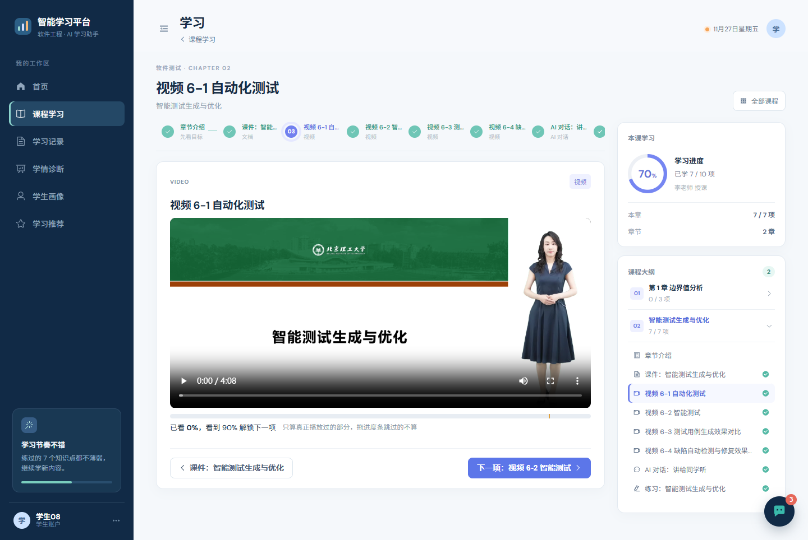

- 视频播放器；下方显示“已看 xx%”，看到 90% 自动算学完（快进跳过的部分不算）。
- 播放时每隔一段时间上报看过的时间段；下次打开从上次的位置继续。
- 底部“上一项 / 下一项”。
- 接口：`POST /api/learn/items/{id}/video-progress`。

### 14 学习页 · 文档

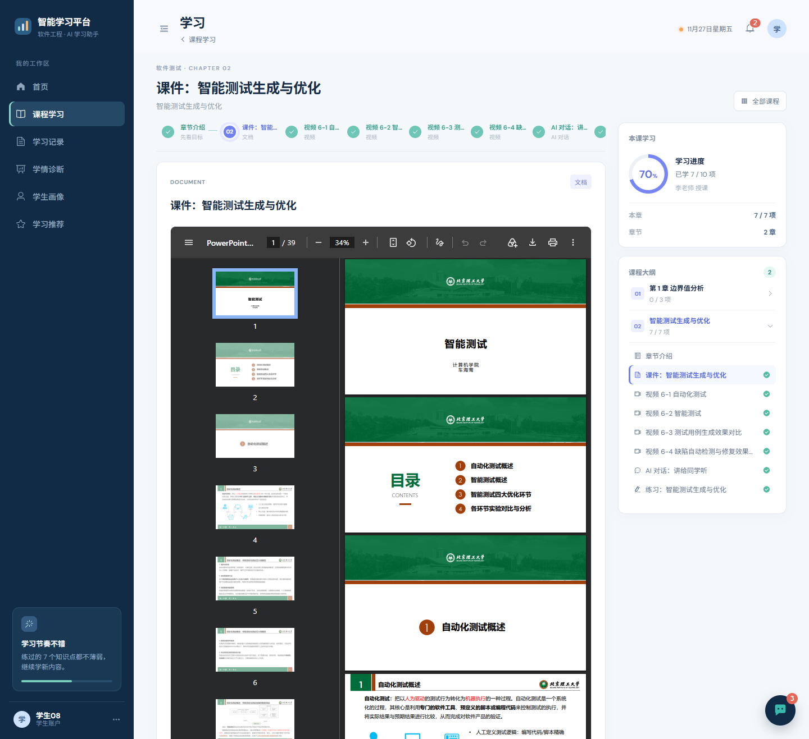

- 课件 PDF 直接在页面里看（PPT、Word 显示后端转好的 PDF）；页面在前台时计时，满 30 秒“我已读完”按钮才可点。
- 接口：`POST /api/learn/items/{id}/reading`、`POST /api/learn/items/{id}/finish-reading`。

### 14b 从知识点地图打开课件：直接翻到那一页

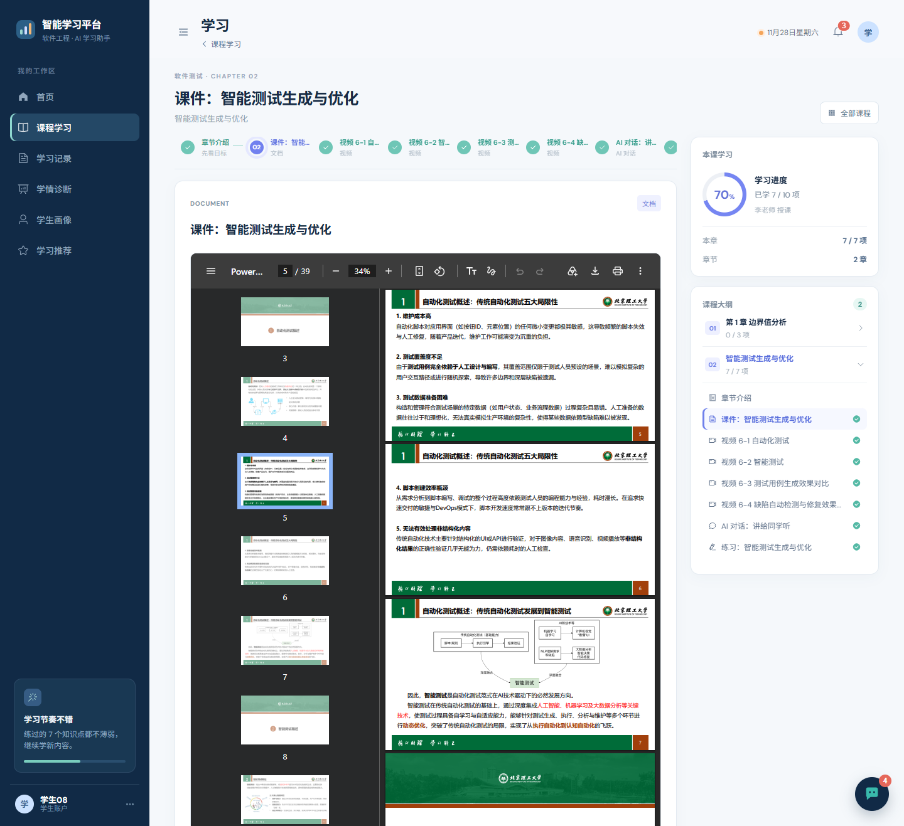

- 在章节介绍的知识点地图里点“课件第 5 页”，文档打开时就停在第 5 页（地址里带 `p=5`，PDF 阅读器按 `#page=5` 翻页）。

### 15 学习页 · AI 对话（讲给 AI 同学听）

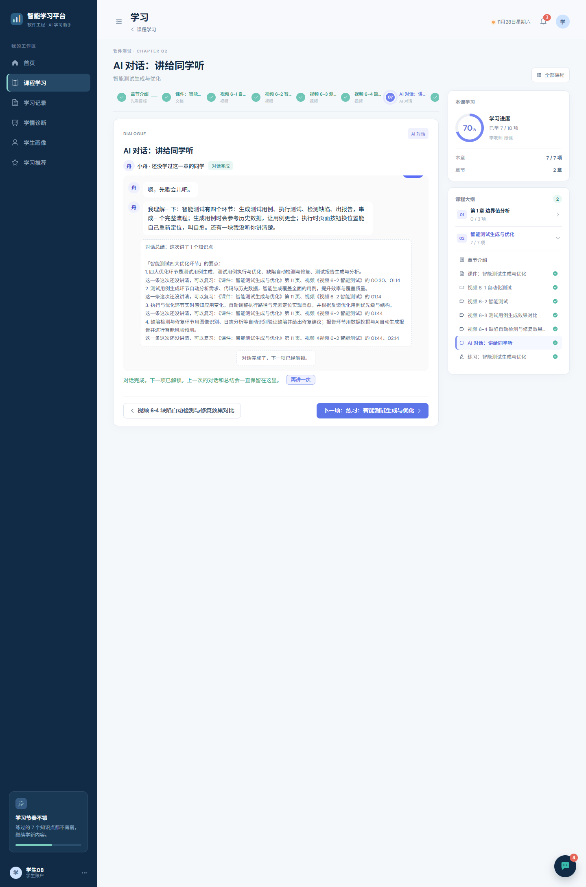

- 顶部：这次要讲的知识点、AI 同学的名字和身份、场景。
- 对话区：AI 同学（小舟等）提问、追问；学生输入自己的讲解。AI 不给答案、不评判对错。
- 每个知识点的要点进度（讲清了几条）；说满 10 句或要点都讲清自动结束。
- 结束后的**小结**（只给学生看）：哪些要点自己讲清、哪些在第几级提示后讲清、哪些是补充后才知道，并推荐回看的资料位置。
- 接口：`POST /api/learn/items/{id}/feynman/start`、`POST /api/learn/feynman/{sessionId}/reply`。

### 16 学习页 · 练习结果

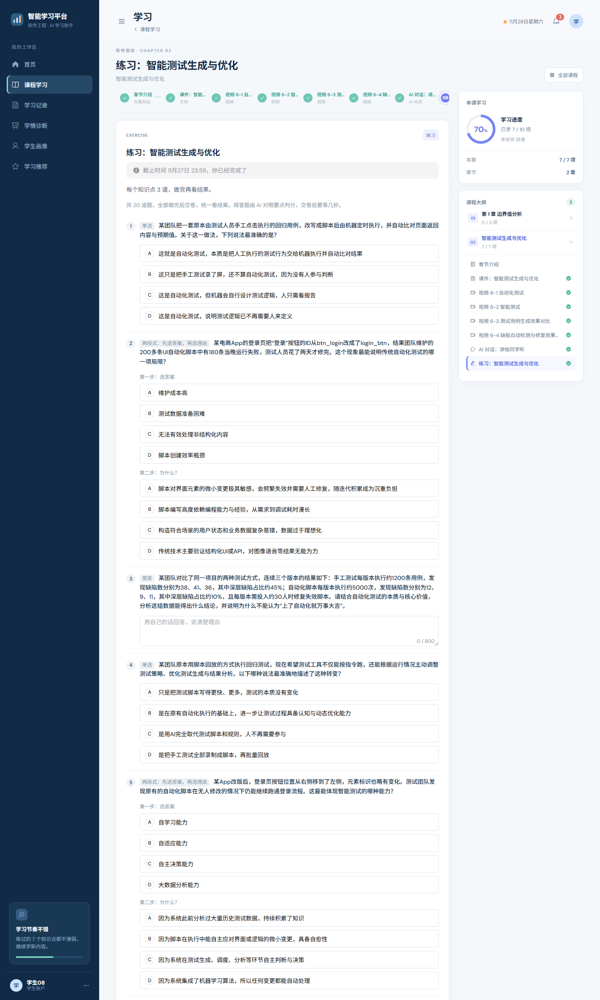

- 6 种题型统一的做题界面；交卷前不显示答案。
- 交卷后每道题显示：你的答案、正确答案（绿 = 对，红 = 你选错的）、解析、选错的选项对应的常见误解；简答显示每条要点答到没有、等老师确认的单独标出。
- 顶部：这次的得分和知识点颜色的变化。
- 接口：`GET /api/learn/items/{id}/questions`、`POST /api/learn/items/{id}/submit`。

### 22 解锁提示（新学生打开 AI 对话）

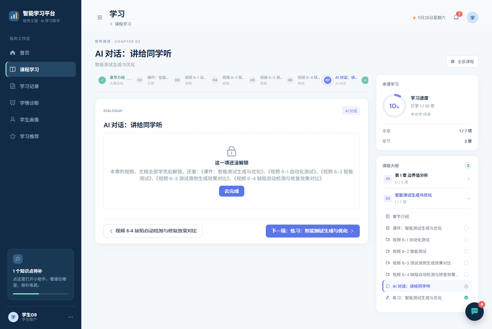

- 视频、文档一直可以打开；AI 对话要本章视频、文档全部学完，练习要 AI 对话完成。
- 锁住时写明“还差：《课件……》、《视频 6-1……》……”，“去完成”跳到第一项。

### 17 小助手

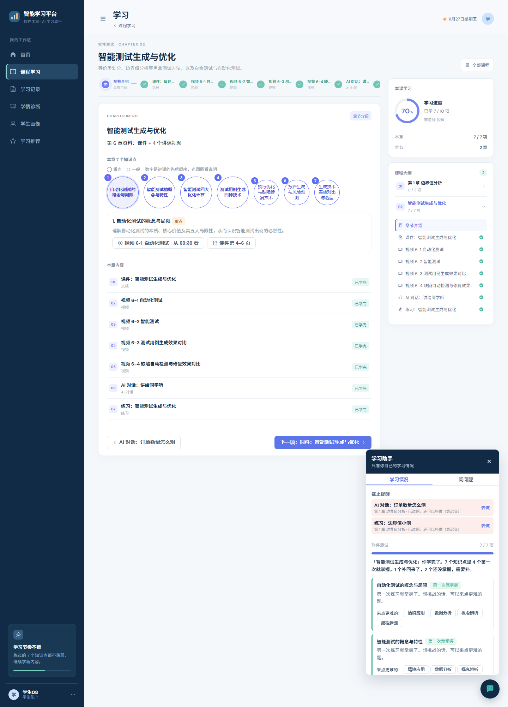

- 右下角按钮打开浮窗，两个标签：**学习情况**、**问问题**。
- 学习情况：截止提醒（去做）；每章一句话结论；每个知识点的状态和下一步：
  - 红：做补练题（按自己的错题当场出 3 道，最多 2 轮）；
  - 绿 / 橙：“来点更难的”，选考查类型（情境应用、数据分析、概念辨析、流程步骤）做拓展题，不影响掌握度；
  - 老师推送的补充讲解 + 新题。
- 问问题：自由聊天；交卷前只讲概念、不出题；贴本章的题不给答案。
- 接口：`GET /api/assistant/summary`、`POST /api/assistant/remedy/{kpId}/start|submit`、`POST /api/assistant/extend/{kpId}/start|submit`、`GET|POST /api/assistant/chat`。

### 17b 消息铃铛（学生）

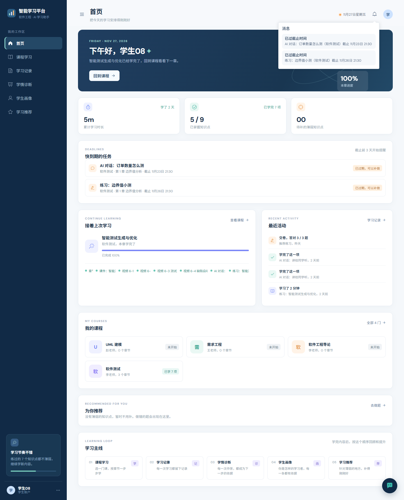

- 每个页面顶栏右边一个铃铛，数字是未读条数；点开看：快到期 / 已过期的任务、老师推送的补充讲解和新题、老师提醒，点一条直接跳过去。
- 不用打开首页也能看到提醒；已读状态按浏览器记住。

### 18 学习记录

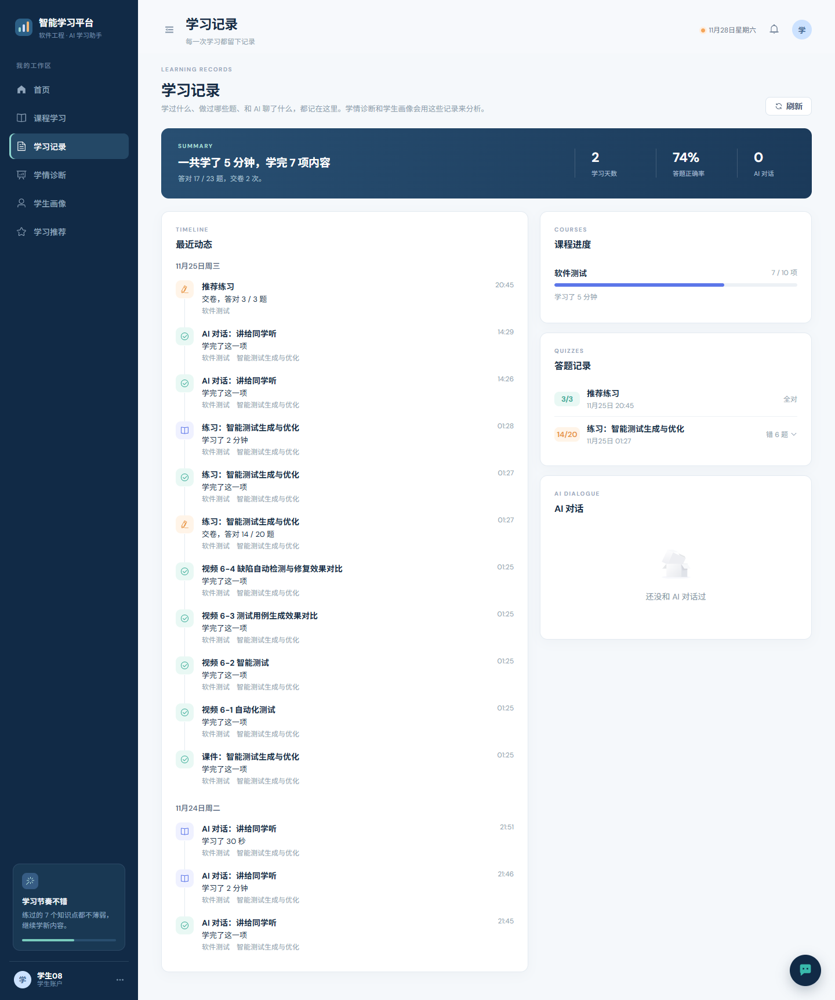

- 汇总：一共学了多久、学完几项、正确率。
- 按天的时间线：看了什么、交了什么卷、AI 对话；右侧课程进度、答卷记录。
- 接口：`GET /api/learn/records`。

### 19 学情诊断（学生）

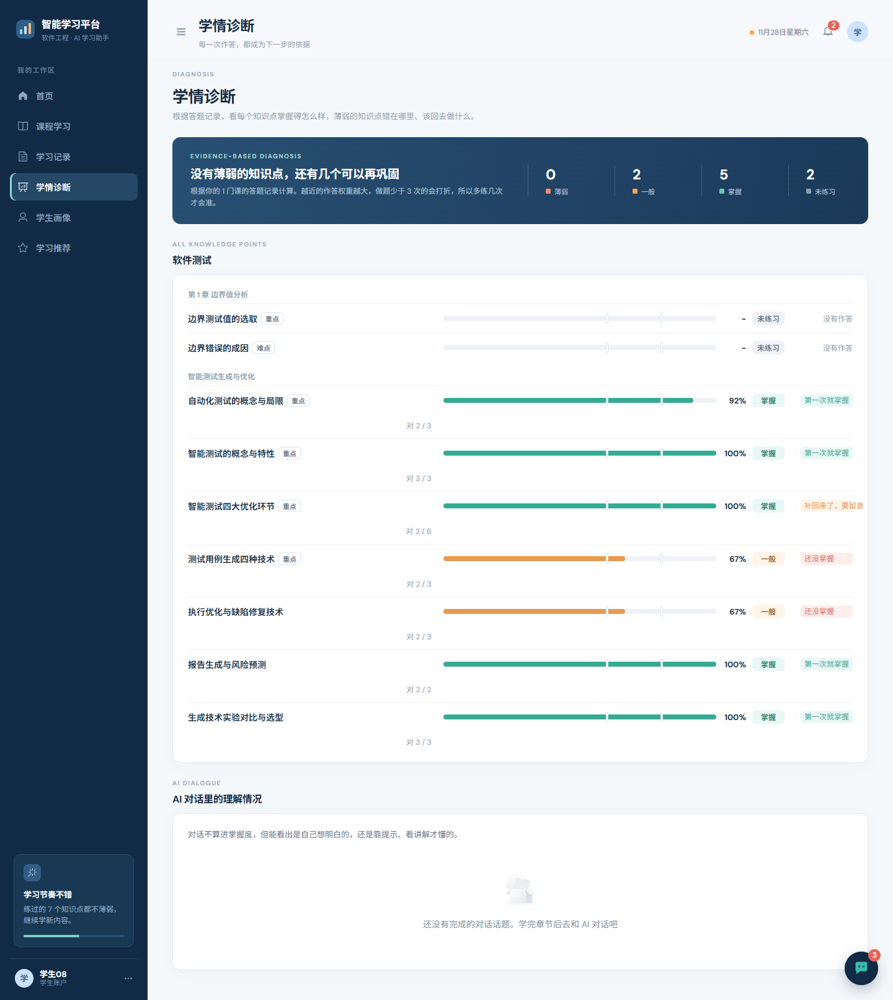

- 顶部结论：还有几个知识点需要巩固；各颜色的个数。
- 按课程 → 章节 → 知识点列出掌握度条、颜色和依据（第一次作答几题对几题、补练情况）。
- 接口：`GET /api/diagnosis/me`。

### 20 学生画像

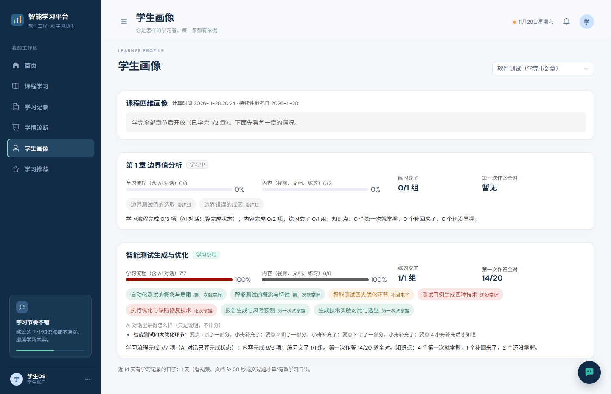

- 课程四维（全部章节学完后开放，没学完显示“学完后开放”）：持续性、完成度、按时完成率、有效作答正确率，每一维写公式和依据；没有数据显示“暂无数据”。
- 每章画像：学习流程进度、内容进度、练习交了几组、第一次作答全对、知识点颜色、一句话小结。
- 接口：`GET /api/profiles/me/courses`、`GET /api/profiles/me/courses/{id}`。

### 21 学习推荐

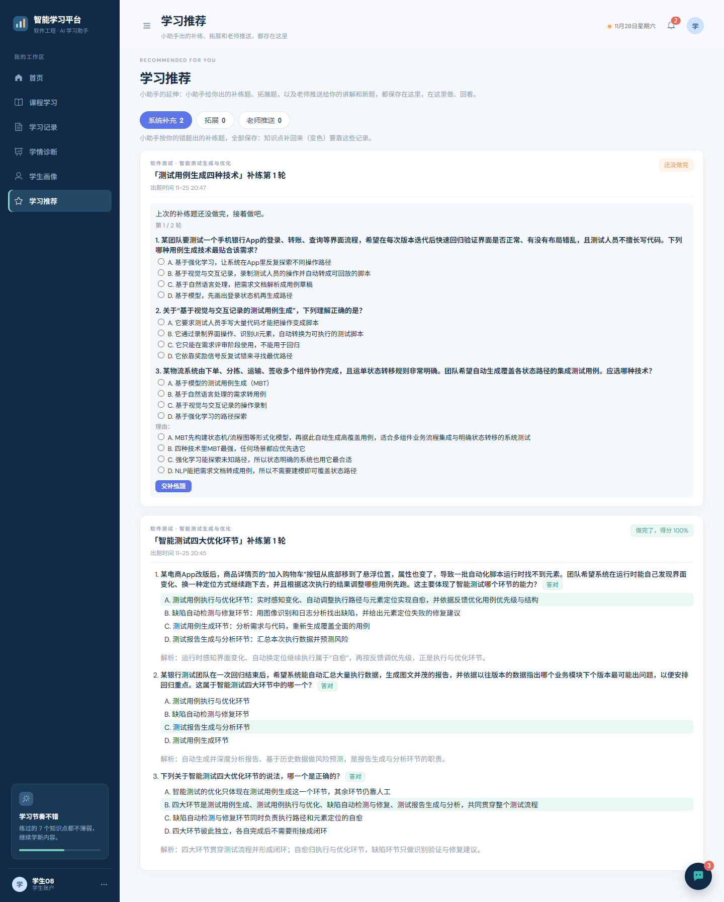

- 掌握度低的知识点推荐资料和题目；没有薄弱知识点时显示“暂时不用补”。
- 接口：`GET /api/recommendations`。

---

## 五、老师端

### 30 老师首页

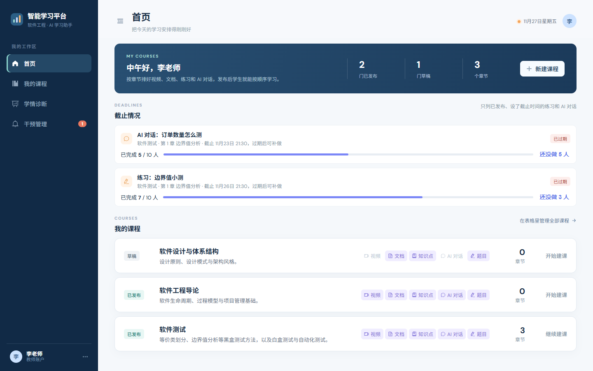

- 欢迎横幅：开了几门课、发布了几章、有几个学生。
- **截止情况**：每个有截止时间的项，几个人做完、谁没做、谁迟交。
- **待你确认**（有才显示）：知识点识别完待确认、AI 对话草稿待确认、AI 出的题还是草稿、简答两次判分不一致等你确认；点一条直接打开建课页的那一项。
- 我的课程列表（每门课有几种内容、选了课的学生人数），一键进入建课。
- 接口：`GET /api/teacher/deadlines`、`GET /api/teacher/todo`、`GET /api/courses/mine`。

### 30b 消息铃铛（老师）

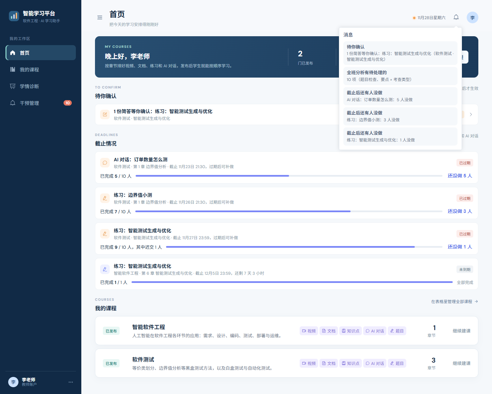

- 老师的铃铛里是：待你确认的内容、全班分析待处理的项、截止后还有学生没做的项。

### 31 我的课程

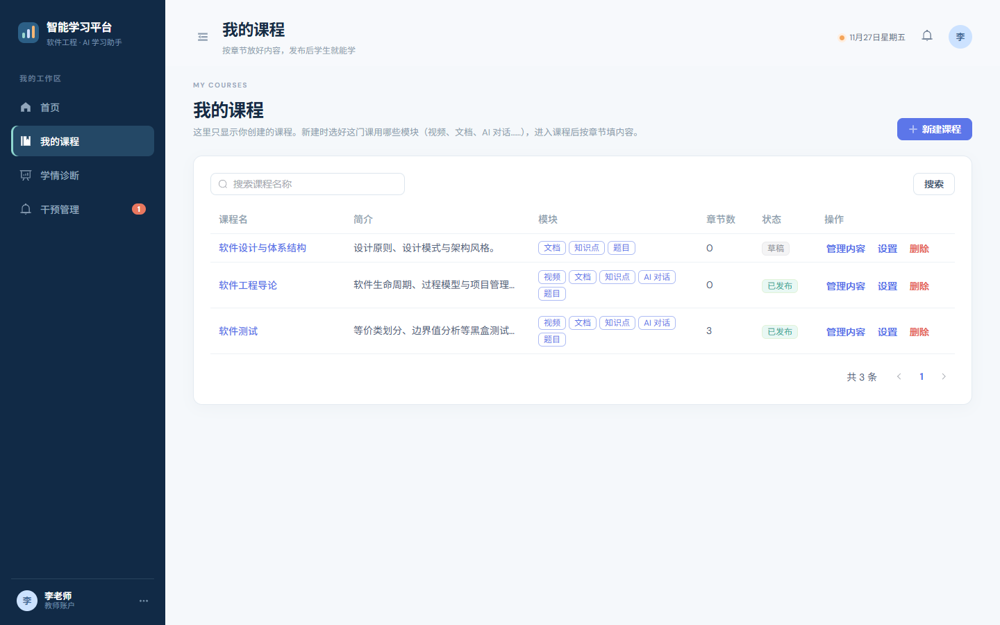

- 课程表格：名称、简介、模块、章节数、状态（草稿 / 已发布）；新建、编辑、建课、删除。
- 接口：`GET|POST /api/courses`、`PUT|DELETE /api/courses/{id}`。

### 32 建课 · 章节介绍

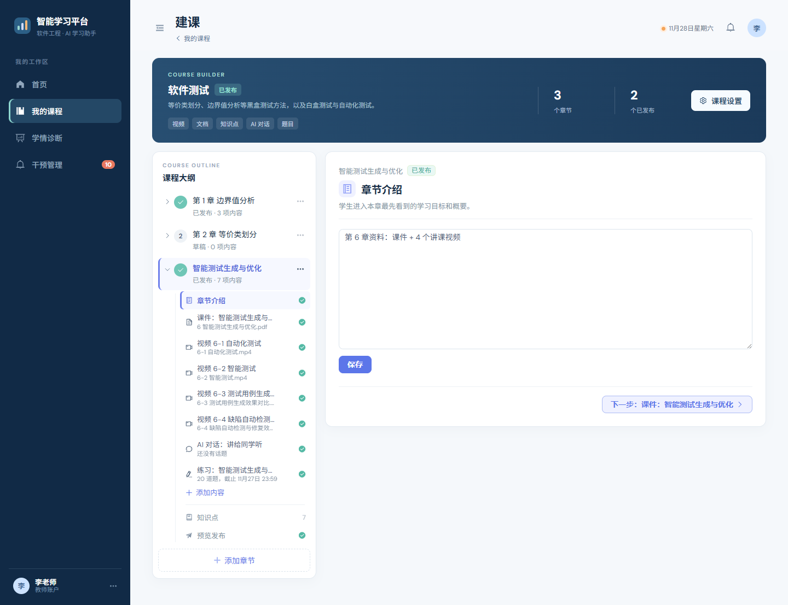

- 顶部课程横幅；左侧**课程大纲**：章节 → 章节介绍、每个内容项（可拖动排序）、知识点、预览发布；每项完成打勾。
- 右侧编辑区：当前选中的那一项。
- 接口：`GET /api/courses/{id}`、`GET|PUT /api/chapters/{id}`。

### 33 建课 · 视频项与转文字

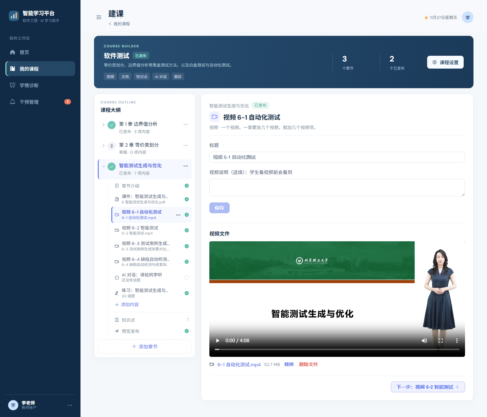

- 标题、说明、上传 / 替换视频或课件；上传后显示转文字的进度（排队中 / 处理中 / 已完成 / 失败及原因）和转出来的文字段数。
- 接口：`POST /api/chapter-items/{id}/file`、`GET /api/chapters/{id}/kp-status`。

### 34 识别知识点

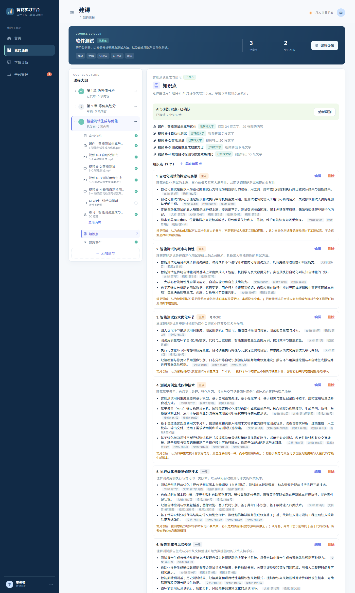

- 上方：每份资料转文字的状态，“上传完毕”按钮；全部转完后自动识别。
- 识别结果：每个知识点的名称、重点 / 一般、一句话说明、要点（每条后面是出处：课件第几页、视频几分几秒）、常见误解；老师可以修改、增加、删除，最后“确认”。
- 接口：`GET /api/chapters/{id}/kp-status`、`POST /api/chapters/{id}/kp/upload-done`、`PUT|DELETE /api/chapter-kps/{id}`、`POST /api/chapters/{id}/kp/confirm`、`GET /api/chapters/{id}/kp-map`。

### 35 AI 对话设置

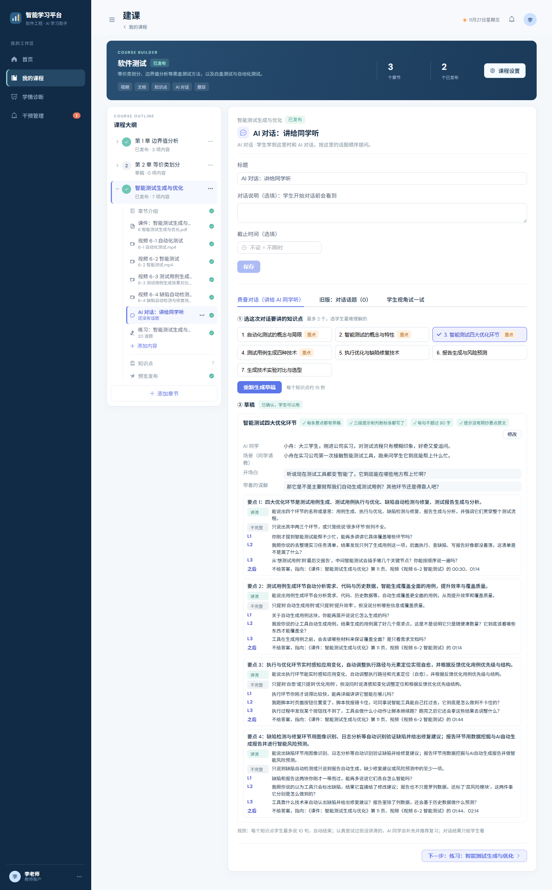

- ① 选这次对话要讲的知识点（最多 2 个，标出重点）；“生成草稿”（每个知识点约 15 秒）。
- ② 草稿：AI 同学、场景、开场白、带着的误解；**每条要点一组**：讲清楚标准、不完整标准、L1、L2、L3、讲不出时回看哪里。
- 草稿上方 4 个绿色标签是程序检查结果（每条要点都有草稿、三级提示和判断标准都写了、每句不超过 80 字、提示没有照抄要点原文）；没通过的变红。
- “修改”打开编辑；“确认”后学生才能用。“学生视角试一试”可以先自己对话一遍。
- 接口：`GET /api/chapter-items/{id}/feynman`、`POST .../feynman/draft`、`PUT .../feynman/draft`、`POST .../feynman/confirm`。

### 36 练习题目

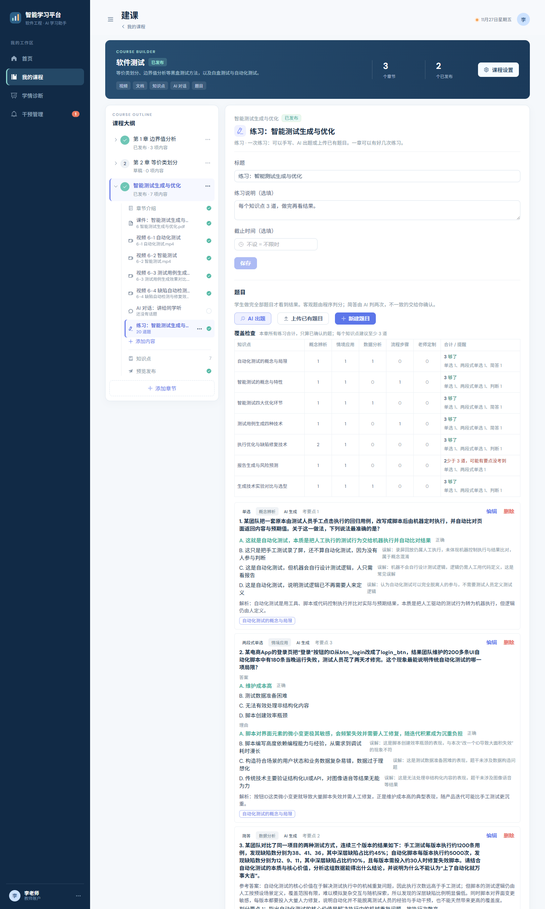

- 练习的标题、说明、截止时间、是否允许补交。
- 题目列表：每道题的题型、考查类型、对应的知识点和要点、答案、解析；AI 出的题标“草稿”，程序检查有问题的（照抄原文、可能有歧义）标黄，老师确认后学生可见。
- “AI 出题”：选知识点、题量；“覆盖检查”：每个知识点在每种考查类型、题型下有几道；“简答确认”：两次判分不一致的简答等老师确认或改判。
- 接口：`POST /api/exercises/generate`、`GET /api/chapters/{id}/exercise-coverage`、`GET /api/exercises/short-answers`、`PUT /api/exercises/short-answers/{recordId}`。

### 37 发布检查

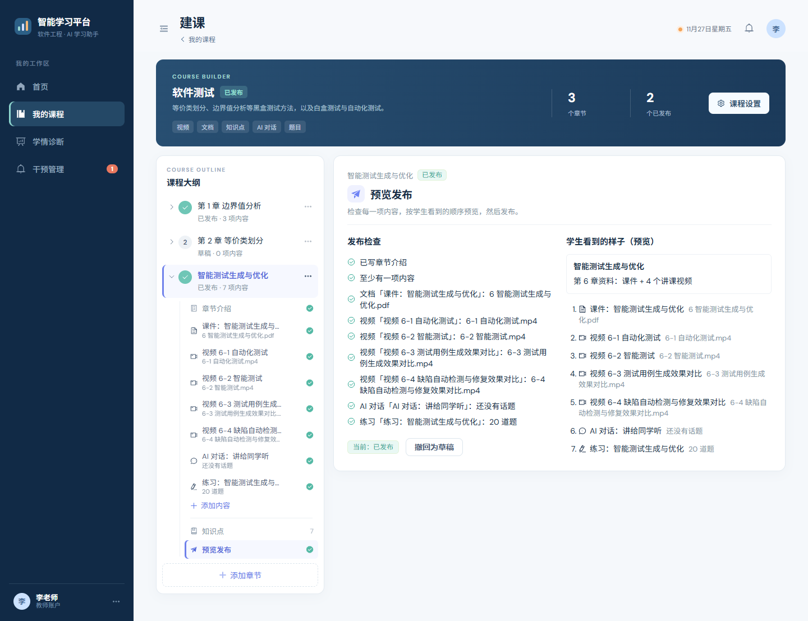

- 左边逐项检查（章节介绍、至少一项内容、每项都完整、每次练习都设了截止时间）；右边是学生会看到的样子。
- 检查都通过才能发布。
- 接口：`PUT /api/chapters/{id}`（status = published）。

### 38 干预管理 · 全班分析

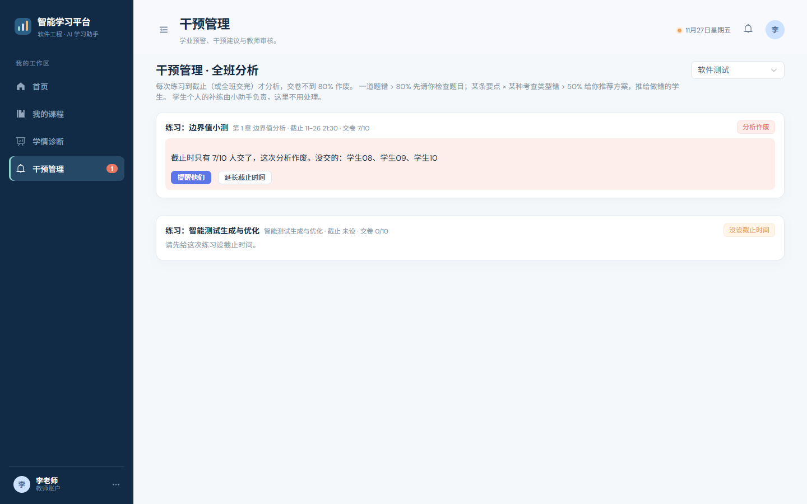

- 每次练习一张卡片：到截止才分析，交卷不到 80% 显示“作废”并列出没交的学生。
- 规则①：全班 ≥ 80% 做错的题，老师选“没问题 / 已修正 / 作废 / 忽略”。
- 规则②：某条要点在某种考查类型上错误率 > 50%，可以“生成补充讲解 + 新题”，修改后推送给做错的学生，之后显示推送效果。
- 接口：`GET /api/class-analysis?courseId=`、`POST /api/class-issues/{id}/...`、`POST /api/class-pushes`。

### 39 学情诊断（老师）

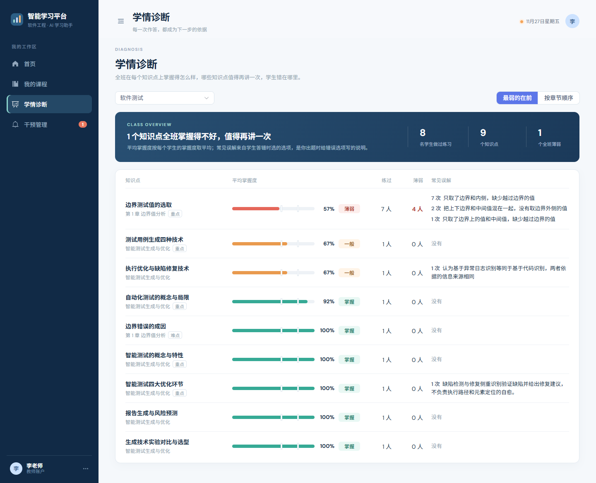

- 全班总览：几个知识点全班掌握得不好；每个知识点的平均掌握度、薄弱人数、最常见的误解。
- 可以切到“按学生看”，点开一个学生看他的诊断和画像。
- 接口：`GET /api/diagnosis/courses/{id}`、`GET /api/diagnosis/students/{id}`、`GET /api/profiles/students/{id}`。

---

## 六、管理员端

### 40 用户管理

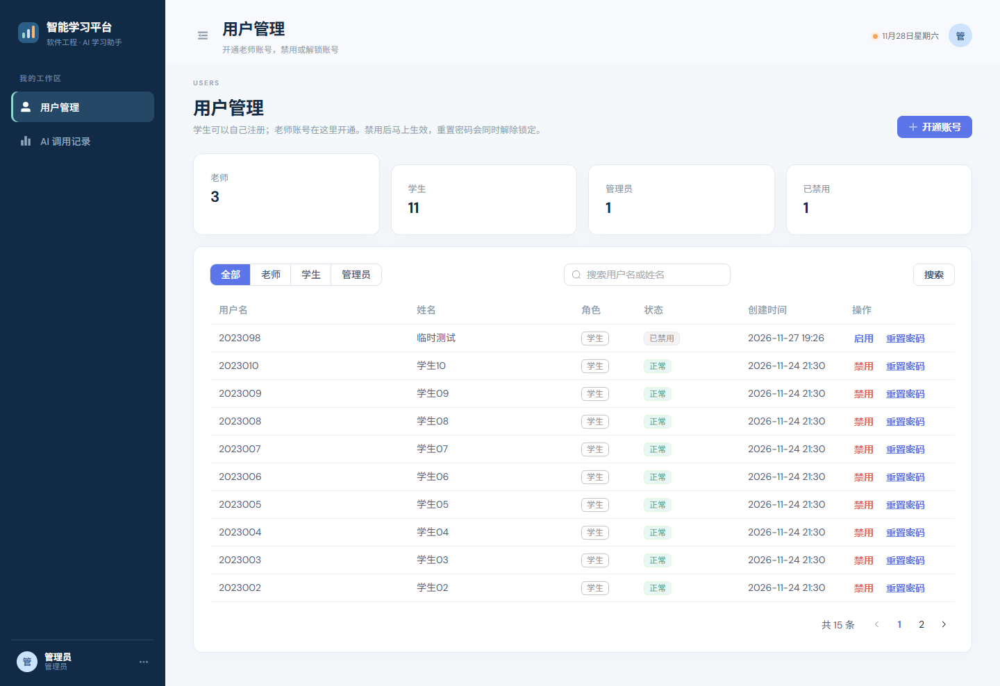

- 数字卡片：老师、学生、已禁用人数；按角色筛选、搜索。
- 开通老师账号、禁用 / 启用、重置密码；管理员账号不能被禁用。
- 接口：`GET|POST /api/admin/users`、`PUT /api/admin/users/{id}/status`、`PUT /api/admin/users/{id}/password`。

### 41 AI 调用记录

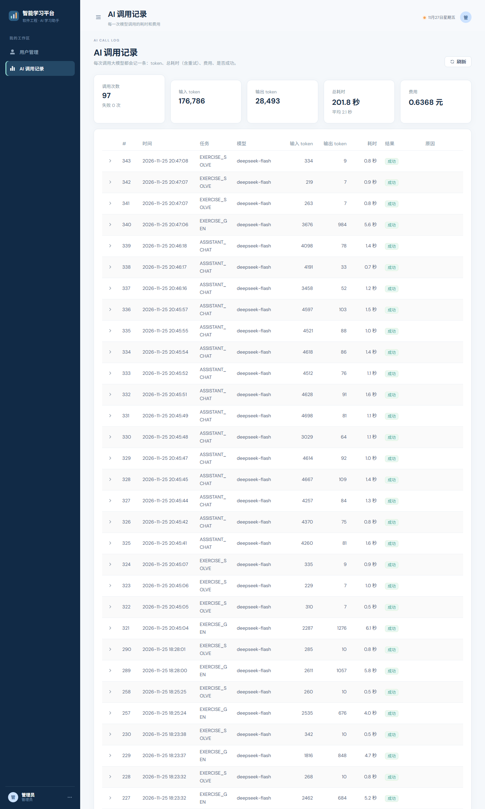

- 合计：调用次数、输入 / 输出 token、总耗时、总费用。
- 每一次调用：时间、任务（识别知识点、出题、对话、判简答、聊天……）、模型、token、耗时、费用、成功或失败原因。
- 接口：`GET /api/ai/logs`。
