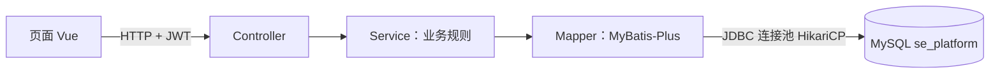

# 数据库说明（MySQL）

> 软件工程智能学习平台 · 第 2 组 · 2026-11-27
> 讲清楚三件事：数据存在哪里、怎么存（表怎么设计）、后端怎么调用（一个请求从页面到 SQL）。
> 表结构的完整清单见《数据设计》第五节；这里讲的是 MySQL 上实际跑起来的样子，例子都是在本机 MySQL 里查出来的真实数据。

---

## 一、数据存在哪里

| 项目 | 现在的做法 |
|---|---|
| 数据库 | **MySQL 8.4.11**（社区版，LTS），本机运行，只监听 `127.0.0.1:3306`，外部连不进来 |
| 库 | `se_platform`，字符集 `utf8mb4`（中文、表情都能存），排序规则 `utf8mb4_0900_ai_ci`，时区东八区 |
| 账号 | 后端用专用账号 `se_app`，**只有 `se_platform` 这一个库的权限**；`root` 只用来管理。两个密码都是随机生成的，存在仓库外面（`C:\ZI\mysql\本机密码.txt`）和不提交的 `application-local.yml` 里，代码和 Git 里都没有 |
| 存储引擎 | InnoDB（支持事务、行锁，崩溃后能恢复） |
| 资料文件 | 视频、课件文件本身**不存数据库**，存在磁盘 `backend/uploads/年/月/uuid.扩展名`；数据库 `material` 表只存路径、大小、类型 |
| 开发 / 测试 | 开发也可以用 H2（文件库，`backend/data`）；单元测试用 H2 内存库。三者用**同一份建表语句**（`schema.sql`），写法同时兼容 H2 和 MySQL |

### 1.1 怎么启动

```powershell
C:\ZI\mysql\mysql-8.4.11-winx64\bin\mysqld.exe --defaults-file=C:\ZI\mysql\my.ini --console
```

```powershell
cd C:\ZI\se-learning-platform\backend
.\mvnw.cmd spring-boot:run "-Dspring-boot.run.profiles=mysql"
```

- 后端加上 `mysql` 配置（`application-mysql.yml`）就连 MySQL；不加就用 H2。
- 第一次连到空库时，后端自动执行 `schema.sql` 建 33 张表、`data.sql` 放演示数据；之后只补新加的表和列，不清空（`KeepDataConfig`）。
- 本机现在的 MySQL 里已经是开发库的全部真实数据（第 6 章的资料文字、识别出的知识点、AI 对话、作答记录等），用 `tools/db/h2_to_mysql.py` 从 H2 搬过来的。

### 1.2 自己去看数据

```powershell
C:\ZI\mysql\mysql-8.4.11-winx64\bin\mysql.exe -u root -p -h 127.0.0.1 --default-character-set=utf8mb4 se_platform
```

进去以后可以 `SHOW TABLES;`、`DESC mastery;`、`SELECT * FROM chapter_kp;`。

---

## 二、怎么存：表的设计

### 2.1 33 张表，按用途分组

| 用途 | 表 |
|---|---|
| 账号 | `user` |
| 课程内容 | `course` → `chapter` → `chapter_item`（视频 / 文档 / 练习 / AI 对话）；`material`（文件信息）；`knowledge_point`；`exercise`、`exercise_knowledge_point`；`enrollment`（选课） |
| 资料 → 文字 → 知识点 | `material_job`（转文字进度）、`material_text`（转出的文字，一段一行）、`chapter_kp_state`、`chapter_kp`（识别出的知识点） |
| AI 对话 | `feynman_setup`（老师确认的草稿）、`feynman_session`（一次对话及进度）、`feynman_message`（每一句）；旧版 `dialogue_*` 4 张 |
| 学习记录 | `learning_event`（看了什么、学完什么）、`item_progress`（视频看过的时间段、文档阅读秒数）、`answer_record`（每一次作答） |
| 诊断 / 画像 | `mastery`（每人每知识点一行）、`profile_snapshot`（学完时的画像快照） |
| 干预 / 小助手 | `item_analysis`、`class_issue`、`class_push`（全班分析和推送）；`remedy_round`（补练、拓展）、`assistant_message`（聊天）、`assistant_notice`（提醒）、`recommendation` |
| 运维 | `ai_call_log`（每次调用大模型的 token、耗时、费用） |

### 2.2 几条设计约定（为什么这样存）

| 约定 | 例子 | 为什么 |
|---|---|---|
| 每张表 `id BIGINT AUTO_INCREMENT` 主键 | — | 简单、插入快 |
| **不建外键约束**，引用关系写在列注释里 | `chapter.course_id → course.id` | H2 和 MySQL 两边都要能跑；删除时由业务代码决定是一起删还是拒绝 |
| “每人每项一行”用唯一约束保证 | `mastery (student_id, knowledge_point_id)`、`enrollment (course_id, student_id)`、`item_progress (student_id, item_id)` | 并发时也不会出现两行；查询直接走这个索引 |
| 结构化的内容存成 JSON 字符串（`TEXT`） | `exercise.options = ["8、12、16","7、8、16、17",…]`；`chapter_kp.key_points = [{"text":"…","sources":["D1-P4"]}]`；`feynman_session.state` 存整段对话的进度 | 这些内容总是整块读、整块写，不需要按里面的字段查；表结构简单 |
| 记录只增不改 | `answer_record` 每次作答新增一行；`learning_event` 每个行为一行 | 掌握度、画像都从记录重算，算法改了可以用原始记录重新算一遍 |
| 能现算的不存 | 解锁状态、画像四维、全班分析的大部分数字 | 避免和记录不一致；唯一例外是“学完时的画像快照”，因为它就是要固定下来 |
| 逻辑删除 | `deleted = 1` | 误删可以恢复；查询时 MyBatis-Plus 自动加 `deleted = 0` |
| 时间列自动填 | `created_at`、`updated_at` | MyBatis-Plus 插入、更新时自动填 |

### 2.3 例子：`mastery` 表在 MySQL 里长什么样

```sql
CREATE TABLE `mastery` (
  `id` bigint NOT NULL AUTO_INCREMENT,
  `student_id` bigint NOT NULL,
  `knowledge_point_id` bigint NOT NULL,
  `mastery` decimal(5,4) NOT NULL,          -- 当前掌握度
  `attempt_count` int NOT NULL,
  `correct_count` int NOT NULL,
  `first_mastery` decimal(5,4) DEFAULT NULL, -- 原始掌握度 F：练习里每道题第一次作答的平均分，之后不改
  `first_count` int NOT NULL DEFAULT '0',
  `remedy` decimal(5,4) DEFAULT NULL,        -- 补练 R
  `remedy_count` int NOT NULL DEFAULT '0',
  `remedy_status` varchar(16) DEFAULT NULL,  -- recovered 已补回来 / practicing 补练中
  `updated_at` datetime DEFAULT NULL,
  PRIMARY KEY (`id`),
  UNIQUE KEY `uk_mastery` (`student_id`,`knowledge_point_id`)
) ENGINE=InnoDB DEFAULT CHARSET=utf8mb4 COLLATE=utf8mb4_0900_ai_ci
```

学生 08（id 12）在第 6 章的 7 个知识点（真实数据）：

| knowledge_point_id | first_mastery | remedy | mastery | remedy_status | 页面上的颜色 |
|---|---|---|---|---|---|
| 3 | 0.9167 | — | 0.9167 | — | 绿（F ≥ 0.8） |
| 4 | 1.0000 | — | 1.0000 | — | 绿 |
| 5 | 0.0833 | 1.0000 | 1.0000 | recovered | 橙（第一次没掌握，补练补回来了） |
| 6 | 0.6667 | — | 0.6667 | — | 红（还没补回来） |
| 7 | 0.6667 | — | 0.6667 | — | 红 |
| 8 | 1.0000 | — | 1.0000 | — | 绿 |
| 9 | 1.0000 | — | 1.0000 | — | 绿 |

颜色不存数据库，由 `MasteryService.color()` 按 `first_mastery` 和 `remedy_status` 现算，所以练习、小助手、画像、老师端看到的颜色永远一致。

### 2.4 例子：资料转出来的文字（`material_text`）

| id | item_id | seg_key | kind | page | start_sec | content（前 30 字） |
|---|---|---|---|---|---|---|
| 1 | 4 | P2 | pdf | 2 | — | 自动化测试概述：智能测试概述智能测试四大优化环节… |
| 2 | 4 | P4 | pdf | 4 | — | 自动化测试概述：自动化测试：把以人为驱动的测试行为… |

`seg_key` 就是出处编号：知识点的每条要点都带着这些编号，学生点“课件第 4 页”时，后端用 `item_id + page` 找到要打开的文件和页码；视频段落用 `start_sec` 跳到那一秒。视频同音字纠正改过的段落，改之前的原文存在 `original` 列。

---

## 三、怎么调用：从页面到 SQL

### 3.1 分层



- **Mapper**：每张表一个接口，继承 MyBatis-Plus 的 `BaseMapper<实体>`，增删改查不用手写 SQL，例如 `MasteryMapper extends BaseMapper<Mastery>`。
- **实体**：一张表一个类，字段和列一一对应（`student_id` ↔ `studentId`，自动转换），例如 `Mastery`、`AnswerRecord`。
- **查询条件**用 `LambdaQueryWrapper` 写，编译时就能检查字段名，例如：

```java
Mastery m = masteryMapper.selectOne(new LambdaQueryWrapper<Mastery>()
        .eq(Mastery::getStudentId, studentId)
        .eq(Mastery::getKnowledgePointId, kpId));
```

MyBatis-Plus 把它变成（后端日志里能看到实际执行的 SQL）：

```sql
SELECT id,student_id,knowledge_point_id,mastery,attempt_count,correct_count,first_mastery,first_count,
       remedy,remedy_count,remedy_status,updated_at
FROM mastery WHERE (student_id = ? AND knowledge_point_id = ?)
```

`?` 是参数占位：值由 JDBC 单独传，不拼进 SQL，所以不会被 SQL 注入。这条查询正好用上唯一索引 `uk_mastery`。

- **连接**：Spring Boot 的 HikariCP 连接池，启动时建好一批连接，请求来了借一个、用完还回去。
- **事务**：一次请求里要一起成功或一起失败的写操作（例如交卷：写作答记录 + 更新掌握度）放在 `@Transactional` 方法里。

### 3.2 例子：学生交卷时，数据库发生了什么

`POST /api/learn/items/65/submit` → `LearnService.submit`：

| 步 | 做什么 | SQL（简化） |
|---|---|---|
| 1 | 检查截止时间、选课、解锁（本章 AI 对话做完没有） | `SELECT … FROM chapter_item WHERE id=?`；`SELECT COUNT(*) FROM enrollment WHERE student_id=? AND course_id=?`；“学完”从三处查：`learning_event`（finish_item）、`answer_record`、`dialogue_session`（已结束） |
| 2 | 取这次练习的题和答案 | `SELECT … FROM exercise WHERE item_id=? AND draft=0` |
| 3 | 判分：客观题程序判；简答先程序判，再调大模型判两次，每次调用写一行日志 | `INSERT INTO ai_call_log (task, input_tokens, output_tokens, cost_cny, latency_ms, …) VALUES (…)` |
| 4 | 每道题存一行作答（交过卷本身就算这一项学完，不另外写“学完”） | `INSERT INTO answer_record (student_id, exercise_id, course_id, item_id, answer, is_correct, score, status, submitted_at, …) VALUES (…)` |
| 5 | 重算涉及的知识点：只取每道题第一次作答 | `SELECT … FROM answer_record WHERE student_id=? AND exercise_id IN (…) ORDER BY submitted_at` |
| 6 | 更新或新建掌握度那一行 | `UPDATE mastery SET first_mastery=?, mastery=?, … WHERE id=?`（没有就 `INSERT`，唯一约束保证一人一知识点一行） |

实际执行的 SQL 都会打在后端日志里（`application.yml` 里开了 MyBatis 的 SQL 日志），例如学生打开“学情诊断”时：

```text
==>  Preparing: SELECT id,student_id,knowledge_point_id,mastery,attempt_count,correct_count,first_mastery,first_count,remedy,remedy_count,remedy_status,updated_at FROM mastery WHERE (student_id = ?)
==> Parameters: 12(Long)
```

### 3.3 例子：老师上传课件，到识别出知识点

| 步 | 表 |
|---|---|
| 上传文件 | 文件写磁盘；`INSERT material`；`UPDATE chapter_item SET material_id=?`；`INSERT material_job (status='queued')` |
| 后台转文字 | `UPDATE material_job SET status='processing'` → 每段 `INSERT material_text` → `UPDATE material_job SET status='done'` |
| 老师点“上传完毕”、都转完了 | `UPDATE chapter_kp_state SET status='recognizing'`；视频同音字纠正 `UPDATE material_text SET content=?, original=?`；识别 `INSERT chapter_kp`（每个知识点一行，要点和出处是 JSON）；`UPDATE chapter_kp_state SET status='draft'` |
| 老师确认 | `INSERT/UPDATE knowledge_point`；`UPDATE chapter_kp SET knowledge_point_id=?`；`UPDATE chapter_kp_state SET status='confirmed'` |

---

## 四、从 H2 搬到 MySQL、备份

| 操作 | 怎么做 |
|---|---|
| H2 → MySQL | ① 用 H2 自带工具把开发库导出成 SQL（`SCRIPT SIMPLE COLUMNS`）；② `python tools/db/h2_to_mysql.py h2dump.sql mysql_cols.tsv out.sql`：转成 MySQL 的写法（`"表"` → `` `表` ``、H2 的 Unicode 转义还原成中文、跳过已删掉的旧表）；③ 在 MySQL 里执行 `out.sql`（先清空再导入，用 `NO_BACKSLASH_ESCAPES` 保证 JSON 里的反斜杠原样存）。本机已经做过一次：29 张表、664 行全部导入，中文和 JSON 都正常 |
| 备份 | `mysqldump -u root -p --default-character-set=utf8mb4 se_platform > backup.sql` |
| 恢复 | `mysql -u root -p se_platform < backup.sql` |
| 回到干净的演示数据 | `DROP DATABASE se_platform; CREATE DATABASE se_platform DEFAULT CHARACTER SET utf8mb4;`，再启动后端（自动建表、放演示数据） |
