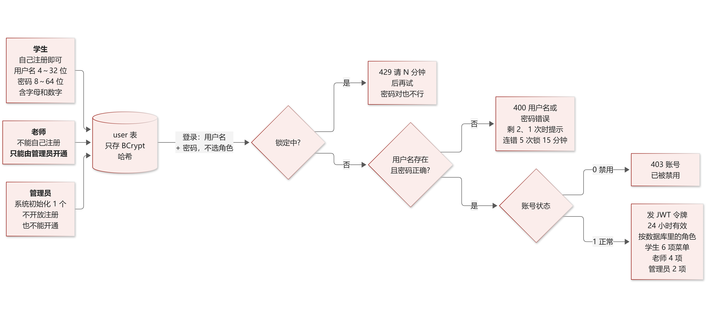
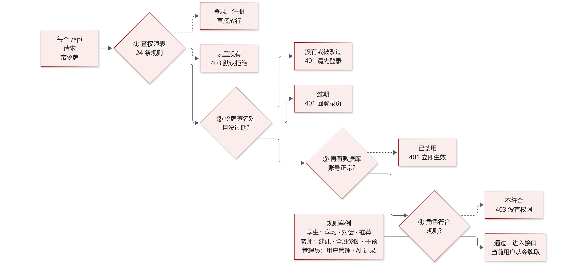

# 01 登录与权限（auth 模块）

> 这一份讲清楚：账号从哪里来、登录时检查什么、登录之后每个请求检查什么、令牌怎么保存和过期、管理员怎么管账号。
> 对照的代码：`auth/`（`AuthService`、`AdminUserService`、`AuthDtos`、`security/JwtService`、`security/AccessRules`、`security/AuthInterceptor`、`security/LoginAttempts`）、`common/CurrentUser`、`common/config/WebConfig`、`user` 表；前端 `views/login/`、`views/admin/UserManage.vue`、`api/request.js`、`router/index.js`。

---

## 一、一句话

**账号按角色开通，登录时过三关拿到 24 小时的令牌；之后每一次调接口，后端都再过四关，才知道“你是谁、能不能用这个功能”。**

| 部分 | 回答的问题 | 图 |
|---|---|---|
| 开户与登录 | 你是不是本人、能不能进来 | T2 |
| 每个请求的检查 | 你现在还能不能用、能不能用这个功能 | T2b |

---

## 二、图 T2：开户与登录

### 2.1 怎么读

- **左边三个框**：按角色写开户方式，都写进 `user` 表。
- **中间三个菱形**：登录时的三步检查，从左到右按顺序。
- **每个菱形往上的分支**：没通过，框里是返回码和提示。
- **最右下**：三关都过了，发令牌、按角色进入。

### 2.2 开户：账号从哪里来

| 角色 | 怎么开户 | 为什么 |
|---|---|---|
| 学生 | **自己注册**（管理员也可以代开） | 学生多，不可能都让管理员录入 |
| 老师 | **不能自己注册，只能由管理员开通** | 老师能建课、能看全班学生的数据，不能让任何人注册成老师 |
| 管理员 | 系统初始化 1 个，**不开放注册，也不能被开通** | 权限最大 |

**怎么保证学生注册不成老师**：注册页没有角色选项，注册接口的请求里**也没有角色字段**，后端一律存成学生。就算有人自己发请求、塞进 `"role":"teacher"`，也会被忽略（有测试）。

**注册规则**（`POST /api/auth/register`）：

| 字段 | 规则 | 不符合时 |
|---|---|---|
| 用户名 | 4～32 位字母、数字或下划线；不能重复 | 格式不对 400；重复 **409**“用户名「X」已被注册” |
| 密码 | 8～64 位，至少一个字母和一个数字 | 400“密码为 8～64 位，至少包含一个字母和一个数字” |
| 姓名 | 必填，不超过 32 字 | 400 |
| 角色 | 没有这个字段，一律是学生 | — |

- 前端按同样规则当场提示，另外检查两次输入的密码是否一致。
- 注册成功直接发令牌，进入学生首页。
- 密码只存 **BCrypt 哈希**（不超过 100 字符），数据库里没有明文；就算数据库泄露，也看不出原密码。

### 2.3 登录：三个判断

接口：`POST /api/auth/login`，只发用户名和密码，**不选角色**（角色以数据库里的账号为准）。

| 顺序 | 判断 | 规则 | 不通过 |
|---|---|---|---|
| ① | 锁定中？ | 同一用户名**连续输错 5 次，锁 15 分钟** | **429**“密码连续错误 5 次，请 N 分钟后再试”；锁住时密码对了也不行 |
| ② | 用户名存在且密码正确？ | BCrypt 比对 | **400**“用户名或密码错误”；**剩 2 次、1 次时**加“还可以再试 N 次” |
| ③ | 账号状态 | 1 正常 · 0 禁用 | **403**“账号已被禁用，请联系管理员” |
| 通过 | 发令牌 | JWT，**24 小时有效** | — |

**每个判断是为了什么**：

| 判断 | 为了什么 | 为什么放在这个位置 |
|---|---|---|
| ① 锁定中？ | 防止有人一直猜密码。不限次数的话，别人可以写程序把常见密码一个个试过去，迟早试中 | 放在第一步：锁住后连密码都不比对，输对也进不去，才真正挡住猜密码 |
| ② 密码正确？ | 确认是本人，只有知道密码的人能登录 | 用户名不存在和密码错误**给同一句提示**，别人没法靠提示判断“这个用户名是真的”再专门猜它 |
| ③ 账号状态 | 让管理员能关掉账号，例如学生毕业、老师离职、账号被盗 | 放在密码之后：只有密码对的人才看到“已被禁用”，不知道密码的人连账号存不存在都不知道 |

**锁定的细节**（`LoginAttempts`）：

- **按用户名计数，不管这个用户名存不存在都一样计数、一样上锁**，所以“还能试几次”“已锁定”这些提示也不会暴露哪些用户名是真的。
- 第 1、2 次只说“用户名或密码错误”；第 3 次起提示剩 2 次、1 次；第 5 次锁定。
- 解锁：15 分钟到期自动解锁；登录成功清零；管理员**重置密码**或**启用账号**也会马上解锁。
- 计数放在内存里，后端重启后清零。

### 2.4 登录页上看到什么

错误显示在登录卡片里（不是一闪而过的提示），密码框自动清空：

| 情况 | 页面上看到的 |
|---|---|
| 没填 | 输入框下红字“请输入用户名”/“请输入密码”，不发请求 |
| 输错第 1、2 次 | “用户名或密码错误” |
| 输错第 3、4 次 | “用户名或密码错误，还可以再试 2 次 / 1 次” |
| 输错第 5 次及锁定期间 | “密码连续错误 5 次，请 N 分钟后再试” |
| 账号被禁用 | “账号已被禁用，请联系管理员” |
| 后端没开 | “连不上服务器，请检查后端是否已启动” |

登录页下方：“还没有账号？学生注册”，以及“老师账号由管理员开通”。

### 2.5 登录之后：按角色进入

| 角色 | 菜单 | 登录后进入 |
|---|---|---|
| 学生 | 首页、课程学习、学习记录、学情诊断、学生画像、学习推荐（**6 项**） | 首页 |
| 老师 | 首页、我的课程、学情诊断、干预管理（**4 项**） | 首页 |
| 管理员 | 用户管理、AI 调用记录（**2 项**） | 用户管理 |

- AI 调用记录从老师端移到了管理员端：这是平台管理的事，不是日常教学。
- 菜单只是隐藏；真正的限制在后端（见 T2b）。

---

## 三、图 T2b：每个请求的检查

### 3.1 怎么读

- 沿**实线**从左上到右下，是每一步都通过。
- 每一步**右边虚线**连的框，是不通过时的返回。
- 左下角“规则举例”：三种角色各能调哪些接口。

### 3.2 四个判断

登录只发生一次；之后**每调一次接口**，后端拦截器（`AuthInterceptor`）都要再确认一次：

| 顺序 | 判断 | 规则 | 不通过 |
|---|---|---|---|
| ① | 查权限表 | 24 条规则，从上往下第一条匹配生效；登录、注册不用令牌 | 表里没有的接口一律 **403**（默认拒绝） |
| ② | 令牌签名对、没过期 | 签名用只有服务器知道的密钥算；过期时间 24 小时 | 没有或被改过 **401**“请先登录”；过期 **401**“登录已过期，请重新登录” |
| ③ | 再查数据库 | 账号还在、状态正常 | 被禁用 **401**“账号已被禁用”：**禁用立即生效** |
| ④ | 角色符合规则 | 角色在这条规则允许的名单里 | **403**“没有权限访问这个接口” |
| 通过 | 进入接口 | 当前用户从令牌取，放进本次请求（`CurrentUser`） | — |

**每个判断是为了什么**：

| 判断 | 为了什么 | 不做会怎样 |
|---|---|---|
| ① 查权限表 | 先确定这个接口谁能调；表里没写的一律拒绝 | 以后新加接口忘了设权限，就谁都能调 |
| ② 令牌 | 确认令牌是我们自己发的、没被改过、还在 24 小时内 | 有人伪造令牌，或把令牌里的“学生”改成“老师”，就能冒充 |
| ③ 再查数据库 | 确认这个账号现在还正常 | 管理员禁用了账号，这个人手上的令牌还能用到 24 小时过期 |
| ④ 角色 | 确认这个角色能用这个接口 | 学生登录后直接调老师的接口，改课程、看全班数据 |

**前端收到后怎么处理**：

- **401**：清掉登录状态，跳回登录页，并记住刚才在哪一页；重新登录后直接回到那一页。
- **403**：页面顶部显示后端给的原因。

### 3.3 权限表（`AccessRules`，24 条）

| 谁能调 | 接口 |
|---|---|
| 不用登录 | `/api/auth/login`、`/api/auth/register` |
| 登录即可 | `/api/auth/**`（我是谁、改密码）、`/api/hello/**` |
| 管理员 | `/api/admin/**`（用户管理）、`/api/ai/logs/**`（AI 调用记录） |
| 学生 | `/api/learn/**`、`/api/dialogue/**`、`/api/recommendations/**`、`/api/assistant/**`、`/api/diagnosis/me`、`/api/profiles/me`、`/api/interventions/mine` |
| 学生 + 老师 | `/api/materials/**`（资料文件：老师预览、学生学习） |
| 老师 | `/api/courses/**`、`/api/chapters/**`、`/api/chapter-items/**`、`/api/knowledge-points/**`、`/api/exercises/**`、`/api/teacher/**`、`/api/diagnosis/**`、`/api/profiles/**`、`/api/interventions/**`、`/api/alerts/**` |

- **顺序有意义**：更具体的写在前面。例如 `/api/diagnosis/me`（学生）写在 `/api/diagnosis/**`（老师）前面。
- **默认拒绝**：表里没有的接口一律 403。
- **自动检查**：测试 `everyEndpointHasAnAccessRule` 逐个检查后端所有接口都有规则，新加接口忘了写，测试直接失败。
- **管理员不能调教学接口**：管理员只管账号和平台，不能替老师改课，也不能看学生的学习数据。

### 3.4 “当前用户”从哪来

| 以前 | 现在 |
|---|---|
| 当前老师固定为 2 号（李老师） | 从令牌里取 |
| 当前学生默认 5 号，用请求头 `X-Demo-Student-Id` 切换 | 从令牌里取；带这个请求头也冒充不了别人（有测试） |

业务代码（建课、学习记录、AI 对话、诊断、干预……）只从 `CurrentUser` 取当前用户，不用关心令牌。

---

## 四、令牌：存在哪、怎么判断过期

### 4.1 关掉页面要重新登录吗？

**不用。24 小时内重新打开都还是登录状态。**

登录成功后，前端把令牌存进浏览器的 **localStorage**（本地存储），之后每个请求自动带上 `Authorization: Bearer 令牌`。

| 操作 | 令牌还在吗 |
|---|---|
| 刷新页面 | 在 |
| 关掉标签页再打开 | 在 |
| 关掉整个浏览器、第二天再打开（24 小时内） | 在 |
| 点“退出登录” | 删掉 |
| 换电脑、换浏览器 | 没有，要重新登录 |

### 4.2 令牌里有什么

令牌分三段：**头.内容.签名**，都是 Base64URL 编码。

| 内容字段 | 含义 | 例子 |
|---|---|---|
| `sub` | 用户 id | 2 |
| `role` | 角色 | teacher |
| `name` | 姓名 | 李老师 |
| `iat` | 签发时间 | 11 月 22 日 10:00 |
| `exp` | 过期时间 = 签发时间 + 24 小时 | 11 月 23 日 10:00 |

- **签名**：用 HMAC-SHA256 和只有服务器知道的密钥，对“头.内容”算出来。没有加新的依赖，用的是 JDK 自带的算法。
- **密钥**：配置 `platform.auth.jwt-secret` 或环境变量 `JWT_SECRET`，不写在代码里。都没配就每次启动随机生成一个；开发阶段数据库也是每次启动重建的，正好一致。

### 4.3 怎么判断过期

**每次请求，后端拿 `exp` 和现在的时间比**（`JwtService.verify`）：

- 还没到：放行。
- 已经过了：返回 **401**“登录已过期，请重新登录”。前端清掉令牌、跳回登录页，记住刚才的页面，登录后回到那一页。

**过期时间改不了**：`exp` 在签名保护的范围里，改一个字签名就对不上，后端判为假令牌（401）。把令牌里的 `student` 改成 `teacher` 也是一样。

### 4.4 现在的不足

- **按签发时间算，不是按最后一次操作算**：令牌签发满 24 小时，不管这个人是不是正在操作，下一次请求都会被要求重新登录。
- **决定先保留 24 小时**。改进方法见第七节（自动续期、记住我）。

### 4.5 资料文件怎么带令牌

视频、文档用 `<video>`、`<a>` 打开，浏览器不会给它们加请求头。所以**只有** `/api/materials/**` 允许把令牌放在网址里（`?token=`）。别的接口这样传无效，实测返回 401。

---

## 五、管理员：用户管理

接口 `/api/admin/users`，页面“用户管理”，只有管理员能用。

| 功能 | 规则 |
|---|---|
| 人数统计 | 老师、学生、管理员、已禁用各多少 |
| 列表 | 按角色筛选；按用户名或姓名搜索；每页 10 条（最多 50）；新建的在前；**显示“锁定中”** |
| 开通账号 | **只能开老师或学生**，不能开管理员；用户名、密码规则同注册；重复 409 |
| 禁用 | 弹窗确认；禁用后这个人的令牌**下一次请求就 401**，已打开的页面退回登录页 |
| 启用 | 恢复登录，同时解锁 |
| 重置密码 | 新密码同样规则，弱密码当场被拦；**同时解除锁定** |
| 不能做 | 修改自己、修改任何管理员账号（403），避免把管理员锁在外面 |

**所有角色都能改自己的密码**（`PUT /api/auth/password`，侧边栏头像菜单 → 修改密码）：要输原密码；新密码同样规则；不能和原密码一样。

---

## 六、测试

### 6.1 单元测试

后端 **106 个测试全部通过**：原来的 96 个，加上新写的 `AuthSecurityTest` 10 个。

| 测试 | 验证什么 |
|---|---|
| loginGivesATokenThatIdentifiesTheUser | 登录拿到令牌，`/me` 认出是谁 |
| missingBrokenOrTamperedTokenIs401 | 没令牌、乱写、把令牌里的 student 改成 teacher → 401 |
| expiredTokenIs401WithAClearMessage | 过期 → 401“登录已过期，请重新登录” |
| eachRoleOnlyReachesItsOwnEndpoints | 三种角色各 3～4 个接口，能调的和不能调的都测 |
| currentUserComesFromTheToken | 两个老师看到的课程数不同；学生带演示请求头也冒充不了别人 |
| everyEndpointHasAnAccessRule | 后端所有接口都有权限规则 |
| studentsCanRegisterButNeverAsTeacher | 注册成学生；塞 role 无效；重名 409；弱密码、短用户名 400 |
| fiveWrongPasswordsLockTheAccountUntilAdminResets | 第 3、4 次提示剩几次；第 5 次锁；锁住后密码对也不行；不存在的用户名同样计数；管理员重置后能登录 |
| disablingAnAccountCutsOffItsTokenImmediately | 禁用后旧令牌马上 401，重新登录 403 |
| adminCreatesTeachersButCannotTouchAdmins | 开通的老师账号能登录；不能开管理员；不能禁用管理员 |

原来的 `AuthControllerTest` 4 个测试也补了检查：登录返回令牌，有效期 24 小时。

其他业务测试默认关掉登录检查（`src/test/resources/config/application.yml`），当前用户用演示身份，专心测业务逻辑；登录和权限由上面 10 个测试单独打开检查来测。

### 6.2 浏览器实测（前后端真实运行）

1. 不填 → 输入框下提示。
2. 输错 1 次 → 卡片里“用户名或密码错误”，密码框清空。
3. 第 3 次 → “还可以再试 2 次”；第 5 次 → 锁定；再输对的密码 → 仍然“请 15 分钟后再试”。
4. 管理员登录 → 直接进入用户管理；teacher01 显示“锁定中”。重置密码时弱密码当场被拦；重置后锁定解除，teacher01 用新密码登录成功。
5. 学生03 的令牌能调学生接口，调老师接口 403。管理员禁用学生03 → 这个令牌下一次请求 401“账号已被禁用”，重新登录 403；之后再启用。
6. 注册：弱密码、两次不一致当场提示；用已有用户名 → “已被注册”；新用户名 → 直接进入学生首页，看到的是自己的空数据。
7. 老师 teacher01：菜单 4 项，我的课程只有自己的 3 门。
8. 学生01：学情诊断、课程学习正常，控制台没有报错。
9. 资料文件：不带令牌 401；网址带令牌能通过检查；别的接口在网址里带令牌无效。

---

## 七、还没做的

| 项目 | 说明 |
|---|---|
| 令牌自动续期（建议优先做） | 令牌快过期时（例如剩不到 2 小时），后端在响应里顺便发一个新令牌，前端替换旧的。一直在用的人不会被中途踢出去；连续 24 小时不用才要重新登录。只改拦截器和前端请求两处 |
| “记住我” | 登录页加勾选框：勾上发 7 天的令牌，不勾发 24 小时。自己的电脑久一点，公用电脑短一点 |
| 退出登录让令牌立即失效 | 现在退出只删前端保存的令牌，令牌本身 24 小时内仍有效。要做就加“令牌黑名单”或“令牌版本号” |
| 锁定计数放到共享存储 | 现在放内存，重启清零；部署多台服务器要换成 Redis 之类的共享存储 |
| 锁定可能被恶意利用 | 别人故意输错 5 次就能把某个账号锁 15 分钟；管理员可以重置密码马上解锁。以后可以改成按 IP + 用户名一起计数 |
| 学生加入班级、选课 | 现在注册后能看到所有已发布的课程；`user.clazz_id` 字段已经留好 |
| 首次登录强制改密码 | 管理员开的账号用的是初始密码 |
| 演示账号的密码 | 种子数据的演示密码比新规则短，只用于演示；新建和修改的密码都按新规则 |

---

## 八、讲稿

**T2 开户与登录（约 40 秒）**

> 账号按角色有不同的来源：学生自己注册，角色固定是学生；老师不能自己注册，只能由管理员开通，因为老师能建课、能看全班学生的数据；管理员是系统初始化的，不开放注册。密码只存 BCrypt 哈希。
>
> 登录时按三步检查。先看这个用户名是不是因为连续输错 5 次被锁了 15 分钟。再比对密码，用户名不存在和密码错误给同一句提示，避免别人试出哪些账号存在。密码对了才看账号有没有被禁用。全部通过后发一个 24 小时有效的令牌，前端按账号的角色显示菜单：学生 6 项、老师 4 项、管理员 2 项。

**T2b 每个请求的检查（约 40 秒）**

> 登录之后，每一次调接口都要过四步。先查权限表，表里没写的接口一律拒绝。再验证令牌，没有、被改过或者过期，都退回登录页。然后再查一次数据库，所以管理员禁用一个账号是马上生效的。最后看角色对不对，学生调老师的接口会被拒绝。都通过了，接口才知道当前用户是谁。
>
> 令牌存在浏览器本地，关掉页面也还在，24 小时内打开不用重新登录。过期时间写在令牌里，并且受签名保护，改不了。

---

## 九、被问到时

| 问题 | 回答 |
|---|---|
| 为什么登录不能选角色？ | 角色写在账号里，由后端决定；能选的话，学生就能把自己选成老师 |
| 老师怎么开户？ | 只能由管理员在“用户管理”里开通；注册页没有老师选项，注册接口也不接收角色 |
| 为什么用户名不存在和密码错误提示一样？ | 不让别人试出哪些用户名是真的 |
| 锁定会不会被人恶意锁别人的号？ | 会，这是锁定的代价；管理员可以重置密码马上解锁。以后可以按 IP 和用户名一起计数 |
| 关掉页面要重新登录吗？ | 不用。令牌存在浏览器本地，关掉页面、关掉浏览器都还在，24 小时内直接进入 |
| 怎么知道令牌过期？ | 过期时间写在令牌里，受签名保护改不了；后端每次请求拿它和现在比，过期返回 401，前端回登录页，登录后回到原来的页面 |
| 正在用的时候到 24 小时会被踢吗？ | 现在会，按签发时间算；下一步加自动续期 |
| 为什么每次请求都查数据库？ | 为了禁用立即生效；只是按主键查一行，代价很小 |
| 前端隐藏菜单够不够？ | 不够，菜单只是界面；真正的限制在后端四步检查，直接调接口也绕不过去 |
| 退出登录后令牌还能用吗？ | 现在 24 小时内还能用；以后加令牌黑名单 |
| 新加接口忘了设权限怎么办？ | 默认拒绝；而且有测试检查所有接口都有规则，忘了写测试会失败 |
| 密码存在哪？ | 只存 BCrypt 哈希，不存明文；数据库泄露也看不出原密码 |
| 为什么不用 Spring Security？ | 我们需要的只是令牌和按路径的角色检查，自己写一个拦截器更容易看懂、也更容易测试；以后功能变复杂再换 |
