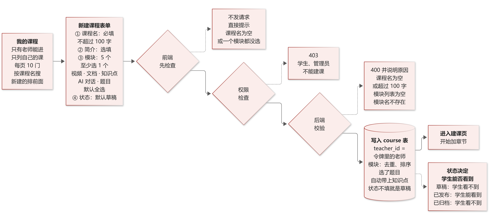
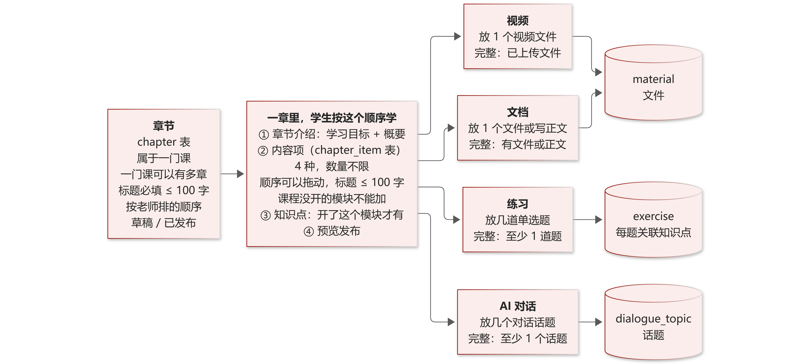
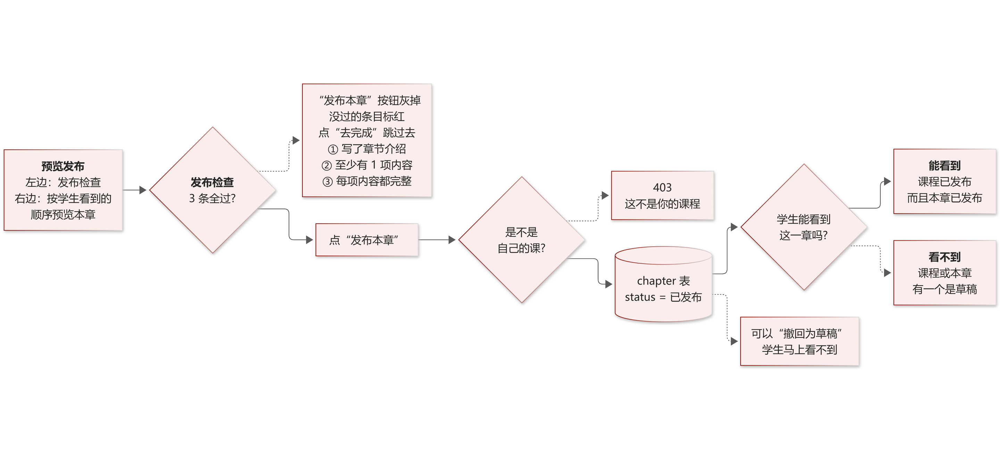
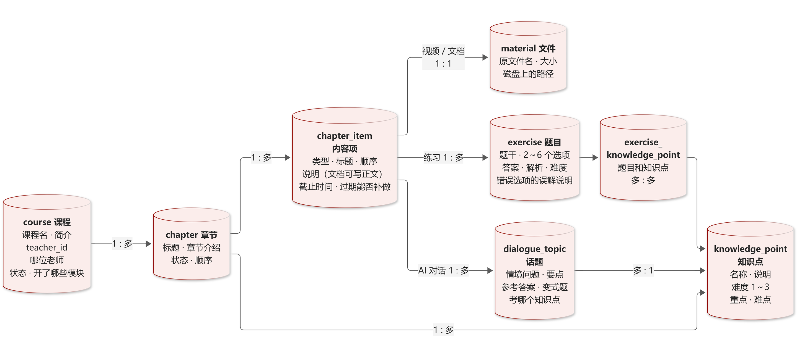
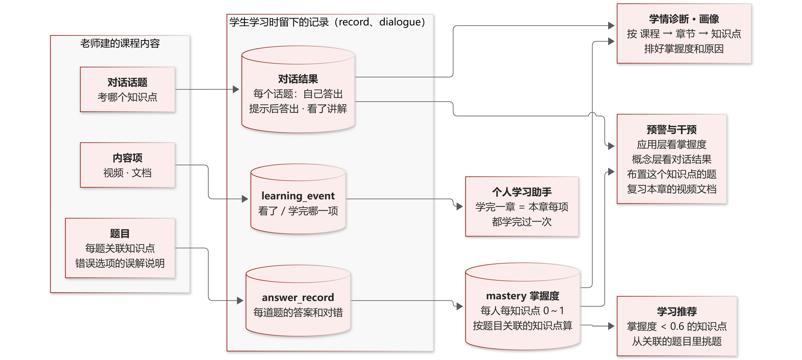

# 02 课程内容（course）

> 本文档目前写到 **创建课程、章节和内容项、发布一章、课程数据和其他模块的关系、不同场景**。知识点、题目、资料（文件上传）的录入细节随后补在后面。
> - 数据和模块关系：另外对照了 `schema.sql` 全部表，以及 `RecordService`、`MasteryService`、`DiagnosisService`、`ProfileService`、`RecommendService`、`InterventionService`、`LayerService`、`AssistantService` 读课程数据的地方。
> 规则都对照过代码，以代码为准：
> - 创建课程：`CourseService`、`CourseSaveRequest`、`CourseController`、`course` 表（`schema.sql`）、前端 `CourseManage.vue`、`CourseFormDialog.vue`、`courseModules.js`。
> - 章节和内容项：`ChapterService`、`ChapterItemService`、`ChapterSaveRequest`、`ChapterItemSaveRequest`、`OrderRequest`、`chapter` / `chapter_item` 表、`LearnService`、前端 `CourseBuilder.vue`、`chapter/ChapterIntro.vue`、`chapter/ChapterPublish.vue`。

---

## 一、一句话

老师先建一门课（选用哪些模块），再在建课页里一章一章地加内容：每章有章节介绍、若干内容项（视频、文档、练习、AI 对话）、知识点，最后检查完整再发布。**课程和章节都发布了，学生才看得到这一章。**

| 图 | 回答什么问题 |
|---|---|
| T3 创建课程 | 谁能建课？要填什么？前端和后端各检查什么？存进哪里？状态有什么用？ |
| T4 章节与内容项 | 一门课里面是什么结构？一章由哪几部分组成？4 种内容项各放什么、存在哪张表、什么算“完整”？ |
| T5 发布一章 | 一章要满足什么才能发布？发布时后端查什么？学生什么时候能看到？ |
| T6 课程内容的数据 | 课程模块有哪几张表、每张存什么、表之间什么关系、为什么这样存？ |
| T7 课程内容被谁用 | 其他模块（记录、诊断、推荐、干预、助手）用课程的哪些数据、拿来做什么？ |
| 第七节 不同场景 | 学生没做、快到期、老师改了已学过的内容、越权误操作时，系统怎么处理？ |

---

## 二、T3 创建课程

### 2.1 怎么读这张图

- 从左往右看：我的课程 → 新建课程表单 → 三道检查（菱形）→ 写入 `course` 表 → 进入建课页。
- 每个菱形向上的**虚线**表示不通过，框里写返回什么、为什么。
- 三道检查依次是：前端先检查、权限检查、后端校验。
- 右下角的虚线框说明课程**状态**对学生端的影响。

### 2.2 我的课程（入口）

| 项目 | 规则 | 依据 |
|---|---|---|
| 谁能进 | **只有老师**。`/api/courses/**` 在权限表里只给老师；学生、管理员调用返回 **403** | `AccessRules` |
| 列哪些课 | **只列当前老师自己的课**；老师是谁从令牌里取 | `CourseService.pageMine` → `CurrentUser.teacherId()` |
| 分页 | 每页 **10 门** | 前端 `query.size = 10`；后端默认 `size=10` |
| 搜索 | 按课程名**模糊搜索**（包含关键词即可） | `like(name, keyword)` |
| 排序 | **新建的排前面**（按 id 倒序） | `orderByDesc(id)` |
| 每行显示 | 课程名、简介、模块标签、章节数、状态标签；操作：管理内容、设置、删除 | `CourseManage.vue` |

演示数据（`data.sql`）：共 **6 门课**。

- 2 号老师 3 门：软件测试（已发布）、软件工程导论（已发布）、软件设计与体系结构（草稿，只开文档、知识点、题目 3 个模块）。
- 3 号老师 2 门：需求工程（已发布）、软件项目管理（已归档）。
- 4 号老师 1 门：UML 建模（已发布）。
- 合计 4 门已发布、1 门草稿、1 门已归档。

所以 2 号老师登录后，“我的课程”里只有 3 门，看不到另外 3 门。

### 2.3 新建课程表单：4 项

| # | 字段 | 规则 | 打开表单时的默认值 |
|---|---|---|---|
| ① | 课程名 | **必填，不超过 100 字**（输入框最多只能打 100 字）；保存时去掉首尾空格 | 空 |
| ② | 简介 | 选填，长度不限（数据库是 TEXT 类型） | 空 |
| ③ | 模块 | 5 个：视频、文档、知识点、AI 对话、题目。**至少选 1 个** | **5 个全选** |
| ④ | 状态 | 3 种：草稿、已发布、已归档 | **草稿** |

5 个模块各自是什么（页面上每个模块卡片下的说明）：

| 模块 | key | 说明 |
|---|---|---|
| 视频 | video | 上传教学视频，一章可以放好几个 |
| 文档 | document | 课件、PDF、Word，或直接写一段阅读 |
| 知识点 | knowledge | 整理本章知识点，标重点难点 |
| AI 对话 | dialogue | 学完和 AI 对话，巩固理解 |
| 题目 | exercise | 单选题，每题关联知识点 |

- 章节介绍和预览发布**每门课都有**，不算模块，不用选。
- **题目和知识点联动**：题目要关联知识点，所以：
  - 选了题目却没选知识点 → 自动勾上知识点；
  - 题目开着时取消知识点 → 题目也一起取消。
- 表单下方的提示：以后可以在“课程设置”里改模块，**关掉的模块内容不会删除**。

### 2.4 三道检查

#### ① 前端先检查（不发请求）

| 情况 | 结果 |
|---|---|
| 课程名为空（只有空格也算空） | 提示“请填写课程名”，不发请求 |
| 一个模块都没选 | 提示“至少选一个模块”，不发请求 |

**为什么要有**：最常见的漏填，在浏览器里就能发现，不用等一次网络来回，老师马上看到提示。
**为什么不够**：前端检查可以被绕过（比如直接调接口），所以后端还要再检查一遍，见 ③。

#### ② 权限检查（每个请求都过，详见 01 文档 T2b）

| 情况 | 结果 |
|---|---|
| 没登录、令牌被改过或过期 | **401**，前端回登录页 |
| 学生或管理员调 `POST /api/courses` | **403**“没有权限访问这个接口” |
| 老师 | 通过，并从令牌里得到“当前老师是谁” |

**为什么要有**：建课只能是老师的事；而且课程归谁，必须由后端从令牌里取，**不能让前端在请求里自己填 teacher_id**，否则可以冒充别的老师建课。

#### ③ 后端校验

| 情况 | 返回的提示 |
|---|---|
| 课程名为空或只有空格 | 400“课程名不能为空” |
| 课程名超过 100 字 | 400“课程名不超过 100 字” |
| 状态不是 draft / published / archived 之一 | 400“状态只能是 draft / published / archived” |
| 模块列表是空的 | 400“至少选一个模块” |
| 模块名不存在（比如传了 game） | 400“没有这个模块：game” |

- 多个字段同时出错时，提示用“；”拼成一句话一起返回。
- 这类业务错误的 HTTP 状态码是 200，错误码 400 和提示放在返回的 JSON 里，前端读出提示弹出来（项目统一约定，见 `GlobalExceptionHandler`）。只有登录和权限的 401、403 用真正的 HTTP 状态码。

**为什么要有**：数据库的 `name` 字段是 `VARCHAR(100) NOT NULL`，不检查的话，超长或为空会在写库时报一个看不懂的数据库错误；模块名不检查的话，库里会存进一个不存在的模块，后面加内容时判断就乱了。

### 2.5 写入 course 表

| 字段 | 写什么 |
|---|---|
| name | 去掉首尾空格后的课程名 |
| description | 简介，原样保存 |
| teacher_id | **令牌里的当前老师**（不看前端传什么） |
| status | 传了就用；**没传就是 draft 草稿** |
| modules | 逗号分隔的模块 key，例如 `document,knowledge,exercise` |
| created_at / updated_at | 自动填当前时间 |
| deleted | 0（以后删除是逻辑删除，改成 1，不真正删行） |

模块在存之前会整理：

1. **不传 modules 字段 = 全部 5 个**（兼容老的调用方式）。
2. **去重**，并**按固定顺序排**：视频、文档、知识点、AI 对话、题目。
3. **选了题目，自动带上知识点**（后端再保证一次，不依赖前端）。

例子：传 `["exercise", "document"]`，存成 `document,knowledge,exercise`（测试 `courseOnlyAcceptsChosenModules` 验证的就是这个）。

### 2.6 保存之后

- 页面提示“课程已创建，接着添加章节”，**直接跳到这门课的建课页**，从加第 1 章开始。
- 进建课页时后端还会再查一次：这门课**是不是当前老师的**，不是返回 **403**“这不是你的课程，不能修改”。改课程、加章节、加章节里的内容，都要先过这一关（`CourseService.requireOwned`）。

### 2.7 状态有什么用

| 状态 | 学生端 | 老师端 |
|---|---|---|
| 草稿 draft（默认） | **看不到**：课程列表不出现；直接打开这门课返回“课程不存在” | 正常编辑 |
| 已发布 published | **看得到**，可以学习 | 正常编辑 |
| 已归档 archived | **看不到**（同草稿） | 还在“我的课程”里，可以再改回已发布 |

- 学生端只列已发布的课（`CourseService.pagePublished`），打开课程时也再查一次状态（`LearnService.course`）。
- 课程发布了也不代表每章都能看：**章节也有自己的草稿 / 已发布状态**，学生只看到已发布的章节（章节部分再详细写）。
- **默认草稿的原因**：老师刚建课时内容是空的，如果默认发布，学生会看到一门什么都没有的课。

### 2.8 模块的作用（建课时选的模块，后面怎么用）

- 建课页里“添加内容”只列开了的模块（视频、文档、练习、AI 对话）；没开知识点模块，就不显示知识点标签。
- 后面加内容时后端会检查：没开视频模块却加视频，返回 400“这门课没有开启「视频」模块，可以在课程设置里打开”（`CourseService.requireModule`）。
- 演示：“软件设计与体系结构”只开了文档、知识点、题目，所以这门课不能加视频和 AI 对话。

### 2.9 同一张表单用来改课程（“设置”）

- “我的课程”每行的“设置”打开的是**同一张表单**，内容填好当前值，规则和新建完全一样。
- 只能改自己的课，别人的课返回 **403**。
- 删除：只能删自己的课；**课程下还有章节时不能删**，返回 409“这门课还有 N 个章节，请先删除章节”；删除是逻辑删除。

---

## 三、T4 章节与内容项

### 3.1 怎么读这张图

- 从左往右是“一门课里面装了什么”：章节 → 一章的组成 → 4 种内容项 → 各自的数据存在哪张表。
- 中间的框按**学生学习的顺序**列出一章的 4 个部分；建课页左边的大纲也是这个顺序。
- 右边每种内容项的框写了两件事：里面放什么、什么时候算**完整**（发布时要检查，见 T5）。
- 圆柱是数据库表。

### 3.2 章节

| 项目 | 规则 | 依据 |
|---|---|---|
| 属于谁 | 一章属于一门课（`course_id`）；**建好后不能换课程** | `ChapterSaveRequest` 注释 |
| 数量 | 一门课的章数不限 | — |
| 标题 | **必填，不超过 100 字**；保存时去掉首尾空格 | `@NotBlank`、`@Size(max = 100)` |
| 添加时的默认标题 | 前端弹框里预填“第 N 章 ”（N = 现有章数 + 1），老师接着写 | `CourseBuilder.addChapter` |
| 章节介绍 | 选填，长度不限（TEXT）；页面上可以一键“插入模板”：学习目标 + 概要 | `ChapterIntro.vue` |
| 状态 | 2 种：草稿 draft、已发布 published；**新建默认草稿** | `ChapterSaveRequest`、`ChapterService.copy` |
| 顺序 | 新建的排在最后；可以**拖动**或用菜单“上移 / 下移”调整 | `ChapterService.reorder` |
| 层级 | 只有一级（章）；表里预留了 `parent_id`，现在不用 | `schema.sql` |
| 删除 | 本章**还有内容项或知识点时不能删**，返回 409“本章还有 3 项内容、2 个知识点，请先删除”；删除是逻辑删除 | `ChapterService.delete` |

添加一章后，页面直接打开这一章的“章节介绍”，提示“章节已创建，先写章节介绍，再添加内容”。

### 3.3 一章的 4 个部分（学生按这个顺序学）

| # | 部分 | 有没有 | 作用 |
|---|---|---|---|
| ① | 章节介绍 | **每章都有** | 学生进入本章最先看到的学习目标和概要 |
| ② | 内容项 | 数量不限，可以是 0 个（但 0 个不能发布） | 学生真正学习的内容，按老师排的顺序 |
| ③ | 知识点 | **课程开了知识点模块才有** | 老师整理用：题目和 AI 对话都关联知识点，学情诊断按知识点统计 |
| ④ | 预览发布 | **每章都有** | 检查完整、按学生看到的样子预览、发布或撤回 |

- 建课页右边底部有“下一步”按钮，按 ① → 每个内容项 → ③ → ④ 的顺序带老师走一遍。
- 当前打开的是哪一章、哪一部分记在网址里（例如 `?chapter=3&view=item:12`），**刷新页面还停在原处**。

### 3.4 内容项：4 种

| 类型 | key | 里面放什么 | 数据存在哪 | 什么算完整 |
|---|---|---|---|---|
| 视频 | video | **1 个视频文件**（一章要几个视频就加几个视频项） | `material` 表（文件） | 已上传文件 |
| 文档 | document | **1 个文件**（课件、PDF、Word），或者**不传文件直接写正文** | `material` 表；正文存在内容项的 `description` | 有文件**或**有正文 |
| 练习 | exercise | 几道单选题（一章可以有好几次练习） | `exercise` 表，每题关联知识点 | **至少 1 道题** |
| AI 对话 | dialogue | 几个对话话题，学生学到这里时按话题顺序和 AI 对话 | `dialogue_topic` 表 | **至少 1 个话题** |

所有内容项共用的规则：

| 项目 | 规则 | 依据 |
|---|---|---|
| 存在哪 | `chapter_item` 表：所属课程、所属章节、类型、标题、说明、文件 id、顺序 | `schema.sql` |
| 类型 | 只能是上面 4 种之一，否则 400；不选类型 400“请选择内容类型” | `ChapterItemSaveRequest`、`ChapterItemService.create` |
| 标题 | **必填，不超过 100 字**（学生在章节里看到的名字）；前端预填“视频：”“阅读：”“练习：”“AI 对话：” | `@NotBlank`、`@Size(max = 100)`；`ITEM_TYPES` |
| 课程模块 | 内容项的类型名和课程模块名是同一套：**课程没开这个模块就不能加**，返回 400“这门课没有开启「视频」模块，可以在课程设置里打开”；建课页的“添加内容”也只列开了的类型 | `requireOwnedWithModule` |
| 数量、顺序 | 一章里数量不限；可以拖动或上移 / 下移，**只能在本章里调**，不能拖到别的章。学习顺序固定为“资料（视频、文档）→ AI 对话 → 练习”：调顺序时违反就拒绝并提示；新建的排在自己那一类的最后（新加的 AI 对话自动排到练习前面） | `ChapterItemService.reorder`、`normalizeOrder` |
| 能改什么 | 只能改标题和说明；**不能换章节、不能换类型** | `ChapterItemSaveRequest` 注释 |
| 文件 | 只有视频和文档能上传文件，其他类型上传返回 400；再传一次就**替换**旧文件，旧文件一起删掉（细节在资料部分写） | `uploadFile` |
| 删除 | **连同里面的东西一起删**：文件、题目（及题目和知识点的关联）、话题。删之前前端会提示，例如“里面的 2 道题也会一起删除” | `ChapterItemService.delete`（`@Transactional`） |

### 3.5 每一步谁能做（归属检查）

章节和内容项的**每一次新增、修改、删除、调顺序**，后端都会顺着往上查到课程，确认**是当前老师自己的课**，否则返回 403“这不是你的课程，不能修改”：

- 内容项 → 所属章节 → 所属课程 → `course.teacher_id` 是否等于令牌里的老师。
- 调顺序时还会检查传来的每个 id **确实属于这门课 / 这一章**，否则返回 400“章节不属于这门课”或“内容项不属于本章”。
- 调顺序是一个事务（`@Transactional`）：中途出错就全部回滚，**不会只改了一半顺序**。

### 3.6 演示数据

“软件测试”（2 号老师，已发布）有 2 章：

| 章 | 状态 | 内容 |
|---|---|---|
| 第 1 章 边界值分析 | 已发布 | 章节介绍；3 个内容项：阅读（文档正文）→ 练习：边界值小测（2 道题）→ AI 对话：订单数量怎么测（2 个话题）；2 个知识点 |
| 第 2 章 等价类划分 | 草稿 | 只有标题，还没有内容（演示：草稿章节学生看不到） |

---

## 四、T5 发布一章

### 4.1 怎么读这张图

- 从左往右：预览发布页 → 发布检查 → 点“发布本章” → 后端检查归属 → 写入 `chapter` 表 → 学生能不能看到。
- 菱形向上的虚线是不通过；最右边两个框是学生端的结果。
- 下面的虚线框表示发布后也可以撤回。

### 4.2 发布检查：3 条

| # | 检查 | 不通过时 |
|---|---|---|
| ① | 写了章节介绍（不能只有空格） | 标红，点“去完成”跳到章节介绍 |
| ② | 至少有 1 项内容 | 标红 |
| ③ | **每项内容都完整**（视频有文件；文档有文件或正文；练习至少 1 道题；AI 对话至少 1 个话题） | 每个不完整的内容项单独一行标红，写明缺什么（例如“还没有题目”），点“去完成”跳过去 |

- 3 条全过之前，“发布本章”按钮是**灰的，点不了**。
- 同一页右边是**预览**：按学生看到的顺序列出章节标题、章节介绍、每个内容项和它的情况。
- “完整”由后端算好，随内容项一起返回（`ChapterItemView.ready`），前端只负责显示。

**为什么要有**：防止学生打开一章，看到的是空的视频、没有题的练习或没有话题的对话。

### 4.3 发布和撤回

| 操作 | 后端做什么 | 结果 |
|---|---|---|
| 发布本章 | 检查这一章的课程是不是当前老师的（不是返回 403），把 `chapter.status` 改成 published | 提示“已发布，学生可以看到本章” |
| 撤回为草稿 | 同样检查归属，改回 draft | 提示“已撤回为草稿”，**学生马上看不到** |

### 4.4 学生什么时候能看到一章

**课程已发布** 而且 **本章已发布**，两个条件同时满足才看得到：

| 课程 | 章节 | 学生 |
|---|---|---|
| 已发布 | 已发布 | **看得到**，可以学习、做题、对话 |
| 已发布 | 草稿 | 课程能进，但大纲里没有这一章 |
| 草稿或已归档 | 任意 | 整门课都看不到 |

- 学生端打开课程时后端只返回已发布的章节（`LearnService.course`）。
- 学生做练习、交答案时，后端还会**再查一次这一章是不是已发布**，不是就拒绝（`LearnService.exercises`）。所以即使知道题目的地址，也做不了草稿章节的题。

**为什么章节也要有状态**：老师可以先发布课程和写好的第 1 章，后面的章边写边发布，不用等整门课都写完。

---

## 五、T6 课程内容的数据：存什么、为什么这样存

### 5.1 怎么读这张图

- 每个圆柱是一张表，框里写这张表**存了什么**。
- 箭头上的“1 : 多”表示一对多：例如一门课有多章、一章有多个内容项。
- 题目和知识点是**多对多**，中间用一张关联表 `exercise_knowledge_point` 连起来。
- 右下角的知识点是**汇合点**：题目和对话话题最后都指向它。

### 5.2 一句话说清关系

> **课程 → 章节 → 内容项** 是给学生“学”的顺序；**知识点** 是给系统“算”的单位。题目和话题一头挂在内容项下面（学生在哪里做），一头连到知识点（做的是哪个知识点）。

为什么要这样分两条线：

- 学生看到的是“第 1 章 → 视频、文档 → AI 对话 → 练习”，这是**学习顺序**，由内容项决定。资料 → AI 对话 → 练习这个先后是固定的（2026-11-28 定）。
- 老师和系统关心的是“这个学生边界值掌握得怎么样”，这是**知识点**。一个知识点的题可能分散在好几次练习里，一次练习也可能考好几个知识点。
- 所以题目同时记两件事：`item_id`（属于哪一次练习）和关联的知识点。掌握度、诊断、推荐、预警全部按知识点算，不受老师怎么排内容影响。

### 5.3 每张表存什么、为什么

| 表 | 存什么 | 为什么要存 / 为什么这样存 |
|---|---|---|
| `course` 课程 | 课程名、简介、`teacher_id`、状态（草稿 / 已发布 / 已归档）、开了哪些模块（逗号分隔） | `teacher_id` 决定谁能改；状态决定学生能不能看到；模块决定能加哪几类内容。模块只有 5 个、只用来判断“开没开”，所以存成一个字符串，不单独建表 |
| `chapter` 章节 | 课程 id、标题、章节介绍、状态、顺序号；预留 `parent_id` | 章节有自己的状态，可以一章一章发布；顺序号让老师自由排；`parent_id` 留给以后加“节” |
| `chapter_item` 内容项 | 课程 id、章节 id、类型、标题、说明（文档可直接写正文）、文件 id、顺序号、**截止时间**、**过期能否补做** | 一章内容的**最小单位**。学生“学完了哪一项”、干预“让学生复习哪几项”都按内容项记。多存一份课程 id，按课程统计时不用再查章节 |
| `material` 文件 | 课程 id、章节 id、原文件名、文件大小、类型、**磁盘上的相对路径**、上传人 | 文件本身存在磁盘上，表里**只存路径**，数据库不会因为视频变得很大；存原文件名是为了下载时还叫原来的名字 |
| `exercise` 题目 | 章节 id、所属练习 `item_id`、题干、2～6 个选项、答案、解析、难度 1～3、**每个错误选项的误解说明**、出题人 | 误解说明是为了“为什么错”：学生选错时显示这条说明，诊断和干预统计“反复出现的误解”也用它。难度用来推荐难度接近的题 |
| `exercise_knowledge_point` 关联 | 题目 id、知识点 id（两个一起不能重复） | 一道题可以考几个知识点，一个知识点有很多题，所以是多对多。**每道题至少关联 1 个知识点**，否则这道题做了也算不进任何掌握度 |
| `knowledge_point` 知识点 | 章节 id、名称、说明、难度 1～3、是否重点、是否难点、顺序号 | 系统计算的单位：掌握度、诊断、推荐、预警、干预全部按知识点。重点、难点给老师和诊断页标出来 |
| `dialogue_topic` 话题 | 所属 AI 对话项、**考哪个知识点**、情境问题、要点、参考答案、提示、变式题 | 话题连到知识点，学生对话的结果才能和练习的结果放在同一个知识点上比较（细节在 03 模块写） |

### 5.4 几个共同的设计

| 设计 | 做法 | 目的 |
|---|---|---|
| 逻辑删除 | 课程、章节、内容项、知识点、题目、文件、话题删除时只把 `deleted` 改成 1 | 学生的作答记录还指向这些题；真删了，学习记录里就会出现“找不到的题” |
| 删除保护 | 课程有章节不能删；章节有内容或知识点不能删；知识点被题目关联不能删（409） | 防止一下删掉一大片，或者留下指向不存在知识点的题目 |
| 一起删 | 删内容项时，里面的文件、题目、话题一起删 | 它们只属于这一项，留着就成了没有归属的数据 |
| “完整”不存 | 内容项完不完整每次现算（有没有文件、有几道题） | 存下来就要在每次传文件、加题、删题时同步更新，容易对不上 |
| 冗余的课程 id | 内容项、知识点、题目、文件都多存一份 `course_id` | 按课程统计时直接查，不用一层层往上找 |
| 不建外键约束 | 表之间的关系由代码保证（`require`、`requireOwned`） | 和逻辑删除配合：被“删除”的行还在，外键约束反而碍事 |

---

## 六、T7 课程内容被谁用：和其他模块的关系

### 6.1 怎么读这张图

- 左边：老师建的课程内容，只列和其他模块有关的 3 样。
- 中间：学生学习时留下的记录。
- 右边：读这些记录的模块。
- 从左往右就是“**老师建了什么 → 学生做了什么 → 系统得出什么**”。

### 6.2 课程内容是整个系统的底座

课程模块**只负责存内容，不存学生的任何数据**。学生的数据都存在别的模块里，但每一条都指回课程内容：

| 学生的数据（哪个模块） | 指向课程内容的哪里 | 用来做什么 |
|---|---|---|
| `learning_event` 学习行为（record） | 内容项 id | 记“看了哪一项、学完哪一项、看了多久” |
| `answer_record` 答题记录（record） | 题目 id、所属练习 id、课程 id | 每道题的答案和对错；**每次作答都新增一条，重做也保留历史** |
| 对话结果（dialogue） | 话题 id → 知识点 | 每个话题是自己答出、提示后答出还是看了讲解 |
| `mastery` 掌握度（diagnosis） | 知识点 id | 每人每个知识点一行，0～1 |
| `alert` / `intervention` 预警和干预（intervention） | 课程 id、知识点 id；布置的题目 id、复习的内容项 id | 哪个学生哪个知识点有问题、布置了什么 |

### 6.3 每个模块用课程内容的哪一部分

| 模块 | 读课程的什么 | 怎么用 |
|---|---|---|
| 学习记录（record） | 内容项、题目 | 学生学完一项、交一次卷就存一条；学习记录页按课程 → 章节显示进度 |
| 掌握度（diagnosis） | **题目和知识点的关联** | 学生交卷后，找出这几道题关联的知识点，用这些知识点上**最近 10 次**作答重算掌握度（越近的权重越大，每往前一次乘 0.8；不到 3 次再打折） |
| 学情诊断、画像（diagnosis、profile） | 课程 → 章节 → 知识点的结构；**错误选项的误解说明**；话题 | 按课程、章节、知识点排好掌握度；说明为什么低：最近几次的对错、答错时暴露的误解、对话里每个话题的结果 |
| 学习推荐（recommend） | `remedy_round`、`class_push` | 小助手的延伸：保存小助手出的补练、拓展和学生接收的老师推送（2026-11-28 起不再从练习里挑题） |
| 预警与干预（intervention） | 知识点、题目、话题、本章的视频和文档 | **两层判断**：应用层看这个知识点的掌握度，概念层看考这个知识点的话题结果。布置时从这个知识点关联的题里选（最多 3 道），复习内容取知识点所在章的视频和文档项 |
| 个人学习助手（assistant） | 已发布课程的章节和内容项、知识点 | **学完一章 = 本章每个内容项都学完过一次**；学完后按知识点给个人总结 |
| AI 对话（dialogue） | AI 对话项和它下面的话题 | 学生在哪个对话项开始，就只用这一项下的话题，按老师排的顺序问 |

### 6.4 为什么这样设计

1. **知识点做汇合点**：练习（会不会用）和对话（懂不懂道理）是两种不同的证据，只有都连到同一个知识点，干预才能判断是“会背不会用”（A）还是“会做不懂道理”（B）。
2. **课程模块不存学生数据**：老师改内容不会动到学生记录；学生数据多了也不影响建课。
3. **记录只增不改**：答题记录每次都新增，掌握度从记录重算。所以掌握度算法以后要调，可以用原始记录重新算一遍。

---

## 七、不同场景怎么处理

下面是“正常流程以外”的情况，按现在代码的真实行为写。**标“没处理”的是现在系统做不到的**，写在第九节“还没做的”里。

### 7.1 学生没做、没做完

| 场景 | 现在怎么处理 |
|---|---|
| **快到期了学生还没做** | 老师可以给练习和 AI 对话设截止时间。**截止前 3 天**学生首页出现“快到期的任务”，学习页上写“还剩 X 天 X 小时”；老师首页“截止情况”显示每一项完成了几个人、谁还没做。细节见 7.4 |
| **过了截止时间还没做** | 看老师在这一项上怎么选：**还能补做**——学生照常做，记为迟交，老师那边算“迟交 N 人”；**不能再交**——练习交卷、开始 AI 对话都被拒绝，返回“已经过了截止时间……老师设置了过期后不能补做”。截止前已经开始的对话可以做完 |
| 学生一项都没学 | 学习记录里这门课进度是 0；没有掌握度；**不会触发预警**（两层都是“没做过”，系统不知道他会不会，不报警）；学习助手不会认为他学完了这一章 |
| 练习只做了一部分就交卷 | 前端拦住：“还有 N 道题没做”，不能交。直接调接口交的话，没答的题存空答案、算错 |
| 练习做到一半关掉页面 | 交卷之前答案**不保存**，下次打开从头做 |
| 一个知识点只做了 1～2 次 | 掌握度会被打折（例如 2 次全对 = 0.67，不到 0.8），避免做对 1 道就算掌握；干预的应用层把不到 3 次当“还没做够”，不报警 |
| 老师布置了干预任务，学生一直不做 | 每条干预开始执行时就有**期限**：默认第 7 天 23:59（`platform.intervention.due-days`），老师审核时可以另选，执行中可以“改期限”（要晚于现在，最长 60 天）。快到期时学生首页提醒“老师布置：……”；过了期限**不拦着做**（这是补救练习），老师干预页标“已逾期”并计数；逾期后做完记为“逾期后完成”。老师也可以撤回，撤回后没做的题交回系统推荐 |
| 学过一章后，老师又在这一章加了新内容 | 学习助手按“本章每项都学完过一次”判断，新加的那项没学，这一章就**变回没学完** |

### 7.2 老师改动已经有学生学过的内容

| 场景 | 现在怎么处理 |
|---|---|
| 改了题目的正确答案 | 以前的答题记录**不重新判**：当时判对就是对。改完以后的作答按新答案判 |
| 删了一道学生做过的题 | 题目逻辑删除，和知识点的关联删掉；学生下次在这个知识点上交卷时重算掌握度，这道题的旧作答就**不再算进去** |
| 改了题目关联的知识点 | 下次重算时按新的关联算 |
| 把已发布的章节撤回成草稿 | 学生马上看不到这一章，也不能再做里面的题；**已有的学习记录、掌握度都保留** |
| 把课程归档 | 学生整门课看不到；记录保留；老师仍能在“我的课程”里看到，可以再发布 |
| 关掉课程的某个模块 | 已经加的内容不删，学生照常能学；只是不能再加这一类内容 |
| 删了一个内容项 | 里面的文件、题目、话题一起删（逻辑删除）；学生的作答记录还在；这一章的进度按剩下的内容项算 |

### 7.3 越权和误操作

| 场景 | 现在怎么处理 |
|---|---|
| 老师改别的老师的课、章节、内容 | 403“这不是你的课程，不能修改” |
| 学生知道草稿章节里题目的地址，直接去取 | 后端检查章节没发布，拒绝 |
| 误删整门课 / 整章 | 有内容时不能删（409），要先清空；删除是逻辑删除，数据库里还在 |
| 两位老师同时改同一门课 | 一门课只属于一位老师，不会出现 |

### 7.4 截止时间（已做：练习和 AI 对话）

**谁设、设在哪**

| 项目 | 规则 | 依据 |
|---|---|---|
| 能设的内容项 | **只有练习和 AI 对话**（要学生“交”的）；视频、文档设截止时间返回 400“只有练习和 AI 对话可以设截止时间” | `ChapterItemService.canHaveDeadline` |
| 在哪里设 | 建课页打开这一项，填“截止时间（选填）”，不填 = 不限时；只能选今天以后的日期，默认时间 23:59 | `ItemEditor.vue` |
| 精度 | 到分钟，秒数抹掉 | `ChapterItemService.copy` |
| 过期后 | 老师二选一：**还能补做（记为迟交）**（默认）/ **不能再交** | `chapter_item.allow_late` |
| 大纲显示 | 内容项下面写“2 道题，截止 11月24日 15:33” | `itemSummary` |

**存了什么**：`chapter_item` 加两列——`due_at`（截止时间，空 = 不限时）、`allow_late`（过期能不能补做，默认能）。**“是否迟交”不另外存**：拿完成时间和截止时间比就知道。

**怎么算“做了”**：取最早的一次完成时间，三种来源任一即可——学完这一项（学习记录里的“学完”）、练习交过卷（答题记录）、AI 对话结束过（对话状态“已结束”）。晚于截止时间就算迟交。

**三种状态**（学生和老师看到的一样）

| 状态 | 条件 | 学生看到 | 老师看到 |
|---|---|---|---|
| 未到期 | 离截止超过 3 天 | 学习页“截止 11月30日 23:59” | 灰色“未到期” |
| **快到期** | 离截止不到 **3 天**（`platform.deadline.remind-days`，可配置） | 首页“快到期的任务”；学习页“还剩 1 天 23 小时” | 橙色“快到期” |
| **已过期** | 过了截止时间 | 可补做：“已过期，可以补做”；不能交：红色“已截止，不能再交”，练习入口换成提示 | 红色“已过期”，排在最前 |

**学生端**：首页“快到期的任务”只列**还没做的、已过期或快到期的**，按截止时间排，点一下直接跳到那一项；离截止还早的只显示“另外还有 N 项”。做完就从列表里消失。

**老师端**：首页“截止情况”列出自己**已发布**课程里所有设了截止时间的项，已过期的在前。每项显示：已完成几人 / 应做几人、其中迟交几人、进度条；点“还没做 N 人”展开名单（姓名和学号）。

**应做人数**：现在没有选课表，已发布的课所有学生都能学，所以“应做” = 全部正常状态的学生（演示数据 10 人）。以后有了选课表就改成选了这门课的学生。

**后端拦截**：过了截止时间、而且老师选了“不能再交”时——
- 练习交卷：返回 400“已经过了截止时间（11 月 21 日 15:33），老师设置了过期后不能补做”（`LearnService.submit`）。
- 开始 AI 对话：同样返回 400（`DialogueService.start`）。**截止前已经开始的对话可以继续做完**，因为学生是在截止前开始的。
- 前端也会提前显示，但真正拦住的是后端，直接调接口也绕不过。

**演示数据**：“软件测试”第 1 章——练习 **2 天后**截止（快到期，10 人里 7 人做过）；AI 对话**昨天**已截止、允许补做（10 人里 5 人做完）。学生01 做过练习、没做对话，所以首页只提醒对话“已过期，可以补做”。

**测试**（`DeadlineTest`，4 个）：

| 测试 | 验证什么 |
|---|---|
| `studentSeesOnlyWhatIsNotDone` | 学生01 只提醒没做的对话（已过期、可补做）；12 号两样都没做，对话在前、练习“快到期” |
| `teacherSeesWhoHasNotDoneIt` | 已过期的排前面；对话 10 人里 5 人完成，没做的是 5、6、12、13、14 号；练习 7 人完成、3 人没做 |
| `lateSubmissionIsCountedOrBlocked` | 允许补做时 12 号补交，老师那边“迟交 1 人、完成 8 人”；改成不能再交后，13 号交卷和开始对话都被拒；去掉截止时间后又能做，也不再提醒 |
| `onlyExerciseAndDialogueCanHaveDeadline` | 阅读设截止时间返回 400；练习可以，秒数被抹掉 |

**干预任务的期限（也已做）**：干预开始执行时定期限，默认 7 天后的 23:59；老师审核时可以另选，执行中可以改（要晚于现在、最长 60 天）。学生首页的“快到期的任务”里也会出现老师布置的任务，点击跳到“学习推荐”。过了期限不拦着做，只在老师的干预页标“已逾期”、顶部计数；做完晚于期限记为“逾期后完成”。存在 `intervention.due_at`。测试：`InterventionControllerTest` 新增 2 个（默认 7 天、学生看得到；老师指定期限 → 逾期 → 延期 → 逾期后完成、完成后不能再改）。细节在 08 预警与干预模块的文档里再写。

---|---|---|
| 截止时间 `due_at` | 内容项（某次练习、某个 AI 对话什么时候交）；干预任务（老师布置的什么时候做完） | 知道哪天到期 |
| 提醒学生 | 学生首页、学习助手：到期前 N 天列出“还没做的”，过期的标红 | 学生自己知道要赶 |
| 告诉老师 | 老师首页、预警：到期还没做的人数和名单；过期没做算一种新的预警（“没做”和“做错了”分开） | 老师知道谁没跟上 |
| 过期后怎么办 | 由老师选：仍可以补做（标“迟交”）/ 不能再做 | 两种课堂规则都支持 |

这一块要不要做、到期前几天提醒、过期后还能不能补，**需要我们组决定**。

---

## 八、测试

后端 112 个测试全部通过。和这三张图直接相关的：

| 测试 | 验证什么 |
|---|---|
| `CourseContentControllerTest.courseOnlyAcceptsChosenModules` | 传题目 + 文档，存成文档、知识点、题目 3 个（自动带上知识点、按固定顺序）；这门课加视频、加 AI 对话都返回 400，加文档成功；模块列表为空返回 400；模块名 game 返回 400 |
| `CourseContentControllerTest.teacherOnlySeesAndEditsOwnCourses` | 2 号老师的“我的课程”共 3 门，每门的 teacher_id 都是 2；打开、修改 3 号课程（别人的）返回 403；往别人的课里加章节返回 403 |
| `CourseContentControllerTest.teacherBuildsChapterEndToEnd` | 建课 → 加章节（默认草稿）→ 一章加 **2 个视频项**各传一个文件，上传后变成完整；视频项传 PDF 返回 400；文档项不传文件只写正文也算完整；**调顺序**把练习放到最前，没传文件的视频项不完整；有内容的章节删除返回 **409**；删掉练习项，里面的题目一起删掉 |
| `CourseContentControllerTest.seededChapterHasContent` | 演示数据第 1 章：3 个内容项、2 个知识点；第 1 项是文档且完整，练习里 2 道题，对话里 2 个话题 |
| `LearnControllerTest.onlyPublishedCoursesAndChapters` | 学生的课程列表共 4 门，全是已发布；“软件测试”只看到已发布的第 1 章和它的 3 项内容，看不到草稿的第 2 章；草稿课程（4 号）学生打开返回 404 |
| `AuthSecurityTest`（角色矩阵） | 学生、管理员调 `/api/courses/mine` 返回 403；老师返回 200 |
| `AuthSecurityTest`（当前用户来自令牌） | 不同老师登录，“我的课程”只列各自的课 |

---

## 九、还没做的

创建课程：

1. **每页条数后端没有上限**：前端固定每页 10 门，但直接调接口可以传很大的 size。可以像用户管理一样限制最多 50。
2. **老师能读别人课程的基本信息**：`GET /api/courses` 和 `GET /api/courses/{id}` 只要求是老师，不检查是不是自己的课（只读，不能改）。最终可以收紧到只看自己的。
3. **选课表还没建**：课程的学生人数现在固定显示 0；已发布的课所有学生都能看到。
4. **课程名可以重复**：同一位老师可以建两门同名课程，没有拦。
5. **没有封面图、学分、学期等字段**，只有课程名、简介、模块、状态。

章节和内容项、发布：

6. **发布检查只在前端**：3 条检查是前端算的（“完整”由后端算好返回），但后端改状态时**不再检查一遍**，直接调接口可以发布一个不完整的章节。最终应该在后端发布时也检查，不满足返回 400。
7. **删掉中间的项后，新加的不一定排在最后**：新建章节或内容项的顺序号用的是“现有数量”，不是“最大顺序号 + 1”。例如一章有 4 项（顺序 0～3），删掉前 2 项后再加一项，新项顺序号是 2，会排在原来顺序为 3 的那项前面。改法是取最大顺序号 + 1，改动很小。
8. **只查了章节状态，没查课程状态**：学生做题时后端只检查章节已发布；如果课程是草稿但章节已发布，知道题目地址仍能取到题。学生正常使用时进不了草稿课程，所以页面上不会出现，最终应该一起检查。
9. **关掉模块后，已有的内容项还在**：课程关掉某个模块后，已经加的那类内容项不会删除，学生端照常显示，只是不能再加新的。这是有意的（不丢内容），但老师可能以为关掉就看不到了，页面提示可以写得更清楚。
10. **只有一级章节**：表里预留了 `parent_id`，还没有“节”。

场景（见第七节）：

11. **提醒只在页面上**：练习、AI 对话和干预任务的截止时间都做了（见 7.4），但还没有站内消息或邮件，学生要打开首页才看得到。
12. **一项都没做的学生不会被预警**：两层都是“没做过”时系统不报警。老师只能在诊断页自己看出来“没数据”。最终可以加一种“没参与”的预警（例如发布满 N 天还没学）。
13. **干预任务没有期限和提醒**：学生一直不做，任务就一直“执行中”。
14. **练习做到一半不保存**：关掉页面要从头做。
15. **改了答案不重新判**：以前的作答按当时的答案算。这样做是为了记录不被改写，但老师改错答案后学生的掌握度不会自动更正，最终可以给老师一个“按新答案重新判”的按钮。

---

## 十、讲稿

**T3 创建课程（约 40 秒）**

> 老师登录后进入“我的课程”，这里只有老师能进，只列自己的课，每页 10 门，可以按名称搜索。
> 新建课程要填 4 项：课程名必填、最多 100 字；简介选填；这门课用哪 5 个模块里的哪些，至少选一个，默认全选，选了题目会自动带上知识点，因为每道题都要关联知识点；状态默认草稿。
> 保存时过三道检查：前端先拦住没填课程名、没选模块；后端再查身份，只有老师能建课；最后校验内容，不合格返回 400 并说明原因。
> 通过后写进 course 表，课程归谁由后端从令牌里取，前端改不了。然后直接进入建课页加章节。
> 状态决定学生能不能看到：草稿和已归档学生都看不到，只有已发布才出现在学生的课程列表里。

**T4 章节与内容项（约 40 秒）**

> 一门课由多个章节组成，章节按老师排的顺序，可以拖动调整。
> 每一章按学生学习的顺序分 4 部分：先是章节介绍，写学习目标和概要；然后是内容项；再是知识点；最后是预览发布。
> 内容项有 4 种：视频放一个视频文件，文档放一个文件或者直接写正文，练习放几道单选题，AI 对话放几个对话话题。一章里数量不限，顺序随便排，比如可以先放视频、再练习、再看一份文档、最后和 AI 对话。课程没开的模块，就不能加那类内容。
> 章节、内容项的每一次修改，后端都会顺着查到课程，确认是这位老师自己的课。

**T5 发布一章（约 30 秒）**

> 一章写完后到预览发布。发布前要过 3 条检查：写了章节介绍、至少有一项内容、每项内容都完整——视频要有文件，练习至少一道题，对话至少一个话题。没过的条目标红，可以一键跳过去补，全过了才能点发布。
> 学生要看到一章，必须课程已发布、而且这一章也已发布。所以老师可以先发布写好的第 1 章，后面的章边写边发布。发布后也可以撤回成草稿，学生马上就看不到了。

**T6 课程内容的数据（约 40 秒）**

> 课程内容一共 8 张表（其中话题表属于对话模块，这里一起画）。课程、章节、内容项是一对多一层层往下，这是学生学习的顺序。另一条线是知识点：题目和知识点是多对多，用一张关联表连起来，每道题至少关联一个知识点；对话话题也指向一个知识点。
> 为什么这样分？学生看到的是“第 1 章、视频、练习、对话”，但系统要回答的是“这个学生边界值掌握得怎么样”，所以题目同时记属于哪次练习、考哪个知识点。
> 存的东西都有用途：错误选项的误解说明用来解释为什么错，难度用来推荐难度接近的题，文件只存路径不存进数据库。删除都是逻辑删除，因为学生的作答记录还指向这些题。

**T7 课程内容被谁用（约 40 秒）**

> 课程模块只存内容，不存学生数据。学生学一项内容记一条学习行为，做一道题记一条答题记录，对话记下每个话题的结果，这些都指回课程内容。
> 答题记录按题目关联的知识点算出掌握度，后面的模块都用它：诊断按课程、章节、知识点排好；推荐挑掌握度低于 0.6 的知识点的题；干预把掌握度和对话结果放在同一个知识点上比较，判断是不会用还是不懂道理；学习助手看本章每一项学完没有。

**第七节 不同场景（约 30 秒，挑两个讲）**

> 我们也考虑了正常流程以外的情况。比如老师改了题目答案，以前的作答不重新判，记录不会被改写；撤回章节后学生看不到，但记录和掌握度都保留。
> 再比如快到期了学生还没做：老师可以给练习和 AI 对话设截止时间，截止前 3 天学生首页提醒；老师首页能看到每一项几个人做了、谁还没做。过了截止时间，老师可以选还能补做、记为迟交，或者不能再交，后端会直接拒绝。

---

## 十一、被问到时

**创建课程**

1. **前端已经检查了，为什么后端还要检查？**
   前端检查是为了马上提示，但可以被绕过，比如直接调接口。真正保证数据正确的是后端。

2. **teacher_id 为什么不让前端传？**
   前端传的东西都能被改。如果让前端传，就能冒充别的老师建课。现在后端从令牌里取，令牌有签名，改不了。

3. **为什么默认是草稿？**
   刚建的课是空的。默认发布的话，学生会看到一门没有内容的课。老师加完内容再发布。

4. **选题目为什么一定要带上知识点？**
   每道题都必须关联知识点，诊断和推荐是按知识点算掌握度的。没有知识点，题目就没法关联。前端和后端都保证这一点。

5. **模块关掉了，原来的内容会怎样？**
   已经加的内容不会删除，学生端照常显示；只是不能再加这一类的新内容。重新打开模块就能继续加。

6. **已归档和草稿有什么区别？**
   对学生来说一样，都看不到。区别在意思上：草稿是还没准备好，已归档是上完了、收起来。

7. **课程能删吗？**
   只能删自己的课，而且课程下没有章节才能删，避免一下误删整门课的内容。删除是逻辑删除，数据还在库里。

8. **老师能看到别的老师的课吗？**
   “我的课程”只列自己的；打开、修改、加章节别人的课都返回 403。目前还能通过接口读到别人课程的基本信息，这是还没收紧的地方（见第九节）。

**章节和内容项**

9. **为什么把内容做成“内容项”，而不是每章固定一个视频、一份文档？**
   实际上课一章可能有两三个视频，中间穿插练习。做成内容项后，一章可以放任意多个、任意顺序，学生就按老师排的顺序学。

10. **一章能放几个视频？**
    不限。一个视频项放一个视频，要几个就加几个视频项。

11. **为什么章节下还有内容就不能删，内容项却可以连同题目一起删？**
    删一章影响太大，一下就没了一整章，所以要求先清空，相当于确认两次。删一个内容项影响的范围小，而且删之前页面会写明“里面的 2 道题也会一起删除”，确认后一起删，避免留下没有归属的题目和话题。

12. **内容项能不能换类型、挪到别的章？**
    不能。题目、话题、文件都挂在内容项下面，换类型或换章节会让它们对不上。需要的话删掉重建。

13. **调顺序的时候出错会怎样？**
    调顺序是一个事务，中途出错就全部回滚，不会只改了一半；前端也会重新读一遍服务器上的顺序。

**发布**

14. **“完整”是怎么判断的？**
    后端在返回内容项时算好：视频有文件、文档有文件或正文、练习至少 1 道题、对话至少 1 个话题。前端按这个结果显示红绿。

15. **不完整的章节一定发布不了吗？**
    在页面上发布不了，按钮是灰的。但后端改状态时目前没有再检查，直接调接口可以绕过，这是要补的地方（见第九节）。

16. **课程已发布、章节是草稿，学生看到什么？**
    能进这门课，但大纲里没有这一章；就算知道题目地址，做题时后端也会检查章节没发布并拒绝。

17. **为什么课程和章节要分两层状态？**
    课程状态管“这门课开不开放”，章节状态管“这一章写好了没有”。这样老师不用等整门课写完才发布，可以一章一章地放出来。

**数据和模块关系**

18. **为什么题目要同时记“属于哪次练习”和“考哪个知识点”？**
    前者是学生在哪里做，后者是系统怎么算。一个知识点的题可能分散在几次练习里，一次练习也可能考几个知识点。掌握度按知识点算，老师怎么排内容都不影响结果。

19. **为什么题目和知识点是多对多？**
    一道综合题可能同时考两个知识点，做对做错都应该算进这两个知识点。所以用一张关联表，而不是在题目上只记一个知识点。

20. **为什么删除都是逻辑删除？**
    学生的答题记录、学习记录都指向这些题和内容项。真删了，记录里就会出现找不到的题，掌握度的来源也说不清。

21. **课程模块和诊断、推荐、干预是什么关系？**
    课程模块提供“内容和知识点”，记录模块存“学生做了什么”，诊断把两者合起来算出掌握度，推荐和干预再用掌握度。课程模块自己不存任何学生数据。

**场景**

22. **快到期了学生还没做，系统怎么办？**
    老师给练习或 AI 对话设截止时间。截止前 3 天学生首页出现“快到期的任务”，学习页写还剩多久；老师首页显示每一项完成了几个人，可以展开看谁还没做。过了截止时间按老师的选择：还能补做就记为迟交，不能再交就由后端直接拒绝。

23. **“迟交”存在哪里？**
    不另外存。答题记录和对话记录本来就有时间，和截止时间一比就知道是不是迟交，这样也不会出现两份数据对不上。

24. **为什么视频和文档不能设截止时间？**
    截止时间是给“要交的东西”用的。看视频、读文档没有交的动作，学完与否靠学生自己点开，设截止时间意义不大。

25. **一个学生什么都不做，老师知道吗？**
    现在不会自动预警，因为系统没有他的数据，判断不了会不会。老师在诊断页能看到他没有数据。最终可以加“发布满几天还没学”的预警。

26. **老师发现题目答案写错了，改了之后学生的成绩会变吗？**
    以前的作答不重新判，按当时的答案算，这样记录不会被事后改写。改完以后的作答按新答案判。以后可以加一个“按新答案重新判”的按钮，由老师决定。
