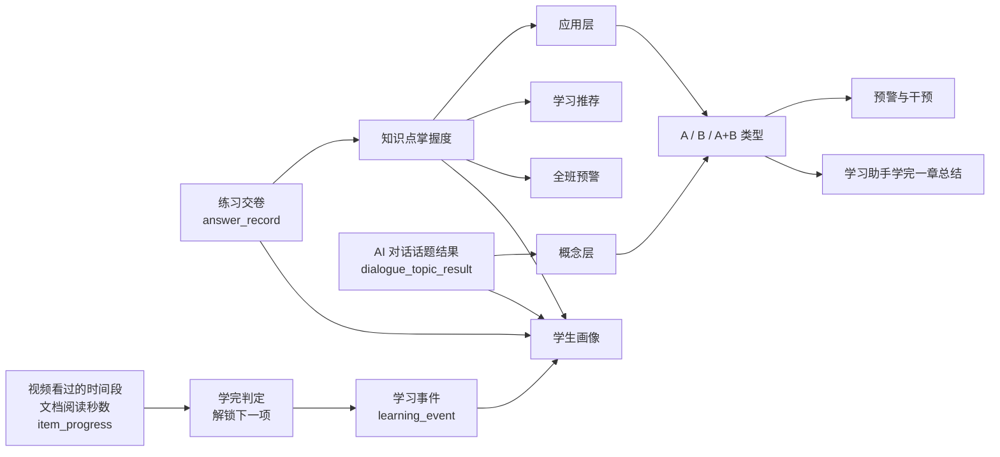
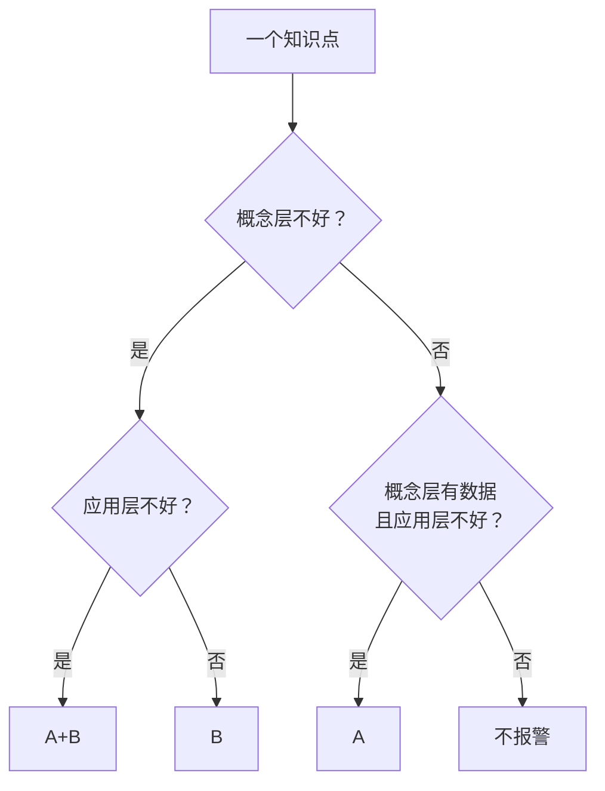

# 学情计算方法与公式

学生学习情况的所有数字是怎么算出来的，以及视频、文档怎么算“学完”、下一项什么时候解锁。05 学情诊断、06 学生画像、07 学习推荐、08 预警与干预、09 学习助手几个模块都用到，所以单独放一份，各模块文档引用这里。

内容对照过代码，以代码为准。参数都在代码里写成常量，改数字只改一个地方。

## 总览：数字从哪里来、到哪里去

| 数字 | 用在哪里 | 代码 |
|---|---|---|
| 视频、文档学完判定 | 学习页按顺序解锁 | `record/service/ProgressService` |
| 学完的定义和解锁 | 学习页、截止时间、学习助手 | `record/service/CompletionService` |
| 知识点掌握度 | 诊断、推荐、画像、干预、助手 | `diagnosis/service/MasteryService` |
| 两层判断和 A/B/A+B 类型 | 干预、助手 | `intervention/service/LayerService` |
| 干预有没有效 | 干预 | `intervention/service/InterventionService` |
| 全班预警 | 干预（老师端） | `intervention/service/InterventionService` |
| 推荐选题 | 学习推荐 | `recommend/service/RecommendService` |
| 画像 6 个维度和标签 | 学生画像 | `profile/service/ProfileService` |
| 学完一章的总结 | 学习助手 | `assistant/service/AssistantService` |

---

## 一、视频和文档怎么算学完（学完才解锁下一项）

一章里的内容由老师排顺序，比如“文档 → 视频 → 练习 → AI 对话”。学生要**按顺序学**：上一项学完，下一项才解锁。所以每种内容都要有一个“学完”的判断方式，本节写视频和文档两种。

### 1.1 解锁规则

$$
\text{第 } k+1 \text{ 项解锁} \iff \text{第 } k \text{ 项学完}
$$

- 每章第 1 项默认解锁。
- 学生自己已经学完的项一直是解锁的，老数据不会被锁回去。
- 顺序跟着老师排的走，不写死“视频在前”。老师调整顺序后，锁自动跟着变（锁不存进数据库，每次按“学完”记录实时算）。

| 内容 | 学完的条件 |
|---|---|
| 视频 | 完成度 $P \ge 90\%$（见 1.2） |
| 文档 | 阅读满 30 秒，并且点了“我已读完”（见 1.3） |
| 练习 | 交过卷 |
| AI 对话 | 所有话题都聊完 |

### 1.2 视频：完成度 ≥ 90%

**公式：**

$$
P = \frac{\sum_{i=1}^{n}(e_i - s_i)}{D}\qquad(\text{各段 } [s_i, e_i] \text{ 先合并，互不重叠})
$$

$$
\text{学完} \iff P \ge 90\%
$$

| 符号 | 意思 |
|---|---|
| $[s_i, e_i]$ | 第 $i$ 段**真正播放过**的时间段，从第 $s_i$ 秒播到第 $e_i$ 秒 |
| $e_i - s_i$ | 这一段的长度（秒） |
| $n$ | 合并后一共有几段 |
| $D$ | 视频总时长（秒） |

**“先合并，互不重叠”是什么意思**：同一段看了几遍，会记下几段重叠的时间段。合并成一段以后再相加，重复看的部分只算一次。相隔不到 0.5 秒的两段也并成一段（播放时前端记录的时间点之间有零点几秒的空隙）。

**这个公式自带的两条规则：**

| 学生的操作 | 结果 | 原因 |
|---|---|---|
| 拖进度条跳过一段 | 跳过的部分不算 | 跳过的部分没有播放，不会被记成时间段 |
| 同一段看好几遍 | 只算一次 | 重叠的时间段合并后只留一段 |

**例子：一个 20 秒的视频（$D = 20$）**

| 步骤 | 学生做了什么 | 合并后的时间段 | 计算 | $P$ | 结果 |
|---|---|---|---|---|---|
| 1 | 从头看到第 8 秒 | $[0, 8]$ | $\dfrac{8}{20}$ | 40% | 未学完 |
| 2 | 拖到第 14 秒，看到结尾 | $[0, 8],\ [14, 20]$ | $\dfrac{(8-0)+(20-14)}{20}=\dfrac{14}{20}$ | 70% | 未学完，跳过的 8～14 秒不算 |
| 3 | 回去重看第 3～6 秒 | $[0, 8],\ [14, 20]$ | $\dfrac{14}{20}$ | 70% | 未学完，重复的不加 |
| 4 | 补看第 8～12 秒 | $[0, 12],\ [14, 20]$ | $\dfrac{(12-0)+(20-14)}{20}=\dfrac{18}{20}$ | **90%** | **学完，下一项解锁** |

第 2 步已经播到了结尾，但 $P$ 只有 70%，所以“播到结尾”不等于学完。第 4 步还有第 12～14 秒没看，差 10%，允许。

**为什么是 90% 而不是 100%**：片尾常有几秒空白，学生也可能差一两秒没看到。要求 100% 容易误伤，90% 已经能说明基本看完了。

**倍速和拖动：**
- 最高 2 倍速，超过会被调回 2 倍。倍速播放的部分照样算。
- 进度条可以随便拖，跳过的部分不计入 $P$，所以判定一样公平。

**接着看**：每次上报都会记下当前播放的位置，下次打开视频从这个位置继续。

### 1.3 文档：读满 30 秒，并且点“我已读完”

**公式：**

$$
t = \sum_{j=1}^{m}(b_j - a_j)
$$

$$
\text{学完} \iff t \ge 30 \text{ 秒} \ \ \land\ \ \text{学生点了“我已读完”}
$$

| 符号 | 意思 |
|---|---|
| $[a_j, b_j]$ | 第 $j$ 段页面在前台的时间，切到别的页面就结束这一段 |
| $t$ | 累计阅读时间（秒） |
| $\land$ | “并且”，两个条件都要满足 |

**两个条件是“并且”，不是“或者”：**

| 读了多久 | 点没点按钮 | 结果 |
|---|---|---|
| 不到 30 秒 | 点不了，按钮是灰的，显示“还需 x 秒” | 未学完 |
| 满 30 秒 | 没点 | 未学完 |
| 满 30 秒 | 点了“我已读完” | **学完，下一项解锁** |

- 只要求“满 30 秒”：学生开着页面去做别的事，时间到了也算读完，按钮就没意义了。
- 只要求“点按钮”：学生一打开就点，30 秒的要求就没了。
- 两个一起要求：至少读了一会儿，并且学生自己确认读完了。

**例子**：学生先读了 18 秒，切到别的页面（暂停计时），回来又读了 15 秒。

$$
t = 18 + 15 = 33 \ \ge\ 30 \ \Rightarrow\ \text{按钮变成“我已读完”，点了就学完}
$$

**为什么用固定的 30 秒**：按字数或页数算阅读时长太繁琐，老师也不好解释；固定时间加一个按钮，学生一看就懂。

### 1.4 防作弊：后端怎么检查

学完由**后端**判定，前端只负责记录和上报。

| 检查 | 规则 | 防的是什么 |
|---|---|---|
| 视频上报是否可信 | 两次上报之间新增的观看时长 $\le$ 实际经过的秒数 $\times 2$ + 5 秒，超出的这次上报不算 | 改请求，直接说“看完了” |
| 视频总时长 | 第一次上报时定下，之后不能改 | 把时长改小，让 $P$ 变大 |
| 文档阅读秒数 | 每次最多加“距离上次上报经过的秒数 + 3”，单次最多 60 秒 | 改请求，一次报很多秒 |
| “我已读完” | 后端再检查 $t \ge 30$，不够就拒绝，提示还差几秒 | 绕过灰色按钮直接调接口 |
| 直接报“学完” | 视频、文档不接受前端直接报“学完”，只能由后端判定 | 跳过判定 |
| 锁 | 交练习、取题目、开始 AI 对话、上报视频和文档进度时，后端都检查上一项学完没有，没学完就拒绝，提示“请先完成上一项：《xxx》” | 绕过页面直接做后面的项 |

公式里的系数 2 来自最高 2 倍速；加 5 秒、加 3 秒是给网络延迟留的余量。

### 1.5 数据怎么存

新建一张 `item_progress` 表，每个学生、每一项一行：

| 字段 | 存什么 |
|---|---|
| `student_id`、`item_id` | 谁、哪一项 |
| `duration_sec` | 视频总时长 $D$，第一次上报时定下 |
| `watched_ranges` | 视频合并后的时间段，例如 `[[0,12],[14,20]]` |
| `watched_sec` | 各段长度之和 $\sum(e_i - s_i)$ |
| `read_sec` | 文档累计阅读秒数 $t$ |
| `last_position` | 视频上次播放到哪里，下次接着看 |
| `completed_at` | 判定学完的时间；空表示还没学完 |

判定学完时，同时写一条 `finish_item` 学习事件。截止时间、学习助手、老师看板原来就用这条记录，不用改。

**上报时机**：浏览器一直在记，但不是每一秒都发给后端。

视频：播放时浏览器持续延长当前这一段；发现进度突然跳了（拖动），就把这一段收起来，从新位置开始记下一段。发给后端的时机：

| 时机 | 说明 |
|---|---|
| 播放中，每 10 秒 | 定时报一次 |
| 暂停，或者播完 | 停下来时马上报 |
| 切到别的标签页、最小化窗口 | 页面转到后台时马上报 |
| 离开这一项 | 点到别的项、返回课程列表时报 |

- 拖进度条不单独发请求，只在浏览器里把刚才那段收好，跟着下一次一起报。
- 没有新看过的内容就不发。
- 每次发：视频总时长、目前所有看过的时间段、现在播到第几秒，例如 `{"duration": 20, "ranges": [[0,8],[14,20]], "position": 20}`。

文档：浏览器每秒数一次，页面在前台才加 1 秒。发给后端的时机：

| 时机 | 说明 |
|---|---|
| 攒满 10 秒 | 每读 10 秒报一次 |
| 切到别的标签页、最小化窗口 | 把还没报的秒数报掉 |
| 离开这一项 | 把还没报的秒数报掉 |
| 点“我已读完” | 先把剩下的秒数报掉，再发“我已读完” |

- 每次发的是这次新读了几秒，不是总数，例如 `{"seconds": 10}`。

直接关掉浏览器时，页面关得太快，最后一次上报可能发不出去，最多丢掉不到 10 秒的进度；学生下次接着看或读一会儿就能补上。

### 1.6 测试

`ProgressTest` 共 4 个测试，覆盖下面这些情况：

| 测试 | 验证什么 |
|---|---|
| 视频合并与 90% | 按上面 20 秒视频的 4 步走一遍，$P$ 依次是 40%、70%、70%、90%，最后一步学完；没解锁时上报被拒 |
| 视频上报太快 | 马上又报看完了 0～20 秒，不算；总时长不能改小；没有时长的上报被拒 |
| 文档 30 秒 + 按钮 | 一打开就点被拒（还需 30 秒）；马上又报 10 秒只加 3 秒；读满 33 秒后点按钮学完，练习解锁；不能直接报“学完” |
| 锁 | 没读文档的学生取练习题、交卷、开始对话都被拒；以前做过练习和对话的学生不被锁回去 |

---

## 二、知识点掌握度（其他数字的基础）

### 公式

> 2026-11-25 起：加了**猜测校正**和**可信度权重**，以支持 6 种题型和 AI 判的简答。完整说明和算例见 [练习与掌握度-设计.md](练习与掌握度-设计.md) 第五节。

只看最近 10 次作答（等老师确认的简答不算），越近的一次权重越大：

$$
W_i = t_i \cdot r_i,\qquad t_i = 0.8^{\,n-i},\qquad n \le 10
$$

$$
p=\frac{\sum W_i \cdot s_i}{\sum W_i},\qquad g=\frac{\sum W_i \cdot g_i}{\sum W_i},\qquad
\text{mastery}=\max\left(0,\ \frac{p-g}{1-g}\right)
$$

- $s_i$：第 $i$ 次的得分。客观题答对 1、答错 0（两段式两段都对、多选全对才算对）；简答 = 答到的要点数 ÷ 要点总数。
- $g_i$：这道题蒙对的概率。单选 1/选项数，判断 0.5，两段式 1/(答案数×理由数)，多选 1/(2^选项数−1)，填空、简答 0。**完全靠蒙的学生掌握度为 0。**
- $r_i$：可信度权重。程序判 1；简答 AI 判两次一致 0.5；老师确认过 1。
- $t_i$：时间权重，$i=n$ 是最近一次，权重 1；往前每一次乘 0.8。
- **作答不到 3 次时打折**：结果再乘 $n/3$。
- 保留 4 位小数。
- 旧的作答记录没存 $s、g、r$：$s$ 按对错，$g$ 按题型和选项数现算，$r = 1$。

| 参数 | 值 | 为什么 |
|---|---|---|
| 窗口 `WINDOW` | 10 次 | 只看近期，很久以前的错不该一直拖分 |
| 衰减 `DECAY` | 0.8 | 最近一次占得多，但一次失误不会让分数归零 |
| 最少次数 `MIN_ATTEMPTS` | 3 次 | 做对 1 道题不能算掌握，数据太少要打折 |

### 规则

- 一道题关联几个知识点，这次作答就算进每一个知识点。
- 每次交卷后，只重算这次交卷涉及的知识点，结果存进 `mastery` 表。
- 重做同一道题算新的一次作答，旧的也保留在窗口里。

### 等级

| 掌握度 | 等级 |
|---|---|
| ≥ 0.8 | 掌握 |
| 0.6 ～ 0.8 | 一般 |
| < 0.6 | 薄弱 |
| 没作答过 | 还没练 |

0.6 也是后面“应用层好不好”“干预有没有效”“推荐不推荐”的分界线（代码里叫 `PASS`）。

### 例子（演示数据）

| 情况 | 计算 | 结果 |
|---|---|---|
| 先错后对（2 次） | $\dfrac{0.8\times0+1\times1}{0.8+1}\times\dfrac{2}{3}$ | 0.3704，薄弱 |
| 两次都对 | $\dfrac{0.8+1}{0.8+1}\times\dfrac{2}{3}$ | 0.6667，一般 |
| 三次都对 | $1\times1$ | 1.0000，掌握 |
| 对、对、错（最近一次错） | $\dfrac{0.64+0.8+0}{0.64+0.8+1}$ | 0.5902，薄弱 |
| 错、对、对 | $\dfrac{0+0.8+1}{2.44}$ | 0.7377，一般 |

后两行对错的次数相同，但最近一次错了分就低。这就是加权的用处：看的是现在会不会，不是历史平均。

---

## 三、两层判断

一个知识点分两层看：**应用层**看会不会做题，**概念层**看能不能把道理讲出来。

### 应用层

| 条件 | 结果 |
|---|---|
| 作答不到 3 次 | 没数据 |
| 掌握度 ≥ 0.6 | 好 |
| 掌握度 < 0.6 | 不好 |

### 概念层

取考这个知识点的话题，看最近一次已结束或暂停的 AI 对话里这些话题的结果：

| 话题结果里有 | 结果 |
|---|---|
| 讲解后仍不会（REVEALED），或跳过（SKIPPED_IRRELEVANT） | 不好 |
| 提示后答出（HINT_CORRECT），或讲解后会用（REVEALED_APPLIED） | 一般 |
| 全部自己答出（SELF_CORRECT） | 好 |
| 没做过这些话题的对话 | 没数据 |

**跳过的补充规则**：如果最近一次对话里，这些话题全部被跳过，就往前找一次真实作答的对话来判断；更早也没有，算“不好”。这样学生没法靠跳过躲开预警。

### 组合成类型

| 概念层 | 应用层 | 类型 | 意思 |
|---|---|---|---|
| 好或一般 | 不好 | **A** | 懂道理但不会用 |
| 不好 | 好或没数据 | **B** | 会做题但没懂道理 |
| 不好 | 不好 | **A+B** | 两层都不好 |
| 其他 | | 不报警 | |

A、B、A+B 现在都由系统直接执行干预，不等老师审核；老师事后可以撤回、改期限。

---

## 四、干预有没有效

| 类型 | 学生要做什么 | 什么时候算做完 | 有效的条件 |
|---|---|---|---|
| A 变式练习 | 做系统挑的题（最多 3 道） | 布置的题都做过 | 做完后掌握度 ≥ 0.6 |
| B 复习 + 重做对话 | 看复习内容，重做 AI 对话 | 复习看过，对话也重做了 | 复习之后那次对话的概念层是“好”或“一般” |
| A+B 先复习再练习 | 第 1 步按 B，第 2 步按 A | 第 1 步完成后进入第 2 步；第 2 步按 A 判断 | 掌握度 ≥ 0.6 |

干预期限：开始执行时定，默认 7 天后 23:59（`platform.intervention.due-days`）；老师改期限最多 60 天后。过期后仍然可以做，只标“已逾期”。

---

## 五、全班预警

一个知识点同时满足下面两条，就给老师报全班预警：

$$
\text{练过人数}\ge 5 \quad\text{且}\quad \frac{\text{薄弱人数}}{\text{练过人数}} > 30\%
$$

| 参数 | 值 | 为什么 |
|---|---|---|
| `CLASS_MIN_PRACTICED` | 5 人 | 人太少时比例没意义，1 人里 1 人薄弱就是 100% |
| `CLASS_WEAK_RATIO` | 30% | 三分之一左右的人都不会，说明是教的问题，不是个别学生的问题 |

预警里同时给出答错时出现最多的误解，老师可以直接针对这个误解讲。

例子（演示数据）：知识点 1，练过 7 人，薄弱 4 人，57% > 30%，触发。

---

## 六、学习推荐选题

1. 取这个学生掌握度 < 0.6 的知识点，从低到高排。
2. 每个知识点挑题，按下面的顺序：

| 优先级 | 题目 |
|---|---|
| 1 | 上次做错的 |
| 2 | 没做过的 |
| 3 | 以前错过、后来做对的 |
| 同一档里 | 难度和知识点难度最接近的排前面 |

3. 每个知识点最多 3 道，一共最多 5 道。
4. 正在干预的知识点不在推荐里出现，避免同一件事给学生两份任务。

---

## 七、学生画像

### 6 个维度（都在 0 ～ 1，没数据就留空，不当 0 算）

| 维度 | 公式 | 说明 |
|---|---|---|
| 投入 | $\min\!\left(1,\ \dfrac{\text{近 14 天学习的天数}}{7}\r
ight)$ | 两周学 7 天（隔天一次）就算满分 |
| 完成度 | $\dfrac{\text{学完的内容项}}{\text{学过的课程里的内容项总数}}$ | |
| 正确率 | $\dfrac{\text{答对题数}}{\text{作答题数}}$ | |
| 掌握度 | 练过的知识点掌握度的平均值 | 没练过的不算进去 |
| 订正 | $\dfrac{\text{重做后成绩提高的练习组}}{\text{做错后重做的练习组}}$ | 看错了会不会回头改 |
| 独立思考 | 每个话题打分后取平均 | 打分见下表 |

独立思考的打分：

| 话题结果 | 分 |
|---|---|
| 自己答出 | 1 |
| 提示后答出 | 0.6 |
| 讲解后会用 | 0.4 |
| 讲解后仍不会 | 0.2 |
| 跳过 | 0 |

### 标签

| 标签 | 条件 |
|---|---|
| 学习规律 | 近 14 天学了 ≥ 4 天 |
| 学习不太连续 | 近 14 天学了 1 ～ 3 天 |
| 错了会回头订正 | 重做后成绩提高过 |
| 能独立想明白 | 自己答出的话题 ≥ 一半 |
| 依赖讲解 | 看了讲解才懂的话题 ≥ 一半 |
| 擅长 某知识点 | 这个知识点是“掌握” |
| 薄弱 某知识点 | 这个知识点是“薄弱” |

---

## 八、学习助手：学完一章的总结

学完一章的标准：本章每个内容项都学完过一次。

学完后，每个知识点按第三节的两层判断给出结论：

| 概念层 | 应用层 | 结论 | 建议 |
|---|---|---|---|
| 不好 | 不好 | 两边都不稳 | 先复习这一章，再和 AI 聊一次，然后做题 |
| 不好 | 其他 | 概念没讲出来 | 先复习，再和 AI 聊一次 |
| 其他 | 不好 | 会讲不会用 | 做几道题把它用熟 |
| 其他 | 好 | 稳了 | 不用额外做 |
| 好或一般 | 没数据 | 练得太少 | 再做几道确认一下 |
| 没数据 | 没数据 | 数据不够 | 多做几道题（不够 3 次时，只有做题能补上数据） |

判断按表的顺序从上往下，命中第一条就停。

---

## 九、所有参数一览

| 参数 | 值 | 位置 |
|---|---|---|
| 视频学完的完成度 | 90% | `ProgressService.VIDEO_PASS` |
| 视频最高倍速 | 2 倍 | `ProgressService.MAX_RATE` |
| 文档最短阅读时间 | 30 秒 | `ProgressService.READ_MIN_SEC` |
| 时间段合并的间隔 | 0.5 秒 | `ProgressService.MERGE_GAP` |
| 掌握度窗口 | 最近 10 次 | `MasteryService.WINDOW` |
| 衰减系数 | 0.8 | `MasteryService.DECAY` |
| 最少作答次数 | 3 次 | `MasteryService.MIN_ATTEMPTS` |
| 等级分界 | 0.8 / 0.6 | `MasteryService` |
| 应用层及格线 | 0.6 | `LayerService.PASS` |
| 干预最多布置题数 | 3 道 | `InterventionService.MAX_EXERCISES` |
| 干预默认期限 | 7 天 | `application.yml` 的 `platform.intervention.due-days` |
| 干预期限上限 | 60 天 | `InterventionService.MAX_DUE_DAYS` |
| 全班预警最少人数 | 5 人 | `InterventionService.CLASS_MIN_PRACTICED` |
| 全班预警薄弱比例 | 30% | `InterventionService.CLASS_WEAK_RATIO` |
| 推荐每个知识点 / 总数 | 3 / 5 道 | `RecommendService` |
| 画像统计周期 | 近 14 天 | `ProfileService` |
| 截止提醒窗口 | 3 天 | `application.yml` 的 `platform.deadline.remind-days` |

---

## 十、被问到时怎么答

**Q1：为什么不直接用正确率？**
正确率是历史平均，学生早期全错、后来全对，正确率还是很低。加权后看的是现在会不会。

**Q2：为什么是 0.8、10 次、3 次？**
是经验值，放在常量里方便调。0.8 时最近 3 次约占总权重的一半；10 次以前的权重已经不到 0.14，影响很小，所以截掉；3 次是最少能看出趋势的次数。

**Q3：只做题不对话，会被判成 B 吗？**
不会。概念层没数据时不算“不好”。B 要求概念层确实是“不好”。

**Q4：学生故意跳过所有话题能躲开预警吗？**
不能。全部跳过时往前找真实作答；找不到，概念层直接算“不好”。

**Q5：掌握度和画像里的正确率有什么不同？**
正确率是所有作答平均，不分先后；掌握度按知识点算、只看最近 10 次、越近越重要，还对作答太少打折。

**Q6：视频播到结尾为什么还不算看完？**
只算真正播放过的部分。拖进度条跳过的那段没有播放，不算进完成度 $P$；$P$ 到 90% 才算学完。

**Q7：学生把视频重复看三遍前 1 分钟，能凑够时长吗？**
不能。同一段的时间段会合并，重复看的部分只算一次。

**Q8：文档为什么要 30 秒加一个按钮，不是满 30 秒自动算完？**
两个条件是“并且”的关系。只看时间，开着页面走开也算读完；只看按钮，一打开就点。两个一起要求，才能保证至少读了一会儿，并且学生自己确认读完了。

**Q9：学生改请求能直接把视频报成看完吗？**
不能。学完由后端判定；新增的观看时长不能超过实际经过的时间 × 2，总时长第一次定下后不能改，前端也不能直接报“学完”。
