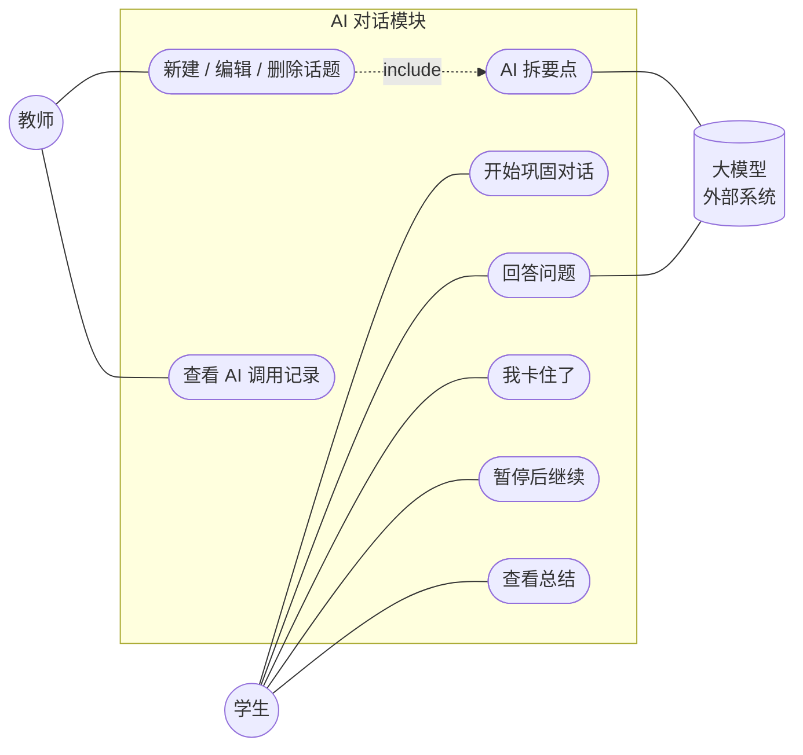
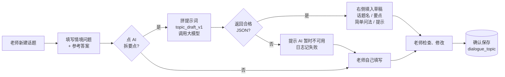
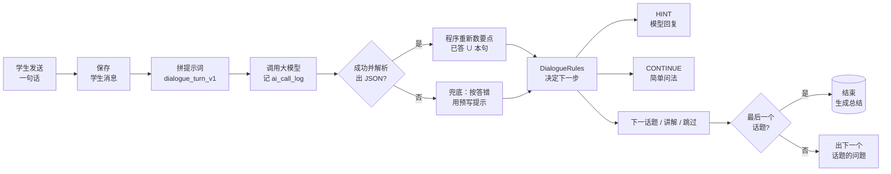
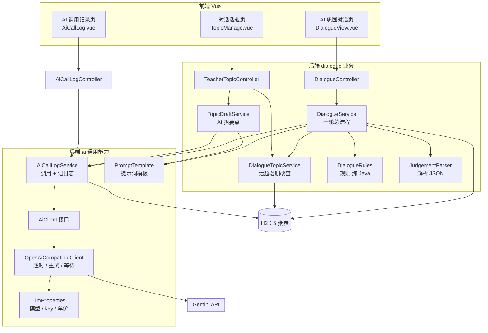
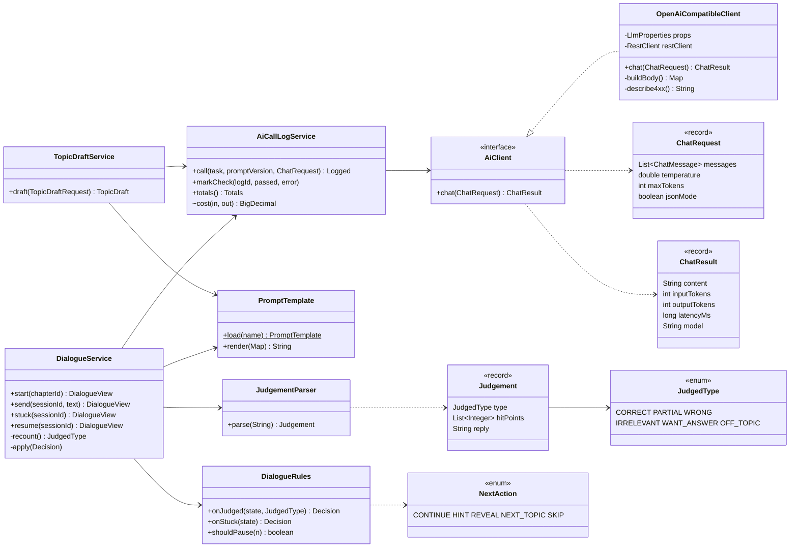
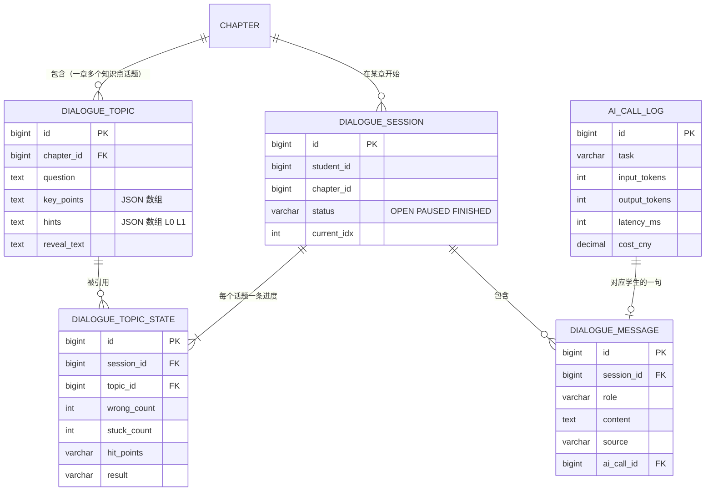
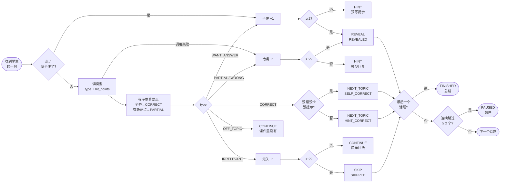
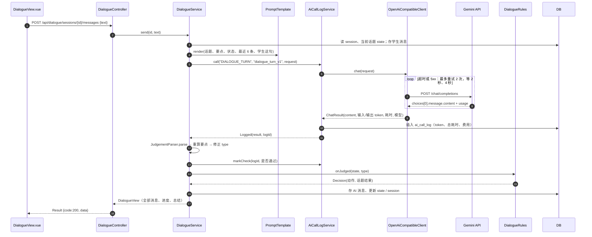
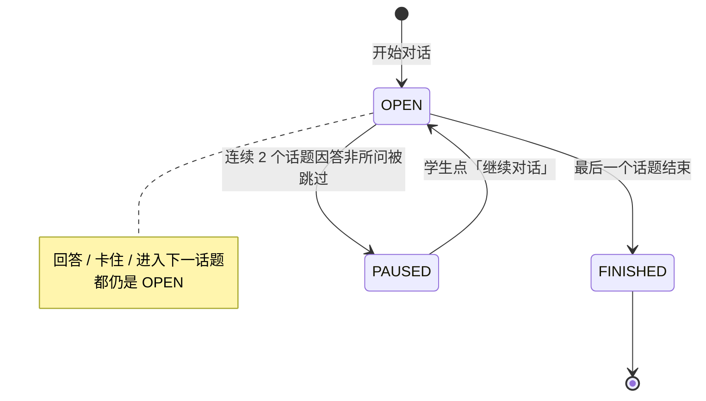
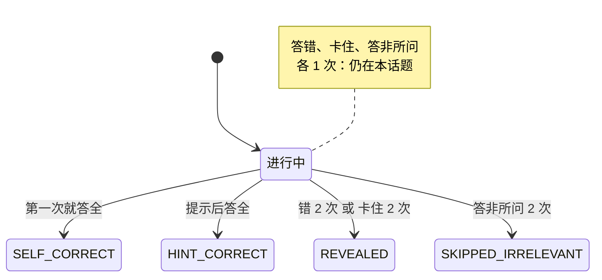

# AI 巩固对话模块：我们是怎么做的（逐页讲稿）

> 第 2 组 · 软件工程智能学习平台 · 2026-10-29
> 本文档和 PPT《汇报-AI对话模块-分析与设计.pptx》**逐页对应**：每一节就是一页，标题和 PPT 完全相同。
> 每页分三部分：**页面上有什么**、**讲稿**（照着讲即可）、**补充**（被问到时用，可以不讲）。

| 页 | 标题 | 对应老师要求 |
|---|---|---|
| 1 | AI 巩固对话模块：我们是怎么做的 | 封面 |
| 2 | 问题和我们的思路 | 背景和目标 |
| 3 | 用例图 | 分析 · 用例图 |
| 4 | 业务流程 1：老师建话题 | 分析 · 业务场景 / 业务流程图 |
| 5 | 业务流程 2：学生说一句话 | 分析 · 业务场景 / 业务流程图 |
| 6 | 功能框图 | 设计 · 功能框图 |
| 7 | 类图 | 设计 · 类图 |
| 8 | E-R 图与表设计 | 设计 · E-R 图 / DB 表设计 |
| 9 | 活动图与规则 | 设计 · 活动图 |
| 10 | 顺序图 | 设计 · 顺序图 |
| 11 | 状态图 | 设计 · 状态图 |
| 12 | 真实跑通 | Demo（界面用真实截图代替界面框图） |
| 13 | 测试与踩过的坑 | 实现 / 测试 |
| 14 | 待讨论与下一步 | 结尾 |

14 页之后是**附录 A–I**：老师侧和学生侧调用大模型的代码逐步说明、怎么限制模型的回答、两份提示词全文、5 张表的完整字段、接口清单、配置说明、24 个测试清单、已知问题。

---

## 第 1 页　AI 巩固对话模块：我们是怎么做的

**页面上有什么**：标题；第 2 组 · 软件工程智能学习平台；分析与设计 · 真实 Gemini 跑通 · token 与耗时全记录。

**讲稿**

> 这次我们只讲 AI 巩固对话这个模块：老师出题、学生和 AI 对话，以及每次调用大模型的 token 和耗时记录。登录、菜单这些通用页面不讲。我们按"遇到什么问题 → 怎么分析 → 怎么设计 → 跑出来的结果 → 怎么测试"的顺序讲。

---

## 第 2 页　问题和我们的思路：模型只判断，程序管流程

**页面上有什么**：上面三张问题卡片；下面左右对比"大模型只做两件事 / 程序负责其余所有事"。

| 问题 | 来源 |
|---|---|
| 学生遇到不会的题，直接问通用 AI 抄答案 | 小组描述、模拟学生消息 |
| AI 被学生催一次，就给出接近答案的提示（越级） | 第二课探查 Q5 |
| AI 让学生对照课件例子，而例子里就是答案（带出处反而泄露） | 第二课探查 Q2 |

| 大模型只做两件事 | 程序负责其余所有事 |
|---|---|
| 判断学生这句属于哪一类（6 种） | 数要点决定答没答全，不全信模型 |
| 写一句追问或提示（≤ 80 字） | 按规则决定追问、讲解、换话题 |
| | 讲解和总结用老师确认的文字 |
| | 每次调用记录 token、耗时、费用 |

**讲稿**

> 我们要解决三个问题：学生直接问 AI 拿答案；AI 被学生催一次就说出答案；AI 引用课件例子反而泄露答案。后两个是我们第二课实验里真实看到的。
>
> 我们的做法是：一章学完后，AI 就几个话题和学生对话，一个话题对应一个知识点。关键是把职责拆开——**大模型只做两件事**：判断学生这句属于哪一类、写一句追问。**其他都由程序控制**：答没答全由程序数要点，下一步做什么由规则决定，讲解用老师的原文，每次调用都记录。一句话：模型负责"说话"，程序负责"做决定"。

**补充**：6 种类型是 correct（全答到）、partial（答到一部分）、wrong（相关但错）、irrelevant（无关，如"哈哈"）、want_answer（直接要答案）、off_topic（问资料以外的问题）。

---

## 第 3 页　用例图：老师出题，学生对话，大模型只在两处被调用

**页面上有什么**：用例图；右边"教师""学生"两张卡片。



**讲稿**

> 老师可以新建、编辑话题，新建时可以让 AI 帮忙拆要点；还可以查看 AI 调用记录。学生可以开始对话、回答问题、点"我卡住了"、暂停后继续、查看总结。
>
> 整个模块只有两个地方会调用大模型：老师的"AI 拆要点"和学生的"回答问题"。其余操作——包括"我卡住了"、讲解、换话题、总结——都不调用模型，所以不花钱，也不会出错。

---

## 第 4 页　业务流程 1：老师只填问题和答案，AI 拆要点，老师确认

**页面上有什么**：横向流程图；活动的输入/输出表；底部一句说明。



| 活动 | 输入 | 输出 |
|---|---|---|
| 填写 | 情境问题、参考答案、出处、依据原文 | 草稿请求 |
| AI 拆要点 | 提示词 topic_draft_v1（含参考答案和出处） | JSON：title、key_points 2–4 条、simple_question、hints 2 条 |
| 老师确认 | AI 草稿（可直接改） | dialogue_topic 一行；参考答案 = 讲解原文 |
| 实测一次 | 输入 397 token | 输出 160 token，耗时 5.8 秒 |

**讲稿**

> 老师这一侧，老师只需要填情境问题和参考答案。点"AI 拆要点"后，后端用提示词模板把老师的内容拼进去，调用大模型；模型返回合格的 JSON，就填到页面右边当草稿：话题名、2 到 4 条要点、一个简单问法、两级提示。老师检查、修改，点"确认保存"才写进数据库。
>
> 我们实测一次：输入 397 token、输出 160 token、耗时 5.8 秒。要强调两点：AI 只出草稿，老师确认才算数；参考答案原样存为讲解原文，学生最后看到的讲解一定是老师写的话。

**补充：怎么把模型的回答限制住**
1. 提示词里只有老师填的问题、答案、出处，没有其他资料；
2. 提示词要求要点"只能来自参考答案"，条数和字数有上限，提示 L0 不能出现要点原文；
3. JSON 模式 + 温度 0.2，输出格式固定、结果稳定；
4. 程序检查：不是 JSON、缺话题名或要点就报错，不把半成品给老师；
5. 老师确认后才保存，并标记 `created_by_ai = 1`。
6. 还没做：程序不检查要点条数和字数，也不检查要点是否真的来自参考答案，这些目前靠老师把关。

---

## 第 5 页　业务流程 2：学生说一句话，系统怎么回应

**页面上有什么**：横向流程图；活动的输入/输出表。



| 活动 | 输入 | 输出 |
|---|---|---|
| 拼提示词 | 话题、要点、依据、尝试次数、已用提示、已答要点、最近 6 条、学生这句 | 约 540–620 输入 token |
| 调模型 | temperature 0.2，max_tokens 4096，JSON 模式 | `{type, hit_points, reply}`，约 66–70 输出 token |
| 重新数要点 | 模型的 hit_points ∪ 已答要点 | 修正后的 type |
| 规则 → 生成消息 | 话题状态 + type（或"我卡住了"） | 动作 + 话题结果；模型回复 / 预写提示 / 讲解原文 |

**讲稿**

> 学生每发一句话，后端依次做：先保存学生的消息；再拼提示词，里面有这个话题的要点、依据资料、学生已经答到的要点和最近 6 条对话；然后调用模型，模型返回类型、答到了哪几条要点、一句回复。
>
> 这里最重要的一步是**程序重新数要点**：把之前答到的和这一句答到的合在一起，全齐了才算答对。所以模型说"全对"不一定算数。最后由规则决定是追问、讲解还是换下一个话题。如果模型调用失败，就按答错处理，回复改用老师预写的提示，对话不会中断。

**补充**：提示词 dialogue_turn_v1 的约束：只根据依据资料和要点说话；回复不超过 80 字、只问一个问题；先肯定说对的再追问；不说出还没答到的要点；只输出 JSON。程序对输出的检查：不是 JSON 或 type 不在 6 种之内 → 走兜底；回复为空或超过 120 字 → 不用模型的回复；要点编号越界 → 去掉。

---

## 第 6 页　功能框图：业务层和通用 AI 层分开，调用全部经过日志

**页面上有什么**：功能框图；右边"ai/ 通用能力""统一入口"两张卡片。



**讲稿**

> 系统分三层：上面是三个页面；中间是 dialogue 业务层，包括两个 Controller、拆要点服务、对话总流程、规则和解析；左下是通用的 ai 层，包括模型配置、HTTP 客户端、提示词模板和调用日志。
>
> 两个设计要点：第一，ai 层和业务无关，以后老师侧其他 AI 功能可以直接复用；第二，业务代码不直接调用模型客户端，**所有调用都必须经过 AiCallLogService**，所以每次调用一定会被记录，不会漏。

---

## 第 7 页　类图：先定义 AiClient 接口，测试时换成假的

**页面上有什么**：类图；底部一句说明。



**讲稿**

> 类图里最关键的是 AiClient 接口。正式运行时用 OpenAiCompatibleClient 真的发 HTTP 请求；测试时换成 FakeAiClient，直接返回我们预设的 JSON。这样测试不花钱、结果固定，而且业务代码一行都不用改。
>
> 另外，规则放在 DialogueRules 里，是纯 Java，不依赖数据库和模型，可以直接写单元测试；模型的判断类型和下一步动作都用枚举表示，写错名字编译时就会报错。

---

## 第 8 页　E-R 图与表设计：5 张表，进度表和日志表是关键

**页面上有什么**：E-R 图；右边 5 张表的关键字段和作用。



| 表 | 关键字段 | 作用 |
|---|---|---|
| dialogue_topic | question, key_points, hints, reveal_text | 老师确认的话题（= 知识点） |
| dialogue_session | status, current_idx | 学生在某章的一次对话 |
| dialogue_topic_state | wrong / stuck / irrelevant_count, hint_level, hit_points, result | 每个话题的进度；规则和总结只看它 |
| dialogue_message | role, content, source, ai_call_id | 每条消息，可追溯到对应的模型调用 |
| ai_call_log | input / output_tokens, latency_ms, cost_cny, success, error | 每次模型调用的 token、总耗时（含重试）、费用 |

**讲稿**

> 一章有多个话题，一个话题对应一个知识点。学生每开始一次对话，就建一个 session，并给每个话题建一条进度。每条消息都记录来源（模型写的、老师预写的、程序生成的），学生的消息还能通过 ai_call_id 找到这一句用了多少 token。
>
> 重点是两张表：**进度表**记录三种次数、提示到第几级、已经答到哪些要点、最后结果，规则和总结只看这张表，不看模型；**调用日志表**记录每次调用的 token、总耗时、费用、是否成功和失败原因。

**补充**：费用 = 输入 token × 输入单价 ÷ 100 万 + 输出 token × 输出单价 ÷ 100 万。章节表还没建，chapter_id 先固定为 1。

---

## 第 9 页　活动图与规则：程序怎么决定下一步

**页面上有什么**：活动图；下面"第 1 次 / 第 2 次"规则表。



| 学生的情况 | 第 1 次 | 第 2 次 |
|---|---|---|
| 答错 / 部分对 | HINT：显示模型的追问 | REVEAL：显示老师的讲解原文（REVEALED） |
| 我卡住了 / 要答案 | HINT：老师预写的提示（不用模型的回复） | REVEAL（REVEALED） |
| 答非所问 | CONTINUE：换简单问法 | SKIP 跳过（连续跳过 2 个话题就暂停） |
| 答全（程序数要点） | 没错没卡没提示 → SELF_CORRECT | 其他 → HINT_CORRECT，进入下一话题 |

**讲稿**

> 先看下面的表，比较好讲：每种情况第一次怎样、第二次怎样。答错第一次，由模型追问；第二次就不再追问，直接显示老师的讲解。卡住了或者直接要答案，我们**不让模型发挥**，只给老师预写的提示，第二次就讲解。答非所问第一次换一个简单问法，第二次跳过这个话题；如果连续跳过两个话题，就暂停对话。答全了就进入下一个话题，没错没卡过的记为"自己答对"，否则记为"提示后答对"。
>
> 图上再补两点：模型调用失败时按答错处理；一个话题结束后先看是不是最后一个，是就结束，不是再看要不要暂停。

**补充**：点"我卡住了"按钮时完全不调用模型；学生打字说"直接告诉我"时会调用模型（要先判断出它是"要答案"），但不用模型写的回复。问资料以外的问题（off_topic）不计次，回复"课件里没有这部分"并重复问题。规则表每一行都有单元测试。

---

## 第 10 页　顺序图：学生发一句话，后端依次做了什么

**页面上有什么**：顺序图（18 步）；底部一句说明。



**讲稿**

> 按编号快速过一遍：页面发请求给 Controller，Service 读出对话状态、保存学生消息，用模板拼提示词，然后经过日志服务调用模型客户端。客户端在循环里发请求给 Gemini，超时或服务繁忙最多重试 2 次，中间等 2 秒、4 秒。拿到结果后，日志服务**立即**写入 token、总耗时和费用；Service 再解析结果、重新数要点，补记这次输出有没有通过检查，然后交给规则决定下一步，保存消息和状态，把整份对话返回给页面。
>
> 重试在客户端里完成，业务代码不用管。

---

## 第 11 页　状态图：一次对话与一个话题

**页面上有什么**：左边一次对话的状态图，右边一个话题的状态图。





**讲稿**

> 左边：一次对话只有三种状态——进行中、暂停、结束。连续跳过两个话题会暂停，学生点"继续对话"回到进行中；最后一个话题结束就是结束。
>
> 右边：一个话题最后一定是四种结果之一：自己答对、提示后答对、看了讲解、跳过。总结页就是按这四种结果分组生成的，不用调用模型。

**补充：一次对话和一个话题是什么关系**

两者是两个层级：**一次对话**是外层，**一个话题**是里层，一次对话里依次聊好几个话题。可以把它想成课后的一次口头小测：

- **一次对话** = 这一整场小测，从学生点"开始对话"到出总结为止；
- **一个话题** = 小测里的一道题，对应一个知识点，比如"下边界取哪些值"。

```
一次对话（学生张同学，第 1 章）
├── 话题 1：下边界取哪些值      → 结果：提示后答对
└── 话题 2：为什么要测边界附近  → 结果：看了讲解
                                 → 全部结束，出总结
```

**一次对话**（`dialogue_session` 表）看"整场还在不在进行"，`status` 只有 3 种，另外用 `current_idx` 记录现在聊到第几个话题：

| 状态 | 意思 | 什么时候变成这个状态 |
|---|---|---|
| OPEN 进行中 | 正在聊 | 点"开始对话"之后；暂停后点"继续对话"也回到这里 |
| PAUSED 暂停 | 先停一下 | 学生连续 2 个话题都答非所问被跳过，系统判断他现在不在状态 |
| FINISHED 结束 | 聊完了 | 最后一个话题结束 |

学生回答、点"我卡住了"、换到下一个话题，都不改变对话的状态，一直是 OPEN。

**一个话题**（`dialogue_topic_state` 表）看"这道题学生最后是怎么过的"。聊的过程中记录答错次数（`wrong_count`）、卡住次数（`stuck_count`）、答非所问次数（`irrelevant_count`）、已答到的要点（`hit_points`，如 "1,3"）。话题还在聊时是"进行中"；结束后 `result` 定下来，一定是 4 种之一：

| 结果 | 意思 | 怎么来的 |
|---|---|---|
| SELF_CORRECT 自己答对 | 最好 | 没答错、没卡住、没用提示，就答全了要点 |
| HINT_CORRECT 提示后答对 | 还不错 | 中间答错过或卡住过，被提示后答全 |
| REVEALED 看了讲解 | 需要复习 | 答错 2 次或卡住 2 次，系统直接显示老师的讲解 |
| SKIPPED_IRRELEVANT 跳过 | 没认真答 | 答非所问 2 次 |

答错、卡住、答非所问各 1 次时还是"进行中"，系统只给提示或换个问法，学生可以继续答。

**两者怎么配合（第 12 页 Demo 那一次）**

| 学生做了什么 | 一次对话 | 话题 1 | 话题 2 |
|---|---|---|---|
| 点"开始对话" | OPEN，当前第 1 题 | 进行中 | 进行中 |
| "1 和 50 吧"（答对一部分） | OPEN | 进行中（错 1 次，已答要点 2） | 进行中 |
| "那 0 也要测……还有 2？"（答全） | OPEN，换到第 2 题 | HINT_CORRECT | 进行中 |
| 点"我卡住了" | OPEN | | 进行中（卡住 1 次） |
| "因为 50 太普通了"（答错） | OPEN | | 进行中（错 1 次） |
| "直接告诉我答案吧" | FINISHED | | REVEALED（卡住累计 2 次） |

总结就是读每个话题的结果生成的：话题 1"提示后答对"放进"做得好的"，话题 2"看了讲解"放进"需要再看看的"，不调用模型。

一句话：**一次对话**回答"这次小测还在不在进行"；**一个话题**回答"这道题学生最后是怎么过的"。

---

## 第 12 页　真实跑通：5 次调用全部成功，平均 6.0 秒

**页面上有什么**：左边两张截图（老师 AI 拆要点、学生对话和总结）；右边每次调用的 token 柱状图；底部 4 个合计数字。截图在 `docs/screenshots/`。

| # | 学生 | AI | 程序 |
|---|---|---|---|
| 1 | 1 和 50 吧 | 你说对了 1 这个边界点。不过 50 属于中间值……还需要选取哪些数值？ | PARTIAL，要点 [2] → 模型追问 |
| 2 | 那 0 也要测……还有 2？ | 完全正确！你找齐了下边界的三个关键点…… | 累计 [1,2,3] 全齐 → HINT_CORRECT，换话题 |
| 3 | （我卡住了） | 提示：想想程序员写判断条件时最容易犯什么错。 | 不调模型，预写提示 |
| 4 | 因为 50 太普通了 | 没错，中间值确实很难发现逻辑漏洞……什么样的输入才能让这个错误现形？ | 错 1 次 → 模型追问 |
| 5 | 直接告诉我答案吧 | 我们一起来看：（老师的讲解原文）（出处：课件第 13 页） | 卡住累计 2 次 → REVEALED，结束 |
| 总结 | | 完成 2/2；做得好：下边界取哪些值；需要再看看：为什么要测边界附近 | 程序生成，不调模型 |

| # | 任务 | 输入 token | 输出 token | 耗时 |
|---|---|---|---|---|
| 1 | 老师拆要点 | 397 | 160 | 5.8 秒 |
| 2 | 学生对话 | 538 | 70 | 4.6 秒 |
| 3 | 学生对话 | 613 | 67 | 4.7 秒 |
| 4 | 学生对话 | 615 | 66 | 5.5 秒 |
| 5 | 学生对话 | 600 | 70 | 9.6 秒 |
| **合计** | 5 次，失败 0 | **2,763** | **433** | **30.2 秒（平均 6.0 秒）** |

**讲稿**

> 这是我们用真实 Gemini（gemini-3-flash-preview）跑通的一次完整流程。左上是老师拆要点，AI 拆出了 3 条要点和两级提示；左下是学生的一整段对话，学生先答对一部分、AI 追问、补全后进入下一个话题；第二个话题学生卡住、答错、要答案，最后看了讲解，结束后生成总结。
>
> 右边是这 5 次调用的数据：全部成功，每次输入约 600 token、输出约 70 token，合计 2,763 和 433，总耗时 30.2 秒、平均 6 秒。用的是免费额度，所以是 0 元；按 DeepSeek 的价格估算，一次对话约 0.007 元，远低于 0.1 元的目标。

**补充**：6 秒偏慢，因为是免费版，而且 Gemini 会先"思考"；目标是换成付费模型后 p95 ≤ 3 秒。截图用的模型是 gemini-3-flash-preview，现在的默认配置是 gemini-3.1-flash-lite。

---

## 第 13 页　测试与踩过的坑

**页面上有什么**：左边"24 个自动测试全部通过"和测试分层；右边接入 Gemini 遇到的问题表。

- 单元测试：规则表每一行（10 个）
- 集成测试：用 FakeAiClient 走完整段对话、失败兜底、模型说全对但要点不齐时程序改判、话题接口、调用日志（10 个）
- 骨架测试：统一返回格式和异常处理（4 个）
- 冒烟测试：真实 Gemini 跑老师和学生流程并截图
- 下一步：5 种模拟学生评测 type 判断准确率（目标 ≥ 85%）

| 接入 Gemini 遇到的问题 | 怎么解决 |
|---|---|
| gemini-2.5-flash 返回 404，已不对新用户开放 | 换模型 |
| gemini-3.8-flash 超过 45 秒无回复 | 换模型 |
| gemini-3.1-flash-lite 高峰期常返回 503 | 重试 + 等待（2 秒、4 秒） |
| 回复被截断成半个 JSON：模型"思考"占用了 max_tokens | max_tokens 从 1024 提高到 4096 |
| 读超时被包成笼统异常，接口返回 500 | 补上捕获，按超时重试 |

**讲稿**

> 测试方面，我们一共写了 24 个自动测试，全部通过。规则和整段对话都用假的模型来测，不花钱、结果固定；真实模型只用来做冒烟测试，就是刚才那一页的截图。
>
> 接入真实模型时踩了 5 个坑：模型下线、模型太慢、高峰期返回 503、回复被模型的"思考"占满 token 而截断、读超时变成了 500 错误。这些问题都是靠调用日志里的错误原因和原始返回查出来的，这也是我们坚持每次调用都记日志的原因。

---

## 第 14 页　待讨论与下一步

**页面上有什么**：4 条待讨论和计划。

1. **调用失败是否算"答错"**：实测 503 时答对的话题被记成"看了讲解"，建议改成不计次、请学生再发一次。
2. **主备模型**：主用免费额度大的 flash-lite，繁忙时才切到 flash-preview。配置已经写好（`fallback-model`），但切换的代码还没写，见附录 I。
3. **持久化**：从内存库切到 MySQL；建章节表，话题挂到知识点下。
4. **对话探查**：5 种模拟学生跑一遍，双人标注 type 是否判对、回复好不好。

**讲稿**

> 最后有两点想听听大家的意见：一是模型调用失败时要不要算学生答错，我们实测发现这样会冤枉学生，建议改成不计次；二是主备模型怎么用。另外两点是下周计划：把数据库换成 MySQL、建章节表，以及用 5 种模拟学生评测模型判断的准确率。

---

## 附：可能被问到的问题

| 问题 | 回答要点 |
|---|---|
| 怎么保证 AI 不泄露答案？ | 练习题和答案从来不放进提示词；话题情境刻意和练习题不同；学生要答案时只给预写提示；讲解用老师的原文。**还没做**：检查模型回复里有没有练习题内容（计划中） |
| 模型判断错了怎么办？ | 答没答全由程序数要点决定；判断准确率要用 5 种模拟学生评测，目标 ≥ 85%，还没测 |
| 为什么 6 秒这么慢？ | 免费版 + 模型会先"思考"；目标是付费模型 p95 ≤ 3 秒 |
| 为什么不让模型直接决定下一步？ | 第二课实验里模型被催一次就越级；规则交给程序，结果稳定，也能写测试 |
| API key 放在哪里？ | 只放在被 Git 忽略的 application-local.yml，日志里只打印"是否配置"，不打印 key |

---

# 附录（详细资料，汇报时按需翻阅）

| 附录 | 内容 | 对应页 |
|---|---|---|
| A | 老师侧：AI 拆要点的代码逐步说明 | 第 4 页 |
| B | 学生侧：一轮对话的代码逐步说明 | 第 5、9、10 页 |
| C | 怎么把模型的回答限制在范围内（老师侧 + 学生侧） | 第 2、4、5、9 页 |
| D | 两份提示词全文 | 第 4、5 页 |
| E | 5 张表的完整字段 | 第 8 页 |
| F | 接口清单 | 第 6、10 页 |
| G | 配置说明（模型、key、超时、重试） | 第 6、13 页 |
| H | 24 个自动测试清单 | 第 13 页 |
| I | 已知问题与还没做的事 | 第 14 页 |

---

## 附录 A　老师侧：AI 拆要点的代码逐步说明

```
TopicManage.vue（老师点"AI 拆要点"）
   │  POST /api/teacher/topics/draft   {question, answer, sourceRef, sourceText}
   ▼
TeacherTopicController.draft()      ① 校验参数（问题、答案不能为空）
   ▼
TopicDraftService.draft()           ② 用模板拼提示词
   │                                ③ 组装请求（温度 0.2、JSON 模式）
   ▼
AiCallLogService.call()             ④ 开始计时，调用模型，写一条调用日志
   ▼
OpenAiCompatibleClient.chat()       ⑤ 发 HTTP 请求给 Gemini，失败时重试
   ▼
Gemini API                          ⑥ 返回 JSON 文字 + token 用量
   ▲
TopicDraftService.parse()           ⑦ 解析和检查；不合格就报错，不把半成品交给老师
   ▼
页面右侧显示草稿 → 老师修改 → 点"确认保存"   ⑧ 人工确认后才写进 dialogue_topic
```

### ⓪ 前端：老师点按钮

`frontend/src/views/teacher/TopicManage.vue`

```js
async function runDraft() {
  if (!form.question.trim() || !form.answer.trim()) {
    ElMessage.warning('先填写情境问题和参考答案')   // 前端先拦一次，空的不发请求
    return
  }
  drafting.value = true                               // 按钮变成"AI 正在拆要点…"
  try {
    const d = await draftTopic({ question: form.question, answer: form.answer,
                                 sourceRef: form.sourceRef, sourceText: form.sourceText })
    form.title = d.title                              // 把 AI 草稿填到右边
    form.keyPoints = d.keyPoints
    form.simpleQuestion = d.simpleQuestion
    form.hints = [d.hints[0] || '', d.hints[1] || '']
    form.createdByAi = true
    draftInfo.value = `${d.model}，用时 ${(d.latencyMs / 1000).toFixed(1)} 秒`
  } finally {
    drafting.value = false
  }
}
```

`frontend/src/api/teacherTopic.js`

```js
// 模型可能先"思考"，后端最多重试 2 次（3 × 30 秒 + 等待），所以前端等待上限放宽到 110 秒
export function draftTopic(data) {
  return request.post('/teacher/topics/draft', data, { timeout: 110000 })
}
```

`request` 是项目统一的 axios 封装：后端返回 `code == 200` 时直接取出 `data`，否则弹出 `message`。所以 AI 失败时页面会自动显示红色提示。

### ① Controller：接收请求、校验参数

`dialogue/dto/TopicDraftRequest.java`

```java
public record TopicDraftRequest(
        @NotBlank(message = "情境问题不能为空") @Size(max = 1000, message = "情境问题不超过 1000 字") String question,
        @NotBlank(message = "参考答案不能为空") @Size(max = 2000, message = "参考答案不超过 2000 字") String answer,
        @Size(max = 100, message = "出处不超过 100 字") String sourceRef,
        @Size(max = 2000, message = "依据原文不超过 2000 字") String sourceText) {
}
```

`dialogue/controller/TeacherTopicController.java`

```java
@PostMapping("/draft")
public Result<TopicDraft> draft(@Valid @RequestBody TopicDraftRequest req) {
    return Result.ok(draftService.draft(req));
}
```

- `@RequestBody`：把前端的 JSON 转成 `TopicDraftRequest` 对象。
- `@Valid`：按注解检查，不合格直接返回 `{"code":400,"message":"参考答案不能为空"}`，不会调用模型。

### ②③ Service：拼提示词、组装请求

`dialogue/service/TopicDraftService.java`

```java
private final PromptTemplate template = PromptTemplate.load("topic_draft_v1");   // 启动时读一次模板文件

public TopicDraft draft(TopicDraftRequest req) {
    String prompt = template.render(Map.of(
            "question", req.question().trim(),
            "answer", req.answer().trim(),
            "source", formatSource(req.sourceRef(), req.sourceText())));

    // temperature 0.2：拆要点要稳定；maxTokens 4096：模型的"思考"也算在里面
    ChatRequest request = new ChatRequest(List.of(ChatMessage.user(prompt)), 0.2, 4096, true);
    ...
}

private String formatSource(String ref, String text) {
    boolean hasRef = ref != null && !ref.isBlank();
    boolean hasText = text != null && !text.isBlank();
    if (!hasRef && !hasText) {
        return "（老师没有提供，只依据参考答案）";      // 明确告诉模型：没有别的资料
    }
    return (hasRef ? ref.trim() + "：" : "") + (hasText ? text.trim() : "");
}
```

`ai/prompt/PromptTemplate.java`：读模板、替换占位符

```java
private static final Pattern PLACEHOLDER = Pattern.compile("\\{\\{(\\w+)}}");   // 匹配 {{xxx}}

public static PromptTemplate load(String name) {               // 读 resources/prompts/{name}.md
    try (InputStream in = new ClassPathResource("prompts/" + name + ".md").getInputStream()) {
        return new PromptTemplate(name, new String(in.readAllBytes(), StandardCharsets.UTF_8));
    } catch (IOException e) {
        throw new IllegalStateException("找不到提示词模板 prompts/" + name + ".md", e);
    }
}

public String render(Map<String, String> values) {              // 漏传任何一个占位符就报错
    Matcher m = PLACEHOLDER.matcher(text);
    StringBuilder sb = new StringBuilder();
    while (m.find()) {
        String value = values.get(m.group(1));
        if (value == null) {
            throw new IllegalArgumentException("提示词模板 " + name + " 缺少占位符：" + m.group(1));
        }
        m.appendReplacement(sb, Matcher.quoteReplacement(value));
    }
    m.appendTail(sb);
    return sb.toString();
}
```

`ai/client/ChatRequest.java`

```java
public record ChatRequest(List<ChatMessage> messages, double temperature, int maxTokens, boolean jsonMode) {
}
```

### ④ 统一入口：调用并写日志

`TopicDraftService` 里调用它：

```java
AiCallLogService.Logged logged;
try {
    logged = callLog.call(AiCallLogService.TASK_TOPIC_DRAFT, template.name(), request);
} catch (AiCallException e) {
    throw new BusinessException(AI_UNAVAILABLE, "AI 暂时不可用：" + e.getMessage());   // 503
}
```

`ai/log/AiCallLogService.java`

```java
public Logged call(String task, String promptVersion, ChatRequest request) {
    AiCallLog log = new AiCallLog();
    log.setTask(task);                         // TOPIC_DRAFT
    log.setPromptVersion(promptVersion);       // topic_draft_v1
    log.setModel(props.getModel());
    log.setRequestJson(toJson(request));       // 完整提示词也存下来

    long start = System.currentTimeMillis();   // 从这里计时，所以包含重试和等待
    try {
        ChatResult result = aiClient.chat(request);
        log.setLatencyMs((int) (System.currentTimeMillis() - start));
        log.setModel(result.model());
        log.setInputTokens(result.inputTokens());
        log.setOutputTokens(result.outputTokens());
        log.setCostCny(cost(result.inputTokens(), result.outputTokens()));
        log.setResponseJson(result.content());
        log.setSuccess(true);
        mapper.insert(log);
        return new Logged(result, log.getId());
    } catch (AiCallException e) {
        log.setLatencyMs((int) (System.currentTimeMillis() - start));
        log.setSuccess(false);
        log.setError(truncate(e.getMessage()));
        mapper.insert(log);                    // 失败也写一条
        throw e;
    }
}

BigDecimal cost(int inputTokens, int outputTokens) {   // 输入×单价÷100万 + 输出×单价÷100万
    return props.getPriceInputPerMillion().multiply(BigDecimal.valueOf(inputTokens))
            .add(props.getPriceOutputPerMillion().multiply(BigDecimal.valueOf(outputTokens)))
            .divide(MILLION, 6, RoundingMode.HALF_UP);
}
```

`aiClient` 的类型是接口 `AiClient`：正式运行时注入 `OpenAiCompatibleClient`，测试时注入 `FakeAiClient`。

### ⑤ 真正发 HTTP 给 Gemini

`ai/client/OpenAiCompatibleClient.java`

```java
public ChatResult chat(ChatRequest request) {
    if (!props.isApiKeyConfigured()) {
        throw new AiCallException("没有设置环境变量 LLM_API_KEY");
    }
    Map<String, Object> body = buildBody(request);
    int attempts = 1 + Math.max(0, props.getMaxRetries());      // max-retries: 2 → 最多 3 次
    AiCallException last = null;
    for (int i = 1; i <= attempts; i++) {
        long start = System.currentTimeMillis();
        try {
            JsonNode json = restClient.post()
                    .uri("/chat/completions")
                    .header("Authorization", "Bearer " + props.getApiKey())
                    .body(body)
                    .retrieve()
                    .body(JsonNode.class);
            return parse(json, System.currentTimeMillis() - start);
        } catch (HttpClientErrorException e) {          // 4xx：直接失败，不重试
            throw new AiCallException(describe4xx(e), e);
        } catch (HttpServerErrorException e) {          // 5xx：如 503 繁忙
            last = new AiCallException("模型服务报错 " + e.getStatusCode().value(), e);
        } catch (ResourceAccessException e) {
            last = new AiCallException("连接模型超时或网络不通", e);
        } catch (RestClientException e) {               // 读回复超时会被包成这个笼统异常
            last = new AiCallException("等待模型回复超时", e);
        }
        log.warn("调用模型失败（第 {}/{} 次）：{}", i, attempts, last.getMessage());
        if (i < attempts) {
            pause(RETRY_DELAY_MS * i);   // 第 1 次重试前等 2 秒，第 2 次前等 4 秒
        }
    }
    throw last;
}

private Map<String, Object> buildBody(ChatRequest request) {
    Map<String, Object> body = new LinkedHashMap<>();
    body.put("model", props.getModel());
    body.put("messages", request.messages());
    body.put("temperature", request.temperature());
    body.put("max_tokens", request.maxTokens());
    if (request.jsonMode()) {
        body.put("response_format", Map.of("type", "json_object"));
    }
    body.putAll(props.getExtraBody());
    return body;
}
```

4xx 的中文原因（`describe4xx`）：

| HTTP | 页面上看到的原因 |
|---|---|
| 400 | 请求格式不对（常见原因：模型名写错、key 无效） |
| 401 / 403 | API key 无效或没有权限 |
| 404 | 接口地址或模型名不存在 |
| 429 | 调用太频繁或免费额度用完了 |
| 其他 | 请求被拒绝 |

后面还会附上服务方返回内容的前 200 个字符（不含我们的 key）。

**实际发出的请求体：**

```json
{
  "model": "gemini-3.1-flash-lite",
  "messages": [{ "role": "user", "content": "你在帮《软件工程》课程的老师……【参考答案】分成三类：……" }],
  "temperature": 0.2,
  "max_tokens": 4096,
  "response_format": { "type": "json_object" }
}
```

### ⑥ Gemini 返回：取出内容和 token

```java
private ChatResult parse(JsonNode json, long latencyMs) {
    JsonNode content = json == null ? null : json.path("choices").path(0).path("message").path("content");
    if (content == null || !content.isTextual() || content.asText().isBlank()) {
        throw new AiCallException("模型返回的内容为空或格式不对");
    }
    JsonNode usage = json.path("usage");
    return new ChatResult(
            content.asText(),                              // 模型写的那段 JSON 文字
            usage.path("prompt_tokens").asInt(0),          // 输入 token
            usage.path("completion_tokens").asInt(0),      // 输出 token
            latencyMs,
            json.path("model").asText(props.getModel()));
}
```

Gemini 的原始返回大致如下，只取 `content` 和 `usage`：

```json
{
  "choices": [{ "message": { "role": "assistant",
      "content": "{\"title\": \"成绩输入等价类划分\", \"key_points\": [...], ...}" } }],
  "usage": { "prompt_tokens": 397, "completion_tokens": 160 },
  "model": "gemini-3-flash-preview"
}
```

注意 `content` 是**字符串**，里面才是我们要的 JSON，所以第 ⑦ 步还要再解析一次。

### ⑦ 解析和检查

```java
try {
    TopicDraft draft = parse(result);
    callLog.markCheck(logged.logId(), true, null);             // 日志补记：通过检查
    return draft;                                              // 返回给页面（不存库）
} catch (BusinessException e) {
    callLog.markCheck(logged.logId(), false, e.getMessage());  // 日志补记：没通过及原因
    throw e;
}

TopicDraft parse(ChatResult result) {
    JsonNode json;
    try {
        json = objectMapper.readTree(stripCodeFence(result.content()));   // 去掉可能包着的 ```json
    } catch (JsonProcessingException e) {
        throw new BusinessException(AI_UNAVAILABLE, "AI 返回的不是 JSON，请再试一次");
    }
    List<String> keyPoints = textList(json.path("key_points"));         // 去掉空白项
    List<String> hints = textList(json.path("hints"));
    String title = json.path("title").asText("").trim();
    String simpleQuestion = json.path("simple_question").asText("").trim();
    if (keyPoints.isEmpty() || title.isEmpty()) {
        throw new BusinessException(AI_UNAVAILABLE, "AI 返回的内容缺少话题名或要点，请再试一次");
    }
    return new TopicDraft(title, keyPoints, simpleQuestion, hints, result.model(), result.latencyMs());
}
```

实测一次的返回（397 输入 / 160 输出 token，5.8 秒）：

```json
{
  "title": "成绩输入等价类划分",
  "key_points": ["有效等价类0到100，如60", "无效等价类小于0，如-5", "无效等价类大于100，如120"],
  "simple_question": "如果成绩必须是0到100的整数，那么输入数据可以分为哪几种情况？请每种情况举一个例子。",
  "hints": ["请从输入数据的合法性以及超出范围的两种情况进行思考。",
            "试着考虑成绩在正常范围内、低于最小值以及高于最大值这三种情形。"]
}
```

### ⑧ 老师确认后保存

老师点"确认保存"时调用 `POST /api/teacher/topics`（新建）或 `PUT /api/teacher/topics/{id}`（修改）。`DialogueTopicService` 去掉空白要点、把要点和提示转成 JSON 字符串存进 `dialogue_topic`，**参考答案原样存为 `reveal_text`（讲解原文）**，AI 起草的话题标记 `created_by_ai = 1`。

| 步骤 | 文件 | 方法 |
|---|---|---|
| ⓪ | `TopicManage.vue` / `teacherTopic.js` | `runDraft()` / `draftTopic()` |
| ① | `TeacherTopicController` + `TopicDraftRequest` | `draft()` + `@Valid` |
| ② | `TopicDraftService` + `PromptTemplate` | `draft()`、`formatSource()`、`render()` |
| ③ | `TopicDraftService` | `new ChatRequest(..., 0.2, 4096, true)` |
| ④ | `AiCallLogService` | `call()`、`cost()`、`markCheck()` |
| ⑤ | `OpenAiCompatibleClient` | `chat()`、`buildBody()`、`describe4xx()` |
| ⑥ | `OpenAiCompatibleClient` | `parse(JsonNode, ...)` |
| ⑦ | `TopicDraftService` | `parse(ChatResult)`、`stripCodeFence()`、`textList()` |
| ⑧ | `DialogueTopicService` | `create()` / `update()` |

---

## 附录 B　学生侧：一轮对话的代码逐步说明

```
DialogueView.vue（学生按 Enter 发送）
   │  POST /api/dialogue/sessions/{id}/messages   {"text": "1 和 50 吧"}
   ▼
DialogueController.send()           ① 校验：不能为空，最多 500 字
   ▼
DialogueService.send()              ② 读对话和当前话题的进度；对话不是 OPEN 就拒绝
   │                                ③ 先保存学生这句消息
   │                                ④ 拼提示词 dialogue_turn_v1
   ▼
AiCallLogService.call()             ⑤ 调模型 + 记日志（和老师侧同一套，见附录 A ④⑤⑥）
   ▼
JudgementParser.parse()             ⑥ 解析 {type, hit_points, reply}，并检查回复能不能用
   ▼
DialogueService.recount()           ⑦ 程序重新数要点，修正 type
   ▼
DialogueRules.onJudged()            ⑧ 规则决定下一步（纯 Java）
   ▼
DialogueService.apply() / moveOn()  ⑨ 生成要显示的消息；必要时换话题、暂停或结束
   ▼
DialogueService.view()              ⑩ 返回整份对话（全部消息、话题进度、结束时的总结）
```

### 开始对话：`DialogueService.start(chapterId)`

1. 取这一章所有启用的话题，没有就报错"这一章还没有对话话题，请老师先添加"；
2. 建一条 `dialogue_session`：学生固定为演示学生（id = 5），状态 OPEN，当前第 0 个话题；
3. 每个话题建一条 `dialogue_topic_state`：各种次数为 0，`hint_level = -1`；
4. AI 先说第一句（来源 RULE，不调模型）："我们开始吧。先来讨论「下边界取哪些值」。" + 情境问题。

整个方法加了 `@Transactional`：里面多次写库，要么全部成功，要么全部撤销。

### ① Controller

```java
public record SendMessageRequest(
        @NotBlank(message = "说点什么再发送吧") @Size(max = 500, message = "一次最多 500 字") String text) {
}

@PostMapping("/sessions/{id}/messages")
public Result<DialogueView> send(@PathVariable Long id, @Valid @RequestBody SendMessageRequest req) {
    return Result.ok(service.send(id, req.text()));
}
```

### ②③ 读状态、先存学生消息

```java
@Transactional
public DialogueView send(Long sessionId, String text) {
    DialogueSession session = requireOpen(sessionId);       // 暂停时提示"请先点继续对话"，结束后提示"对话已经结束"
    DialogueTopicState state = currentState(session);       // 当前话题的进度
    TopicView topic = topicService.get(state.getTopicId());   // 当前话题的内容（要点、提示、讲解）

    DialogueMessage studentMsg = save(session.getId(), state.getTopicIdx(), "STUDENT", text.trim(), null);
    ...
```

### ④ 拼提示词

```java
private String buildPrompt(DialogueSession session, DialogueTopicState state, TopicView topic, String text) {
    List<String> points = topic.keyPoints();
    String keyPoints = IntStream.range(0, points.size())
            .mapToObj(i -> (i + 1) + ". " + points.get(i))       // 要点编号：1. 2. 3.
            .collect(Collectors.joining("\n"));
    String source = (topic.sourceRef() == null ? "" : topic.sourceRef() + "：")
            + (topic.sourceText() == null ? "" : topic.sourceText());
    Set<Integer> before = hits(state);                              // 之前已经答到的要点
    int attempts = state.getWrongCount() + state.getStuckCount() + state.getIrrelevantCount();

    return turnTemplate.render(Map.ofEntries(
            Map.entry("topic_title", topic.title()),
            Map.entry("question", topic.question()),
            Map.entry("key_points", keyPoints),
            Map.entry("source", source.isBlank() ? "（无）" : source),
            Map.entry("attempts", String.valueOf(attempts)),
            Map.entry("hints_used", String.valueOf(state.getHintLevel() + 1)),
            Map.entry("hit_before", before.isEmpty() ? "无" : join(before)),
            Map.entry("instruction", "如果没答全，给出一个更具体的提示，但不要说出要点原文。"),
            Map.entry("recent", recent(session.getId())),            // 最近 6 条消息
            Map.entry("student_text", text)));
}
```

学生说"1 和 50 吧"时，提示词后半部分实际是这样（模板全文见附录 D）：

```
【话题】下边界取哪些值
【情境问题】某网上商城规定每单购买数量为 1 到 99 件。测试"下限"时，你会挑哪几个数量来测？为什么？
【要点】
1. 越过下边界的 0（应被拒绝）
2. 正好在边界上的 1
3. 边界内侧的 2
【依据资料】课件第 13 页：边界值分析：在边界上、边界外侧、边界内侧各取值进行测试。
【程序状态】本话题已尝试 0 次，已用提示 0 次，此前已答到的要点：无
【本轮要求】如果没答全，给出一个更具体的提示，但不要说出要点原文。
【最近对话】
AI：我们开始吧。先来讨论「下边界取哪些值」。……
学生：1 和 50 吧
【学生这一句】1 和 50 吧
```

注意：学生这句在保存后才拼提示词，所以它在"最近对话"和"学生这一句"里各出现一次（见附录 I）。

### ⑤ 调模型（并记日志）

```java
Judgement judgement;
String modelReply;
Long logId = null;
try {
    AiCallLogService.Logged logged = callLog.call(AiCallLogService.TASK_DIALOGUE_TURN, turnTemplate.name(),
            new ChatRequest(List.of(ChatMessage.user(buildPrompt(session, state, topic, text.trim()))),
                    0.2, 4096, true));   // 温度 0.2；4096 是因为"思考"也占 token，1024 时实测被截断
    logId = logged.logId();
    ChatResult result = logged.result();
    judgement = parser.parse(result.content());                               // ⑥
    modelReply = usable(judgement.reply()) ? judgement.reply() : null;       // ⑥ 回复能不能用
    callLog.markCheck(logId, modelReply != null, modelReply != null ? null : "回复为空或超过 120 字");
} catch (AiCallException e) {
    // 调用失败（超时、503……）或格式不对：本轮按"答错"处理，回复改用预写提示
    if (logId != null) {
        callLog.markCheck(logId, false, e.getMessage());   // 调用成功但格式不对
    }
    judgement = new Judgement(JudgedType.WRONG, List.of(), "");
    modelReply = null;
}
studentMsg.setAiCallId(logId);     // 学生这句关联到这次调用，能查到它用了多少 token
```

`AiCallLogService.call()` 和 `OpenAiCompatibleClient` 与老师侧完全相同，见附录 A ④⑤⑥。

### ⑥ 解析模型的判断：`JudgementParser.parse()`

```java
public Judgement parse(String content) {
    JsonNode json;
    try {
        json = objectMapper.readTree(stripCodeFence(content));
    } catch (JsonProcessingException e) {
        throw new AiCallException("格式不对：不是 JSON");
    }
    JudgedType type;
    try {
        type = JudgedType.valueOf(json.path("type").asText("").trim().toUpperCase());   // "partial" → PARTIAL
    } catch (IllegalArgumentException e) {
        throw new AiCallException("格式不对：type 不在 6 种之内");
    }
    List<Integer> hits = new ArrayList<>();
    for (JsonNode n : json.path("hit_points")) {
        if (n.canConvertToInt()) {
            hits.add(n.asInt());                // 不是数字的项直接忽略
        }
    }
    return new Judgement(type, hits, json.path("reply").asText("").trim());
}
```

回复能不能用：

```java
private boolean usable(String reply) {
    return reply != null && !reply.isBlank() && reply.length() <= MAX_REPLY_CHARS;   // MAX_REPLY_CHARS = 120
}
```

实测第 1 句模型返回：`{"type": "partial", "hit_points": [2], "reply": "你说对了 1 这个边界点。不过 50 属于中间值……"}`

### ⑦ 程序重新数要点：`recount()`

```java
private JudgedType recount(DialogueTopicState state, TopicView topic, Judgement j) {
    int n = topic.keyPoints().size();
    Set<Integer> all = hits(state);                                                   // 之前答到的
    List<Integer> valid = j.hitPoints().stream().filter(i -> i >= 1 && i <= n).toList();   // 去掉越界编号
    all.addAll(valid);                                                                // 合并
    state.setHitPoints(all.isEmpty() ? null : join(all));

    JudgedType type = j.type();
    if (type == JudgedType.CORRECT || type == JudgedType.PARTIAL || type == JudgedType.WRONG) {
        if (all.size() == n) {
            return JudgedType.CORRECT;               // 合起来全齐了 → 算答对
        }
        if (type == JudgedType.CORRECT || !valid.isEmpty()) {
            return JudgedType.PARTIAL;               // 模型说全对但不齐 → 改判部分对
        }
    }
    return type;                                     // 其他类型（无关、要答案、离题）照用模型的判断
}
```

| 模型说 | 之前已答 | 这句答到 | 程序最终判 |
|---|---|---|---|
| partial [2] | 无 | 2 | PARTIAL（不齐） |
| partial [1,3] | 2 | 1、3 | **CORRECT**（合起来 1、2、3 全齐） |
| correct [1] | 无 | 1 | **PARTIAL**（模型说全对，但只有 1 条） |
| wrong [] | 2 | 无 | WRONG |
| correct [1,2,3,7] | 无 | 1、2、3（7 越界被去掉） | CORRECT |

### ⑧ 规则：`DialogueRules`

```java
public Decision onJudged(DialogueTopicState s, JudgedType type) {
    return switch (type) {
        case CORRECT -> {
            boolean clean = s.getWrongCount() == 0 && s.getStuckCount() == 0 && s.getHintLevel() < 0;
            yield finish(s, NextAction.NEXT_TOPIC, clean ? TopicResult.SELF_CORRECT : TopicResult.HINT_CORRECT);
        }
        case PARTIAL, WRONG -> {
            s.setWrongCount(s.getWrongCount() + 1);
            yield s.getWrongCount() >= MAX_WRONG                    // MAX_WRONG = 2
                    ? finish(s, NextAction.REVEAL, TopicResult.REVEALED)
                    : new Decision(NextAction.HINT, null);
        }
        case WANT_ANSWER -> onStuck(s);                             // 要答案和"我卡住了"算同一个计数
        case IRRELEVANT -> {
            s.setIrrelevantCount(s.getIrrelevantCount() + 1);
            yield s.getIrrelevantCount() >= MAX_IRRELEVANT          // MAX_IRRELEVANT = 2
                    ? finish(s, NextAction.SKIP, TopicResult.SKIPPED_IRRELEVANT)
                    : new Decision(NextAction.CONTINUE, null);
        }
        case OFF_TOPIC -> new Decision(NextAction.CONTINUE, null);   // 不计次
    };
}

public Decision onStuck(DialogueTopicState s) {
    s.setStuckCount(s.getStuckCount() + 1);
    if (s.getStuckCount() >= MAX_STUCK) {                            // MAX_STUCK = 2
        return finish(s, NextAction.REVEAL, TopicResult.REVEALED);
    }
    s.setHintLevel(s.getHintLevel() + 1);                            // 下一级预写提示
    return new Decision(NextAction.HINT, null);
}

public boolean shouldPause(int irrelevantTopicsInRow) {
    return irrelevantTopicsInRow >= PAUSE_AFTER_SKIPS;               // PAUSE_AFTER_SKIPS = 2
}
```

### ⑨ 生成要显示的消息：`apply()` 和 `moveOn()`

```java
switch (d.action()) {
    case HINT -> {
        // 要答案时也用预写提示：最容易泄露的场景，不让模型自由发挥
        if (modelReply != null && type != JudgedType.WANT_ANSWER) {
            aiSay(session, idx, modelReply, "MODEL");
        } else {
            int level = type == null || type == JudgedType.WANT_ANSWER
                    ? state.getHintLevel() : state.getWrongCount() - 1;
            aiSay(session, idx, "提示：" + prewrittenHint(topic, level), "TEMPLATE");
        }
    }
    case CONTINUE -> {
        String text = type == JudgedType.OFF_TOPIC
                ? "这个问题课件里没有涉及，我们先回到刚才的问题：\n" + topic.question()
                : "我们先回到这个问题：\n" + (blank(topic.simpleQuestion()) ? topic.question() : topic.simpleQuestion());
        aiSay(session, idx, text, "TEMPLATE");
    }
    case NEXT_TOPIC -> aiSay(session, idx, modelReply != null ? modelReply : "回答正确！", modelReply != null ? "MODEL" : "RULE");
    case REVEAL -> aiSay(session, idx, "我们一起来看：\n" + topic.revealText() + sourceSuffix(topic), "TEMPLATE");
    case SKIP -> aiSay(session, idx, "这个问题我们先看讲解：\n" + topic.revealText() + sourceSuffix(topic), "TEMPLATE");
}
stateMapper.updateById(state);
if (d.result() != null) {
    moveOn(session, d.action());          // 话题结束了
}
```

`moveOn()` 的顺序：先更新"连续跳过的话题数"（跳过 +1，否则清零）→ **是最后一个话题就结束**（"所有话题都完成了，下面是本次对话的总结。"）→ 否则切到下一个话题 → **如果是跳过且连续跳过 ≥ 2 个就暂停**（"看起来你现在不太方便继续，我们先暂停……"）→ 否则说出下一个话题（"接下来讨论「…」。" + 情境问题）。

每条 AI 消息都记着来源 `source`：

| source | 谁写的 | 什么时候 |
|---|---|---|
| MODEL | 大模型 | 答错 / 部分对时的追问；答对时的一句肯定 |
| TEMPLATE | 老师预写 | 预写提示、简单问法、讲解原文 |
| RULE | 程序拼的 | 开场、换话题、暂停、结束、"回答正确！" |

### ⑩ 返回和总结：`view()`

每次操作都返回整份 `DialogueView`：`sessionId`、`status`、`currentIdx`、每个话题的标题和结果、全部消息、结束时的 `summary`。前端直接重画，不用自己拼。总结按话题结果分组：SELF_CORRECT / HINT_CORRECT → "做得好的"，REVEALED → "需要再看看的"（附出处），SKIPPED_IRRELEVANT → "没有作答的"。**总结不调模型。**

### 另外两个操作

- **我卡住了** `stuck()`：存一条"（我卡住了）"，**不调模型**，直接 `rules.onStuck()`：第 1 次给预写提示，第 2 次讲解。
- **继续对话** `resume()`：只有暂停时可用；状态改回 OPEN，连续跳过数清零，AI 重新说出当前话题的问题。

---

## 附录 C　怎么把模型的回答限制在范围内

### 老师侧（AI 拆要点）

| 层 | 做法 | 防止什么 |
|---|---|---|
| 1. 只喂老师的内容 | 提示词里只有老师填的问题、参考答案、出处；没填出处就明确写"只依据参考答案" | 模型拿不到的东西就写不出来 |
| 2. 提示词规则 | 要点只能来自参考答案、2–4 条、每条 ≤ 20 字；提示 L0 不出现要点原文、L1 不直接说答案 | 编造内容、提示太直白 |
| 3. 固定格式 | JSON 模式，规定 4 个字段；温度 0.2 | 自由发挥的长文 |
| 4. 程序检查 | 不是 JSON、缺话题名、没有要点 → 报错；空白条目去掉 | 半成品交给老师 |
| 5. 老师确认 | 只是草稿，老师可以改每个字段，确认后才保存；参考答案原样当讲解 | 模型拆错直接进入学生对话 |

### 学生侧（每一轮对话）

学生看到的回复没有老师逐条审核，所以限制更多：

| 层 | 做法 | 代码位置 |
|---|---|---|
| 1. 喂进去的内容受控 | 只有这个话题的情境问题、要点、老师确认的依据原文、最近 6 条对话。**练习题和答案从不放进提示词** | `buildPrompt()` |
| 2. 提示词规则 | 只根据资料说话；≤ 80 字、只问一个问题；先肯定再追问；不说出还没答到的要点原文；只输出 JSON | `dialogue_turn_v1.md` |
| 3. 固定格式 | JSON 模式；type 必须是 6 种之一，否则视为格式不对 | `JudgementParser` |
| 4. 回复检查 | 回复为空或超过 120 字 → 不用模型的回复，改用预写提示；日志记"未通过检查" | `usable()` |
| 5. 程序改判 | 答没答全由程序数要点；越界编号去掉；模型说全对但不齐 → 改判部分对 | `recount()` |
| 6. 规则不交给模型 | 什么时候追问、讲解、换话题、暂停、结束，全由 `DialogueRules` 决定 | `DialogueRules` |
| 7. 关键时刻不用模型的话 | 要答案 → 预写提示；讲解 → 老师原文；换话题、开场、结束 → 程序拼的固定句；总结 → 程序生成 | `apply()`、`moveOn()` |
| 8. 失败不卡住 | 调用失败或格式不对 → 按答错处理、给预写提示，对话继续 | `send()` 的 catch |
| 9. 可追溯 | 每次调用的完整提示词、原始返回、是否通过检查都在 `ai_call_log`；学生消息带 `ai_call_id` | `AiCallLogService` |

**模型能"说话"的地方只有两处**：答错 / 部分对时的追问，答对时的一句肯定。其余所有显示给学生的文字都来自老师或程序。

**还没做到的**：原设计里"检查模型回复有没有提到练习题题干或正确选项（泄露检查）"还没实现；现在靠第 1 层（练习题不进提示词）和话题情境刻意不同于练习题。

---

## 附录 D　两份提示词全文

文件在 `backend/src/main/resources/prompts/`，文件名带版本号，日志里记录每次用的是哪一版。

### topic_draft_v1.md（老师拆要点）

```
你在帮《软件工程》课程的老师准备"章节巩固对话"的话题。老师给了一个情境问题和参考答案。
请把参考答案拆成学生需要答到的要点，并写出一个简单问法和两级提示。

要求：
1. title：话题名，不超过 12 个字。
2. key_points：2 到 4 条，按参考答案里的顺序；每条不超过 20 个字；只能来自参考答案，不要补充参考答案以外的内容。
3. simple_question：学生答非所问时换用的问法，比原问题更简单、更具体，一句话，不超过 40 个字。
4. hints：正好两条。第一条只指出思考方向，不出现任何要点原文；第二条更具体，但仍然不直接说出答案。每条不超过 40 个字。
5. 只输出 JSON，不要输出其他内容，格式：
{"title": "...", "key_points": ["...", "..."], "simple_question": "...", "hints": ["...", "..."]}

【情境问题】{{question}}
【参考答案】{{answer}}
【依据资料】{{source}}
```

### dialogue_turn_v1.md（学生一轮）

```
你是《软件工程》软件测试单元的辅导者，正在和一名本科生做巩固对话。
规则：
1. 只根据【依据资料】和【要点】说话，不补充资料以外的事实。
2. 回复不超过 80 个汉字，只问一个问题；语气友好、中性，不夸大学生的回答。
3. 先肯定学生说对的部分，再针对没说到的要点追问或提示。
4. 不要直接说出还没答到的要点原文；本轮要求见【本轮要求】。
5. 只输出 JSON，格式如下，不要输出其他内容：
{"type": "...", "hit_points": [...], "reply": "..."}
type 只能是：correct（要点全部答到）、partial（答到一部分）、wrong（相关但答错）、
irrelevant（和问题无关，如"哈哈"、表情、闲聊）、want_answer（直接要答案）、off_topic（问资料以外的问题）。
hit_points 填学生这一句答到的要点编号（从 1 开始），没有就填 []。
如果把此前已答到的要点和这一句合起来已经覆盖全部要点，type 填 correct，reply 写一句简短的肯定。

【话题】{{topic_title}}
【情境问题】{{question}}
【要点】
{{key_points}}
【依据资料】{{source}}
【程序状态】本话题已尝试 {{attempts}} 次，已用提示 {{hints_used}} 次，此前已答到的要点：{{hit_before}}
【本轮要求】{{instruction}}
【最近对话】
{{recent}}
【学生这一句】{{student_text}}
```

---

## 附录 E　5 张表的完整字段

### dialogue_topic　话题（老师确认的巩固问题）

| 字段 | 类型 | 说明 |
|---|---|---|
| id | BIGINT PK 自增 | |
| chapter_id | BIGINT NOT NULL | 所属章节（章节表还没建，先固定 1） |
| sort_order | INT 默认 0 | 对话里的先后顺序 |
| title | VARCHAR(100) NOT NULL | 话题名 |
| question | TEXT NOT NULL | 情境问题 |
| simple_question | TEXT | 答非所问时换用的简单问法 |
| key_points | TEXT NOT NULL | JSON 数组：要点 |
| hints | TEXT | JSON 数组：预写提示 L0、L1 |
| reveal_text | TEXT NOT NULL | 讲解原文（老师的参考答案） |
| source_ref | VARCHAR(100) | 出处，如"课件第 13 页" |
| source_text | TEXT | 依据的原理句原文 |
| created_by_ai | TINYINT(1) 默认 0 | 是否由 AI 起草 |
| enabled | TINYINT(1) 默认 1 | 是否启用 |
| created_at / updated_at | DATETIME | 自动填充 |
| deleted | TINYINT 默认 0 | 逻辑删除 |

### dialogue_session　一次对话

| 字段 | 类型 | 说明 |
|---|---|---|
| id | BIGINT PK 自增 | |
| student_id | BIGINT NOT NULL | 学生（登录还没做，固定 5） |
| chapter_id | BIGINT NOT NULL | 哪一章 |
| kind | VARCHAR(16) NOT NULL | CHAPTER 章节对话（REVIEW 错题讲解以后做） |
| status | VARCHAR(16) NOT NULL | OPEN / PAUSED / FINISHED |
| current_idx | INT 默认 0 | 当前第几个话题（从 0 开始） |
| irrelevant_topics_in_row | INT 默认 0 | 连续因答非所问被跳过的话题数 |
| created_at / updated_at | DATETIME | |

### dialogue_topic_state　每个话题的进度

| 字段 | 类型 | 说明 |
|---|---|---|
| id | BIGINT PK 自增 | |
| session_id | BIGINT NOT NULL | 属于哪次对话 |
| topic_idx | INT NOT NULL | 第几个话题；(session_id, topic_idx) 唯一 |
| topic_id | BIGINT | → dialogue_topic.id |
| wrong_count | INT 默认 0 | 答错 / 部分对的次数 |
| stuck_count | INT 默认 0 | 卡住 / 要答案的次数 |
| irrelevant_count | INT 默认 0 | 答非所问的次数 |
| hint_level | INT 默认 -1 | 已给到第几级预写提示，-1 = 没给 |
| hit_points | VARCHAR(100) | 已答到的要点，如 "1,3" |
| result | VARCHAR(20) | SELF_CORRECT / HINT_CORRECT / REVEALED / SKIPPED_IRRELEVANT；null = 进行中 |

### dialogue_message　对话消息

| 字段 | 类型 | 说明 |
|---|---|---|
| id | BIGINT PK 自增 | |
| session_id | BIGINT NOT NULL | 属于哪次对话（有索引） |
| topic_idx | INT | 属于第几个话题 |
| role | VARCHAR(16) NOT NULL | STUDENT / AI |
| content | TEXT NOT NULL | 内容 |
| source | VARCHAR(16) | MODEL / TEMPLATE / RULE（AI 消息才有） |
| judged_type | VARCHAR(16) | 学生这句最终被判成哪类（程序改判后的） |
| ai_call_id | BIGINT | → ai_call_log.id；"我卡住了"不调模型，为空 |
| created_at | DATETIME | |

### ai_call_log　AI 调用日志

| 字段 | 类型 | 说明 |
|---|---|---|
| id | BIGINT PK 自增 | |
| task | VARCHAR(32) NOT NULL | TOPIC_DRAFT / DIALOGUE_TURN |
| model | VARCHAR(64) NOT NULL | 实际使用的模型 |
| prompt_version | VARCHAR(32) NOT NULL | topic_draft_v1 / dialogue_turn_v1 |
| input_tokens / output_tokens | INT | 模型返回的 usage；失败时为空 |
| cost_cny | DECIMAL(10,6) | 费用（元） |
| latency_ms | INT | 总耗时，含重试和等待 |
| success | TINYINT(1) NOT NULL | 调用本身是否成功 |
| passed_check | TINYINT(1) | 输出是否通过检查 |
| error | VARCHAR(255) | 失败或未通过的原因 |
| request_json | TEXT | 完整请求（含提示词），开发阶段保留 |
| response_json | TEXT | 模型的原始回复文字 |
| created_at | DATETIME | |

---

## 附录 F　接口清单

所有接口返回统一格式 `{"code": 200, "message": "ok", "data": ...}`；业务错误时 `code` 为 400 / 404 / 503 等，`message` 是中文原因。

| 方法 | 路径 | 用途 | 调模型 |
|---|---|---|---|
| GET | `/api/teacher/topics/ai-status` | AI 是否可用（只返回有没有 key 和模型名，不返回 key） | 否 |
| POST | `/api/teacher/topics/draft` | AI 拆要点，返回草稿，不保存 | **是** |
| GET | `/api/teacher/topics?chapterId=1` | 本章话题列表 | 否 |
| POST | `/api/teacher/topics?chapterId=1` | 新建话题 | 否 |
| PUT | `/api/teacher/topics/{id}` | 修改话题 | 否 |
| DELETE | `/api/teacher/topics/{id}` | 删除话题（逻辑删除） | 否 |
| GET | `/api/dialogue/chapters/{chapterId}` | 开场页：本章话题标题列表 | 否 |
| POST | `/api/dialogue/sessions?chapterId=1` | 开始对话 | 否 |
| GET | `/api/dialogue/sessions/{id}` | 刷新页面后恢复对话 | 否 |
| POST | `/api/dialogue/sessions/{id}/messages` | 学生发一句 `{"text": "..."}` | **是** |
| POST | `/api/dialogue/sessions/{id}/stuck` | 我卡住了 | 否 |
| POST | `/api/dialogue/sessions/{id}/resume` | 暂停后继续 | 否 |
| GET | `/api/ai/logs?limit=100` | 调用记录 + 汇总（次数、失败数、token、总耗时、平均耗时、费用） | 否 |

---

## 附录 G　配置说明

`backend/src/main/resources/application.yml` 的 `llm:` 段（由 `LlmProperties` 读取）：

| 配置 | 现在的值 | 说明 |
|---|---|---|
| base-url | `https://generativelanguage.googleapis.com/v1beta/openai` | Gemini 的 OpenAI 兼容接口；换 DeepSeek / 千问只改这里和 model |
| model | `gemini-3.1-flash-lite` | 主模型（免费额度大，高峰期常 503） |
| fallback-model | `gemini-3-flash-preview` | 备用模型。**配置已写，代码还没用上**（见附录 I） |
| api-key | `${LLM_API_KEY:}` | 真实 key 写在被 Git 忽略的 `application-local.yml`，会覆盖这一行；也可以用环境变量 |
| connect-timeout-ms | 5000 | 连上服务器最多等 5 秒 |
| read-timeout-ms | 30000 | 等回复最多 30 秒 |
| max-retries | 2 | 超时或 5xx 时最多重试 2 次（等 2 秒、4 秒）；4xx 不重试 |
| price-input-per-million / price-output-per-million | 0 / 0 | 每百万 token 单价（元）；免费额度填 0 |
| extra-body | `{}` | 原样合并进请求体的额外参数 |

其他：
- `application.yml` 里的 `spring.config.import: optional:classpath:application-local.yml` 负责读取本机私有配置；文件不存在也能启动。
- 启动时日志只打印模型名和"是否配置了 key"，**不打印 key 本身**；`LlmProperties` 的 `apiKey` 加了 `@ToString.Exclude`。
- 前端等待模型的超时：拆要点和学生发言都是 110 秒（后端最多 3 次 × 30 秒 + 等待）。

---

## 附录 H　24 个自动测试清单

运行方式：在 `backend` 目录执行 `mvnw test`。除冒烟测试外，全部用 `FakeAiClient`，不调用真实 API。

**DialogueRulesTest（规则，10 个，纯 Java）**

| 测试 | 验证 |
|---|---|
| correct_firstTry_isSelfCorrect | 第一次就答全 → NEXT_TOPIC，SELF_CORRECT |
| correct_afterOneWrong_isHintCorrect | 错过一次后答全 → HINT_CORRECT |
| correct_afterStuck_isHintCorrect | 卡住过后答全 → HINT_CORRECT |
| partialOnce_givesHint | 部分对一次 → HINT，错误次数 = 1 |
| wrongTwice_reveals | 错两次 → REVEAL，REVEALED |
| stuckOnce_givesFirstPrewrittenHint | 卡住一次 → HINT，提示级别 = 0 |
| stuckThenWantAnswer_reveals | 卡住后又要答案 → REVEAL |
| irrelevantOnce_continues_twice_skips | 无关一次 CONTINUE，两次 SKIP |
| offTopic_continues_withoutCounting | 离题 → CONTINUE，不计任何次数 |
| pauseAfterTwoSkippedTopics | 连续跳过 1 个不暂停，2 个暂停 |

**DialogueFlowTest（整段对话，3 个，MockMvc + FakeAiClient）**

| 测试 | 验证 |
|---|---|
| wholeDialogue_partialHintCorrect_thenStuckWrongReveal_thenSummary | 开场 → 部分对追问 → 补全换话题（HINT_CORRECT）→ 卡住（不调模型）→ 错两次讲解 → FINISHED → 总结正确 → 结束后不能再发 → 日志正好 4 条，输入 400 / 输出 200 token |
| modelFails_fallsBackToPrewrittenHint | 模型超时 → 接口仍返回 200，回复是预写提示 |
| irrelevantTwice_skipsTopic_andModelCannotForceCorrect | 无关两次跳过；模型说全对但只给 1 条要点 → 程序改判，不换话题 |

**TeacherTopicControllerTest（老师话题，7 个）**

| 测试 | 验证 |
|---|---|
| draft_returnsParsedKeyPoints | 正常拆要点；提示词里带参考答案和出处；日志记 TOPIC_DRAFT、token、通过检查 |
| draft_acceptsJsonWrappedInCodeFence | 模型把 JSON 包在 ```json 里也能解析 |
| draft_badJson_returns503 | 模型返回"我不知道" → 503 |
| draft_aiFails_returns503WithReason | 模型超时 → 503 + 中文原因；日志记失败 |
| draft_missingAnswer_returns400 | 没填参考答案 → 400"参考答案不能为空" |
| seededTopics_areListedInOrder | 示例的 2 个话题按顺序列出，要点 3 条 |
| saveThenDelete | 保存（空白要点被去掉）→ 删除 → 列表恢复 |

**HelloControllerTest（骨架，4 个）**：统一返回格式和全局异常处理。

**冒烟测试（手动，真实 Gemini）**：老师和学生流程各跑一遍并截图，截图在 `docs/screenshots/`。

---

## 附录 I　已知问题与还没做的事

| # | 问题 | 现状 | 建议 |
|---|---|---|---|
| 1 | 调用失败按"答错"处理 | 实测 503 时，答对的话题被记成"看了讲解" | 改成不计次、请学生再发一次（需组里决定） |
| 2 | 备用模型没生效 | `fallback-model` 配置和 `LlmProperties` 字段都有了，但 `OpenAiCompatibleClient` 没用它，忙时不会自动切换 | 主模型重试后仍 503 / 超时时改用备用模型 |
| 3 | 泄露检查没做 | 不检查模型回复里有没有练习题题干或正确选项 | 按本章练习题生成禁用词表，回复命中就换成预写提示 |
| 4 | 学生这句在提示词里出现两次 | 先存消息再拼提示词，"最近对话"里已经有这句 | 拼"最近对话"时去掉最后这一条 |
| 5 | 老师拆要点不检查条数和字数 | 提示词要求 2–4 条、≤ 20 字，程序不检查；也不检查要点是否来自参考答案 | 靠老师确认；以后可加检查 |
| 6 | 数据库是内存库 | 后端重启后话题、对话、日志都清空 | 切 MySQL 或 H2 文件模式 |
| 7 | 登录和章节还没接 | 学生固定 id = 5，章节固定 1 | 接入登录和章节表 |
| 8 | 没有 key 时的提示文字过时 | 写的是"没有设置环境变量 LLM_API_KEY"，其实也可以写在 application-local.yml | 改提示文字 |
| 9 | 判断准确率没测 | type 一致率目标 ≥ 85% | 5 种模拟学生评测，双人标注 |
