# 汇报图解说明

> 第 2 组 · 软件工程智能学习平台 · 共 36 张设计图，35 张界面截图
> 每张图都按“讲什么、怎么读、讲稿”来写，部分图补了“被问到时”。说明已对照当前代码；标了“未做”“计划”的内容不要说成已完成。
> 图片统一为 2880×1296（20:9），放在 16:9 幻灯片标题下方，宽约 12.4 英寸时，字号约 9–13pt。

---

## 一、整体

### 01a 用例图：老师和管理员

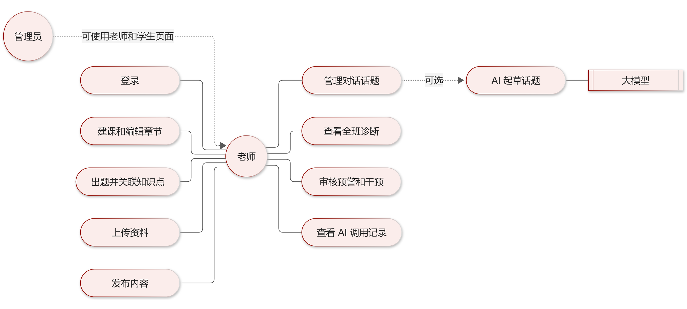

- **讲什么：** 老师能做哪些事。
- **怎么读：** 中间的圆是角色，椭圆是用例，方框“大模型”是外部系统。虚线“可选”表示这一步不是必须的。
- **讲稿：** 老师负责把内容准备好，包括建课、出题、上传资料、管理话题和发布；学生学习后，老师查看全班诊断，审核预警和干预，也能查看 AI 调用记录。建话题时可以让 AI 起草，但起草结果要老师确认。管理员目前可以使用老师和学生的页面。
- **被问到时：** 真实登录还在做，现在角色校验尚未在后端生效。

### 01b 用例图：学生

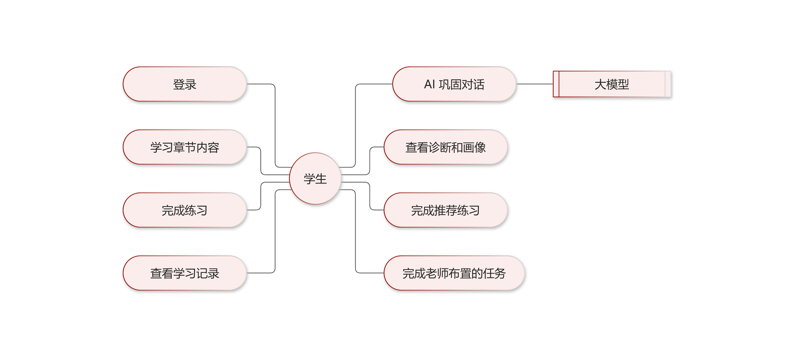

- **讲什么：** 学生能做哪些事。
- **怎么读：** 只有“AI 巩固对话”连到大模型，其他用例不调用模型。
- **讲稿：** 学生学习章节内容、做练习、用 AI 对话巩固，再查看记录、诊断和画像。系统会给推荐练习，老师通过干预后，学生还会看到老师布置的任务。

### 02 功能框图

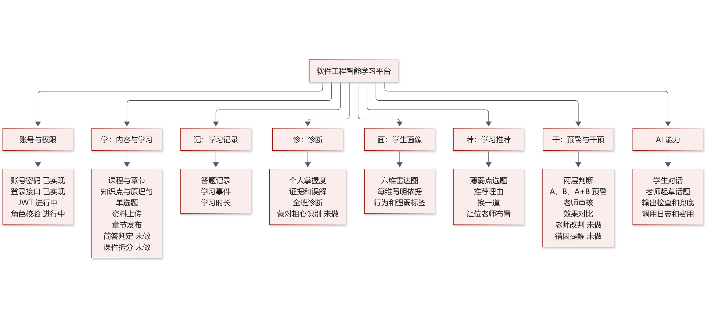

- **讲什么：** 平台分成哪些功能模块，每块做到哪里。
- **怎么读：** 第一层是模块，第二层是功能点。没有标注的已实现；标了“进行中”“未做”的还没完成。
- **讲稿：** 平台按“学、记、诊、画、荐、干”这条主线组织，另外有账号权限和 AI 能力两块支撑。主线都有可运行的功能。账号权限还在做 JWT 和角色校验；简答判定、课件拆分、蒙对粗心识别、老师改判和错因提醒还没做。

### 03 技术架构图

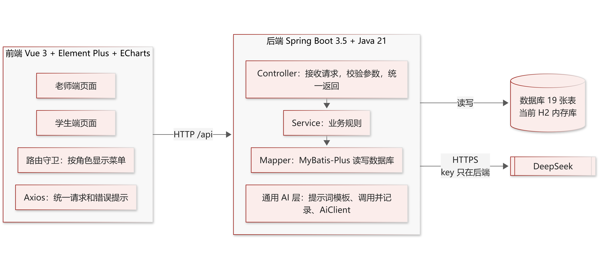

- **讲什么：** 前端、后端、数据库和模型的关系。
- **怎么读：** 从左到右是一次请求经过的路径。后端内部从上到下分层。
- **讲稿：** 前端用 Vue 3，只通过 `/api` 访问后端。后端是 Spring Boot，Controller 接请求，Service 写业务规则，Mapper 读写数据库。所有模型调用都走通用 AI 层，并记录日志。API key 只放在后端，前端碰不到。
- **被问到时：** 数据库现在是 H2 内存库，重启后回到种子数据；建表语句兼容 MySQL，但还没有切换。

### 04 老师端和学生端的三条线

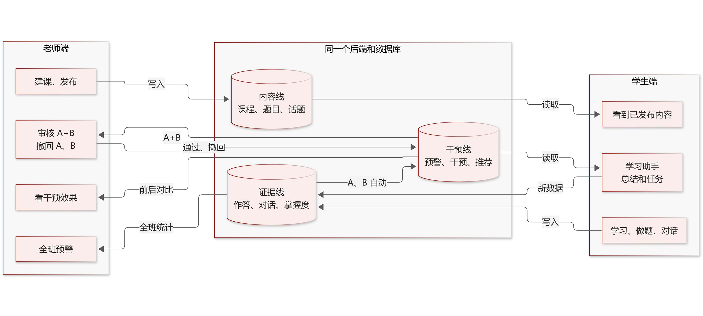

- **讲什么：** 两端是怎么联系起来的。
- **怎么读：** 左边老师端，右边学生端，中间是共享的数据。沿箭头看：内容线（老师写、学生读），证据线（学生写），干预线（A、B 自动生成，A+B 老师审核，学生在学习助手里看到）。
- **讲稿：** 两端不直接通信，都是读写同一个后端和数据库。内容线：老师发布，学生看到。证据线：学生学习和对话产生数据，系统按两层判断。干预线：只有一层不好的 A、B 系统直接给学生布置任务，两层都差的 A+B 老师审核后再推；某个知识点全班薄弱的人太多时，提醒老师。学生做完后的新数据又回到证据线，用来判断干预是否有效。三条线组成闭环。
- **被问到时：** 系统还没有选课和班级表，已发布课程所有学生都能看到。

---

## 二、业务流程

### 05 老师备课发布

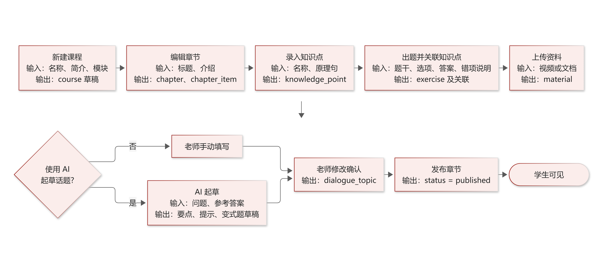

- **讲什么：** 老师把一章内容准备到学生可见的全过程。
- **怎么读：** 先看上行，再看下行。每个框写了活动的输入和输出，输出里的英文是写入的表或字段。
- **讲稿：** 老师先建课和章节，录入知识点，出题时给题目关联知识点，并写错项说明，再上传资料。对话话题可以手写，也可以让 AI 起草，但都要老师确认后才保存。发布后，学生才能看到。

### 06 学生学习做题

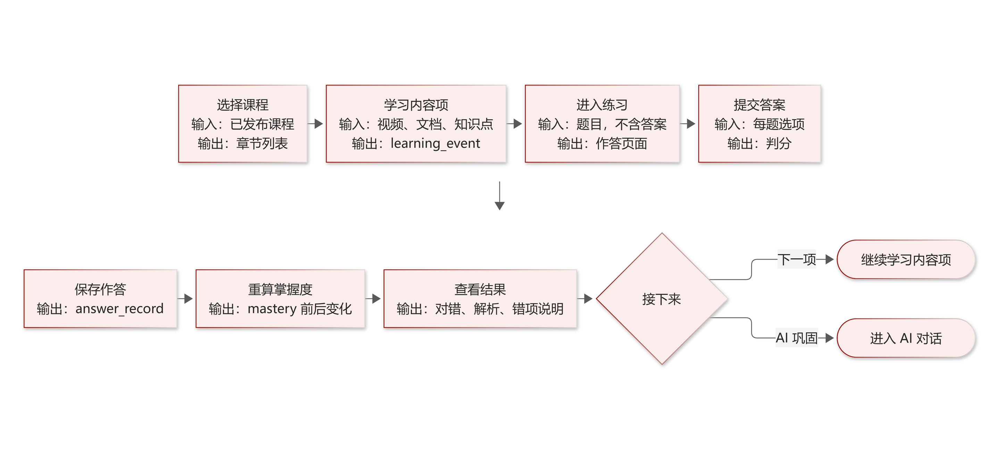

- **讲什么：** 学生学习、交卷，以及交卷后系统做了什么。
- **怎么读：** 上行是学生操作，下行是提交后的处理和结果。
- **讲稿：** 学生进入课程学习内容，系统记录学习事件。练习页面下发的题目不带答案。交卷后，后端判分，保存作答，重算相关知识点的掌握度，再把对错、解析和错项说明返回。之后学生可以继续学习，或进入 AI 对话。

### 07 AI 巩固对话

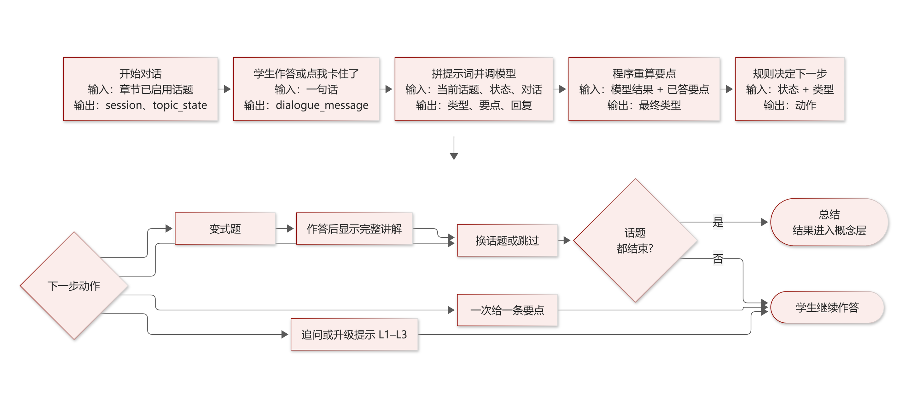

- **讲什么：** 学生说一句话后，系统如何回应。
- **怎么读：** 上行是一轮处理；下行从“下一步动作”分成四种走向。
- **讲稿：** 模型读取当前话题和对话，判断回答类型、答到了哪些要点，并写回复。但是否答全由程序重新计算，下一步也由规则决定：可能追问或升级提示，可能一次给一条要点，可能进入变式题，也可能换话题或跳过。全部话题结束后生成总结，结果进入概念层。

### 08 诊断和画像

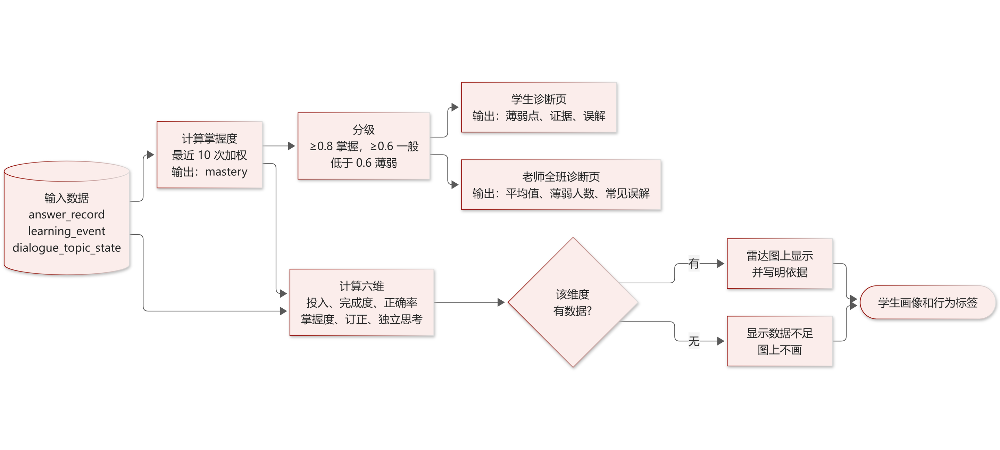

- **讲什么：** 学习数据怎样变成诊断和六维画像。
- **怎么读：** 从左边的数据出发，上路是诊断，下路是画像。
- **讲稿：** 掌握度取一个知识点最近 10 次作答，越近权重越大，每往前一次乘 0.8，作答少于 3 次还要按比例打折。0.8 以上是掌握，0.6 以上是一般，低于 0.6 是薄弱。画像有六个维度：投入、完成度、正确率、掌握度、订正、独立思考。每个维度都写明依据，没有数据就显示数据不足，不在雷达图上画成 0。
- **被问到时：** 独立思考按话题结果打分：自己答出 1，提示后答出 0.6，讲解后会用 0.4，讲解后仍不会 0.2，跳过 0，再取平均。投入按近 14 天的学习天数计算，满 7 天算满分。

### 09 学习推荐

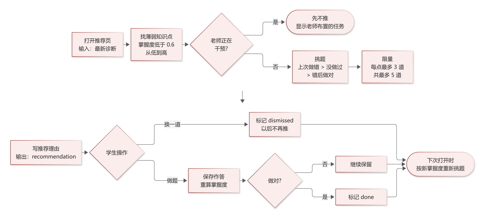

- **讲什么：** 系统如何挑题，并随学习结果更新。
- **怎么读：** 上行是挑题规则，下行是学生操作和状态变化。
- **讲稿：** 打开推荐页时，系统取掌握度低于 0.6 的知识点，从低到高处理。优先推上次做错的，然后是没做过的，最后是以前错过、后来做对的。每个知识点最多 3 道，总共最多 5 道，每道写明理由。老师正在干预的知识点先不推，避免和老师的安排冲突。

### 10 预警和干预

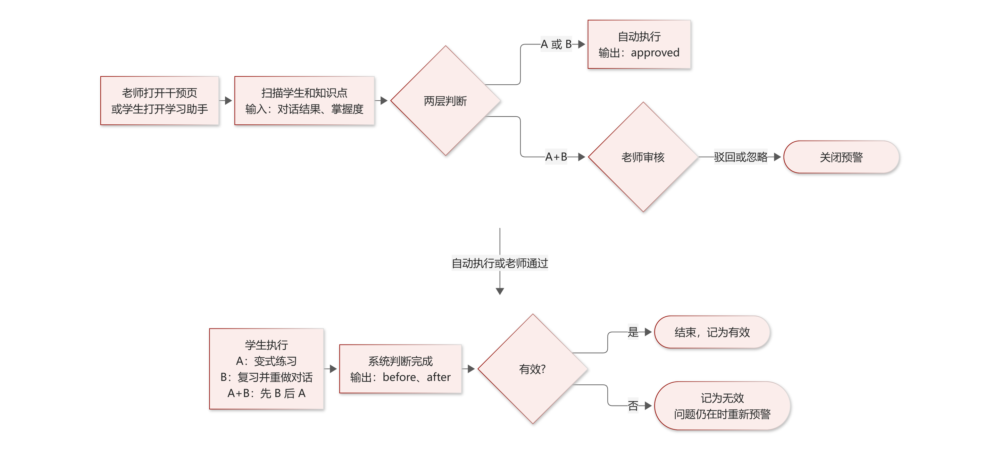

- **讲什么：** 从发现问题到确认干预效果的完整流程。
- **怎么读：** 上行是发现问题：两层判断后，A 或 B 直接执行，A+B 交给老师审核；下行是执行和效果判断。
- **讲稿：** 老师打开干预页，或者学生打开学习助手时，系统扫描学生和知识点，做两层判断。只有一层不好的 A 或 B 直接执行；两层都差的 A+B 交给老师审核，老师可以驳回。执行之后学生完成任务，系统比较干预前后，判断有效还是无效；无效且问题还在时会重新预警。
- **被问到时：** 建议目前用模板生成，不调用模型。

---

## 三、类图

### 11a AI 对话主流程

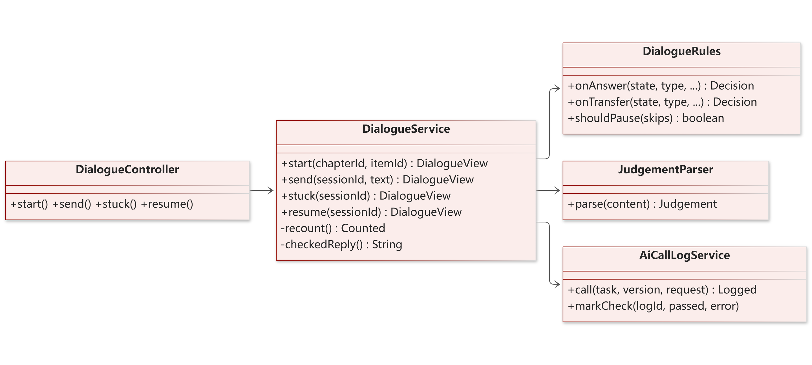

- **讲什么：** 一轮对话涉及的主要类。
- **怎么读：** 箭头表示“使用”。`+` 是公开方法，`-` 是私有方法。
- **讲稿：** Controller 只接请求，`DialogueService` 负责组织一轮对话。`JudgementParser` 解析模型返回，`DialogueRules` 决定下一步，`AiCallLogService` 负责调用模型并记录。规则是纯 Java，不依赖数据库和模型，所以可以直接写单元测试。

### 11b AI 通用层

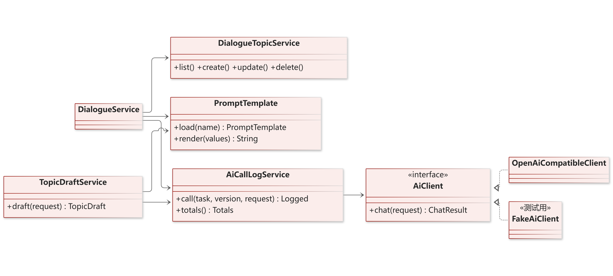

- **讲什么：** 学生对话和老师起草怎样共用 AI 能力。
- **怎么读：** 空心三角箭头表示实现接口。
- **讲稿：** 两个业务都用提示词模板和调用日志服务。日志服务依赖 `AiClient` 接口：运行时用真实客户端，测试时换成 `FakeAiClient`。所以自动化测试不花钱，结果也固定，业务代码不用改。

### 11c 判断类型和结果

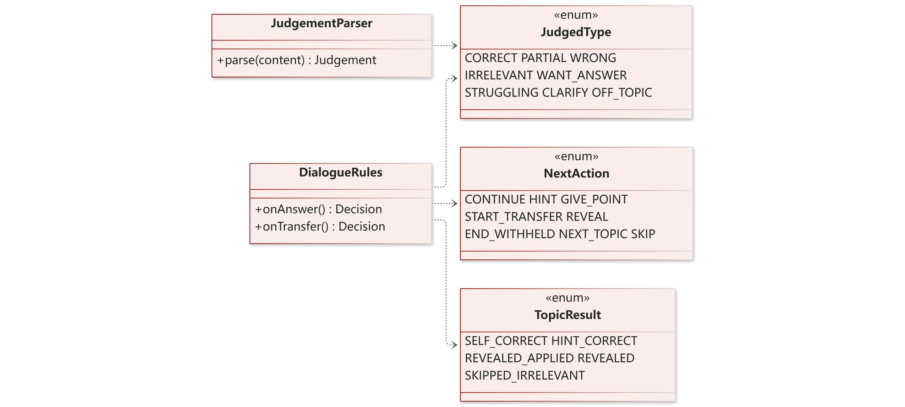

- **讲什么：** 对话规则用到的三组枚举。
- **怎么读：** `JudgedType` 是学生这句的类型，`NextAction` 是下一步动作，`TopicResult` 是话题最终结果。
- **讲稿：** 用枚举把模型的自由文本收敛成固定类别：模型输出 8 种类型之一，规则再转成固定动作和 5 种话题结果。流程不会依赖模型临场发挥。

### 12a 诊断、画像、推荐

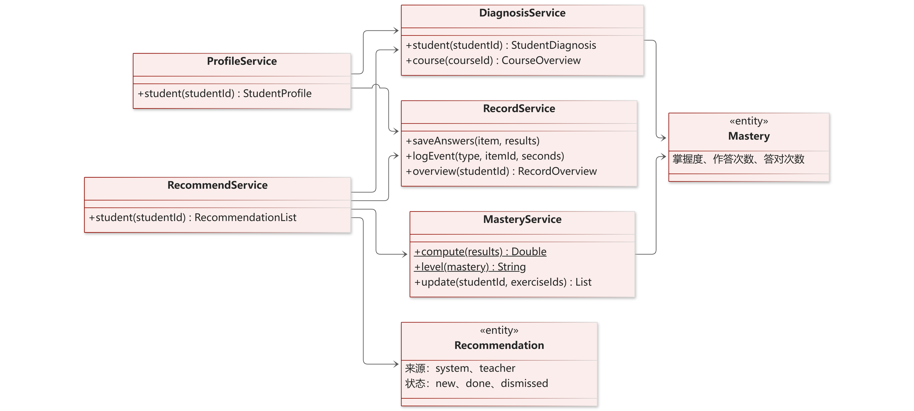

- **讲什么：** “诊、画、荐”的类怎么分工。
- **怎么读：** 左边使用右边，最右边的 entity 对应数据库表。
- **讲稿：** `MasteryService` 负责计算掌握度，`DiagnosisService` 读取掌握度形成诊断。画像服务使用诊断和学习记录，推荐服务使用诊断、掌握度和学习记录，并把结果写进推荐表。

### 12b 预警和干预

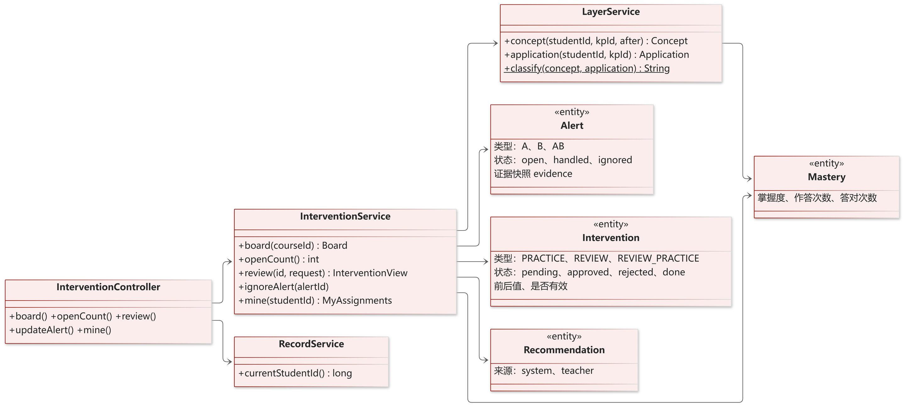

- **讲什么：** “干”的类和实体。
- **怎么读：** 从 Controller 到 Service，再看 Service 用到的判断类和实体。
- **讲稿：** `LayerService` 只负责两层判断，`InterventionService` 负责扫描、审核、执行和看效果。干预通过后，要做的练习写进推荐表，来源标为老师；学生用原来的推荐做题接口完成。

### 13a 登录和学生学习

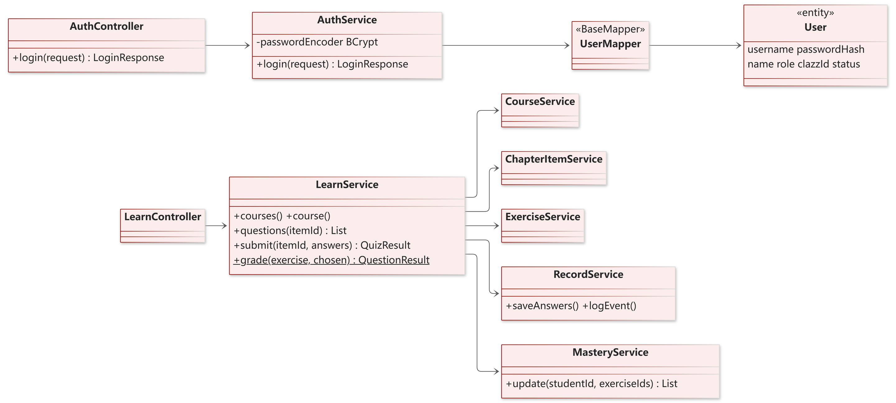

- **讲什么：** 登录和学生交卷涉及的类。
- **怎么读：** 上面一组是登录，下面一组是学习。
- **讲稿：** `AuthService` 按用户名查用户，用 BCrypt 比对密码，返回不含哈希的用户信息。`LearnService` 负责学习页和交卷，判分后调用记录服务和掌握度服务。

### 13b 课程内容管理

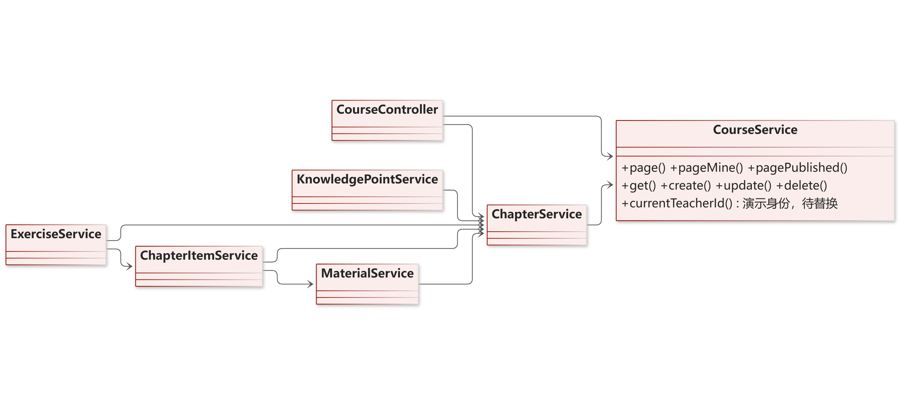

- **讲什么：** 老师端内容管理的服务关系。
- **怎么读：** 箭头指向被依赖的服务。多数内容服务都依赖 `ChapterService` 来确认章节。
- **讲稿：** 课程内容按课程、章节、内容项组织。知识点、题目、资料都挂在章节下面，由章节服务统一检查归属。
- **被问到时：** `currentTeacherId()` 现在是演示身份，登录完成后要替换。

---

## 四、E-R 图

> 共同读法：线两端的符号表示数量，“||”是一个，“o{”是零到多个，“|{”是一到多个。表间关系由代码保证，数据库没有建外键约束。

### 14a 课程内容

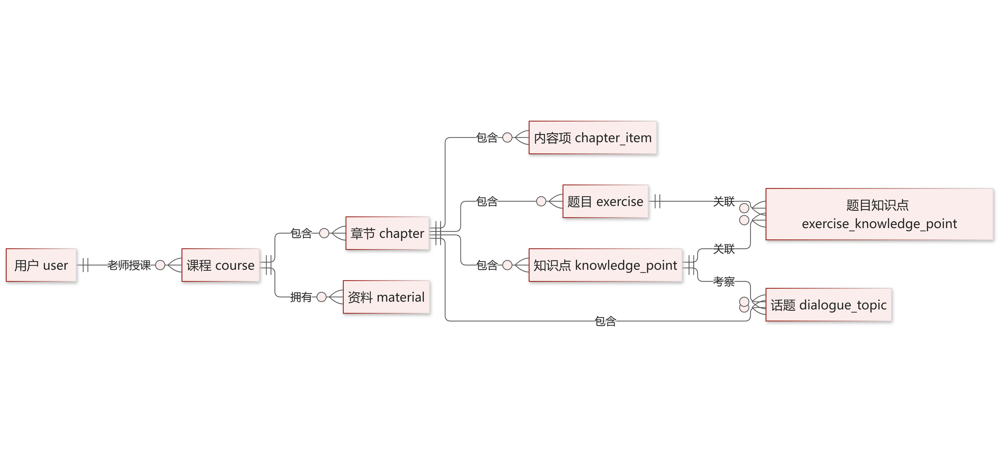

- **讲什么：** 老师准备的内容如何组织。
- **讲稿：** 一个老师可以授多门课，一门课有多个章节，一章下面有内容项、知识点、题目和对话话题。题目和知识点是多对多，所以用 `exercise_knowledge_point` 关联；话题指向它考察的知识点，这样才能把对话结果和练习结果对应到同一个知识点。

### 14b AI 对话

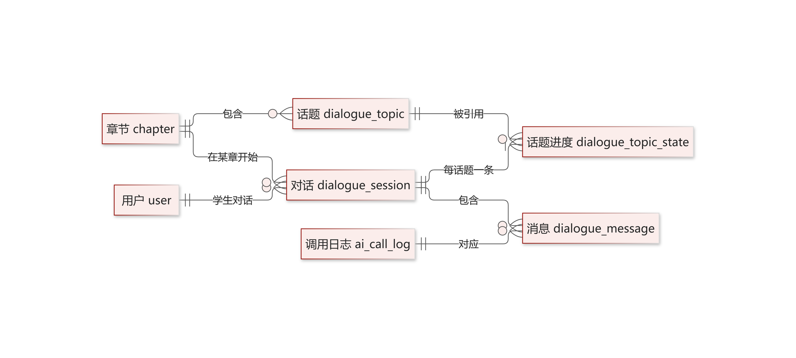

- **讲什么：** 对话过程如何保存。
- **讲稿：** 学生每次在某一章开始，就有一条 `dialogue_session`，每个话题有一条进度。规则和总结主要依据进度表。消息表保存完整对话，并可通过 `ai_call_id` 对应到调用日志，查到这一轮的 token、耗时和费用。

### 14c 学习证据和干预

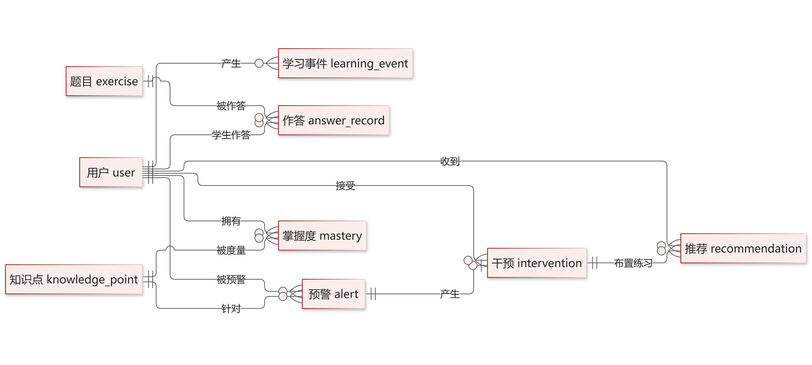

- **讲什么：** 学习数据如何支撑诊断、推荐和干预。
- **讲稿：** 作答和学习事件是原始证据，掌握度由作答算出，每个学生每个知识点一条。预警针对学生和知识点，老师审核后形成干预，干预布置的练习写进推荐表。

---

## 五、活动图

### 15a 答全和答错

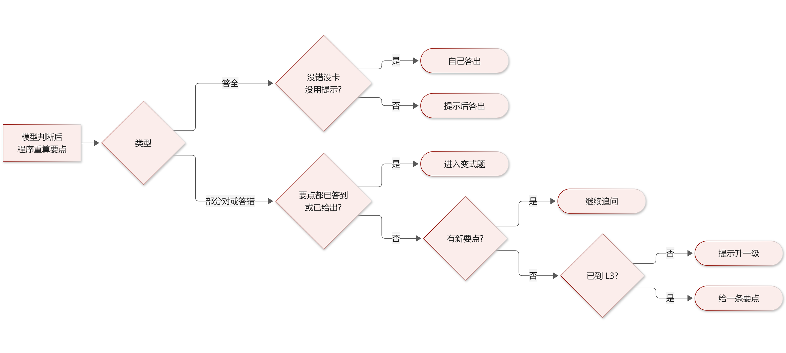

- **讲什么：** 学生回答问题时，规则怎样决定下一步。
- **怎么读：** 菱形是判断，圆角框是这一轮的结果。
- **讲稿：** 模型判断之后，程序先把已答要点和这一句合起来重算。答全时，没错、没卡、没用提示记为自己答出，否则记为提示后答出。没答全时，有新要点就继续追问；没进展就升一级提示；已到 L3 就一次给一条要点。要点都答到或都给出后，进入变式题。
- **被问到时：** 不是按错误次数给答案，而是看有没有进展。

### 15b 要答案和说不会

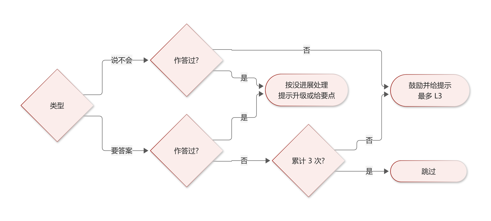

- **讲什么：** 区分“明确要答案”和“真的不会”。
- **讲稿：** 学生作答过，这两种情况都按没有进展处理。没作答过时，说不会只会得到鼓励和提示，最多到 L3，不累计跳过；明确要答案累计 3 次就跳过这个话题。这样既不让学生直接拿答案，也不惩罚真的不会的学生。

### 15c 离题和轮数上限

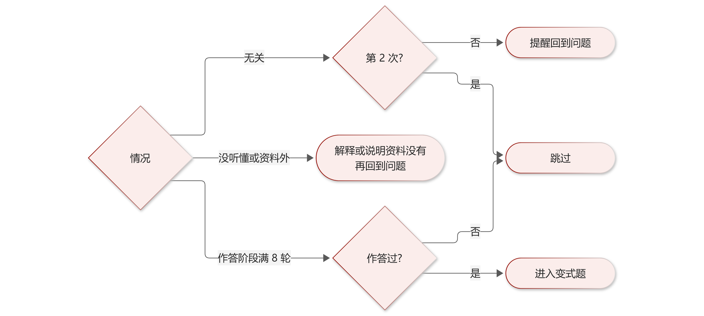

- **讲什么：** 对话不会无限进行。
- **讲稿：** 无关内容第一次提醒回到问题，第二次跳过。没听懂题目或问资料外内容时，不计入离题，解释后回到问题。作答阶段最多 8 轮，作答过的进入变式题，没作答过的跳过。

### 15d 变式题和话题结束

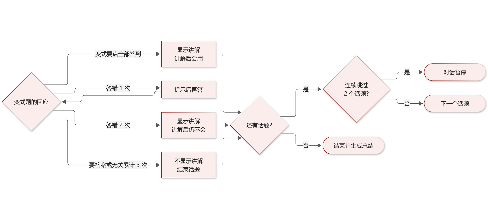

- **讲什么：** 完整讲解什么时候才显示，话题如何收尾。
- **讲稿：** 只有学生在变式题上作答后，才显示完整讲解。答全记为讲解后会用；答错 2 次记为讲解后仍不会。一直要答案或离题累计 3 次，不显示讲解，直接结束话题。之后看还有没有话题；连续跳过 2 个话题时暂停对话。
- **被问到时：** “不显示讲解就结束”在数据上也记为讲解后仍不会。老师没写变式题的旧话题，学生用自己的话说一遍后就显示讲解。

### 16a 两层判断和预警

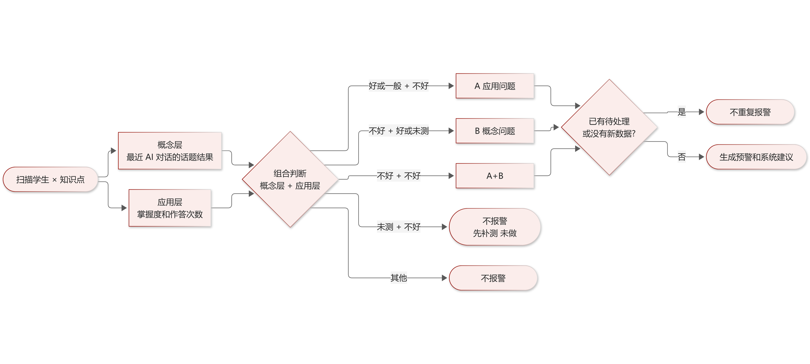

- **讲什么：** 系统怎样判断学生的问题类型。
- **怎么读：** 分支文字的格式是“概念层 + 应用层”。
- **讲稿：** 概念层看最近一次结束或暂停的 AI 对话：有讲解后仍不会或跳过就是不好，有提示后答出或讲解后会用是一般，其余是好。应用层作答少于 3 次算未测，掌握度达到 0.6 算好，否则不好。道理懂但不会用是 A，讲不出道理是 B，两层都不好是 A+B。已有待处理预警或干预，或者没有新数据时不重复报警。
- **被问到时：** 全部跳过时，如果更早有真实作答，就沿用更早的结果。“未测 + 不好”本该先补测，这项还没做，现在不报警。

### 16b 审核、执行和效果

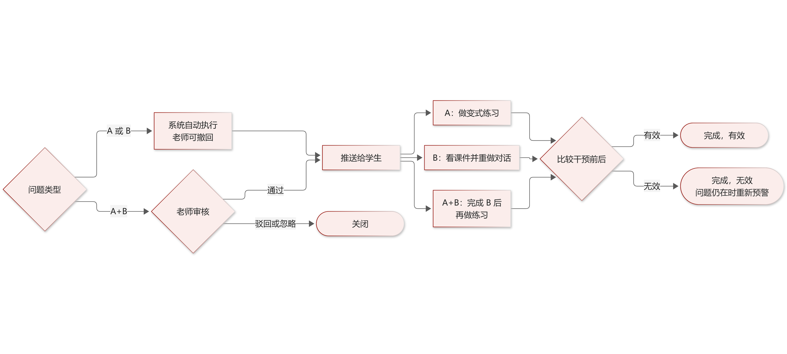

- **讲什么：** 预警之后发生什么。
- **讲稿：** 先看问题类型：A 或 B 由系统自动执行，老师可以撤回；A+B 要老师审核，驳回或忽略就关闭，通过才推给学生。之后 A 做变式练习；B 看课件并重做 AI 对话；A+B 先完成 B，再做练习。A 和 A+B 看完成后的掌握度是否到 0.6，B 看重做对话后概念层是否变好。
- **被问到时：** 按现在的代码，讲解后会用属于概念层一般，所以 B 算有效。

---

## 六、顺序图

### 17a 学生发言到调用模型

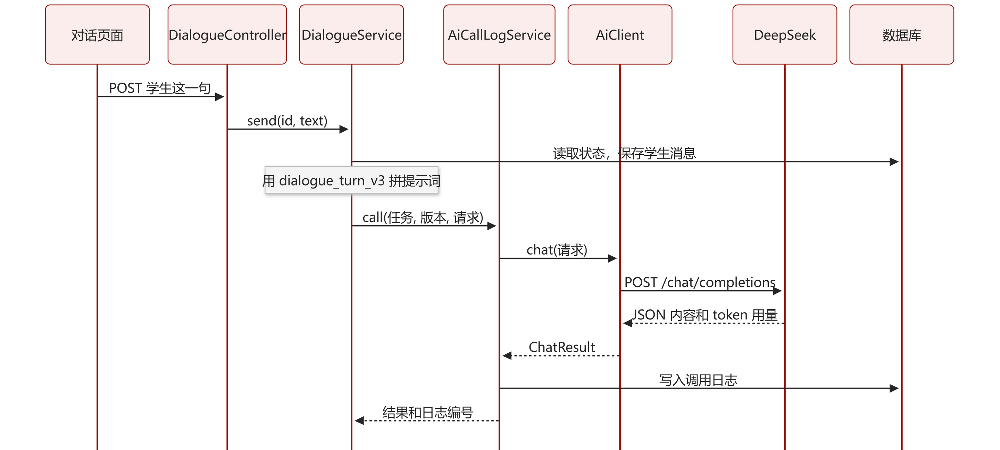

- **讲什么：** 一轮对话的前半段。
- **怎么读：** 从上往下是时间顺序。实线是调用，虚线是返回，灰色框是自身处理。
- **讲稿：** 页面把学生这一句发给后端，后端保存消息，用当前版本的提示词拼请求，再经过日志服务调用模型。返回后立即写调用日志，所以成功和失败都能追溯。

### 17b 规则决定和保存结果

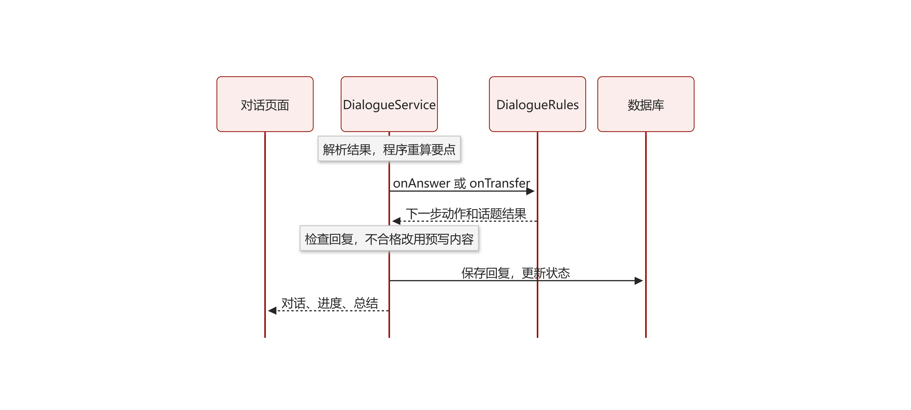

- **讲什么：** 一轮对话的后半段。
- **讲稿：** 拿到模型结果后，程序解析内容并重算要点，交给规则决定下一步。模型回复还要检查：为空、太长或包含未答到的要点原文时，改用老师预写的内容。最后保存状态，把对话和进度返回页面。
- **被问到时：** 现在只能检查要点原文，换说法的泄露检查不出来，计划在评测中统计频率。

### 18 交卷后的数据流

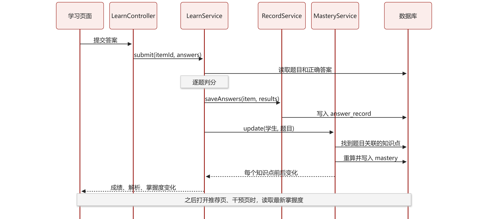

- **讲什么：** 一次交卷如何更新后面的主线。
- **讲稿：** 后端判分后，先保存作答，再找到题目关联的知识点，重新计算掌握度。返回结果里带有掌握度前后变化。推荐页和干预页不用单独接收通知，打开时读取最新掌握度即可。

### 19a 登录已实现部分

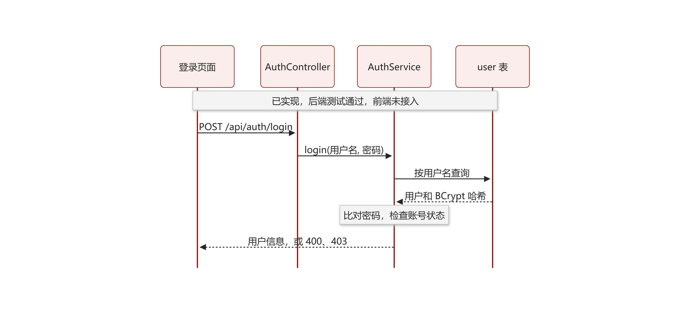

- **讲什么：** 目前完成的登录流程。
- **讲稿：** 登录时按用户名查询，再用 BCrypt 比对密码。用户不存在和密码错误返回同一句提示，避免别人猜账号；密码正确但账号被禁用时才返回 403。这一段后端测试已通过，前端还没有接入。

### 19b 登录计划部分

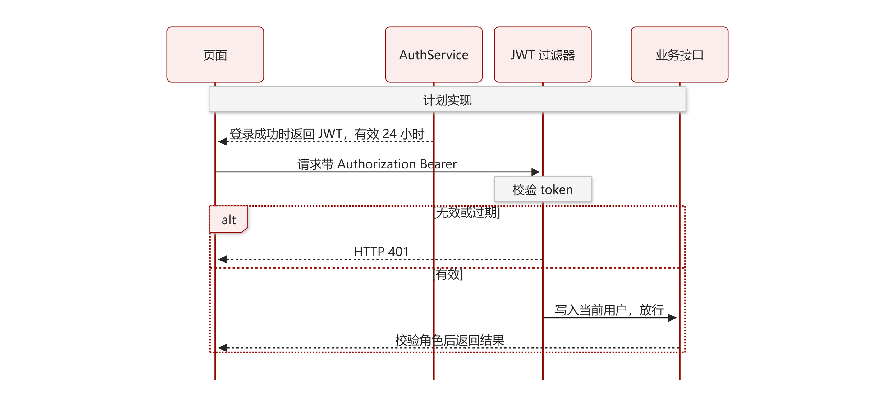

- **讲什么：** 接下来要做的 JWT 和权限校验。
- **讲稿：** 登录成功后发 JWT，有效 24 小时。之后每个请求都带 token，过滤器校验失败就返回 401，校验成功就写入当前用户，业务接口再检查角色。这样可以替换现在的演示身份。**这张图全部是计划，还没有实现。**

---

## 七、状态图

### 20 一次对话

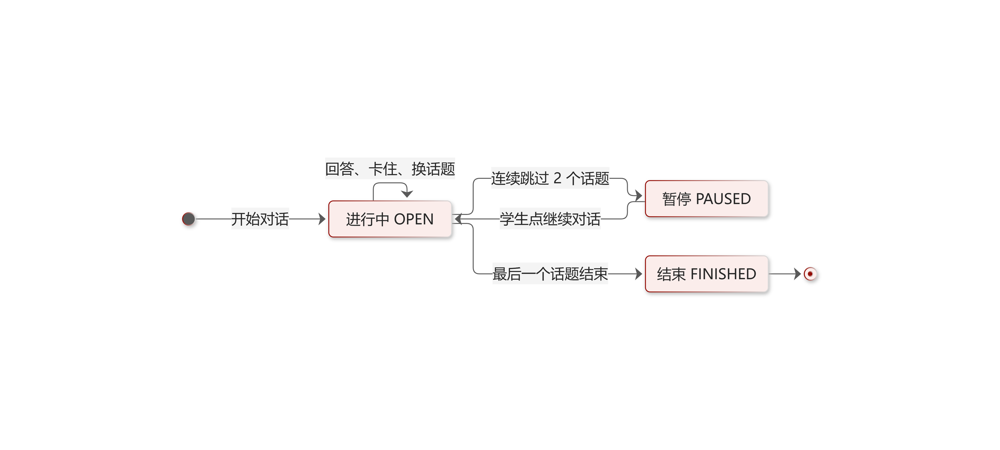

- **讲什么：** 整场对话的状态。
- **讲稿：** 对话开始后是进行中。回答、卡住、换话题都不改变状态。连续跳过 2 个话题会暂停，学生点继续后恢复；最后一个话题结束时进入结束状态。

### 21 一个话题

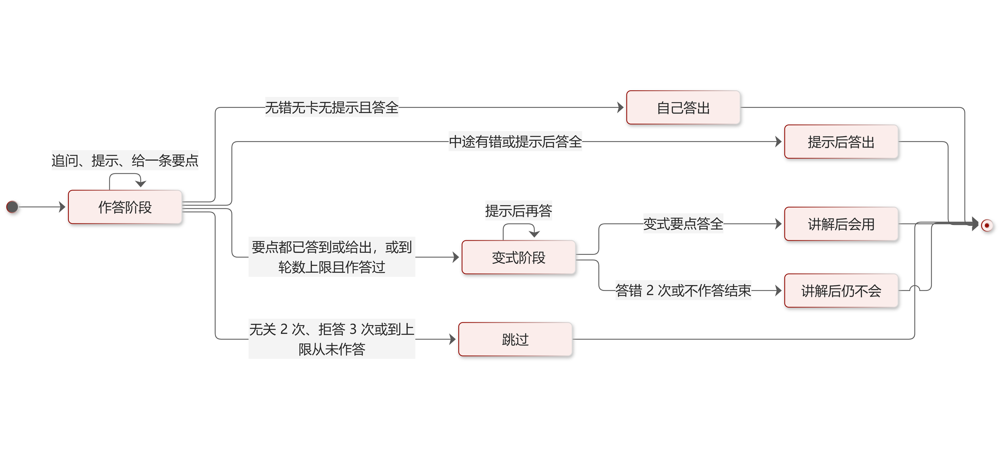

- **讲什么：** 一个话题可能怎样结束。
- **讲稿：** 每个话题从作答阶段开始，直接答全就是自己答出或提示后答出。要点都答到或给出后进入变式阶段，最后是讲解后会用或讲解后仍不会。无关 2 次、拒答 3 次，或到轮数上限还没作答，则跳过。这 5 种结果会进入总结、概念层和画像。

### 22 预警和干预

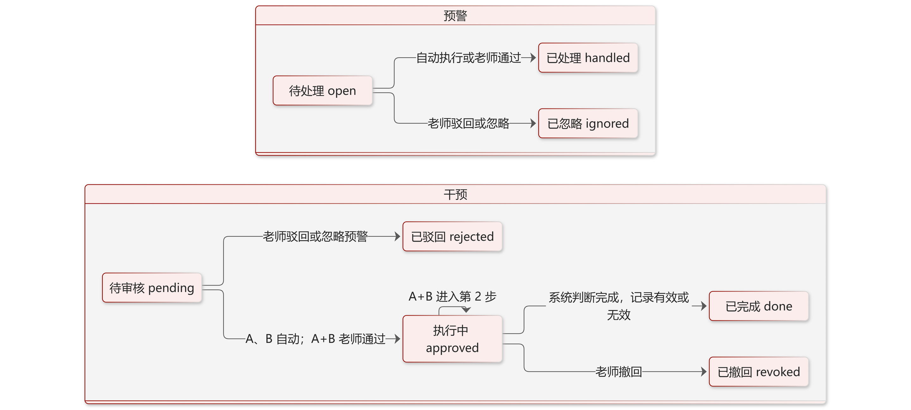

- **讲什么：** 预警和干预各自的状态变化。
- **讲稿：** 预警从待处理变成已处理或已忽略。干预从待审核开始：A、B 由系统直接转为执行中，A+B 要老师通过才进入执行中，驳回则结束；执行中的干预老师可以撤回。A+B 在执行中从第 1 步进入第 2 步；学生完成后变成已完成，并记录有效或无效。

---

## 七之二、页面跳转

### 23 页面跳转图

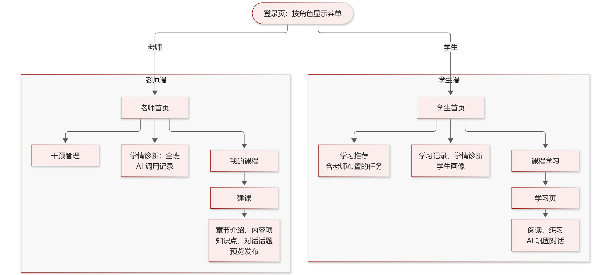

- **讲什么：** 老师端和学生端各有哪些页面，怎么进入。
- **怎么读：** 从登录页按角色分开，箭头是页面之间的进入关系。侧边栏菜单可以直接到达同级页面。
- **讲稿：** 登录后按角色显示菜单。老师从首页进入我的课程，再进建课，在一个页面里编辑章节介绍、内容项、知识点、对话话题并预览发布；另外有干预管理、全班诊断和 AI 调用记录。学生从课程学习进入学习页，按顺序完成阅读、练习和 AI 巩固对话；另外有学习推荐（包括老师布置的任务）、学习记录、学情诊断和学生画像。
- **被问到时：** 管理员两端菜单都能看到。登录接入前，前端仍是演示登录。

---

## 八、界面截图（docs/汇报图/界面/）

> 2026-11-09 截自真实运行的前后端，尺寸同样是 2880×1296，数据是种子数据和本次操作产生的数据。AI 对话用真实 DeepSeek，共 9 次调用。
> **共同要说明的：** 后端登录还没接入前端，截图时用浏览器里的演示身份切换老师和学生。登录页的角色选择和“演示模式”提示是当前状态，接入真实登录后会去掉。

| 编号 | 画面 | 讲什么 |
|---|---|---|
| 01 | 登录页 | 平台入口，当前仍是演示登录 |
| 02 | 老师首页 | 老师看到自己的课程和状态，菜单只有老师功能 |
| 03 | 我的课程 | 课程列表，显示模块、章节数和发布状态 |
| 04 | 建课和章节介绍 | 左边是课程大纲，右边编辑当前内容 |
| 05 | 知识点 | 老师录入知识点和原理句，标记重点难点 |
| 06 | 练习内容项 | 老师编辑一次练习的标题和说明，题目和错项说明在该页下方继续编辑（截图未露出） |
| 07 | 对话话题 | AI 对话内容项，话题挂在章节里 |
| 08 | 编辑话题和 AI 起草 | 左边老师填写，右边确认要点和提示，体现“AI 起草，老师确认” |
| 09 | 预览发布 | 发布前检查内容，并预览学生看到的样子 |
| 10 | 全班诊断 | 按知识点看平均掌握度、薄弱人数和常见误解 |
| 11 | 课程学习 | 学生看到已发布课程 |
| 12 | 章节学习 | 按章节介绍、阅读、练习、AI 对话的顺序学习 |
| 13 | 阅读内容 | 学习内容项，右侧显示进度 |
| 14 | 练习作答 | 题目下发时不带答案 |
| 15 | 练习结果 | 交卷后显示对错、解析和知识点掌握度变化 |
| 16 | AI 对话开场 | 告诉学生要讨论的话题，说明 AI 不会直接给答案 |
| 17 | 第一个问题 | 用情境问题开始 |
| 18 | 说不会 | 学生说太难时，先鼓励，再给提示 |
| 19 | 要答案 | 学生直接要答案，系统要求先试一试，不给答案 |
| 20 | 部分答对 | 肯定说对的部分，再追问还缺的部分 |
| 21 | 提示升级 | 学生没有进展时，系统继续给帮助 |
| 22 | 给要点后进入变式题 | 要点都给出后，换一个情境检验是否会用 |
| 23 | 变式作答后显示讲解 | 学生作答变式题后，才显示完整讲解 |
| 24 | 总结 | 按话题结果生成总结：自己答对、讲解后会用 |
| 25 | 学习记录 | 学习动态和统计，是“记”的结果 |
| 26 | 学情诊断 | 学生看到薄弱知识点和最近作答证据 |
| 27 | 画像标签 | 行为、强弱项标签，都写明依据 |
| 28 | 六维雷达图 | 有数据的维度画在图上，没有数据的显示数据不足 |
| 29 | 学习推荐 | 针对薄弱点推题，并说明推荐理由 |
| 30 | 预警和证据 | 老师看到待处理预警，以及概念层、应用层的证据 |
| 31 | 系统建议和审核 | 系统给出干预建议，老师可以改题、改留言，再决定通过或忽略 |
| 32 | 老师布置的任务 | 老师通过后，学生优先完成这些任务 |
| 33 | 完成任务后的变化 | 学生03 做完 3 道题，掌握度从 22% 到 70%，已经掌握 |
| 34 | 干预效果 | 老师看到每条干预的进度和前后效果 |
| 35 | AI 调用记录 | 本次 9 次调用、0 次失败、共 8,898 输入 token、429 输出 token，约 0.0233 元 |
| 36 | 学习助手图标 | 学生03 首页右下角的助手图标，数字 2 表示新学完一章和一项新任务 |
| 37 | 学完一章的总结 | 「边界测试值的选取」会讲不会用（掌握度 0.22 + 反复出现的误解），建议做题；下面是系统自动布置的练习 |
| 38 | 概念没讲出来 | 学生04 练习全对，但对话里讲不出来，助手建议巩固对话 |
| 39 | 学到一半 | 学生01 学了 2 / 3 项，助手提示继续下一项 |
| 40 | 做练习时隐藏 | 交卷前页面上没有助手按钮 |
| 41 | 全班预警 | 「边界测试值的选取」全班 57% 薄弱（4 / 7 人），最常见错因；只剩一条 A+B 等老师审核 |
| 42 | 干预记录 | 标明系统自动或老师审核；学生04 那条已撤回，学生03 那条可以撤回 |

**被问到时：** 第 33 页的 3 道题是由脚本通过真实接口提交的，用来走完演示流程，不是真实学生的学习数据；AI 对话的学生回答也是我们设计的演示输入。
