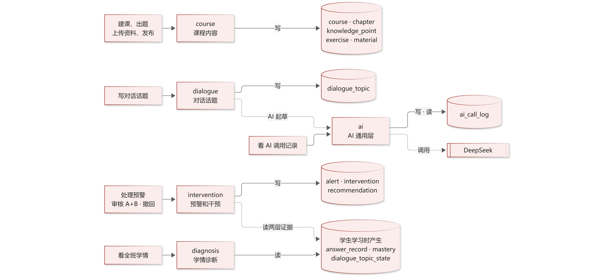
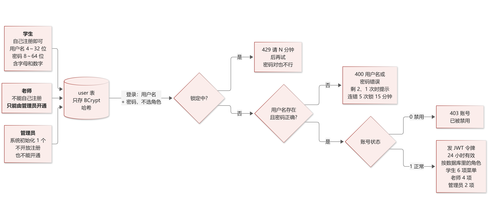
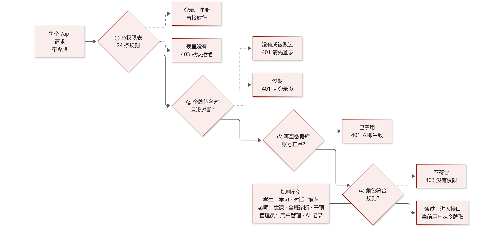
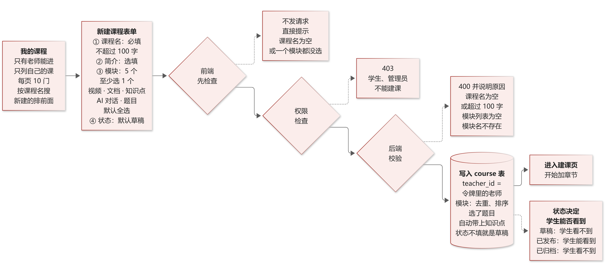

# 最终答辩：图解说明

> 每张图写四项：讲什么、怎么读、讲稿、被问到时。图的源文件在 `源文件/`（Mermaid）。
> 只用图讲模块关系和实现，不放页面截图和代码。

---

## 一、老师端

### T1 老师端全景：老师做的事 → 后端模块 → 数据表

- **讲什么**：老师在系统里做的每件事，由哪个后端模块处理，读写哪些表。
- **怎么读**：
  - 每一行从左到右：老师做的事 → 后端模块 → 数据表。
  - 实线是直接读写；虚线是模块之间或模块和外部的调用。
  - 圆柱是数据库表，方框带竖线的是外部的大模型。
- **讲稿**：
  > 老师端一共五件事，每件对应一个后端模块。
  > - 建课、出题、发布由 course 模块写进课程内容的几张表。
  > - 写对话话题由 dialogue 模块写进话题表；用 AI 起草时，经过 AI 通用层调用 DeepSeek，每次调用都记进调用日志。
  > - 处理预警由 intervention 模块写预警、干预和推荐，它要读学生的作答、掌握度和对话结果，也就是两层证据。
  > - 看全班学情由 diagnosis 模块读同样的学生数据算出来。
  >
  > 右下角那组表是学生学习时产生的，老师端只读它们——这就是老师和学生两端连起来的地方。
- **被问到时**：老师端和学生端不直接通信，都读写同一个后端和数据库。

### T2 开户与登录

- **讲什么**：账号从哪里来，登录时按什么顺序检查。
- **怎么读**：
  - 左边三个框按角色写开户方式：学生自己注册；**老师不能自己注册，只能由管理员开通**；管理员只有系统初始化的 1 个。都写进 user 表。
  - 中间三个菱形是登录时的三步检查，顺序从左到右。
  - 每个菱形往上走是失败，框里是返回码和提示；最右下是登录成功。

**量化规则**（来自 `AuthService`、`LoginAttempts`、`AuthDtos`、`user` 表）：

| 项目 | 规则 |
|---|---|
| 开户方式 | 学生：自己注册（管理员也可以代开）；**老师：只能由管理员开通**，注册页没有老师选项，注册接口也不收角色；管理员：系统初始化 1 个，不开放注册，也不能被开通 |
| 用户名 | 4～32 位字母、数字或下划线，**不能重复**（重复返回 409） |
| 密码 | 8～64 位，至少一个字母和一个数字；只存 BCrypt 哈希（不超过 100 字符），不存明文 |
| 注册的角色 | 请求里**没有角色字段**，一律存成学生 |
| 管理员开通 | 只能开老师或学生，不能开管理员 |
| 登录检查 ① 锁定 | 同一用户名**连续输错 5 次锁 15 分钟**，锁住时密码对了也返回 429 |
| 登录检查 ② 密码 | 用户名不存在和密码错误都返回 **400**“用户名或密码错误”；**剩 2 次、1 次时**提示还能试几次；不存在的用户名也一样计数，试不出谁存在 |
| 登录检查 ③ 状态 | 1 正常、0 禁用；**密码对了才检查**，禁用返回 **403** |
| 成功 | 发 JWT 令牌，**24 小时有效**；角色以数据库为准，登录页不选角色 |
| 菜单 | 学生 6 项、老师 4 项、管理员 2 项（用户管理、AI 调用记录） |
| 解锁 | 登录成功清零；管理员重置密码或启用账号也会解锁 |
| 演示账号 | 1 个管理员、3 个老师、10 个学生 |

- **讲稿**：
  > 账号按角色有不同的来源：学生自己注册，角色固定是学生；老师不能自己注册，只能由管理员开通，因为老师能建课、能看全班学生的数据；管理员是系统初始化的，不开放注册。密码只存 BCrypt 哈希。
  > 登录时按三步检查：先看这个用户名是不是因为连续输错 5 次被锁了 15 分钟；再比对密码，用户名不存在和密码错误给同一句提示，避免别人试出哪些账号存在；密码对了才看账号有没有被禁用。全部通过后发一个 24 小时有效的令牌，前端按账号的角色显示菜单。
- **被问到时**：
  - 为什么不能选角色登录？角色写在账号里，由后端决定；能选的话，学生就能把自己选成老师。
  - 锁定会不会被人恶意锁别人的号？会，这是锁定的代价；管理员可以重置密码马上解锁。以后可以改成按 IP 和用户名一起计数。

### T2b 每个请求的检查

- **讲什么**：登录之后，每调一次接口，后端都要过四步检查。
- **怎么读**：沿实线从左上到右下是“通过”；每一步右边虚线连的是不通过时的返回。

**量化规则**（来自 `AuthInterceptor`、`AccessRules`）：

| 步骤 | 规则 | 不通过 |
|---|---|---|
| ① 权限表 | 24 条规则，从上往下第一条匹配生效；登录、注册不用令牌 | 表里没有的接口一律 **403**（默认拒绝） |
| ② 令牌 | 签名要对、没过期（24 小时） | 没有或被改过 **401**“请先登录”；过期 **401**“登录已过期”，前端回登录页 |
| ③ 再查数据库 | 账号还在、状态正常 | 被禁用 **401**：**禁用立即生效**，不用等令牌过期 |
| ④ 角色 | 角色在这条规则允许的名单里 | **403**“没有权限访问这个接口” |
| 通过 | 当前用户从令牌里取，业务代码不再用固定的老师或学生 | — |

| 角色 | 能调的接口（举例） |
|---|---|
| 学生 | 学习、AI 对话、学习推荐、学习助手、自己的诊断和画像、自己的干预任务 |
| 老师 | 建课、出题、对话话题、全班诊断、单个学生的诊断和画像、预警和干预 |
| 管理员 | 用户管理、AI 调用记录 |
| 学生 + 老师 | 资料文件（视频、文档） |

- **验证**：后端 106 个测试全部通过，其中 10 个专门测登录和权限：
  - 把令牌里的 student 改成 teacher → 401。
  - 每个角色调别人的接口 → 403。
  - 禁用后旧令牌马上 401。
  - 后端所有接口都写了权限规则。
- **讲稿**：
  > 登录之后，每一次调接口都要过四步：先查权限表，表里没写的接口一律拒绝；再验证令牌，没有、被改过或过期都退回登录页；然后再查一次数据库，所以管理员禁用一个账号是马上生效的；最后看角色对不对，学生调老师的接口会被拒绝。都通过了，接口才知道“当前用户是谁”。
- **被问到时**：
  - 为什么每次都查数据库？为了禁用立即生效；只是按主键查一行，代价很小。
  - 前端隐藏菜单够不够？不够，菜单只是界面；真正的限制在后端这四步，直接调接口也绕不过去。
  - 退出登录后令牌还能用吗？现在 24 小时内还能用；以后可以加令牌黑名单。
  - 关掉页面要重新登录吗？不用。令牌存在浏览器本地，关掉页面、关掉浏览器都还在，24 小时内打开直接进入。
  - 怎么知道令牌过期？过期时间（签发时间 + 24 小时）写在令牌里，受签名保护改不了；后端每次请求拿它和现在的时间比，过期返回 401，前端回登录页，登录后回到原来的页面。
  - 正在用的时候到 24 小时会被踢吗？现在会，按签发时间算；下一步可以加自动续期。
  - 每个判断为什么要有、为什么排这个顺序，详见 `docs/记录-登录与权限.md` 2.9、2.10 节。

### T3 创建课程

> T3 已重画（加了前端检查、权限检查和状态说明），最新的完整说明见 `docs/模块说明/02-课程内容.md`，本节以那里为准。

- **讲什么**：老师新建一门课时要填什么、后端检查什么、存进了哪里。
- **怎么读**：从左到右；三个菱形依次是前端检查、权限检查、后端校验，向上的虚线是不通过；最后写库、进入建课页。

**量化规则**（来自 `CourseSaveRequest`、`CourseService`、`course` 表）：

| 项目 | 规则 |
|---|---|
| 我的课程列表 | 只列**当前老师自己的**课；每页 10 门；按课程名模糊搜索；新建的排前面 |
| 课程名 | **必填，不超过 100 字**；保存时去掉首尾空格 |
| 简介 | 选填，长度不限 |
| 模块 | 5 个：视频、文档、知识点、AI 对话、题目。**至少选 1 个**；不传就是全部 5 个；**选了题目会自动带上知识点**（题目必须关联知识点） |
| 状态 | 3 种：草稿 draft、已发布 published、已归档 archived；**默认草稿** |
| 写入 | `course` 表：课程名、简介、teacher_id（当前老师）、状态、模块（逗号分隔）、创建时间 |
| 校验失败 | 课程名为空或太长、模块为空或不存在 → **400**，并说明原因 |
| 修改 / 删除 | **只能改自己的课**，否则 **403**“这不是你的课程，不能修改”；**课程下还有章节时不能删**，返回 **409** 并说明还有几个章节；删除是逻辑删除 |
| 模块的作用 | 后面加内容时会检查：比如没开视频模块却上传视频，返回 **400**“这门课没有开启「视频」模块” |
| 演示数据 | 6 门课：4 门已发布、1 门草稿、1 门已归档 |

- **讲稿**：
  > 老师登录后进入我的课程，只看得到自己的课，每页 10 门，可以按名称搜索。新建课程要填课程名、简介、选这门课用哪些模块，再选状态。课程名必填、最多 100 字；模块 5 个里至少选一个，选了题目会自动带上知识点，因为每道题都要关联知识点；状态默认是草稿，学生看不到。后端校验通过后写进 course 表，记下是哪位老师的课。之后修改和删除都只能改自己的课，课程下还有章节时不能删。
